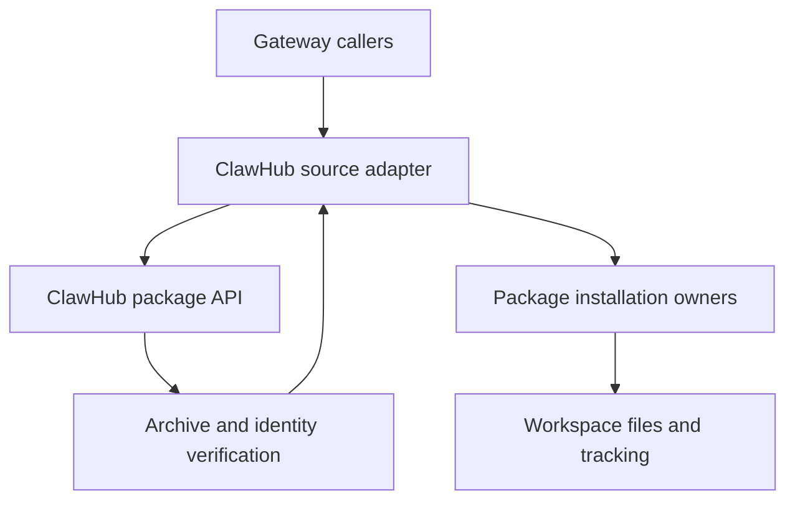

Codex review: needs real behavior proof before merge.

## What this changes

This PR adds published ClawHub discovery, package previews, verified source resolution, Gateway contracts, and deferred skill replacement.

**Example:** Inspect @openclaw/research-briefing@1.0.0 before adding its agent.
- **Before:** The Gateway lacks the published-Claw source adapter and catalog contracts.
- **After:** The adapter returns package contents, instruction excerpts, dependency versions, and artifact-bound trust information.

## Review scores

| Measure | Result | What it means |
|---|---|---|
| **Overall readiness** | 🦪 silver shellfish **(2/6)** | Useful source-layer work with both earlier findings resolved, one remaining recovery-status defect, and incomplete settlement and stable-upgrade evidence. |
| **Proof confidence** | 🦪 silver shellfish **(2/6)** | Real behavior proof is necessary before merge. See [Before merge](#before-merge). |
| **Patch quality** | 🦪 silver shellfish **(2/6)** | Security review found an item that needs attention. |

## Product

**Kind:** Feature · **Worth it:** Yes · **Fix scope:** Complete
**User problem:** Gateway Add clients need published Claw metadata, readable contents, and verified package sources.
**Reason:** The supplied maintainer-authored direction establishes this focused foundation; the companion PRs own the complete Add experience.

## Merge readiness

⛔ **Blocked before merge - 5 items remain**

Keep this PR open as a useful foundation for the active Claw Add stack; both earlier findings are fixed, but incomplete-recovery status is lost on one installation failure path.

**Priority:** P2
**Reviewed head:** `220138fa503a11eb51e9b0effb6bb0808a90a454`

## Before merge

- [ ] **Add real behavior proof** - Authority-chain proof required: the inspected earlier-stack screenshots demonstrate package contents and agent chat, while the new real-lease test supports the guard repair; supplied evidence does not demonstrate allowed settlement and rejection of an unrelated or retired owner through the changed production installation path before deletion or restoration, including retries. Supply a redacted production-owner trace; remove IPs, API keys, phone numbers, and non-public endpoints. After adding proof, update the PR body; ClawSweeper should re-review automatically. If it does not, the PR author or someone with repository write access can comment `@clawsweeper re-review`.
- [ ] **Preserve incomplete recovery through the extraction callback (P2)** - When a guarded skill replacement displaces the old directory and then cannot restore it, archive-install returns recoveryIncomplete: true. Before this new propagation check runs, the onExtracted callback at lines 470–478 rebuilds the failure with only error and replacementBlocked, so the marker is always lost on that path. The companion Add consumer uses this flag to record an external mutation, and therefore misses the partially applied replacement. Forward the marker in that callback and test the public installation boundary. This concern was equally visible at the previously reviewed head and was missed in the earlier review.
- [ ] **Resolve security review attention item** - The guard-composition repair removes the earlier substitution concern, and source review found no reachable authorization bypass.
- [ ] **Resolve merge risk** - Before merge, establish that deferred skill settlement preserves the initiating operation's authority through retained receipts, rollback, and retries.
- [ ] **Add data-model compatibility proof** - The review found that existing stored data may not work after upgrade. Show that existing data still loads and works with this change.

## Findings

- [P2] Preserve incomplete recovery through the extraction callback — `src/skills/lifecycle/clawhub-install-core.ts:488-490`

### Tests

- Low-value test `src/claws/clawhub-source.test.ts`: Remove the 'community matches fill the search cap' case: its mock manufactures success from isOfficial and duplicates nearby request/filter assertions without exercising service-side result capping.
- Missing end-to-end proof: Supply settlement and stable-upgrade evidence through the production owners, and add an install-boundary regression that forwards an incomplete-recovery result through the real extraction callback; base-fail/head-pass proof for that defect is not supplied.

<strong>Agent review details</strong>

### How this fits together

The source adapter translates ClawHub metadata and archives into catalog results and verified package sources; existing plugin and skill installers own filesystem publication, rollback, and tracking.

### Technical review

Best possible solution:

Preserve incomplete-recovery status through the existing installer boundary and establish settlement and upgrade safety before landing.

Do we have a high-confidence way to reproduce the issue?

Source inspection establishes the failure path: an incomplete archive-install recovery returns its marker, the extraction callback drops it, and the public ClawHub install result omits it; no target code was executed.

Is this the best way to solve the issue?

Reusing the package API, verifier, and installation owners is appropriate; forwarding the existing recovery marker is a focused correction without another recovery mechanism.

Full review comments:

- [P2] Preserve incomplete recovery through the extraction callback — `src/skills/lifecycle/clawhub-install-core.ts:488-490`
  When a guarded skill replacement displaces the old directory and then cannot restore it, archive-install returns recoveryIncomplete: true. Before this new propagation check runs, the onExtracted callback at lines 470–478 rebuilds the failure with only error and replacementBlocked, so the marker is always lost on that path. The companion Add consumer uses this flag to record an external mutation, and therefore misses the partially applied replacement. Forward the marker in that callback and test the public installation boundary. This concern was equally visible at the previously reviewed head and was missed in the earlier review.
  Confidence: 0.99
  Late finding: first raised on code an earlier review cycle already covered.

Overall correctness: patch is incorrect
Overall confidence: 0.95

AGENTS.md: found and applied where relevant.

Codex review notes: model internal, reasoning medium; reviewed against [893ba8278065](https://github.com/openclaw/openclaw/commit/893ba827806596e7506b655f1ac0e70da1d46deb).

### Merge-risk options

**Maintainer options:**
1. **Hold for settlement evidence (recommended)**  
   Keep the settlement changes pending until the production owner demonstrates allowed settlement and rejection of unrelated or retired authority before filesystem effects.
2. **Separate deferred replacement**  
   Move deferred skill replacement and settlement changes into a focused follow-up while retaining the existing installer contract in this source layer.

### Provenance checked

- `Deferred installer settlement` keeps the original intent (f1098ee89478d57e43f14e0f98c15427ebbaab50: Retain old payloads until publication settles and prevent cleanup or rollback from acting after ownership changes.)
- `Plugin compatibility recovery guidance` keeps the original intent (5ac5bfe1b36e9970be5c4106f7daaf541d469201: Incompatible plugin selection should name the requirement and suggest upgrading OpenClaw or choosing an explicit compatible version.)
- `Shared ClawHub install trust` keeps the original intent (ec737ee74d9be52101992f0cd5d17f5d3953344b: Check release security before downloading community packages while retaining operator install policy.)
- `Single-extraction archive verification` keeps the original intent (1b2616af117d6d0b8b00688be0f77a7dda3fa0a6: Verify the complete extraction before package-root selection and installation without decompressing archives twice.)

### Testing

Proof path: shipped entry point.

### Security

Needs attention: The guard-composition repair removes the earlier substitution concern, and source review found no reachable authorization bypass.

### Evidence

What I checked:

- **Introduction and current-main boundary:** Reviewed the pinned merge-base-to-head production and test changes. Fetched main lacks the new source adapter and Claws protocol module; the public CLI documentation describes whole-Claw registry support as a separate track: https://docs.openclaw.ai/cli/claws. ([`docs/cli/claws.md:32`](https://docs.openclaw.ai/cli/claws), [893ba8278065](https://github.com/openclaw/openclaw/commit/893ba827806596e7506b655f1ac0e70da1d46deb))
- **Earlier findings resolved:** The latest commit removes the unenforced cron.remove revision parameter and restores the minimum-Gateway-version error's upgrade-or-compatible-version guidance. ([`src/plugins/clawhub.ts:683`](https://github.com/openclaw/openclaw/blob/220138fa503a11eb51e9b0effb6bb0808a90a454/src/plugins/clawhub.ts#L683), [220138fa503a](https://github.com/openclaw/openclaw/commit/220138fa503a11eb51e9b0effb6bb0808a90a454))
- **Recovery status dropped during extraction:** archive-install preserves recoveryIncomplete, but the ClawHub extraction callback reconstructs failure results with only error and replacementBlocked, making the later recoveryIncomplete propagation ineffective. ([`src/skills/lifecycle/clawhub-install-core.ts:488`](https://github.com/openclaw/openclaw/blob/220138fa503a11eb51e9b0effb6bb0808a90a454/src/skills/lifecycle/clawhub-install-core.ts#L488), [220138fa503a](https://github.com/openclaw/openclaw/commit/220138fa503a11eb51e9b0effb6bb0808a90a454))
- **Concrete consumer of recovery status:** The companion core PR, https://github.com/openclaw/openclaw/pull/171623, checks installed.recoveryIncomplete before recording an external mutation; losing that flag hides a partially applied skill replacement. ([`src/claws/packages.ts:328`](https://github.com/openclaw/openclaw/blob/9bbe1f880928a13f065305dfb04df032bfe27afa/src/claws/packages.ts#L328), [9bbe1f880928](https://github.com/openclaw/openclaw/commit/9bbe1f880928a13f065305dfb04df032bfe27afa))
- **Settlement guard repair:** Settlement now checks the initiating authority before the optional additional guard. The added real-lease regression checks that a successor lease cannot settle an original owner's retired transaction, preserving installed and backup directory identities. ([`src/infra/install-package-dir.ts:278`](https://github.com/openclaw/openclaw/blob/220138fa503a11eb51e9b0effb6bb0808a90a454/src/infra/install-package-dir.ts#L278), [220138fa503a](https://github.com/openclaw/openclaw/commit/220138fa503a11eb51e9b0effb6bb0808a90a454))
- **Inspected supplied media:** Both downloaded screenshots show published Research briefing contents and its resulting agent chat. The UI companion, https://github.com/openclaw/openclaw/pull/171600, identifies them as earlier-stack captures. Video preparation failed with 'ffprobe failed: spawnSync ffprobe ENOENT'; the web fallback returned 'Cache miss'. Those inspection limits do not negate the screenshots.

Likely related people:

- **Vincent Koc:** Raw commit f1098ee89478d57e43f14e0f98c15427ebbaab50 adds src/infra/install-package-dir.ts:273 relative to its recorded parents. This identifies author metadata, not feature responsibility or a PR merger. (role: source-line author; confidence: high; commits: [f1098ee89478](https://github.com/openclaw/openclaw/commit/f1098ee89478d57e43f14e0f98c15427ebbaab50); files: `src/infra/install-package-dir.ts`)

### PR surface

Source +2529, Tests +2152, Other 0. Total +4681 across 53 files. Added test files: 5.

View PR surface stats

| Area | Files | Added | Removed | Net |
|---|---:|---:|---:|---:|
| Source | 32 | 3235 | 706 | +2529 |
| Tests | 17 | 2548 | 396 | +2152 |
| Docs | 0 | 0 | 0 | 0 |
| Config | 0 | 0 | 0 | 0 |
| Generated | 0 | 0 | 0 | 0 |
| Other | 4 | 5 | 5 | 0 |
| **Total** | **53** | **5788** | **1107** | **+4681** |

### Labels

Label changes:

No label changes.

Label justifications:

- `P2`: This is a bounded feature foundation with a failure-path recovery defect and no demonstrated urgent production outage.
- `merge-risk: 🚨 compatibility`: Shared installation and persisted skill recovery change, and the lost recovery marker can misclassify a partially applied replacement.
- `merge-risk: 🚨 security-boundary`: Deferred receipts carry authority into later filesystem deletion and restoration, requiring final-effect ownership evidence.
- `rating: 🦪 silver shellfish`: Overall readiness is 🦪 silver shellfish; proof is 🦪 silver shellfish and patch quality is 🦪 silver shellfish.
- `status: 📣 needs proof`: The PR needs real behavior proof before ClawSweeper can clear the contributor ask.
- `proof: 📸 screenshot`: Contributor real behavior proof includes screenshot evidence.

### Rating scale

6/6 🦀 challenger crab · 5/6 🦞 diamond lobster · 4/6 🐚 platinum hermit · 3/6 🦐 gold shrimp · 2/6 🦪 silver shellfish · 1/6 🧂 unranked krab. Overall follows the weaker of proof and patch quality; ✨ marks media proof (a screenshot, video, or linked artifact) that directly shows the changed behavior.

### Workflow

ClawSweeper edits this one comment on every review. Comment `@clawsweeper re-review` for a fresh review only. Repair and merge execution lanes are retired.

### History

Review history (2 earlier review cycles)

<!-- clawsweeper-review-history v=1 total=2 -->
- reviewed 2026-10-14T03:40:42.620Z sha d54d5f453604841659e4fe625c15b91123cdf989 :: needs real behavior proof before merge. :: [P2] Enforce the advertised cron removal revision before deletion | [P3] Restore the next action in plugin compatibility failures
- reviewed 2026-10-14T04:02:33.543Z sha e0f48d7e9afc58820a560f24acdd9fa060e2a304 :: needs real behavior proof before merge. :: [P2] Enforce the advertised cron removal revision before deletion | [P3] Restore the next action in Gateway-version compatibility failures

_Reviewed October 14, 2026, 12:31 AM ET / 04:31 UTC (Revision 3)._

<!-- clawsweeper-security:security-sensitive item=171622 sha=220138fa503a11eb51e9b0effb6bb0808a90a454 confidence=high updated_at=2026-10-14T04:24:25Z reviewed_at=2026-10-14T04:31:27.746Z lease_owner=github-run-38511131625-1 lease_comment_id=6160853206 source_revision=10322d4dbfa4fa53d852004a99f603273062609d40c567b4f3d2bf987f0b7ec1 -->
<!-- clawsweeper-verdict:needs-human item=171622 sha=220138fa503a11eb51e9b0effb6bb0808a90a454 confidence=high updated_at=2026-10-14T04:24:25Z reviewed_at=2026-10-14T04:31:27.746Z lease_owner=github-run-38511131625-1 lease_comment_id=6160853206 source_revision=10322d4dbfa4fa53d852004a99f603273062609d40c567b4f3d2bf987f0b7ec1 hold=security findings=1 -->
<!-- clawsweeper-review-state:blocked item=171622 sha=220138fa503a11eb51e9b0effb6bb0808a90a454 v=1 -->

<!-- clawsweeper-review-version item=171622 reviewed_at=2026-10-14T04:31:27.746Z sha=220138fa503a11eb51e9b0effb6bb0808a90a454 source_revision=10322d4dbfa4fa53d852004a99f603273062609d40c567b4f3d2bf987f0b7ec1 lease_owner=github-run-38511131625-1 lease_comment_id=6160853206 v=1 -->

<!-- clawsweeper-review item=171622 -->