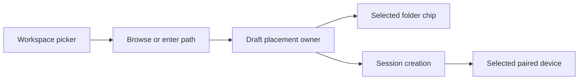

Codex review: needs maintainer review before merge.

## What this changes

This PR moves device-folder editing into the workspace picker and leaves only the selected folder name beside the composer.

**Example:** Choose /workspace/field-notes on Design laptop at a 390 × 844 viewport.
- **Before:** The selected folder still has an absolute-path editor and explanatory paragraph above the composer.
- **After:** The workspace chip shows field-notes; reopening the picker allows changes, and canceling preserves the selected path.

## Review scores

| Measure | Result | What it means |
|---|---|---|
| **Overall readiness** | 🐚 platinum hermit **(4/6)** | Focused, useful change with inspected visual proof, relevant browser coverage, and no actionable findings; the inherited CI failure still prevents a green gate. |
| **Proof confidence** | 🐚 platinum hermit **(4/6)** ✨ media proof bonus | Sufficient (screenshot): Inspected before/after screenshots show the changed selected-folder presentation in the built Control UI at 390 × 844 with a simulated device; reported browser scenarios additionally exercise confirmation, cancellation, model blocking, and pending-create recovery. |
| **Patch quality** | 🐚 platinum hermit **(4/6)** | No actionable review findings were identified. |

## Product

**Kind:** Preference · **Worth it:** Yes · **Fix scope:** Complete
**User problem:** A completed device-folder selection still looks like unfinished setup because its editor and explanation remain above the composer.
**Reason:** Maintainer authorship establishes direction, and the focused interaction change removes clutter while retaining browsing, manual entry, cancellation, and model restrictions.

## Merge readiness

✅ **Ready for maintainer review**

Keep open: this maintainer-authored PR delivers a useful, focused UI improvement with no actionable code findings; required CI remains red from a confirmed main-branch failure.

**Priority:** P3
**Reviewed head:** `5fee7e4faec1db1a76c8d02e2a51fb98fd5a8327`

## Before merge

None.

## Findings

None.

<strong>Agent review details</strong>

### How this fits together

The Control UI workspace picker collects a device-folder choice, commits it through the existing draft placement owner, and passes the unchanged deviceFolder payload to session creation.

### Technical review

Best possible solution:

Keep the existing draft placement owner and commit folder changes only through the picker’s confirmation action.

Do we have a high-confidence way to reproduce the issue?

Current-main source retains the inline editor shown in the supplied before screenshots; no target code was executed during this review.

Is this the best way to solve the issue?

The change is appropriately scoped: it reuses the picker and placement owner, removes the redundant editor and setter, and preserves the session payload and capability checks.

AGENTS.md: found and applied where relevant.

Codex review notes: model internal, reasoning medium; reviewed against [2b46a6130923](https://github.com/openclaw/openclaw/commit/2b46a6130923ef323f7ec0375c9c776d4b02a9b9).

### Provenance checked

- `Device-folder selection and manual entry` changes intended behavior with a stated reason (2c87e333990141e6aa433fd05f1a82f09fca8a5e: Allow sessions to work directly in existing folders on explicitly selected paired devices.)
- `Single device-folder menu choice and folder label` keeps the original intent (a506b3fb0a594564ba11a3856fc3368c2dfa4460: Replace overlapping device-folder choices with one short row, retaining browsing for admins and typed paths for other writers.)
- `Compact picker layout and inline-editor wrapping` changes intended behavior with a stated reason (e80a6dd9fdb4c7ce724472dd5d1b216afb4e70a7: Keep placement controls compact and reachable while ensuring the inline device-folder form fits its row.)
- `Lazy picker content and synchronous domain ownership` keeps the original intent (87a94c4b4236ccaded2cd75790032122037d5a66: Defer optional picker bodies while preserving existing state owners, focus, and loading behavior.)

### Testing

Proof path: shipped entry point.

### Security

None.

### Evidence

What I checked:

- **Pinned change and clean checkout:** Reviewed the introduced merge-base-to-head diff; the screenshot revision and published head have identical trees, and the checkout remained clean. ([5fee7e4faec1](https://github.com/openclaw/openclaw/commit/5fee7e4faec1db1a76c8d02e2a51fb98fd5a8327))
- **Single commit boundary:** Manual edits stay in component-local draft state until confirmation; selectDraftDeviceFolder retains submission and pending-placement guards, clears competing project state, and closes the picker. ([`ui/src/pages/new-session/project-picker-content.tsx:64`](https://github.com/openclaw/openclaw/blob/5fee7e4faec1db1a76c8d02e2a51fb98fd5a8327/ui/src/pages/new-session/project-picker-content.tsx#L64), [5fee7e4faec1](https://github.com/openclaw/openclaw/commit/5fee7e4faec1db1a76c8d02e2a51fb98fd5a8327))
- **Inspected visual evidence:** All four downloaded images were inspected. The clean and annotated comparisons show the built Control UI removing the persistent editor while retaining the selected field-notes chip, using synthetic content and a simulated device. ([`ui/src/pages/new-session/target-controls-view.tsx:259`](https://github.com/openclaw/openclaw/blob/5fee7e4faec1db1a76c8d02e2a51fb98fd5a8327/ui/src/pages/new-session/target-controls-view.tsx#L259), [5fee7e4faec1](https://github.com/openclaw/openclaw/commit/5fee7e4faec1db1a76c8d02e2a51fb98fd5a8327))
- **Distinct browser contracts:** The updated browser scenarios cover manual confirmation and cancellation, browse selection, incompatible-model blocking, non-admin entry without directory listing, and restoration of the original pending-create payload. ([`ui/src/e2e/new-session-page.device-folder.e2e.test.ts:72`](https://github.com/openclaw/openclaw/blob/5fee7e4faec1db1a76c8d02e2a51fb98fd5a8327/ui/src/e2e/new-session-page.device-folder.e2e.test.ts#L72), [5fee7e4faec1](https://github.com/openclaw/openclaw/commit/5fee7e4faec1db1a76c8d02e2a51fb98fd5a8327))
- **Inherited CI failure:** GitHub annotations for the PR job https://github.com/openclaw/openclaw/actions/runs/44943050611/job/136964691186 and scheduled-main job https://github.com/openclaw/openclaw/actions/runs/44935539101/job/136941599780 show the same Settings-search assertion receiving three Spanish results instead of two. https://github.com/openclaw/openclaw/pull/203201 owns the separate expectation correction. ([`ui/src/pages/config/settings-search.test.ts:26`](https://github.com/openclaw/openclaw/blob/5fee7e4faec1db1a76c8d02e2a51fb98fd5a8327/ui/src/pages/config/settings-search.test.ts#L26), [5fee7e4faec1](https://github.com/openclaw/openclaw/commit/5fee7e4faec1db1a76c8d02e2a51fb98fd5a8327))
- **Existing feature and related work:** Current main retains the two-step selectDeviceFolder/setDeviceFolderPath interaction. https://github.com/openclaw/openclaw/pull/169722 established device-folder sessions, and https://github.com/openclaw/openclaw/pull/203259 aligns the inline editor that this PR removes. ([`ui/src/pages/new-session/draft-place-state.ts:106`](https://github.com/openclaw/openclaw/blob/2b46a6130923ef323f7ec0375c9c776d4b02a9b9/ui/src/pages/new-session/draft-place-state.ts#L106), [2b46a6130923](https://github.com/openclaw/openclaw/commit/2b46a6130923ef323f7ec0375c9c776d4b02a9b9))

### PR surface

Source +27, Tests +2, Docs +1. Total +30 across 9 files. Added test files: 0.

View PR surface stats

| Area | Files | Added | Removed | Net |
|---|---:|---:|---:|---:|
| Source | 6 | 95 | 68 | +27 |
| Tests | 2 | 55 | 53 | +2 |
| Docs | 1 | 4 | 3 | +1 |
| Config | 0 | 0 | 0 | 0 |
| Generated | 0 | 0 | 0 | 0 |
| Other | 0 | 0 | 0 | 0 |
| **Total** | **9** | **154** | **124** | **+30** |

### Preflight source

Source unknown. Source comparison at the observed PR snapshot only. Completion is self-reported; body, policy, tests, execution, and report bytes are not verified.

### Labels

Label changes:

- add `P3`: This improves an existing, working folder-selection interaction and reduces mobile composer clutter.
- add `proof: sufficient`: Contributor real behavior proof is sufficient.
- add `proof: 📸 screenshot`: Contributor real behavior proof includes screenshot evidence.
- add `rating: 🐚 platinum hermit`: Overall readiness is 🐚 platinum hermit; proof is 🐚 platinum hermit and patch quality is 🐚 platinum hermit.
- add `status: 👀 ready for maintainer look`: ClawSweeper has no concrete contributor-facing blocker left for this PR.

Label justifications:

- `P3`: This improves an existing, working folder-selection interaction and reduces mobile composer clutter.
- `rating: 🐚 platinum hermit`: Overall readiness is 🐚 platinum hermit; proof is 🐚 platinum hermit and patch quality is 🐚 platinum hermit.
- `status: 👀 ready for maintainer look`: ClawSweeper has no concrete contributor-facing blocker left for this PR.
- `proof: sufficient`: Contributor real behavior proof is sufficient.
- `proof: 📸 screenshot`: Contributor real behavior proof includes screenshot evidence.

### Rating scale

6/6 🦀 challenger crab · 5/6 🦞 diamond lobster · 4/6 🐚 platinum hermit · 3/6 🦐 gold shrimp · 2/6 🦪 silver shellfish · 1/6 🧂 unranked krab. Overall follows the weaker of proof and patch quality; ✨ marks media proof (a screenshot, video, or linked artifact) that directly shows the changed behavior.

### Workflow

ClawSweeper edits this one comment on every review. Comment `@clawsweeper re-review` for a fresh review only. Repair and merge execution lanes are retired.

_Reviewed November 21, 2026, 3:18 PM ET / 20:18 UTC._

<!-- clawsweeper-verdict:needs-human item=203269 sha=5fee7e4faec1db1a76c8d02e2a51fb98fd5a8327 confidence=high updated_at=2026-11-21T20:15:25Z reviewed_at=2026-11-21T20:18:56.294Z lease_owner=github-run-44945162284-1 lease_comment_id=7068607854 source_revision=0fdba6ab620b81ed46fd27a7c1bcecc0d2d27bb3b930206002840164c3d5256f hold=not_opted_in findings=0 -->
<!-- clawsweeper-review-state:ready item=203269 sha=5fee7e4faec1db1a76c8d02e2a51fb98fd5a8327 v=1 -->

<!-- clawsweeper-review-version item=203269 reviewed_at=2026-11-21T20:18:56.294Z sha=5fee7e4faec1db1a76c8d02e2a51fb98fd5a8327 source_revision=0fdba6ab620b81ed46fd27a7c1bcecc0d2d27bb3b930206002840164c3d5256f lease_owner=github-run-44945162284-1 lease_comment_id=7068607854 v=1 -->

<!-- clawsweeper-review item=203269 -->