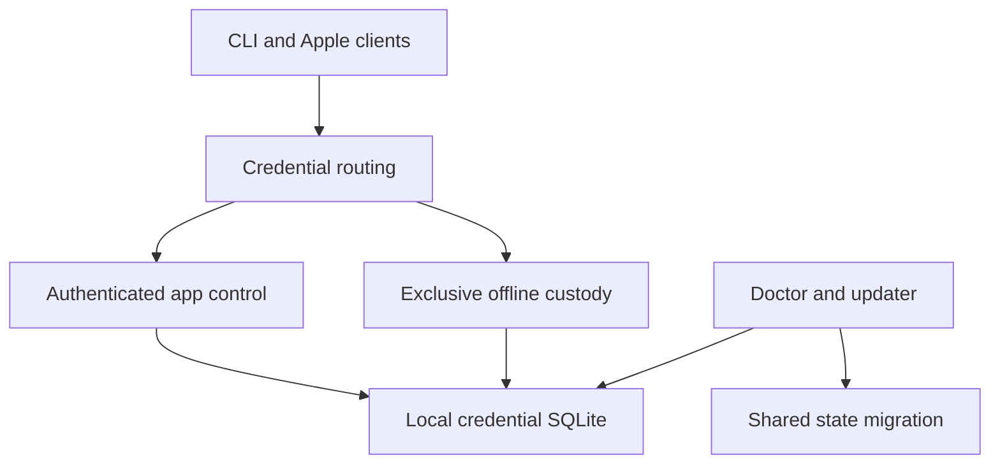

Codex review: needs real behavior proof before merge.

## What this changes

This PR moves client identities, cached tokens, and native socket secrets into a separately versioned local SQLite store.

**Example:** A CLI installation uses PostgreSQL for Gateway state.
- **Before:** Client identity and token access depends on the selected shared-state database.
- **After:** Private client credentials use &lt;resolved-client-root>/client/credentials.sqlite at local schema version 1.

## Review scores

| Measure | Result | What it means |
|---|---|---|
| **Overall readiness** | 🧂 unranked krab **(1/6)** | The inspected repairs are coherent with no new confirmed defect; final native authority evidence remains absent, and review coverage does not certify every changed fixture. |
| **Proof confidence** | 🧂 unranked krab **(1/6)** | Real behavior proof is necessary before merge. See [Before merge](#before-merge). |
| **Patch quality** | 🦐 gold shrimp **(3/6)** | Security review found an item that needs attention. |

## Product

**Kind:** Refactor · **Worth it:** Yes · **Fix scope:** Complete
**User problem:** Private client credential access remains coupled to the Gateway's selected shared-state database.
**Reason:** The maintainer-authored direction and merged prerequisite approve separating local secrets while preserving identity bytes, pairing authority, and rollback behavior.

## Merge readiness

⛔ **Blocked before merge - 4 items remain**

Keep open: this maintainer-approved cutover remains necessary, the two latest findings are addressed, and the explicit landing pause still applies.

**Priority:** P2
**Reviewed head:** `01695d5df1dc12530bbaf4d9a32af5569ad2ec98`

## Before merge

- [ ] **Add real behavior proof** - Authority-chain proof required: provide the scheduled signed real-Mac client.credentials trace showing allowed access and rejection of foreign UID, unowned-root, and closed or replaced owner requests before credential I/O or disclosure, including closure while work waits. Recorded PostgreSQL, updater, and native harness results support their declared scenarios but explicitly exclude this app run; redact secrets, IPs, and non-public endpoints. After adding proof, update the PR body, then request a new review with `@clawsweeper re-review`. The PR author or someone with repository write access can request it.
- [ ] **Resolve security review attention item** - No concrete bypass was established, but the new credential-disclosure boundary still needs its scheduled authority proof.
- [ ] **Resolve merge risk** - Final-effect authorization for native credential disclosure after owner closure or replacement remains unverified.
- [ ] **Complete next step** - Resolve the conflicts GitHub reports for the reviewed head and validate the affected integration changes.

## Findings

None.

### Tests

- Missing end-to-end proof: The scheduled signed-app credential authority scenario remains unshown, and the archive regression has no recorded failing base run.

<strong>Agent review details</strong>

### How this fits together

CLI and Apple clients submit bounded credential operations to the active app or an exclusive offline owner; migration and restore owners preserve the shared/local binding.

### Technical review

Best possible solution:

Complete the approved single-owner cutover with exact migration and restore binding, preserving the documented rollback contract.

Do we have a high-confidence way to reproduce the issue?

This is an approved architectural cutover; current-main source confirms the shared-storage coupling, and no runtime reproduction was attempted during this read-only review.

Is this the best way to solve the issue?

The inspected implementation uses one local credential owner and existing migration, backup, and capture coordinators; the two requested repairs fit those owners without introducing competing state.

AGENTS.md: found and applied where relevant.

Codex review notes: model internal, reasoning medium; reviewed against [0a0d88df543a](https://github.com/openclaw/openclaw/commit/0a0d88df543a9d36c4708f93c56d995da769050c).

### Merge-risk options

**Maintainer options:**
1. **Complete the scheduled native verification (recommended)**  
   Establish allowed and forbidden final credential effects through the signed app before lifting the landing pause.
2. **Retain the landing pause**  
   Keep this PR open while the native proof coordinator completes the scheduled verification.

### Provenance checked

- `Cross-runtime identity persistence` changes intended behavior with a stated reason (98410d986eee7ce7cff8e8466c6d5f9314ae784b: The earlier migration established one SQLite identity owner and preserved key material across Node and Apple clients.)
- `Native adoption of CLI-written identities` keeps the original intent (374007083a52e51d9b4e1d386d61fde585b0544f: Native startup needed to adopt valid canonical identities during shared-state migration without rotating trust or accepting corrupt rows.)
- `Legacy import and rollback` keeps the original intent (https://github.com/openclaw/openclaw/pull/174294: The approved cutover requires copy-only independent sources, durable consumed-import claims, and rebuilding stale local state from authoritative rollback images.)
- `Migration publication attribution` keeps the original intent (https://github.com/openclaw/openclaw/pull/174360: The existing capture coordinator attributes committed migration changes while preserving exact rollback and rejecting foreign writes.)

### Testing

Proof path: in-process harness.

### Security

Needs attention: No concrete bypass was established, but the new credential-disclosure boundary still needs its scheduled authority proof.

### Evidence

What I checked:

- **Archive-alias finding addressed:** Backup capture records the canonical shared source identity separately from lexical archive paths, and restore uses that captured identity rather than resolving a potentially vanished source alias. ([`src/infra/client-credential-restore.ts:192`](https://github.com/openclaw/openclaw/blob/01695d5df1dc12530bbaf4d9a32af5569ad2ec98/src/infra/client-credential-restore.ts#L192), [01695d5df1dc](https://github.com/openclaw/openclaw/commit/01695d5df1dc12530bbaf4d9a32af5569ad2ec98))
- **Restore regression coverage:** The restore suite exercises aliased sources after both original paths disappear, exact identity preservation, mismatched capture rejection, and incomplete-target cleanup; the body explicitly reports no pre-fix runtime failure run. ([`src/infra/client-credential-restore.test.ts:244`](https://github.com/openclaw/openclaw/blob/01695d5df1dc12530bbaf4d9a32af5569ad2ec98/src/infra/client-credential-restore.test.ts#L244), [01695d5df1dc](https://github.com/openclaw/openclaw/commit/01695d5df1dc12530bbaf4d9a32af5569ad2ec98))
- **Planner finding addressed:** The retained first-sign-in expectation now selects vitest.gateway-server-isolated.config.ts, consistent with its current Gateway-server routing. ([`test/scripts/ci-changed-node-test-plan.test.ts:860`](https://github.com/openclaw/openclaw/blob/01695d5df1dc12530bbaf4d9a32af5569ad2ec98/test/scripts/ci-changed-node-test-plan.test.ts#L860), [01695d5df1dc](https://github.com/openclaw/openclaw/commit/01695d5df1dc12530bbaf4d9a32af5569ad2ec98))
- **Native authority boundary:** App control checks peer UID and request authentication; credential execution checks configured roots and retains a closeable custody object through each operation. ([`apps/shared/OpenClawKit/Sources/OpenClawKit/DeviceCredentialAccess.swift:303`](https://github.com/openclaw/openclaw/blob/01695d5df1dc12530bbaf4d9a32af5569ad2ec98/apps/shared/OpenClawKit/Sources/OpenClawKit/DeviceCredentialAccess.swift#L303), [01695d5df1dc](https://github.com/openclaw/openclaw/commit/01695d5df1dc12530bbaf4d9a32af5569ad2ec98))
- **Approved compatibility contract:** The merged prerequisite https://github.com/openclaw/openclaw/pull/174294 records published v2026.10.4 and beta capture/restore experiments, copy-only independent native sources, and the accepted loss of credentials issued between upgrade and rollback; this PR retains that contract. Public docs: [`docs/install/updating.md`](https://docs.openclaw.ai/install/updating). ([`docs/install/updating.md:109`](https://docs.openclaw.ai/install/updating), [4706053bc398](https://github.com/openclaw/openclaw/commit/4706053bc398d6ccf519a4d21fb1e9ed1cecb31d))
- **Explicit landing pause and conflicts:** The full body and latest maintainer comment explicitly leave signed real-Mac proof pending and say not to merge; REST also reports mergeable=false and mergeable_state=dirty for the reviewed head. ([01695d5df1dc](https://github.com/openclaw/openclaw/commit/01695d5df1dc12530bbaf4d9a32af5569ad2ec98))

Likely related people:

- **Peter Steinberger:** Raw commit 98410d986eee7ce7cff8e8466c6d5f9314ae784b adds apps/shared/OpenClawKit/Sources/OpenClawKit/DeviceIdentitySQLiteStore.swift:6 relative to its recorded parents. This identifies author metadata, not feature responsibility or a PR merger. (role: source-line author; confidence: high; commits: [98410d986eee](https://github.com/openclaw/openclaw/commit/98410d986eee7ce7cff8e8466c6d5f9314ae784b); files: `apps/shared/OpenClawKit/Sources/OpenClawKit/DeviceIdentitySQLiteStore.swift`)

### PR surface

PR surface statistics unavailable: the file list is incomplete.

### Root-cause cluster

Relationship: `canonical`
Canonical: https://github.com/openclaw/openclaw/pull/174599
Summary: This PR replaces the closed predecessor and completes the production cutover after the merged preparation work.

Members:
- `superseded`: https://github.com/openclaw/openclaw/pull/174485 - The body identifies this closed, unmerged predecessor as replaced by the current cutover.
- `adjacent_distinct`: https://github.com/openclaw/openclaw/pull/174294 - The merged preparatory owner intentionally enabled no production credential reader or writer.
- `adjacent_distinct`: https://github.com/openclaw/openclaw/pull/174360 - The merged prerequisite supplies PostgreSQL migration and rollback attribution rather than this credential cutover.

Proposal only: this assessment does not dispatch repair, suppress jobs, mutate sibling items, close, or merge anything.

### Labels

Label changes:

- remove `merge-risk: 🚨 automation`: Current PR review merge-risk labels are `merge-risk: 🚨 compatibility`, `merge-risk: 🚨 security-boundary`.

Label justifications:

- `P2`: This is an approved storage and ownership improvement without an established urgent production incident.
- `merge-risk: 🚨 compatibility`: Shared credential tables are retired and client versions must coordinate; the rollback re-pairing tradeoff is explicitly recorded in the merged prerequisite.
- `merge-risk: 🚨 security-boundary`: The app-control endpoint now returns private credential material and depends on current UID, root, and owner-lifetime authority.
- `rating: 🧂 unranked krab`: Overall readiness is 🧂 unranked krab; proof is 🧂 unranked krab and patch quality is 🦐 gold shrimp.
- `status: 📣 needs proof`: The PR needs real behavior proof before ClawSweeper can clear the contributor ask.

### Rank-up moves

Optional improvements that raise the rating; they are not merge blockers.

- Add final-effect proof for foreign UID, foreign root, and closed or replaced native owners, including closure while credential work waits.

### Rating scale

6/6 🦀 challenger crab · 5/6 🦞 diamond lobster · 4/6 🐚 platinum hermit · 3/6 🦐 gold shrimp · 2/6 🦪 silver shellfish · 1/6 🧂 unranked krab. Overall follows the weaker of proof and patch quality; ✨ marks media proof (a screenshot, video, or linked artifact) that directly shows the changed behavior.

### Workflow

ClawSweeper edits this one comment on every review. Comment `@clawsweeper re-review` for a fresh review only. Repair and merge execution lanes are retired.

### History

Review history (4 earlier review cycles)

<!-- clawsweeper-review-history v=1 total=4 -->
- reviewed 2026-10-16T20:05:12.183Z sha a27ee92f9d4d9d183e381d5fbe7f2238e8c0a525 :: needs real behavior proof before merge. :: [P2] Keep predecessor identity repair reachable before cutover validation
- reviewed 2026-10-17T18:37:45.479Z sha c24a2b7257f68e1ecf46a42950f99d92358ca11f :: needs real behavior proof before merge. :: [P1] Preserve explicit identity database paths | [P2] Validate the persisted winner before serving app identities
- reviewed 2026-10-17T20:06:55.732Z sha 2af27ceb28dda236990e1e1b9ed5a51874a998ba :: needs real behavior proof before merge. :: [P2] Accept the exact raw observation when clearing normalized tokens | [P2] Fall back offline after a definite pre-send socket refusal | [P2] Migrate the remaining preauth test identity paths | [P2] Apply migration custody to the untouched-index recovery cases
- reviewed 2026-10-17T21:09:21.031Z sha 574d96bd000422acd1ee2278a258c8a773fa1d75 :: needs real behavior proof before merge. :: [P2] Match archived receipts using captured canonical source identity | [P2] Update the retained planner expectation for first-sign-in routing

_Reviewed October 17, 2026, 6:29 PM ET / 22:29 UTC (Revision 5)._

<!-- clawsweeper-security:security-sensitive item=174599 sha=01695d5df1dc12530bbaf4d9a32af5569ad2ec98 confidence=high updated_at=2026-10-17T22:23:31Z reviewed_at=2026-10-17T22:29:15.550Z lease_owner=github-run-39074815878-1 lease_comment_id=6242167482 source_revision=0182ac4e8e72c028a9e91cbef80d95e0ea48647c5fa53e16f1e4891108714822 -->
<!-- clawsweeper-verdict:needs-human item=174599 sha=01695d5df1dc12530bbaf4d9a32af5569ad2ec98 confidence=high updated_at=2026-10-17T22:23:31Z reviewed_at=2026-10-17T22:29:15.550Z lease_owner=github-run-39074815878-1 lease_comment_id=6242167482 source_revision=0182ac4e8e72c028a9e91cbef80d95e0ea48647c5fa53e16f1e4891108714822 hold=security findings=0 -->
<!-- clawsweeper-review-state:blocked item=174599 sha=01695d5df1dc12530bbaf4d9a32af5569ad2ec98 v=1 -->

<!-- clawsweeper-review-version item=174599 reviewed_at=2026-10-17T22:29:15.550Z sha=01695d5df1dc12530bbaf4d9a32af5569ad2ec98 source_revision=0182ac4e8e72c028a9e91cbef80d95e0ea48647c5fa53e16f1e4891108714822 lease_owner=github-run-39074815878-1 lease_comment_id=6242167482 v=1 -->

<!-- clawsweeper-review item=174599 -->