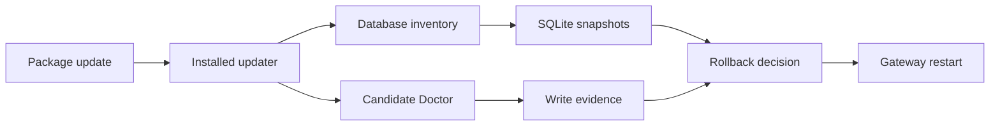

Codex review: blocked before merge. _Reviewed September 25, 2026, 10:22 PM ET / September 26, 2026, 02:22 UTC (Revision 5)._

# ClawSweeper review

## What this changes

The branch adds retained SQLite snapshots and guarded restoration to package-update rollback, includes unregistered agent databases in verified backups, and documents recovery limits.

## Regression provenance

Possible regression — suspected (reviewed change). No predecessor PR is attributed.

## Merge readiness

⛔ **Blocked before merge - 7 items remain**

Keep this PR open. Current main still lacks the requested rollback and archive coverage, but unconditional database capture can block an otherwise compatible package update. Snapshot retention and full upgrade compatibility also remain unresolved.

**Priority:** P0
**Reviewed head:** `d569ba145e8baf2a2b2f5c29e711e7f7f6199ae7`
**Owner decision:** Required. See [Decision needed](#decision-needed).

## Review scores

| Measure | Result | What it means |
|---|---|---|
| **Overall readiness** | 🦐 gold shrimp **(3/6)** | The branch has substantial direct recovery proof and focused validation, while an introduced update-admission regression and unresolved storage compatibility keep it from merge readiness. |
| **Proof confidence** | 🐚 platinum hermit **(4/6)** | Sufficient (terminal): A real npm 2026.9.5 state and agent database passed through the built candidate Doctor, an injected failure, guarded restore, and an old Gateway serving health endpoints with session facts retained. That terminal trace supports the changed recovery owner, but it omits complete package swap and managed-service activation; existing-state upgrade compatibility through the full published-driver path remains unverified. |
| **Patch quality** | 🦐 gold shrimp **(3/6)** | 1 actionable review finding remain. |

## Verification

| Check | Result | Evidence |
|---|---|---|
| **Real behavior** | Verified | Sufficient (terminal): A real npm 2026.9.5 state and agent database passed through the built candidate Doctor, an injected failure, guarded restore, and an old Gateway serving health endpoints with session facts retained. That terminal trace supports the changed recovery owner, but it omits complete package swap and managed-service activation; existing-state upgrade compatibility through the full published-driver path remains unverified. |
| **Evidence reviewed** | 9 items | Unconditional capture: The introduced package-transaction callback captures databases whenever an original update run exists; it does not first establish that Doctor will migrate them. Admission refusal: The new backup owner rejects measured snapshot-space shortages and hard-linked database files before capture, making the unconditional callback an update failure path. Transaction ordering: Package swap awaits the callback after activation preparation and before package replacement and post-install Doctor, so capture refusal prevents that update from proceeding. |
| **Findings** | 1 actionable finding | [P1] Keep compatible updates runnable without full snapshot capacity |
| **Security** | None | None. |

## How this fits together

The installed updater stages a new OpenClaw package and runs Doctor, which can migrate shared and per-agent SQLite databases. If the update fails, recovery decides whether it can restore those databases and restart the previous Gateway; the backup CLI also archives them independently.

## Decision needed

| Question | Recommendation |
|---|---|
| After a package update succeeds and its Gateway is verified, should this PR retain full database snapshots indefinitely or retire them? | **Retire verified successes:** Remove snapshots only after successful final verification while retaining failed and uncertain recovery artifacts. |

Why: The PR changes the storage and recovery-retention contract, and its stated manual-retention choice has no separate recorded maintainer acceptance.

## Before merge

- [ ] **Keep compatible updates runnable without full snapshot capacity (P1)** - This unconditional capture runs for every package transaction before Doctor. Capture then rejects measured disk shortages and hard-linked database files, so a package update with compatible databases fails before any migration even though the existing path could proceed. Gate mandatory capture on migration risk or preserve a verified compatible-update path, with an admission regression.
- [ ] **Resolve merge risk (P1)** - Mandatory capture can stop a schema-compatible package update on measured disk shortage or a hard-linked database, even when no database migration is needed.
- [ ] **Resolve merge risk (P1)** - Successful updates retain a full snapshot of every discovered database until manual removal; the resulting storage lifetime and cleanup responsibility have not received recorded acceptance.
- [ ] **Resolve merge risk (P1)** - The real recovery cell exercises Doctor and guarded restore, but a complete published-updater-to-candidate package-swap and final managed-Gateway recovery cell is not shown.
- [ ] **Complete next step (P2)** - Repair compatible-update capture admission, record the snapshot-retention decision, and prove the complete published-updater recovery path before merge.
- [ ] **Resolve maintainer decision** - Resolve the maintainer decision shown above before merge.
- [ ] **Add data-model compatibility proof** - Confirm migration or upgrade compatibility proof before merge.

## Findings

- [P1] Keep compatible updates runnable without full snapshot capacity — `src/cli/update-cli/update-command-execution.ts:184-189`

<strong>Agent review details</strong>

### Security

None.

### PR surface

Source +1378, Tests +1692, Docs +78. Total +3148 across 75 files.

View PR surface stats

| Area | Files | Added | Removed | Net |
|---|---:|---:|---:|---:|
| Source | 48 | 1562 | 184 | +1378 |
| Tests | 24 | 1751 | 59 | +1692 |
| Docs | 3 | 99 | 21 | +78 |
| Config | 0 | 0 | 0 | 0 |
| Generated | 0 | 0 | 0 | 0 |
| Other | 0 | 0 | 0 | 0 |
| **Total** | **75** | **3412** | **264** | **+3148** |

### Review metrics

| Metric | Value | Why it matters |
|---|---|---|
| **Production versus test growth** | production +1,378 net LOC; tests/support +1,692 net LOC | The PR body attributes production growth to generation evidence, restoration, and lifecycle integration; maintainers should weigh that cost against the recovery contract. |

### Stored data model

Persistent data-model change detected: `migration/backfill/repair: src/cli/update-cli/update-command-database-receipts.ts`, `migration/backfill/repair: src/cli/update-cli/update-command-fresh-doctor.ts`, `migration/backfill/repair: src/commands/doctor-maintenance-types.ts`, `migration/backfill/repair: src/commands/doctor-maintenance.ts`, `migration/backfill/repair: src/flows/doctor-health.ts`, `migration/backfill/repair: src/infra/update-run-codec.ts`, and 3 more. Confirm migration or upgrade compatibility proof before merge.

### Root-cause cluster

Relationship: `fixed_by_candidate`
Canonical: https://github.com/openclaw/openclaw/issues/157846
Summary: This PR is the candidate fix for the linked upgrade rollback report; the merged concurrent-snapshot repair supplies an adjacent primitive but does not implement rollback restoration.

Members:
- `canonical`: https://github.com/openclaw/openclaw/issues/157846 - The PR body uses closing syntax for this still-open report of irreversible schema migration after failed update.
- `partial_overlap`: https://github.com/openclaw/openclaw/pull/158317 - This merged PR repairs consistent snapshot acquisition, which this branch consumes, but does not restore databases on rollback.
- `partial_overlap`: https://github.com/openclaw/openclaw/pull/145169 - The open broader recovery work concerns preservation of newer writes, beyond this branch's guarded pre-migration restoration.

Proposal only: this assessment does not dispatch repair, suppress jobs, mutate sibling items, close, or merge anything.

### Merge-risk options

**Maintainer options:**
1. **Repair admission and settle retention (recommended)**  
   Preserve compatible updates when exhaustive capture cannot run, record the successful-snapshot retention choice, and verify a complete upgrade recovery path.
2. **Accept mandatory capture**  
   Explicitly accept update refusal on constrained installations and indefinite snapshot storage, with operator-facing capacity and cleanup guidance.
3. **Hold the rollout**  
   Pause this branch if the capture admission and recovery-retention tradeoffs cannot be resolved safely for existing installations.

### Technical review

Best possible solution:

Keep pre-migration restoration for updates that can change database compatibility, preserve a runnable path for verified compatible updates on constrained disks, and give operators a visible Fix or Doctor recovery action when rollback is refused.

Do we have a high-confidence way to reproduce the issue?

Yes for the admission regression: the introduced callback always reaches capture, and the new capacity and hard-link checks reject before Doctor. This review established that path from source and the focused tests, without executing the PR.

Is this the best way to solve the issue?

No, not yet. The restoration uses existing update and snapshot owners, but capture needs an admission rule that preserves verified compatible updates.

Full review comments:

- [P1] Keep compatible updates runnable without full snapshot capacity — `src/cli/update-cli/update-command-execution.ts:184-189`
  This unconditional capture runs for every package transaction before Doctor. Capture then rejects measured disk shortages and hard-linked database files, so a package update with compatible databases fails before any migration even though the existing path could proceed. Gate mandatory capture on migration risk or preserve a verified compatible-update path, with an admission regression.
  Confidence: 0.94

Overall correctness: patch is incorrect
Overall confidence: 0.89

AGENTS.md: found and applied where relevant.

Codex review notes: model internal, reasoning high; reviewed against [a410b4d0fb53](https://github.com/openclaw/openclaw/commit/a410b4d0fb5316735ebb1f8e90ed55a6e6336923).

### Labels

Label changes:

- add `proof: sufficient`: Contributor real behavior proof is sufficient. A real npm 2026.9.5 state and agent database passed through the built candidate Doctor, an injected failure, guarded restore, and an old Gateway serving health endpoints with session facts retained. That terminal trace supports the changed recovery owner, but it omits complete package swap and managed-service activation; existing-state upgrade compatibility through the full published-driver path remains unverified.

Label justifications:

- `P0`: Failed updates can strand an older Gateway on newer SQLite schemas, making the core runtime unusable until recovery.
- `merge-risk: 🚨 compatibility`: The new mandatory capture gate can reject package updates that previously proceeded with compatible databases.
- `merge-risk: 🚨 session-state`: The patch replaces persisted shared and per-agent SQLite files during rollback and retains migrated generations for recovery.
- `merge-risk: 🚨 availability`: Snapshot refusal or uncertain restoration can leave a managed Gateway stopped even when the package update path would otherwise complete.
- `rating: 🦐 gold shrimp`: Overall readiness is 🦐 gold shrimp; proof is 🐚 platinum hermit and patch quality is 🦐 gold shrimp.
- `status: ⏳ waiting on author`: ClawSweeper has contributor-facing work open and is waiting for author action. Sufficient (terminal): A real npm 2026.9.5 state and agent database passed through the built candidate Doctor, an injected failure, guarded restore, and an old Gateway serving health endpoints with session facts retained. That terminal trace supports the changed recovery owner, but it omits complete package swap and managed-service activation; existing-state upgrade compatibility through the full published-driver path remains unverified.
- `proof: sufficient`: Contributor real behavior proof is sufficient. A real npm 2026.9.5 state and agent database passed through the built candidate Doctor, an injected failure, guarded restore, and an old Gateway serving health endpoints with session facts retained. That terminal trace supports the changed recovery owner, but it omits complete package swap and managed-service activation; existing-state upgrade compatibility through the full published-driver path remains unverified.

### Evidence

What I checked:

- **Unconditional capture:** The introduced package-transaction callback captures databases whenever an original update run exists; it does not first establish that Doctor will migrate them. ([`src/cli/update-cli/update-command-execution.ts:184`](https://github.com/openclaw/openclaw/blob/d569ba145e8baf2a2b2f5c29e711e7f7f6199ae7/src/cli/update-cli/update-command-execution.ts#L184), [d569ba145e8b](https://github.com/openclaw/openclaw/commit/d569ba145e8baf2a2b2f5c29e711e7f7f6199ae7))
- **Admission refusal:** The new backup owner rejects measured snapshot-space shortages and hard-linked database files before capture, making the unconditional callback an update failure path. ([`src/infra/update-database-backup.ts:95`](https://github.com/openclaw/openclaw/blob/d569ba145e8baf2a2b2f5c29e711e7f7f6199ae7/src/infra/update-database-backup.ts#L95), [d569ba145e8b](https://github.com/openclaw/openclaw/commit/d569ba145e8baf2a2b2f5c29e711e7f7f6199ae7))
- **Transaction ordering:** Package swap awaits the callback after activation preparation and before package replacement and post-install Doctor, so capture refusal prevents that update from proceeding. ([`src/infra/package-update-swap.ts:394`](https://github.com/openclaw/openclaw/blob/d569ba145e8baf2a2b2f5c29e711e7f7f6199ae7/src/infra/package-update-swap.ts#L394), [d569ba145e8b](https://github.com/openclaw/openclaw/commit/d569ba145e8baf2a2b2f5c29e711e7f7f6199ae7))
- **Prior finding remains:** The previous ClawSweeper review identified the compatible-update capacity regression. The pinned head still contains its unconditional trigger; the later rollback correction changes restoration, not capture admission. ([`src/cli/update-cli/update-command-execution.ts:185`](https://github.com/openclaw/openclaw/blob/d569ba145e8baf2a2b2f5c29e711e7f7f6199ae7/src/cli/update-cli/update-command-execution.ts#L185), [d569ba145e8b](https://github.com/openclaw/openclaw/commit/d569ba145e8baf2a2b2f5c29e711e7f7f6199ae7))
- **Current-main necessity:** Fetched main retains the pre-PR rollback refusal and has no update-database-backup owner. Its backup snapshot plan relies on registered agents, so the central requested work is not already on main. ([`src/cli/update-cli/update-command-rollback.ts:299`](https://github.com/openclaw/openclaw/blob/a410b4d0fb5316735ebb1f8e90ed55a6e6336923/src/cli/update-cli/update-command-rollback.ts#L299), [a410b4d0fb53](https://github.com/openclaw/openclaw/commit/a410b4d0fb5316735ebb1f8e90ed55a6e6336923))
- **Real recovery evidence and limit:** The PR body matches the supplied SHA-256. It reports a real npm 2026.9.5 database/Doctor/restore cell that returned schemas 17/21 and an old Gateway serving health endpoints after forced failure. The author expressly limits that cell: it did not run the complete updater/package swap or systemd flow.

Likely related people:

- **steipete:** Suggested for follow-up; no historical authorship or introduction is verified. (role: unverified routing candidate; confidence: low)
- **Jason (Json):** Suggested for follow-up; no historical authorship or introduction is verified. (role: unverified routing candidate; confidence: low)
- **Dallin Romney:** Suggested for follow-up; no historical authorship or introduction is verified. (role: unverified routing candidate; confidence: low)

### Rank-up moves

Optional improvements that raise the rating; they are not merge blockers.

- Preserve schema-compatible package updates when full snapshot capture cannot run, with a focused admission regression.
- Show a redacted published-updater-to-candidate failure and recovery run through package swap and final Gateway state.
- Record the successful-update snapshot retention decision.

### Rating scale

| Score | Internal tier | Crab rank | Meaning |
|---:|:---:|---|---|
| **6/6** | S | 🦀 challenger crab | Exceptional readiness |
| **5/6** | A | 🦞 diamond lobster | Very strong readiness |
| **4/6** | B | 🐚 platinum hermit | Good normal PR; ordinary maintainer review |
| **3/6** | C | 🦐 gold shrimp | Useful, but confidence is limited |
| **2/6** | D | 🦪 silver shellfish | Proof or implementation needs work |
| **1/6** | F | 🧂 unranked krab | Not merge-ready |
| N/A | NA | 🌊 off-meta tidepool | Rating does not apply |

Overall follows the weaker of proof and patch quality.
Shiny media proof means a screenshot, video, or linked artifact directly shows the changed behavior. Runtime, network, CSP, and security claims still need visible diagnostics.

### Workflow

- ClawSweeper keeps one durable marker-backed review comment per issue or PR.
- Re-runs edit this comment so the latest verdict, findings, and automation markers stay together instead of adding duplicate bot comments.
- A fresh review can be triggered by eligible `@clawsweeper re-review` comments, exact-item GitHub events, scheduled/background review runs, or manual workflow dispatch.
- PR/issue authors and users with repository write access can comment `@clawsweeper re-review` or `@clawsweeper re-run` on an open PR or issue to request a fresh review only.
- Maintainers can also comment `@clawsweeper review` to request a fresh review only.
- Fresh-review commands do not start repair, autofix, rebase, CI repair, or automerge.
- Maintainer-only repair and merge flows require explicit commands such as `@clawsweeper autofix`, `@clawsweeper automerge`, `@clawsweeper fix ci`, or `@clawsweeper address review`.
- Maintainers can comment `@clawsweeper explain` to ask for more context, or `@clawsweeper stop` to stop active automation.

### History

Review history (4 earlier review cycles)

<!-- clawsweeper-review-history v=1 total=4 -->
- reviewed 2026-09-25T14:47:59.925Z sha a804f6bfdfbe1054646c41533b5e2b06001eb43e :: blocked before merge. :: [P1] Keep compatible package updates runnable without full snapshot capacity
- reviewed 2026-09-25T18:34:49.011Z sha 03bbc34708c7c527ae93990821b7fb62ba5797f8 :: blocked before merge. :: [P1] Keep compatible package updates runnable without full snapshot capacity
- reviewed 2026-09-25T22:20:23.287Z sha 5828ca4e613c944d0d1e631d00076d1981fa63bf :: blocked before merge. :: [P1] Keep schema-compatible updates runnable without full snapshot capacity
- reviewed 2026-09-26T01:37:51.458Z sha 5828ca4e613c944d0d1e631d00076d1981fa63bf :: blocked before merge. :: [P1] Keep compatible updates runnable without full snapshot capacity

<!-- clawsweeper-verdict:needs-human item=158163 sha=d569ba145e8baf2a2b2f5c29e711e7f7f6199ae7 confidence=high updated_at=2026-09-26T02:18:46Z reviewed_at=2026-09-26T02:22:46.415Z lease_owner=github-run-36211185123-1 lease_comment_id=5842314178 source_revision=3287ff722e7e4c65a46cb6c9e257bbbe487b22a252f63d85a24759b4e4e16bde live_verification=absent -->
<!-- clawsweeper-review-state:blocked item=158163 sha=d569ba145e8baf2a2b2f5c29e711e7f7f6199ae7 v=1 -->

<!-- clawsweeper-review-version item=158163 reviewed_at=2026-09-26T02:22:46.415Z sha=d569ba145e8baf2a2b2f5c29e711e7f7f6199ae7 source_revision=3287ff722e7e4c65a46cb6c9e257bbbe487b22a252f63d85a24759b4e4e16bde lease_owner=github-run-36211185123-1 lease_comment_id=5842314178 v=1 -->

<!-- clawsweeper-review item=158163 -->