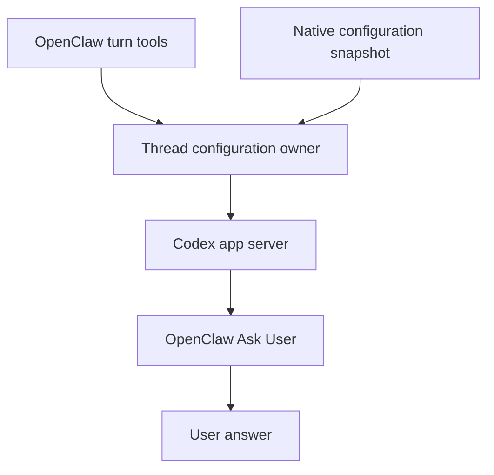

Codex review: needs maintainer review before merge.

## What this changes

Prefer callable OpenClaw Ask User over Codex’s blocking question tool while preserving explicit native opt-ins and restricted-tool policy.

**Example:** A Default-mode conversation with callable ask_user asks the user to choose Reporting or Billing.
- **Before:** Codex can select request_user_input and reject the call as unavailable in Default mode.
- **After:** The native blocking tool is disabled by default, leaving OpenClaw Ask User available for the question.

## Review scores

| Measure | Result | What it means |
|---|---|---|
| **Overall readiness** | 🦐 gold shrimp **(3/6)** | The patch is focused and source-supported, with useful regression coverage; current evidence remains harness-based and exact-head CI is unfinished. |
| **Proof confidence** | 🦐 gold shrimp **(3/6)** | This maintainer-authored PR is outside the ordinary contributor proof gate; current evidence exercises configuration and lifecycle harnesses, while older live-proof reports do not establish this head’s behavior. |
| **Patch quality** | 🐚 platinum hermit **(4/6)** | No actionable review findings were identified. |

## Product

**Kind:** Bug fix · **Worth it:** Yes · **Fix scope:** Complete
**User problem:** A Codex conversation can choose a blocking question tool that rejects the question before the user sees it.
**Reason:** The failure is source-backed, the existing OpenClaw tool supplies the needed capability, and maintainer authorship establishes direction.

## Merge readiness

✅ **Ready for maintainer review**

Keep open: this maintainer-authored PR addresses a current Codex question-tool failure, and source review found no actionable introduced defect.

**Priority:** P2
**Reviewed head:** `48701f966b6f79e92791319914d4606856742b51`

## Before merge

None.

## Findings

None.

### Tests

- Missing end-to-end proof: No current-head shipped-entry-point replay or latest-stable upgrade run is supplied; the body records base-red/head-green proof for the callable-default and supervised-question regressions.

<strong>Agent review details</strong>

### How this fits together

The Codex plugin translates OpenClaw tool availability and native configuration into app-server start, resume, and fork requests; accepted questions then use the existing interactive delivery paths.

### Technical review

Best possible solution:

Keep question selection in the existing thread-configuration owner, using actual executor availability and preserving authored native preferences.

Do we have a high-confidence way to reproduce the issue?

Source establishes the failure: the native blocking tool defaults on, Default-mode support defaults off, and the handler rejects before OpenClaw receives the question; no runtime execution was performed during this review.

Is this the best way to solve the issue?

This is a focused repair: it selects the usable existing tool through one configuration owner, reuses the preflight snapshot and refresh fingerprint, and leaves native opt-ins and restricted policy intact.

AGENTS.md: found and applied where relevant.

Codex review notes: model internal, reasoning medium; reviewed against [16779ec57df8](https://github.com/openclaw/openclaw/commit/16779ec57df82bf752a5cd5b24f96659e442379e).

### Provenance checked

- `Native questions and configuration preferences` changes intended behavior with a stated reason (https://github.com/openclaw/openclaw/pull/109724: Expose accepted native questions through existing structured presentation and request-scoped answer delivery.)
- `Native configuration preservation` keeps the original intent (3f0b58e2696bfe229f96b1403bfd25f65992c584: Preserve local native configuration and established policy across supervised continuation.)
- `Shared effective configuration snapshot` keeps the original intent (82d2c992a25bc38336e1a5d49e1ef15d03798f19: Use canonical native configuration facts for tool-policy and scheduled-capability handling.)

### Testing

Proof path: in-process harness.

### Security

None.

### Evidence

What I checked:

- **Pinned introduced change:** Reviewed the merge-base-to-head hunks and original configuration code; the patch forwards executor availability into the existing configuration owner without adding persisted state. ([`extensions/codex/src/app-server/run-attempt-start.ts:113`](https://github.com/openclaw/openclaw/blob/48701f966b6f79e92791319914d4606856742b51/extensions/codex/src/app-server/run-attempt-start.ts#L113), [48701f966b6f](https://github.com/openclaw/openclaw/commit/48701f966b6f79e92791319914d4606856742b51))
- **Preserved native preferences:** Authored values are resolved from the effective projection or the enabled raw layer matching the winning origin and version, addressing the earlier native-opt-in finding. ([`extensions/codex/src/app-server/config-layer-policy.ts:55`](https://github.com/openclaw/openclaw/blob/48701f966b6f79e92791319914d4606856742b51/extensions/codex/src/app-server/config-layer-policy.ts#L55), [48701f966b6f](https://github.com/openclaw/openclaw/commit/48701f966b6f79e92791319914d4606856742b51))
- **Personally inspected dependency contract:** The patch consumes Codex’s configuration protocol and depends on its tool-registration contract. The inspected sibling source defaults the blocking tool to enabled, gates Default-mode support separately, rejects unavailable modes before emitting a user-input request, and registers async questions independently. GitHub verified the sibling SHA belongs to openai/codex. ([`codex-rs/core/src/tools/handlers/request_user_input.rs:74`](https://github.com/openai/codex/blob/092d3acd6bec3e3a14bdc7e7a2810ab628ab759d/codex-rs/core/src/tools/handlers/request_user_input.rs#L74), [092d3acd6bec](https://github.com/openai/codex/commit/092d3acd6bec3e3a14bdc7e7a2810ab628ab759d))
- **Current main still needs the selection policy:** Fetched main disables native blocking questions for restricted surfaces but lacks this PR’s callable Ask User selection for ordinary conversations. ([`extensions/codex/src/app-server/thread-requests.ts:113`](https://github.com/openclaw/openclaw/blob/16779ec57df82bf752a5cd5b24f96659e442379e/extensions/codex/src/app-server/thread-requests.ts#L113), [16779ec57df8](https://github.com/openclaw/openclaw/commit/16779ec57df82bf752a5cd5b24f96659e442379e))
- **Existing conversation refresh:** The existing fingerprint includes resulting request configuration, and warm reuse falls back to resume when that fingerprint changes; the added lifecycle coverage exercises authored-setting and executor-availability transitions. ([`extensions/codex/src/app-server/thread-lifecycle-warm.ts:516`](https://github.com/openclaw/openclaw/blob/48701f966b6f79e92791319914d4606856742b51/extensions/codex/src/app-server/thread-lifecycle-warm.ts#L516), [48701f966b6f](https://github.com/openclaw/openclaw/commit/48701f966b6f79e92791319914d4606856742b51))
- **Related report and historical intent:** https://github.com/openclaw/openclaw/issues/119333 documents the same Default-mode rejection. Prior native-question work in https://github.com/openclaw/openclaw/pull/109724 and native-configuration preservation in https://github.com/openclaw/openclaw/pull/151001 support retaining accepted native questions and authored preferences.

Likely related people:

- **Peter Steinberger:** Raw commit 82d2c992a25bc38336e1a5d49e1ef15d03798f19 adds extensions/codex/src/app-server/config-layer-policy.ts:25 relative to its recorded parents. This identifies author metadata, not feature responsibility or a PR merger. (role: source-line author; confidence: high; commits: [82d2c992a25b](https://github.com/openclaw/openclaw/commit/82d2c992a25bc38336e1a5d49e1ef15d03798f19); files: `extensions/codex/src/app-server/config-layer-policy.ts`)

### PR surface

Source +76, Tests +219, Docs +10. Total +305 across 13 files. Added test files: 1.

View PR surface stats

| Area | Files | Added | Removed | Net |
|---|---:|---:|---:|---:|
| Source | 6 | 78 | 2 | +76 |
| Tests | 6 | 241 | 22 | +219 |
| Docs | 1 | 10 | 0 | +10 |
| Config | 0 | 0 | 0 | 0 |
| Generated | 0 | 0 | 0 | 0 |
| Other | 0 | 0 | 0 | 0 |
| **Total** | **13** | **329** | **24** | **+305** |

### Review metrics

| Metric | Value | Why it matters |
|---|---|---|
| **Production versus test LOC** | Production +78/-2; tests and test registration +241/-22 | The production growth supplies executor plumbing and native-origin resolution; the tests cover configuration precedence, unavailable executors, supervised continuation, and loaded-thread refresh. |

### Labels

Label changes:

- add `rating: 🦐 gold shrimp`: Overall readiness is 🦐 gold shrimp; proof is 🦐 gold shrimp and patch quality is 🐚 platinum hermit.
- remove `proof: sufficient`: Current real behavior proof status is not_applicable, not sufficient.
- remove `rating: 🦞 diamond lobster`: Current PR rating is `rating: 🦐 gold shrimp`, so this older rating label is no longer current.
- remove `proof: 📸 screenshot`: Current real behavior proof evidence kind is not_applicable.

Label justifications:

- `P2`: A bounded question-tool contract failure can prevent structured questions, while ordinary conversational recovery remains possible.
- `rating: 🦐 gold shrimp`: Overall readiness is 🦐 gold shrimp; proof is 🦐 gold shrimp and patch quality is 🐚 platinum hermit.
- `status: 👀 ready for maintainer look`: ClawSweeper has no concrete contributor-facing blocker left for this PR.

### Rank-up moves

Optional improvements that raise the rating; they are not merge blockers.

- For stronger confidence, replay a Default-mode question in an existing conversation after upgrading from stable, checking both default selection and an authored native opt-in.

### Rating scale

6/6 🦀 challenger crab · 5/6 🦞 diamond lobster · 4/6 🐚 platinum hermit · 3/6 🦐 gold shrimp · 2/6 🦪 silver shellfish · 1/6 🧂 unranked krab. Overall follows the weaker of proof and patch quality; ✨ marks media proof (a screenshot, video, or linked artifact) that directly shows the changed behavior.

### Workflow

ClawSweeper edits this one comment on every review. Comment `@clawsweeper re-review` for a fresh review only. Repair and merge execution lanes are retired.

### History

Review history (10 earlier review cycles; latest 8 shown)

<!-- clawsweeper-review-history v=1 total=10 -->
- reviewed 2026-09-28T10:15:01.313Z sha 884736e48fc0942c824e451bdc2814e423894812 :: blocked before merge. :: none
- reviewed 2026-09-28T10:42:08.219Z sha 884736e48fc0942c824e451bdc2814e423894812 :: blocked before merge. :: [P1] [P1] Preserve native opt-ins from the actual Codex config response
- reviewed 2026-09-28T10:48:03.790Z sha 884736e48fc0942c824e451bdc2814e423894812 :: blocked before merge. :: [P1] Preserve native opt-ins from the actual Codex config response
- reviewed 2026-09-28T12:13:38.970Z sha c70f2d9c4bfbc500c3f8f7c99655e6f88e6be726 :: needs maintainer review before merge. :: none
- reviewed 2026-09-28T12:36:29.607Z sha 63401b87798754082057c0b6611dc3b3b6e51679 :: needs maintainer review before merge. :: none
- reviewed 2026-09-28T22:59:50.114Z sha f0165a42c1258129f0d9b0c7901b4047afe163fe :: needs maintainer review before merge. :: none
- reviewed 2026-09-29T00:01:24.853Z sha 43276169ca3fbf1d3abdbed8187c290f679c774b :: needs maintainer review before merge. :: none
- reviewed 2026-09-29T00:17:37.233Z sha 43276169ca3fbf1d3abdbed8187c290f679c774b :: needs maintainer review before merge. :: none

_Reviewed October 24, 2026, 4:49 AM ET / 08:49 UTC (Revision 11)._

<!-- clawsweeper-verdict:needs-human item=159678 sha=48701f966b6f79e92791319914d4606856742b51 confidence=high updated_at=2026-10-24T08:45:15Z reviewed_at=2026-10-24T08:49:39.875Z lease_owner=github-run-40079211456-1 lease_comment_id=6382140533 source_revision=89882d165b242b62318be2eadc96b7d6d8d4c0d783c6e9643c50df802e53bb17 hold=not_opted_in findings=0 -->
<!-- clawsweeper-review-state:ready item=159678 sha=48701f966b6f79e92791319914d4606856742b51 v=1 -->

<!-- clawsweeper-review-version item=159678 reviewed_at=2026-10-24T08:49:39.875Z sha=48701f966b6f79e92791319914d4606856742b51 source_revision=89882d165b242b62318be2eadc96b7d6d8d4c0d783c6e9643c50df802e53bb17 lease_owner=github-run-40079211456-1 lease_comment_id=6382140533 v=1 -->

<!-- clawsweeper-review item=159678 -->