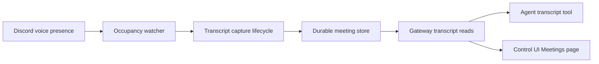

Codex review: blocked before merge. _Reviewed September 2, 2026, 6:45 PM ET / 22:45 UTC._

# ClawSweeper review

## What this changes

This PR adds opt-in Discord voice occupancy capture, model-backed meeting notes, durable transcript reads for agents and Gateway clients, and a Control UI Meetings page.

## Merge readiness

⛔ **Blocked before merge - 8 items remain**

Keep this maintainer-owned feature open: the inventory follow-up does not resolve the prior review’s required product-contract decision or real Discord occupancy/recovery proof.

**Priority:** P2
**Reviewed head:** `1cb879b228d6eeda4bc3acc00dbab3c39485701e`
**Owner decision:** Required. See [Decision needed](#decision-needed).

## Review scores

| Measure | Result | What it means |
|---|---|---|
| **Overall readiness** | 🦐 gold shrimp **(3/6)** | The patch has strong focused source coverage, but product-boundary approval and real Discord behavior evidence remain outstanding. |
| **Proof confidence** | 🦐 gold shrimp **(3/6)** | Not applicable: Real behavior proof is not required for maintainer- or bot-authored pull requests. |
| **Patch quality** | 🐚 platinum hermit **(4/6)** | Security review found an item that needs attention. |

## Verification

| Check | Result | Evidence |
|---|---|---|
| **Real behavior** | Not applicable | Not applicable: Real behavior proof is not required for maintainer- or bot-authored pull requests. |
| **Evidence reviewed** | 8 items | Gateway lifecycle entry: Gateway post-ready startup creates the transcript auto-start service and stops it during shutdown. Occupancy lifecycle owner: The auto-start service owns watcher cleanup, grace timing, bounded retries, reopening, and duplicate account/guild exclusion. Discord provider boundary: Discord owns occupancy observation and applies account, guild, channel, and native voice access checks before capture. |
| **Findings** | None | None. |
| **Security** | Needs attention | Confirm shared trusted-domain note visibility: transcripts.list/get expose durable meeting metadata and notes to operator.read clients; this is an intentional authorization expansion that needs maintainer approval. |

## How this fits together

Discord voice presence feeds an occupancy watcher that starts and stops transcript capture, then stores notes for Gateway and agent readers. The Control UI consumes those Gateway reads to present meeting notes across the trusted Gateway domain.

## Decision needed

| Question | Recommendation |
|---|---|
| Should OpenClaw adopt an opt-in occupancy configuration and public watcher SDK while allowing all operator.read clients in one trusted Gateway domain to read durable meeting notes across agents? | **Approve the documented trusted-domain contract:** Accept the opt-in configuration and shared operator-domain read scope, with real Discord recovery proof before landing. |

Why: This establishes durable configuration, plugin SDK, and transcript-privacy contracts that tests cannot decide.

## Before merge

- [ ] **Resolve security concern: Confirm shared trusted-domain note visibility** - transcripts.list/get expose durable meeting metadata and notes to operator.read clients; this is an intentional authorization expansion that needs maintainer approval.
- [ ] **Resolve merge risk (P1)** - Merging creates a lasting opt-in configuration, public plugin SDK hook, and operator-domain transcript-read contract without the explicit maintainer product decision requested by the prior review.
- [ ] **Resolve merge risk (P1)** - All operator.read clients in one trusted Gateway domain can read durable meeting metadata and notes across agents; that privacy boundary needs intentional acceptance.
- [ ] **Resolve merge risk (P1)** - Attached evidence is simulated/mock coverage; no real human Discord occupancy plus reconnect/restart recovery result is attached.
- [ ] **Complete next step (P2)** - Obtain explicit maintainer approval for the new config/SDK/read-scope contract and attach real Discord human occupancy/recovery proof before merge.
- [ ] **Resolve maintainer decision** - Resolve the maintainer decision shown above before merge.
- [ ] **Review config compatibility** - Confirm compatibility and upgrade impact for the changed config or default surface before merge.
- [ ] **Add data-model compatibility proof** - Confirm migration or upgrade compatibility proof before merge.

## Findings

- [medium] Confirm shared trusted-domain note visibility — `src/gateway/methods/core-descriptors.ts:659`

<strong>Agent review details</strong>

### Security

Needs attention: No concrete implementation exploit was found, but the new shared operator-domain transcript-read surface requires explicit privacy-boundary acceptance.

### PR surface

Source +1838, Tests +1757, Docs +244, Generated 0, Other +133. Total +3972 across 65 files.

View PR surface stats

| Area | Files | Added | Removed | Net |
|---|---:|---:|---:|---:|
| Source | 40 | 2227 | 389 | +1838 |
| Tests | 14 | 1791 | 34 | +1757 |
| Docs | 5 | 258 | 14 | +244 |
| Config | 0 | 0 | 0 | 0 |
| Generated | 2 | 3 | 3 | 0 |
| Other | 4 | 135 | 2 | +133 |
| **Total** | **65** | **4414** | **442** | **+3972** |

### Review metrics

| Metric | Value | Why it matters |
|---|---|---|
| **Production versus test delta** | production +2232/-391; tests +1791/-34; docs/generated/native +391/-17 | The substantial production growth implements a new capability rather than a bug fix and requires product-contract review. |
| **Configuration surface** | 1 added, 0 changed, 0 removed | whenOccupied changes auto-start lifecycle and session-ID behavior when operators opt in. |
| **Public interfaces** | 2 Gateway methods added; 1 plugin SDK occupancy capability added | These establish durable client and plugin contracts beyond the Discord implementation. |

### Stored data model

Persistent data-model change detected: `migration/backfill/repair: extensions/discord/src/doctor.ts`, `serialized state: src/agents/tools/transcripts-auto-start.ts`, `serialized state: src/transcripts/store-sqlite.ts`, `unknown-data-model-change: packages/gateway-protocol/src/schema/transcripts.ts`, `unknown-data-model-change: src/agents/tools/transcripts-auto-start.ts`, `unknown-data-model-change: src/transcripts/store-sqlite.ts`. Confirm migration or upgrade compatibility proof before merge.

### Merge-risk options

**Maintainer options:**
1. **Approve the contract before merge (recommended)**  
   Record maintainer acceptance of the opt-in config, watcher SDK, and trusted-domain note visibility, then obtain real Discord recovery evidence.
2. **Narrow durable-note readers**  
   Redesign transcript reads around a more limited ownership scope if shared operator-domain visibility is not intended.
3. **Pause public API exposure**  
   Defer or split the feature if its permanent configuration and privacy contracts are not ready to support.

### Technical review

Best possible solution:

Record explicit acceptance of the opt-in occupancy, SDK, and trusted-domain read contract, then attach a real human Discord occupancy/restart result before landing.

Do we have a high-confidence way to reproduce the issue?

Not applicable as a feature reproduction: source tests simulate occupancy and restart behavior, but no real human Discord occupancy/recovery result is attached.

Is this the best way to solve the issue?

Acceptable architecture: Discord owns voice-state observation while core owns generic lifecycle and durable reads; maintainer intent is still needed for the public configuration, SDK, and trusted-domain read boundary.

AGENTS.md: found and applied where relevant.

Codex review notes: model internal, reasoning high; reviewed against [e93fc3aee72d](https://github.com/openclaw/openclaw/commit/e93fc3aee72d2ccaafb3b209a4a9fee4e6762112).

### Labels

Label changes:

- add `merge-risk: 🚨 security-boundary`: The new operator.read methods expose durable meeting notes across agents within the trusted Gateway domain.

Label justifications:

- `P2`: This is a meaningful but opt-in feature whose open blockers are product and proof gates, not an active outage.
- `merge-risk: 🚨 compatibility`: The PR adds a config option, public SDK types, and Gateway methods that become upgrade and integration contracts.
- `merge-risk: 🚨 security-boundary`: The new operator.read methods expose durable meeting notes across agents within the trusted Gateway domain.
- `rating: 🦐 gold shrimp`: Overall readiness is 🦐 gold shrimp; proof is 🦐 gold shrimp and patch quality is 🐚 platinum hermit.
- `status: 👀 ready for maintainer look`: ClawSweeper has no concrete contributor-facing blocker left for this PR. Not applicable: Real behavior proof is not required for maintainer- or bot-authored pull requests.

### Evidence

Security concerns:

- [medium] Confirm shared trusted-domain note visibility — `src/gateway/methods/core-descriptors.ts:659`
  transcripts.list/get expose durable meeting metadata and notes to operator.read clients; this is an intentional authorization expansion that needs maintainer approval.
  Confidence: 0.93

What I checked:

- **Gateway lifecycle entry:** Gateway post-ready startup creates the transcript auto-start service and stops it during shutdown. ([`src/gateway/server-startup-post-attach.ts:366`](https://github.com/openclaw/openclaw/blob/1cb879b228d6eeda4bc3acc00dbab3c39485701e/src/gateway/server-startup-post-attach.ts#L366), [1cb879b228d6](https://github.com/openclaw/openclaw/commit/1cb879b228d6eeda4bc3acc00dbab3c39485701e))
- **Occupancy lifecycle owner:** The auto-start service owns watcher cleanup, grace timing, bounded retries, reopening, and duplicate account/guild exclusion. ([`src/agents/tools/transcripts-auto-start.ts:180`](https://github.com/openclaw/openclaw/blob/1cb879b228d6eeda4bc3acc00dbab3c39485701e/src/agents/tools/transcripts-auto-start.ts#L180), [1cb879b228d6](https://github.com/openclaw/openclaw/commit/1cb879b228d6eeda4bc3acc00dbab3c39485701e))
- **Discord provider boundary:** Discord owns occupancy observation and applies account, guild, channel, and native voice access checks before capture. ([`extensions/discord/src/voice/transcripts-source.ts:165`](https://github.com/openclaw/openclaw/blob/1cb879b228d6eeda4bc3acc00dbab3c39485701e/extensions/discord/src/voice/transcripts-source.ts#L165), [1cb879b228d6](https://github.com/openclaw/openclaw/commit/1cb879b228d6eeda4bc3acc00dbab3c39485701e))
- **Trusted-domain read scope:** The new transcript list/get methods are explicitly available to operator.read clients in the shared trusted Gateway domain. ([`src/gateway/methods/core-descriptors.ts:659`](https://github.com/openclaw/openclaw/blob/1cb879b228d6eeda4bc3acc00dbab3c39485701e/src/gateway/methods/core-descriptors.ts#L659), [1cb879b228d6](https://github.com/openclaw/openclaw/commit/1cb879b228d6eeda4bc3acc00dbab3c39485701e))
- **Read handler and data bounds:** The Gateway handler reads durable sessions and only returns utterances when requested, with terminal-text sanitization and a configured utterance bound. ([`src/gateway/server-methods/transcripts.ts:49`](https://github.com/openclaw/openclaw/blob/1cb879b228d6eeda4bc3acc00dbab3c39485701e/src/gateway/server-methods/transcripts.ts#L49), [1cb879b228d6](https://github.com/openclaw/openclaw/commit/1cb879b228d6eeda4bc3acc00dbab3c39485701e))
- **Lifecycle regression coverage:** Focused occupancy tests cover grace-period continuation, stopped-session reopening, stale callbacks, and final summary persistence. ([`src/agents/tools/transcripts-tool.occupancy.test.ts:215`](https://github.com/openclaw/openclaw/blob/1cb879b228d6eeda4bc3acc00dbab3c39485701e/src/agents/tools/transcripts-tool.occupancy.test.ts#L215), [1cb879b228d6](https://github.com/openclaw/openclaw/commit/1cb879b228d6eeda4bc3acc00dbab3c39485701e))

Likely related people:

- **unknown:** Suggested for follow-up; no historical authorship or introduction is verified. (role: unverified routing candidate; confidence: low)

### Rank-up moves

Optional improvements that raise the rating; they are not merge blockers.

- Obtain the explicit product-contract decision.
- Attach a real human occupancy and recovery result from an enabled Discord meeting.

### Rating scale

| Score | Internal tier | Crab rank | Meaning |
|---:|:---:|---|---|
| **6/6** | S | 🦀 challenger crab | Exceptional readiness |
| **5/6** | A | 🦞 diamond lobster | Very strong readiness |
| **4/6** | B | 🐚 platinum hermit | Good normal PR; ordinary maintainer review |
| **3/6** | C | 🦐 gold shrimp | Useful, but confidence is limited |
| **2/6** | D | 🦪 silver shellfish | Proof or implementation needs work |
| **1/6** | F | 🧂 unranked krab | Not merge-ready |
| N/A | NA | 🌊 off-meta tidepool | Rating does not apply |

Overall follows the weaker of proof and patch quality.
Shiny media proof means a screenshot, video, or linked artifact directly shows the changed behavior. Runtime, network, CSP, and security claims still need visible diagnostics.

### Workflow

- ClawSweeper keeps one durable marker-backed review comment per issue or PR.
- Re-runs edit this comment so the latest verdict, findings, and automation markers stay together instead of adding duplicate bot comments.
- A fresh review can be triggered by eligible `@clawsweeper re-review` comments, exact-item GitHub events, scheduled/background review runs, or manual workflow dispatch.
- PR/issue authors and users with repository write access can comment `@clawsweeper re-review` or `@clawsweeper re-run` on an open PR or issue to request a fresh review only.
- Maintainers can also comment `@clawsweeper review` to request a fresh review only.
- Fresh-review commands do not start repair, autofix, rebase, CI repair, or automerge.
- Maintainer-only repair and merge flows require explicit commands such as `@clawsweeper autofix`, `@clawsweeper automerge`, `@clawsweeper fix ci`, or `@clawsweeper address review`.
- Maintainers can comment `@clawsweeper explain` to ask for more context, or `@clawsweeper stop` to stop active automation.

### History

Review history (1 earlier review cycle)

<!-- clawsweeper-review-history v=1 total=1 -->
- reviewed 2026-09-02T22:32:38.125Z sha f487ea27fac1a2d7b7a47d2f381aa6831f4b4aa5 :: blocked before merge. :: none

<!-- clawsweeper-security:security-sensitive item=136679 sha=1cb879b228d6eeda4bc3acc00dbab3c39485701e confidence=high updated_at=2026-09-02T22:41:20Z reviewed_at=2026-09-02T22:45:43.515Z lease_owner=github-run-33691456397-1 lease_comment_id=5517440833 source_revision=94ac65386b737347cefa606365d0a8463e41e596eb9c9e94779faf5d31d398ca live_verification=absent -->
<!-- clawsweeper-verdict:needs-human item=136679 sha=1cb879b228d6eeda4bc3acc00dbab3c39485701e confidence=high updated_at=2026-09-02T22:41:20Z reviewed_at=2026-09-02T22:45:43.515Z lease_owner=github-run-33691456397-1 lease_comment_id=5517440833 source_revision=94ac65386b737347cefa606365d0a8463e41e596eb9c9e94779faf5d31d398ca live_verification=absent -->
<!-- clawsweeper-review-state:blocked item=136679 sha=1cb879b228d6eeda4bc3acc00dbab3c39485701e v=1 -->

<!-- clawsweeper-review-version item=136679 reviewed_at=2026-09-02T22:45:43.515Z sha=1cb879b228d6eeda4bc3acc00dbab3c39485701e source_revision=94ac65386b737347cefa606365d0a8463e41e596eb9c9e94779faf5d31d398ca lease_owner=github-run-33691456397-1 lease_comment_id=5517440833 v=1 -->

<!-- clawsweeper-review item=136679 -->