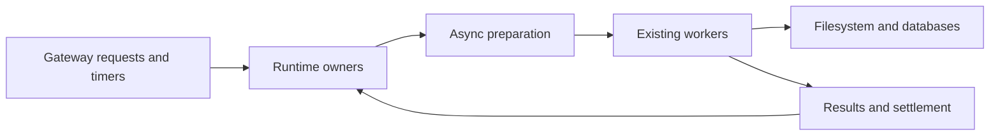

Codex review: needs maintainer review before merge.

## What this changes

Moves Gateway filesystem preparation and recurring inspections into asynchronous operations and existing workers while preserving ordering and cleanup ownership.

**Example:** The reported Linux/btrfs workload used a 35 GiB agent database, about 5,000 sessions, and 62,000 workspace files.
- **Before:** The measured baseline performed 39,322 selected main-thread filesystem syscalls per minute.
- **After:** Candidate source 097dad72 performed 62; this measurement is explicitly pinned to that earlier source.

## Review scores

| Measure | Result | What it means |
|---|---|---|
| **Overall readiness** | 🐚 platinum hermit **(4/6)** | Useful, supported by shipped-entry-point and upgrade evidence, with no new actionable finding in the inspected scope; exact-head CI remains pending. |
| **Proof confidence** | 🐚 platinum hermit **(4/6)** | Sufficient (live_output): Supplied evidence exercises packaged Gateway filesystem behavior on 097dad72 and fresh/stable-upgrade/startup flows on 4b4f6e81, with later changed-owner qualifications; the reviewed successor changes only a browser test and does not relabel those earlier executions. |
| **Patch quality** | 🐚 platinum hermit **(4/6)** | No actionable review findings were identified. |

## Product

**Kind:** Performance · **Worth it:** Yes · **Fix scope:** Complete
**User problem:** Slow host filesystem operations can pause unrelated Gateway requests and timers.
**Reason:** The measured reduction addresses the stated responsiveness problem, and the maintainer-authored PR explicitly records the adverse resource costs and remaining coverage limits.

## Merge readiness

✅ **Ready for maintainer review**

Keep open: this PR addresses a concrete Gateway responsiveness problem that remains on main. The inspected repairs and test-only successor introduce no identified blocker; current-head CI is still running.

**Priority:** P2
**Reviewed head:** `d22df936d67764d6ec6cb1e1c6c015651f8d853f`

## Before merge

None.

## Findings

None.

<strong>Agent review details</strong>

### How this fits together

Gateway requests and timers prepare session, workspace, credential, and process facts; existing workers perform necessary I/O and return results to the owning runtime.

### Technical review

Best possible solution:

Keep necessary filesystem work with existing asynchronous owners while retaining physical identity, FIFO ordering, and accepted-work settlement.

Do we have a high-confidence way to reproduce the issue?

Fetched main contains synchronous filesystem operations in affected Gateway paths, and the supplied packaged workload quantifies their removal on its pinned candidate; no target code was executed during this review.

Is this the best way to solve the issue?

The inspected changes follow the existing-owner approach: remove redundant work, carry prepared facts, and move required I/O while preserving native authority and settlement contracts.

AGENTS.md: found and applied where relevant.

Codex review notes: model internal, reasoning medium; reviewed against [81ca4f4d712a](https://github.com/openclaw/openclaw/commit/81ca4f4d712a67c012c7dc0311e0fa37ac576490).

### Provenance checked

- `SQLite admission and committed publication` keeps the original intent (da67a08b20eb3c16445c7d4cc469f96751736cf9: Keep committed facts recoverable and avoid replaying acknowledged mutations when publication fails, as documented in https://github.com/openclaw/openclaw/pull/167570.)
- `Session discovery reuse` changes intended behavior with a stated reason (f0c671ec92a5370b43e610c8501681202e34805c: Reuse immutable discovery results while preserving physical replacement, registry invalidation, and scoped authority checks.)
- `Adopted-process identity uncertainty` keeps the original intent (36b62fc7d262e5e7b90221b59fad6d4933048aa1: Keep live commands tracked when identity inspection fails and refuse unverified destructive signaling.)

### Testing

Proof path: shipped entry point.

### Security

None.

### Evidence

What I checked:

- **Exact successor is test-only:** The difference from the previous reviewed head changes only the typed character and matching redo expectation; draft replacement, focus, composition, and history assertions remain. ([`ui/src/pages/new-session/composer-editor.browser.test.ts:25`](https://github.com/openclaw/openclaw/blob/d22df936d67764d6ec6cb1e1c6c015651f8d853f/ui/src/pages/new-session/composer-editor.browser.test.ts#L25), [d22df936d677](https://github.com/openclaw/openclaw/commit/d22df936d67764d6ec6cb1e1c6c015651f8d853f))
- **Current main retains the affected synchronous path:** Cold agent writer admission on fetched main still reads physical identity synchronously; the PR separates asynchronous discovery from writer reservation. ([`src/state/openclaw-agent-write-admission.ts`](https://github.com/openclaw/openclaw/blob/81ca4f4d712a67c012c7dc0311e0fa37ac576490/src/state/openclaw-agent-write-admission.ts), [81ca4f4d712a](https://github.com/openclaw/openclaw/commit/81ca4f4d712a67c012c7dc0311e0fa37ac576490))
- **Prior allowlist finding is resolved:** The provider identity distinguishes open allowlists from restrictive exclusions, and the held-rebuild regression checks immediate removal and restoration. ([`src/gateway/server-methods/chat-metadata-model-list.ts:81`](https://github.com/openclaw/openclaw/blob/d22df936d67764d6ec6cb1e1c6c015651f8d853f/src/gateway/server-methods/chat-metadata-model-list.ts#L81), [d22df936d677](https://github.com/openclaw/openclaw/commit/d22df936d67764d6ec6cb1e1c6c015651f8d853f))
- **Runtime and compatibility evidence:** The body and discussion distinguish packaged Gateway measurements on 097dad72 from fresh-install, latest-stable upgrade, and historical Projects startup proof on 4b4f6e81, with preservation assertions and later source bridges; https://github.com/openclaw/openclaw/pull/197510#issuecomment-6891562433 records the upgrade results. ([`scripts/e2e/lib/upgrade-survivor/project-worktree-startup.mjs`](https://github.com/openclaw/openclaw/blob/d22df936d67764d6ec6cb1e1c6c015651f8d853f/scripts/e2e/lib/upgrade-survivor/project-worktree-startup.mjs), [d22df936d677](https://github.com/openclaw/openclaw/commit/d22df936d67764d6ec6cb1e1c6c015651f8d853f))
- **Owner-recorded performance tradeoffs:** The maintainer-authored body explicitly retains increased CPU, allocation, bootstrap latency, and cleanup costs in exchange for reducing main-thread filesystem exposure; it makes no final-tree performance-equivalence claim. ([d22df936d677](https://github.com/openclaw/openclaw/commit/d22df936d67764d6ec6cb1e1c6c015651f8d853f))
- **Actual dependency protocol inspected:** The changed Codex adapter implements the dependency's process/write protocol; direct sibling-source inspection confirms base64 stdin writes and the pipeStdin requirement. ([`codex-rs/exec-server/README.md:337`](https://github.com/openai/codex/blob/6aaac694803004a63c6f393d153c96d22521a6b9/codex-rs/exec-server/README.md#L337), [6aaac6948030](https://github.com/openai/codex/commit/6aaac694803004a63c6f393d153c96d22521a6b9))

### PR surface

PR surface statistics unavailable: the file list is incomplete.

### Preflight source

Source unknown. Source comparison at the observed PR snapshot only. Completion is self-reported; body, policy, tests, execution, and report bytes are not verified.

### Labels

Label changes:

- add `status: 👀 ready for maintainer look`: ClawSweeper has no concrete contributor-facing blocker left for this PR.

Label justifications:

- `P2`: Reduces Gateway-wide exposure to filesystem stalls without evidence requiring emergency prioritization.
- `merge-risk: 🚨 compatibility`: The plugin-visible sandbox execution contract gains optional asynchronous preparation; the owner-authored documentation and bundled consumers describe and implement the additive contract.
- `rating: 🐚 platinum hermit`: Overall readiness is 🐚 platinum hermit; proof is 🐚 platinum hermit and patch quality is 🐚 platinum hermit.
- `status: 👀 ready for maintainer look`: ClawSweeper has no concrete contributor-facing blocker left for this PR.
- `proof: sufficient`: Contributor real behavior proof is sufficient.

### Rating scale

6/6 🦀 challenger crab · 5/6 🦞 diamond lobster · 4/6 🐚 platinum hermit · 3/6 🦐 gold shrimp · 2/6 🦪 silver shellfish · 1/6 🧂 unranked krab. Overall follows the weaker of proof and patch quality; ✨ marks media proof (a screenshot, video, or linked artifact) that directly shows the changed behavior.

### Workflow

ClawSweeper edits this one comment on every review. Comment `@clawsweeper re-review` for a fresh review only. Repair and merge execution lanes are retired.

### History

Review history (11 earlier review cycles; latest 8 shown)

<!-- clawsweeper-review-history v=1 total=11 -->
- reviewed 2026-11-12T12:57:40.364Z sha 2935560c6ce640cc79a0fcab5373bd3f9c697c17 :: needs maintainer review before merge. :: none
- reviewed 2026-11-12T13:47:08.224Z sha 6a551d078012450f54036f930350ceb629ad8991 :: needs maintainer review before merge. :: none
- reviewed 2026-11-12T14:34:40.622Z sha f9680e4c75d4e9096f8afc14f6989f7a1e41bbbf :: blocked before merge. :: none
- reviewed 2026-11-15T08:23:20.137Z sha 1373b512c1259086f815c0679ea12ce6fa31dd3f :: blocked before merge. :: none
- reviewed 2026-11-15T08:49:50.596Z sha 1373b512c1259086f815c0679ea12ce6fa31dd3f :: needs maintainer review before merge. :: none
- reviewed 2026-11-15T10:05:26.272Z sha f7ed312d3b0191311d88cfa44ac85ddd3f9b7e32 :: needs changes before merge. :: [P1] [P1] Preserve open-versus-restricted plugin allowlist semantics
- reviewed 2026-11-15T10:51:45.876Z sha 78f010a9c11e08795c4d5457e488d36b57da412c :: needs maintainer review before merge. :: none
- reviewed 2026-11-15T12:07:43.366Z sha bbf4643d968cd5dc005da8647e9b222ff4e2147e :: blocked before merge. :: none

_Reviewed November 15, 2026, 8:01 AM ET / 13:01 UTC (Revision 12)._

<!-- clawsweeper-verdict:needs-human item=197510 sha=d22df936d67764d6ec6cb1e1c6c015651f8d853f confidence=high updated_at=2026-11-15T12:54:08Z reviewed_at=2026-11-15T13:01:08.882Z lease_owner=github-run-43716140388-1 lease_comment_id=6894611578 source_revision=e7e4a1d9e22a74b0dd42de21dc9f01caeb49134faee36aa171f11ccf5a0c1345 hold=not_opted_in findings=0 -->
<!-- clawsweeper-review-state:ready item=197510 sha=d22df936d67764d6ec6cb1e1c6c015651f8d853f v=1 -->

<!-- clawsweeper-review-version item=197510 reviewed_at=2026-11-15T13:01:08.882Z sha=d22df936d67764d6ec6cb1e1c6c015651f8d853f source_revision=e7e4a1d9e22a74b0dd42de21dc9f01caeb49134faee36aa171f11ccf5a0c1345 lease_owner=github-run-43716140388-1 lease_comment_id=6894611578 v=1 -->

<!-- clawsweeper-review item=197510 -->