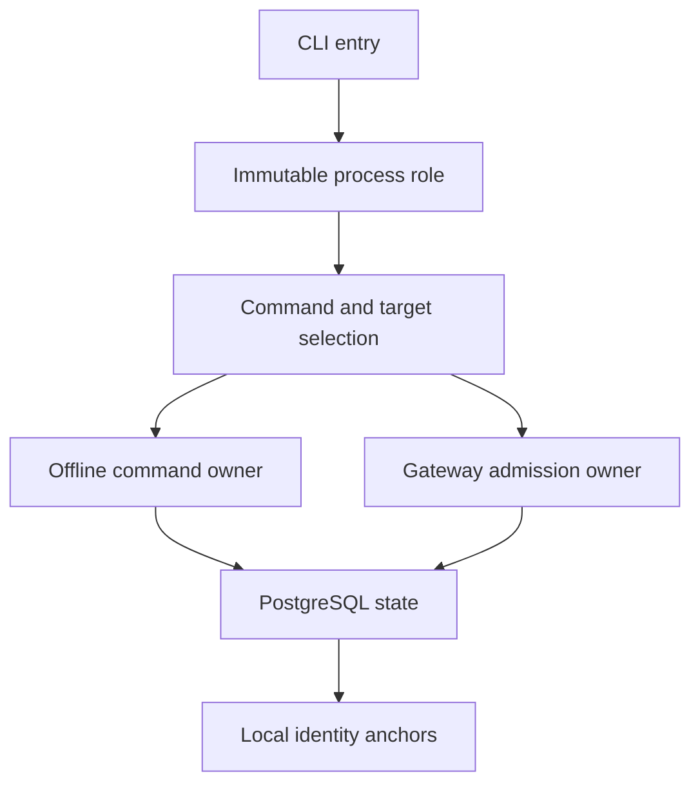

Codex review: blocked before merge.

## What this changes

This PR enables PostgreSQL-backed CLI and Doctor operations while retaining Gateway execution restrictions and recovery ownership.

**Example:** Run `openclaw models status --json` with PostgreSQL configured.
- **Before:** Credential inspection can encounter the Gateway main-thread guard or read the local SQLite anchor.
- **After:** The CLI selects PostgreSQL before inspection and uses the appropriate credential readers.

## Review scores

| Measure | Result | What it means |
|---|---|---|
| **Overall readiness** | 🦪 silver shellfish **(2/6)** | Useful CLI boundary evidence supports the approach, but the verified startup defect and unresolved upgrade compatibility prevent readiness. |
| **Proof confidence** | 🦐 gold shrimp **(3/6)** | Real behavior proof is not required for maintainer- or bot-authored pull requests. |
| **Patch quality** | 🦪 silver shellfish **(2/6)** | 1 actionable review finding remain. |

## Product

**Kind:** Bug fix · **Worth it:** Yes · **Fix scope:** Complete
**User problem:** PostgreSQL users cannot reliably run offline CLI and Doctor commands without execution refusals or incorrect SQLite state access.
**Reason:** The maintainer-authored direction restores documented database ownership without adding public configuration or schemas.

## Merge readiness

⛔ **Blocked before merge - 2 items remain**

This maintainer-authored PR addresses a real PostgreSQL CLI failure, but a focused interactive-startup correction remains necessary.

**Priority:** P1
**Reviewed head:** `29a60c022ca97ab3774d83b96c83d55cbb825de3`

## Before merge

- [ ] **Select configured storage before interactive setup reads state (P1)** - Interactive `onboard`, `setup --wizard` and `crestodian` receive the Gateway process role, so this branch maps them to the Gateway exclusion and returns without selecting storage. These routes have no equivalent final-target admission before their initial state reads: setup skips config preflight, while onboard uses its non-Gateway branch. Configuration/plugin inspection and the wizard's auth readers therefore use the default SQLite path against a PostgreSQL installation, potentially refusing the anchor or hiding persisted credentials. Prepare the configured engine before that work while retaining the Gateway role. This corroborates the existing Codex discussion. It is a late finding: the relevant classification and callers were unchanged at the previous reviewed head and should have been caught then.
- [ ] **Add data-model compatibility proof** - The review found that existing stored data may not work after upgrade. Show that existing data still loads and works with this change.

## Findings

- [P1] Select configured storage before interactive setup reads state — `src/cli/database-engine-selection.ts:105-107`

### Tests

- Missing end-to-end proof: The recorded matrix excludes interactive PostgreSQL setup, and no latest-stable upgrade run demonstrates preserved settings, credentials and session data.

<strong>Agent review details</strong>

### How this fits together

CLI startup resolves the command, configuration and storage target before dispatching to command owners; those owners read or mutate PostgreSQL state while local files retain identity anchors.

### Technical review

Best possible solution:

Prepare configured storage before interactive setup reads state, while preserving the Gateway process role and existing admission boundaries.

Do we have a high-confidence way to reproduce the issue?

Source tracing establishes the interactive selection failure; no target code or tests were executed during this read-only review.

Is this the best way to solve the issue?

Central selection and existing async readers fit the problem, but process-role classification must not imply that every Gateway-capable command already has a storage admission owner.

Full review comments:

- [P1] Select configured storage before interactive setup reads state — `src/cli/database-engine-selection.ts:105-107`
  Interactive `onboard`, `setup --wizard` and `crestodian` receive the Gateway process role, so this branch maps them to the Gateway exclusion and returns without selecting storage. These routes have no equivalent final-target admission before their initial state reads: setup skips config preflight, while onboard uses its non-Gateway branch. Configuration/plugin inspection and the wizard's auth readers therefore use the default SQLite path against a PostgreSQL installation, potentially refusing the anchor or hiding persisted credentials. Prepare the configured engine before that work while retaining the Gateway role. This corroborates the existing Codex discussion. It is a late finding: the relevant classification and callers were unchanged at the previous reviewed head and should have been caught then.
  Confidence: 0.97
  Late finding: first raised on code an earlier review cycle already covered.

Overall correctness: patch is incorrect
Overall confidence: 0.95

AGENTS.md: found and applied where relevant.

Codex review notes: model internal, reasoning medium; reviewed against [44b49b3cac2e](https://github.com/openclaw/openclaw/commit/44b49b3cac2eafb2a866054715a46f8bafe2e9be).

### Provenance checked

- `PostgreSQL main-thread execution guard` changes intended behavior with a stated reason (0820bdd9dcd6f5fa6d0f9c993d260856ba8e6802: Engine prerequisites replaced an admission exemption that could outlive boot with lexical admission and request-time enforcement.)
- `Offline config mutation custody` keeps the original intent (2bf99df55c7e9b148fe5296255882baa1f4a65df: Command-edge ownership prevents ancillary CLI writes from bypassing the running Gateway; this PR retains custody for database-only repair.)
- `Shared-state read lifecycle` keeps the original intent (997e2bfbb241221ac5f4720f554ee95c5b601f80: The async read owner joins transport, native cleanup and retained snapshots; PostgreSQL snapshot retention is integrated into that owner.)

### Testing

Proof path: shipped entry point.

### Security

None.

### Evidence

Acceptance criteria:

- pnpm test src/cli/database-engine-selection.test.ts src/cli/database-process-role.test.ts src/cli/program/register.setup.test.ts --maxWorkers=1
- pnpm test src/infra/database-engine/admission-scope.test.ts --maxWorkers=1
- pnpm openclaw onboard --classic
- pnpm openclaw setup --wizard

What I checked:

- **Previous findings corrected:** The final commit replaces individual updater exclusions with `update *` and makes engine-selection reads retain the supplied environment by default; targeted regression coverage accompanies both corrections. ([`src/commands/config-preflight-snapshot.ts:189`](https://github.com/openclaw/openclaw/blob/29a60c022ca97ab3774d83b96c83d55cbb825de3/src/commands/config-preflight-snapshot.ts#L189), [29a60c022ca9](https://github.com/openclaw/openclaw/commit/29a60c022ca97ab3774d83b96c83d55cbb825de3))
- **Interactive selection gap verified:** Gateway-capable onboarding commands are collapsed into the Gateway exclusion. Setup skips config preflight, and onboard's non-Gateway preflight reads configuration without selecting storage. The wizard subsequently reaches state-backed configuration and credential readers. ([`src/cli/database-engine-selection.ts:105`](https://github.com/openclaw/openclaw/blob/29a60c022ca97ab3774d83b96c83d55cbb825de3/src/cli/database-engine-selection.ts#L105), [29a60c022ca9](https://github.com/openclaw/openclaw/commit/29a60c022ca97ab3774d83b96c83d55cbb825de3))
- **Existing discussion corroborated:** The concern in https://github.com/openclaw/openclaw/pull/175069#discussion_r4302979257 is supported by the wizard path through `runSetupModelAuthStep`, `warnIfModelConfigLooksOff` and `ensureAuthProfileStoreAsync`; auth-row preparation determines its engine from the installed selection. ([`src/agents/auth-profiles/sqlite-read.ts:88`](https://github.com/openclaw/openclaw/blob/29a60c022ca97ab3774d83b96c83d55cbb825de3/src/agents/auth-profiles/sqlite-read.ts#L88), [29a60c022ca9](https://github.com/openclaw/openclaw/commit/29a60c022ca97ab3774d83b96c83d55cbb825de3))
- **Late finding comparison:** Comparison with the previous reviewed head shows the onboarding classification and affected wizard paths unchanged; blame places the exclusion logic in an earlier PR commit. ([`src/cli/database-engine-selection.ts:105`](https://github.com/openclaw/openclaw/blob/29a60c022ca97ab3774d83b96c83d55cbb825de3/src/cli/database-engine-selection.ts#L105), [29a60c022ca9](https://github.com/openclaw/openclaw/commit/29a60c022ca97ab3774d83b96c83d55cbb825de3))
- **Current-main guard and feature history:** Current main retains the unconditional main-thread PostgreSQL restriction outside admission. History traces that guard to the engine-prerequisite work in https://github.com/openclaw/openclaw/pull/170266 and subsequent PostgreSQL ownership work to Peter Steinberger. ([`src/infra/database-engine/admission-scope.ts:22`](https://github.com/openclaw/openclaw/blob/44b49b3cac2eafb2a866054715a46f8bafe2e9be/src/infra/database-engine/admission-scope.ts#L22), [44b49b3cac2e](https://github.com/openclaw/openclaw/commit/44b49b3cac2eafb2a866054715a46f8bafe2e9be))
- **Recorded CLI evidence and compatibility limit:** The complete PR body records a final-head 14/14 PostgreSQL/SQLite CLI matrix with credential, config, agent and anchor checks, and explicitly states that the v2026.10.4 upgrade run remains unperformed. ([29a60c022ca9](https://github.com/openclaw/openclaw/commit/29a60c022ca97ab3774d83b96c83d55cbb825de3))

### PR surface

PR surface statistics unavailable: the file list is incomplete.

### Labels

Label changes:

No label changes.

Label justifications:

- `P1`: The affected PostgreSQL startup path can block setup or conceal existing credentials.
- `merge-risk: 🚨 compatibility`: Existing PostgreSQL installations can enter interactive setup without their configured engine selected.
- `rating: 🦪 silver shellfish`: Overall readiness is 🦪 silver shellfish; proof is 🦐 gold shrimp and patch quality is 🦪 silver shellfish.
- `status: ⏳ waiting on author`: ClawSweeper has contributor-facing work open and is waiting for author action.

### Rating scale

6/6 🦀 challenger crab · 5/6 🦞 diamond lobster · 4/6 🐚 platinum hermit · 3/6 🦐 gold shrimp · 2/6 🦪 silver shellfish · 1/6 🧂 unranked krab. Overall follows the weaker of proof and patch quality; ✨ marks media proof (a screenshot, video, or linked artifact) that directly shows the changed behavior.

### Workflow

ClawSweeper edits this one comment on every review. Comment `@clawsweeper re-review` for a fresh review only. Repair and merge execution lanes are retired.

### History

Review history (6 earlier review cycles)

<!-- clawsweeper-review-history v=1 total=6 -->
- reviewed 2026-10-17T04:29:42.788Z sha b1859bc9a2275aec429f2d5705edff9a0006862c :: blocked before merge. :: [P2] Preserve the Gateway role when onboarding options take values
- reviewed 2026-10-17T09:53:00.287Z sha 6b4587d121f00d54334ff70e4ce130754e9429ea :: blocked before merge. :: [P1] Defer engine selection to maintenance command owners | [P1] Acquire config custody before early Doctor prefix recovery | [P2] Preserve the failing Doctor lint result for unresolved config
- reviewed 2026-10-17T10:40:02.676Z sha 78595953c628147e9ab6aa0c0638acfd65753ef4 :: blocked before merge. :: [P2] Defer database selection for non-local agent turns | [P2] Allow service shutdown without PostgreSQL credentials
- reviewed 2026-10-17T11:47:44.770Z sha d47d1d5c065445a105e31f1ef42524bb9e6dd146 :: blocked before merge. :: [P1] Prepare storage for direct remote-agent Gateway calls | [P2] Leave installed-service restart admission with its lifecycle owner | [P2] Follow config redirects before installing the engine | [P2] Retain one PostgreSQL snapshot throughout the callback
- reviewed 2026-10-17T13:19:30.584Z sha 30b2254dc6dbf8acbd7929762b3374138e00ebfb :: blocked before merge. :: [P2] Defer bare-root storage selection until local state is needed
- reviewed 2026-10-17T13:57:11.957Z sha 351ebf33586e59f2bf0d3216afc2c8e06d43f41a :: blocked before merge. :: [P1] Leave every updater recovery subcommand with its target owner | [P1] Carry the redirected target into full Gateway admission

_Reviewed October 17, 2026, 10:23 AM ET / 14:23 UTC (Revision 7)._

<!-- clawsweeper-verdict:needs-human item=175069 sha=29a60c022ca97ab3774d83b96c83d55cbb825de3 confidence=high updated_at=2026-10-17T14:17:49Z reviewed_at=2026-10-17T14:23:33.467Z lease_owner=github-run-39040098677-1 lease_comment_id=6234974554 source_revision=adfa52c79418305af3aaec851c4cbff31d651db89fb034c7b05f4ee5c1164087 hold=blocked findings=1 -->
<!-- clawsweeper-review-state:blocked item=175069 sha=29a60c022ca97ab3774d83b96c83d55cbb825de3 v=1 -->

<!-- clawsweeper-review-version item=175069 reviewed_at=2026-10-17T14:23:33.467Z sha=29a60c022ca97ab3774d83b96c83d55cbb825de3 source_revision=adfa52c79418305af3aaec851c4cbff31d651db89fb034c7b05f4ee5c1164087 lease_owner=github-run-39040098677-1 lease_comment_id=6234974554 v=1 -->

<!-- clawsweeper-review item=175069 -->