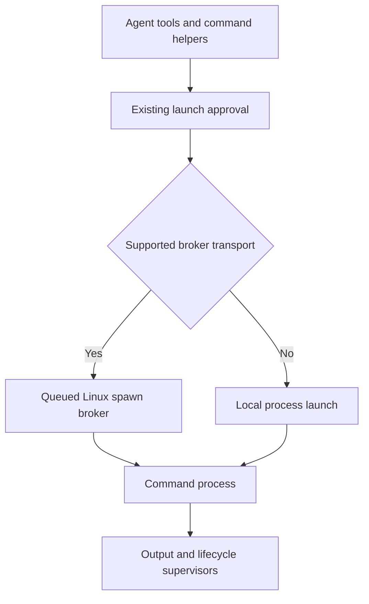

Codex review: needs real behavior proof before merge. _Reviewed September 17, 2026, 2:30 AM ET / 06:30 UTC (Revision 5)._

# ClawSweeper review

## What this changes

Moves Linux Gateway command spawning into a lightweight helper process and adapts output, cancellation, cleanup, startup fallback, and packaging to the asynchronous transport.

## Regression provenance

Possible regression — suspected (reviewed change). No predecessor PR is attributed.

## Merge readiness

⛔ **Blocked before merge - 7 items remain**

Keep open: the optimization remains absent from inspected main, and both previously reported correctness blockers remain in this head. The latest relay extraction does not resolve them.

**Priority:** P1
**Reviewed head:** `fcff141146f88b02b6c6fb74f349f6804dfb562d`

## Review scores

| Measure | Result | What it means |
|---|---|---|
| **Overall readiness** | 🦐 gold shrimp **(3/6)** | Substantial transport coverage supports useful work, but repeated correctness findings and missing approval-boundary proof prevent merge readiness. |
| **Proof confidence** | 🦐 gold shrimp **(3/6)** | Needs stronger real behavior proof before merge: Authority-chain proof required: the captured Linux parenting and broker-loss observations support the transport, but do not show allowed execution alongside rejection of approval revoked during queued native launch before its first effect. This scoped requirement applies despite the maintainer-author exemption. Add a redacted real-path terminal trace or logs, then update the PR body for automatic re-review; if needed, ask a maintainer for `@clawsweeper re-review`. |
| **Patch quality** | 🦐 gold shrimp **(3/6)** | Security review found an item that needs attention. |

## Verification

| Check | Result | Evidence |
|---|---|---|
| **Real behavior** | Needs proof | Needs stronger real behavior proof before merge: Authority-chain proof required: the captured Linux parenting and broker-loss observations support the transport, but do not show allowed execution alongside rejection of approval revoked during queued native launch before its first effect. This scoped requirement applies despite the maintainer-author exemption. Add a redacted real-path terminal trace or logs, then update the PR body for automatic re-review; if needed, ask a maintainer for `@clawsweeper re-review`. |
| **Evidence reviewed** | 10 items | Current main still launches locally: Pinned GitHub contents show that main's spawnWithFallback defaults to native spawn and Gateway startup directly loads its runtime; its process tree contains no spawn-broker directory. No merged replacement was established. Latest release boundary: The GitHub tree for src/process in the supplied latest release, v2026.9.4, contains no spawn-broker directory. Queued launch loses the approval guard: The direct child adapter calls assertCurrent and beforeSpawn before spawnWithFallback. The new transport queues argv/options, but the worker's pre-spawn assertion checks only broker shutdown and IPC connectivity; it cannot revalidate the caller's approval after queuing. |
| **Findings** | 2 actionable findings | [P1] [P1] Preserve live authorization across queued native launches [P2] [P2] Reject failed grep launches before attaching terminal listeners |
| **Security** | Needs attention | Queued command authority survives policy revocation: The new asynchronous native transport retains an approved command without retaining a current-policy guard at its final spawn, allowing execution after approval changes during queuing. |

## How this fits together

The Gateway launches commands for agent tools and internal helpers. The new broker creates those child processes while existing supervisors collect output and manage their lifetimes.

## Before merge

- [ ] **Add real behavior proof** - Needs stronger real behavior proof before merge: Authority-chain proof required: the captured Linux parenting and broker-loss observations support the transport, but do not show allowed execution alongside rejection of approval revoked during queued native launch before its first effect. This scoped requirement applies despite the maintainer-author exemption. Add a redacted real-path terminal trace or logs, then update the PR body for automatic re-review; if needed, ask a maintainer for `@clawsweeper re-review`.
- [ ] **\[P1\] Preserve live authorization across queued native launches (P1)** - On the direct-native adapter path, `beforeSpawn` checks approval before `spawnWithFallback` now queues work through the broker. While that request waits behind IPC or a reserved outbound slot, approval can be revoked; this worker checks only broker liveness before executing the saved argv. The later adapter readiness check cannot undo the first command effect and does not repeat the launch-only policy check. Preserve the existing synchronous guarded path or carry owner-backed authorization through the actual launch boundary. This prior finding remains unresolved.
- [ ] **\[P2\] Reject failed grep launches before attaching terminal listeners (P2)** - If the resolved ripgrep binary fails to spawn under broker scope, `ready()` rejects, but `waitForCommandSpawn` catches that failure and awaits the command with `reject:false`, which fulfills with an Error result. The broker child has already emitted `error` and `close` before this continuation attaches grep's listeners, leaving the tool pending until cancellation. Inspect and reject the failed startup result, as the neighboring find path does, or install terminal handling before awaiting readiness. This prior finding remains unresolved.
- [ ] **Resolve security concern: Queued command authority survives policy revocation** - The new asynchronous native transport retains an approved command without retaining a current-policy guard at its final spawn, allowing execution after approval changes during queuing.
- [ ] **Resolve merge risk (P1)** - Allowed-versus-revoked final-effect evidence is still missing for approval-sensitive native launches queued through the broker.
- [ ] **Resolve merge risk (P1)** - Packaged Linux startup and published-driver upgrade compatibility remain unproven across supported Node runtime lines; a pipe-handoff incompatibility after broker readiness could make previously working commands fail.
- [ ] **Complete next step (P2)** - Resolve both repeated findings and provide approval-revocation final-effect proof plus packaged Linux startup and upgrade evidence.

## Findings

- [P1] [P1] Preserve live authorization across queued native launches — `src/process/spawn-broker/worker.ts:138-147`
- [P2] [P2] Reject failed grep launches before attaching terminal listeners — `src/agents/sessions/tools/grep.ts:270-272`
- [high] Queued command authority survives policy revocation — `src/process/spawn-broker/worker.ts:147`

<strong>Agent review details</strong>

### Security

Needs attention: The broker creates a reachable approval-revocation gap before native execution; no unrelated supply-chain change was found.

### PR surface

Source +2792, Tests +2021, Docs +16, Other +8. Total +4837 across 59 files.

View PR surface stats

| Area | Files | Added | Removed | Net |
|---|---:|---:|---:|---:|
| Source | 32 | 3150 | 358 | +2792 |
| Tests | 23 | 2057 | 36 | +2021 |
| Docs | 1 | 16 | 0 | +16 |
| Config | 0 | 0 | 0 | 0 |
| Generated | 0 | 0 | 0 | 0 |
| Other | 3 | 10 | 2 | +8 |
| **Total** | **59** | **5233** | **396** | **+4837** |

### Review metrics

| Metric | Value | Why it matters |
|---|---|---|
| **Production versus test growth** | Production/tooling +2,793 net lines; tests/support +2,021 net lines | The stated justification is an asynchronous process transport with stream, cancellation, and cleanup parity; that substantial new owner warrants boundary-level proof. |

### Merge-risk options

**Maintainer options:**
1. **Preserve guarded launches and verify transport failures (recommended)**  
   Keep approval-sensitive native launches on the existing guarded path until broker admission preserves that authority, repair grep settlement, and supply packaged startup and upgrade evidence.
2. **Hold the transport cutover**  
   Leave the current launch transport in place until approval and supported-runtime compatibility are demonstrated.

### Technical review

Best possible solution:

Retain the optimization while keeping guarded native launches synchronous until broker dispatch preserves live approval, settling failed searches promptly, and verifying packaged startup and upgrades.

Do we have a high-confidence way to reproduce the issue?

Yes, source establishes focused paths for both findings: revoke approval while a guarded native launch is queued, or make the resolved ripgrep executable fail to spawn under broker scope. Neither was executed during this read-only review.

Is this the best way to solve the issue?

Not yet: the broker addresses the measured spawning cost, but approval-sensitive launches need an owner-preserving handoff or the existing synchronous path, and grep must settle from the failed command result.

Full review comments:

- [P1] [P1] Preserve live authorization across queued native launches — `src/process/spawn-broker/worker.ts:138-147`
  On the direct-native adapter path, `beforeSpawn` checks approval before `spawnWithFallback` now queues work through the broker. While that request waits behind IPC or a reserved outbound slot, approval can be revoked; this worker checks only broker liveness before executing the saved argv. The later adapter readiness check cannot undo the first command effect and does not repeat the launch-only policy check. Preserve the existing synchronous guarded path or carry owner-backed authorization through the actual launch boundary. This prior finding remains unresolved.
  Confidence: 0.96
- [P2] [P2] Reject failed grep launches before attaching terminal listeners — `src/agents/sessions/tools/grep.ts:270-272`
  If the resolved ripgrep binary fails to spawn under broker scope, `ready()` rejects, but `waitForCommandSpawn` catches that failure and awaits the command with `reject:false`, which fulfills with an Error result. The broker child has already emitted `error` and `close` before this continuation attaches grep's listeners, leaving the tool pending until cancellation. Inspect and reject the failed startup result, as the neighboring find path does, or install terminal handling before awaiting readiness. This prior finding remains unresolved.
  Confidence: 0.99

Overall correctness: patch is incorrect
Overall confidence: 0.96

AGENTS.md: found and applied where relevant.

Codex review notes: model internal, reasoning medium; reviewed against [c49879668263](https://github.com/openclaw/openclaw/commit/c4987966826340590b00b6fa973684172d12300e).

### Labels

Label changes:

- add `rating: 🦐 gold shrimp`: Overall readiness is 🦐 gold shrimp; proof is 🦐 gold shrimp and patch quality is 🦐 gold shrimp.
- remove `rating: 🦪 silver shellfish`: Current PR rating is `rating: 🦐 gold shrimp`, so this older rating label is no longer current.

Label justifications:

- `P1`: The reported Linux spawning stalls affect active Gateway command workflows.
- `merge-risk: 🚨 security-boundary`: Queued native launches can outlive the approval check that authorized them.
- `merge-risk: 🚨 availability`: Failed brokered ripgrep launches can leave the registered search tool pending.
- `merge-risk: 🚨 compatibility`: The default Linux transport introduces a private Node pipe dependency without demonstrated packaged upgrade coverage.
- `rating: 🦐 gold shrimp`: Overall readiness is 🦐 gold shrimp; proof is 🦐 gold shrimp and patch quality is 🦐 gold shrimp.
- `status: 📣 needs proof`: The PR needs real behavior proof before ClawSweeper can clear the contributor ask. Needs stronger real behavior proof before merge: Authority-chain proof required: the captured Linux parenting and broker-loss observations support the transport, but do not show allowed execution alongside rejection of approval revoked during queued native launch before its first effect. This scoped requirement applies despite the maintainer-author exemption. Add a redacted real-path terminal trace or logs, then update the PR body for automatic re-review; if needed, ask a maintainer for `@clawsweeper re-review`.

### Evidence

Security concerns:

- [high] Queued command authority survives policy revocation — `src/process/spawn-broker/worker.ts:147`
  The new asynchronous native transport retains an approved command without retaining a current-policy guard at its final spawn, allowing execution after approval changes during queuing.
  Confidence: 0.96

What I checked:

- **Current main still launches locally:** Pinned GitHub contents show that main's spawnWithFallback defaults to native spawn and Gateway startup directly loads its runtime; its process tree contains no spawn-broker directory. No merged replacement was established. ([`src/process/spawn-utils.ts:44`](https://github.com/openclaw/openclaw/blob/c4987966826340590b00b6fa973684172d12300e/src/process/spawn-utils.ts#L44), [c49879668263](https://github.com/openclaw/openclaw/commit/c4987966826340590b00b6fa973684172d12300e))
- **Latest release boundary:** The GitHub tree for src/process in the supplied latest release, v2026.9.4, contains no spawn-broker directory. ([`src/process`](https://github.com/openclaw/openclaw/blob/3a9d69db306cd7f081e06254cb89c4bcc14a7107/src/process), [3a9d69db306c](https://github.com/openclaw/openclaw/commit/3a9d69db306cd7f081e06254cb89c4bcc14a7107))
- **Queued launch loses the approval guard:** The direct child adapter calls assertCurrent and beforeSpawn before spawnWithFallback. The new transport queues argv/options, but the worker's pre-spawn assertion checks only broker shutdown and IPC connectivity; it cannot revalidate the caller's approval after queuing. ([`src/process/spawn-broker/worker.ts:138`](https://github.com/openclaw/openclaw/blob/fcff141146f88b02b6c6fb74f349f6804dfb562d/src/process/spawn-broker/worker.ts#L138), [fcff141146f8](https://github.com/openclaw/openclaw/commit/fcff141146f88b02b6c6fb74f349f6804dfb562d))
- **Existing launch authorization contract:** GitHub verifies https://github.com/openclaw/openclaw/pull/146517 as merged. Its patch adds beforeSpawn to the child adapter; current approval authorization returns a callback that rereads policy. This establishes that approval remains relevant until actual launch, rather than queue admission. ([`src/process/supervisor/adapters/child.ts:223`](https://github.com/openclaw/openclaw/blob/70fe5d7075237a5ab7b54bb5a1c89bbcc77e6c89/src/process/supervisor/adapters/child.ts#L223), [70fe5d707523](https://github.com/openclaw/openclaw/commit/70fe5d7075237a5ab7b54bb5a1c89bbcc77e6c89))
- **Failed grep startup can miss terminal events:** Grep uses reject:false and awaits waitForCommandSpawn before subscribing to error/close. That helper catches broker readiness failure and awaits the fulfilled failed-command result; BrokerChild has already emitted error and close. Unlike find, grep has no failed-start result or missing-stdout check. ([`src/agents/sessions/tools/grep.ts:270`](https://github.com/openclaw/openclaw/blob/fcff141146f88b02b6c6fb74f349f6804dfb562d/src/agents/sessions/tools/grep.ts#L270), [fcff141146f8](https://github.com/openclaw/openclaw/commit/fcff141146f88b02b6c6fb74f349f6804dfb562d))
- **Pinned dependency failure semantics:** OpenClaw pins execa 10.0.1, and the broker directly executes and adapts it. Its handleResult implementation throws failed results only when reject is true, confirming that reject:false does not propagate the failed launch by rejection. ([`lib/return/reject.js:5`](https://github.com/sindresorhus/execa/blob/8017b279e19347efaf2587711c2d57dbd4330740/lib/return/reject.js#L5), [8017b279e193](https://github.com/sindresorhus/execa/commit/8017b279e19347efaf2587711c2d57dbd4330740))

Likely related people:

- **unknown:** The claimed source-line change could not be verified from bounded local history. (role: source history unknown; confidence: low)
- **vincentkoc:** Suggested for follow-up; no historical authorship or introduction is verified. (role: unverified routing candidate; confidence: low)

### Rank-up moves

Optional improvements that raise the rating; they are not merge blockers.

- Preserve queued launch authorization and show allowed execution plus revoked-approval rejection before any command effect.
- Make failed brokered ripgrep startup reject promptly through the registered grep tool.
- Record packaged Linux fresh-start and published-driver upgrade results across supported Node runtime lines.

### Rating scale

| Score | Internal tier | Crab rank | Meaning |
|---:|:---:|---|---|
| **6/6** | S | 🦀 challenger crab | Exceptional readiness |
| **5/6** | A | 🦞 diamond lobster | Very strong readiness |
| **4/6** | B | 🐚 platinum hermit | Good normal PR; ordinary maintainer review |
| **3/6** | C | 🦐 gold shrimp | Useful, but confidence is limited |
| **2/6** | D | 🦪 silver shellfish | Proof or implementation needs work |
| **1/6** | F | 🧂 unranked krab | Not merge-ready |
| N/A | NA | 🌊 off-meta tidepool | Rating does not apply |

Overall follows the weaker of proof and patch quality.
Shiny media proof means a screenshot, video, or linked artifact directly shows the changed behavior. Runtime, network, CSP, and security claims still need visible diagnostics.

### Workflow

- ClawSweeper keeps one durable marker-backed review comment per issue or PR.
- Re-runs edit this comment so the latest verdict, findings, and automation markers stay together instead of adding duplicate bot comments.
- A fresh review can be triggered by eligible `@clawsweeper re-review` comments, exact-item GitHub events, scheduled/background review runs, or manual workflow dispatch.
- PR/issue authors and users with repository write access can comment `@clawsweeper re-review` or `@clawsweeper re-run` on an open PR or issue to request a fresh review only.
- Maintainers can also comment `@clawsweeper review` to request a fresh review only.
- Fresh-review commands do not start repair, autofix, rebase, CI repair, or automerge.
- Maintainer-only repair and merge flows require explicit commands such as `@clawsweeper autofix`, `@clawsweeper automerge`, `@clawsweeper fix ci`, or `@clawsweeper address review`.
- Maintainers can comment `@clawsweeper explain` to ask for more context, or `@clawsweeper stop` to stop active automation.

### History

Review history (4 earlier review cycles)

<!-- clawsweeper-review-history v=1 total=4 -->
- reviewed 2026-09-17T03:57:12.664Z sha 36102ba5ba0f094e6bab62fc6c15edc0eca15f86 :: needs real behavior proof before merge. :: [P1] Preserve live authorization across queued native launches | [P2] Reject failed grep launches before attaching terminal listeners
- reviewed 2026-09-17T04:31:45.068Z sha 84b401c9ca53411696fd268e1ee50901e4d05daf :: needs real behavior proof before merge. :: [P1] Preserve live authorization across queued native launches | [P2] Reject failed grep launches before attaching terminal listeners
- reviewed 2026-09-17T04:52:49.589Z sha 84b401c9ca53411696fd268e1ee50901e4d05daf :: needs real behavior proof before merge. :: [P1] Preserve live authorization across queued native launches | [P2] Reject failed grep launches before attaching terminal listeners
- reviewed 2026-09-17T06:03:45.937Z sha 7801953cb711dd0226f6c0d227d121b59d298c06 :: needs real behavior proof before merge. :: [P1] Preserve live authorization across queued native launches | [P2] Reject failed grep launches before attaching terminal listeners

<!-- clawsweeper-security:security-sensitive item=150564 sha=fcff141146f88b02b6c6fb74f349f6804dfb562d confidence=high updated_at=2026-09-17T06:26:19Z reviewed_at=2026-09-17T06:30:04.957Z lease_owner=github-run-35189679745-1 lease_comment_id=5709957449 source_revision=14ae38a44256bb1c7cae2e99ea6ff55500211e88e3edae849d75437eb87af57c live_verification=absent -->
<!-- clawsweeper-verdict:needs-human item=150564 sha=fcff141146f88b02b6c6fb74f349f6804dfb562d confidence=high updated_at=2026-09-17T06:26:19Z reviewed_at=2026-09-17T06:30:04.957Z lease_owner=github-run-35189679745-1 lease_comment_id=5709957449 source_revision=14ae38a44256bb1c7cae2e99ea6ff55500211e88e3edae849d75437eb87af57c live_verification=absent -->
<!-- clawsweeper-review-state:blocked item=150564 sha=fcff141146f88b02b6c6fb74f349f6804dfb562d v=1 -->

<!-- clawsweeper-review-version item=150564 reviewed_at=2026-09-17T06:30:04.957Z sha=fcff141146f88b02b6c6fb74f349f6804dfb562d source_revision=14ae38a44256bb1c7cae2e99ea6ff55500211e88e3edae849d75437eb87af57c lease_owner=github-run-35189679745-1 lease_comment_id=5709957449 v=1 -->

<!-- clawsweeper-review item=150564 -->