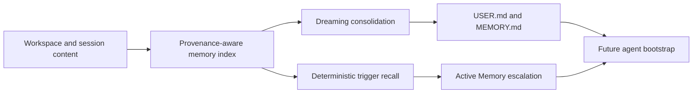

Codex review: needs maintainer review before merge. _Reviewed July 28, 2026, 5:53 AM ET / 09:53 UTC._

# ClawSweeper review

## What this changes

This PR makes OpenClaw memory provenance-aware, enables dreaming and recall escalation by default, adds USER.md and standing intents, and extends memory-host metadata used by recall and promotion.

## Merge readiness

⚠️ **Needs maintainer review before merge - 4 items remain**

Keep open. This is an active, same-day, maintainer-labeled feature PR with a clean merge result pending a base refresh; it is not a conservative-cleanup close candidate. The submitted evidence supports real runtime coverage, but the default-on upgrade policy and expanded memory-host SDK contract still need explicit human ownership before merge. Likely related people: steipete is the strongest routing candidate from the feature commits and recorded design context (medium confidence).

**Priority:** P1
**Reviewed head:** `7f2f77da5e03f9528940a2c65dfe1536fb6e3b35`
**Owner decision:** Required. See [Decision needed](#decision-needed).

## Review scores

| Measure | Result | What it means |
|---|---|---|
| **Overall readiness** | 🦐 gold shrimp **(3/6)** | The branch has strong claimed runtime proof and passing supplied checks, but its unusually broad default, SQLite, and plugin-contract changes still require explicit owner acceptance and a final merge-head refresh. |
| **Proof confidence** | 🦞 diamond lobster **(5/6)** ✨ media proof bonus | Sufficient (linked_artifact): The PR body links redacted after-fix gateway-QA logs, promoted output, lifecycle state, and runtime excerpts, and the supplied checks include a successful Real behavior proof run; redact any private endpoints, credentials, and identifiers in future updates. |
| **Patch quality** | 🦐 gold shrimp **(3/6)** | No actionable review findings were identified. |

## Verification

| Check | Result | Evidence |
|---|---|---|
| **Real behavior** | Verified | Sufficient (linked_artifact): The PR body links redacted after-fix gateway-QA logs, promoted output, lifecycle state, and runtime excerpts, and the supplied checks include a successful Real behavior proof run; redact any private endpoints, credentials, and identifiers in future updates. |
| **Evidence reviewed** | 6 items | Active protected feature PR: The provided PR state is open, created and updated on July 28, 2026, marked mergeable, and carries the protected `maintainer` label; conservative cleanup must keep it open for explicit maintainer handling.<br>Default-on behavior is implemented in the proposed patch: The branch changes the dreaming resolver default from false to true, making absent-config installations opt into the managed dreaming behavior described in the PR body.<br>Active Memory adds a new default mode: The branch normalizes omitted Active Memory mode to `escalate`, changing the reply-path behavior for installations that do not explicitly configure this plugin. |
| **Findings** | None | None. |
| **Security** | None | None. |

## How this fits together

Memory Core indexes workspace and session content into the per-agent SQLite database, then exposes it to deterministic recall and optional deeper Active Memory recall. This PR changes how content earns durable promotion, how trusted memory is injected before replies, and how durable user preferences and future intents are stored.



## Decision needed

| Question | Recommendation |
|---|---|
| Do memory-area owners approve making dreaming and Active Memory escalation default-on for existing absent-config installations while adopting the new optional memory-host metadata and trigger-recall APIs as a supported plugin contract? | **Confirm the recorded default-on contract:** Approve the documented upgrade behavior and SDK seam, then require a rebase and final upgrade-focused proof on the merge head. |

Why: The branch deliberately changes runtime defaults, starts a managed background workflow for previously omitted settings, and expands a cross-plugin API; these are durable product and compatibility choices rather than mechanical review follow-up.

## Before merge

- [ ] **Resolve merge risk (P1)** - Existing absent-config installations will begin running the managed dreaming path and Active Memory escalation unless they explicitly disable them; maintainers should confirm that this intentional upgrade behavior remains acceptable after rebasing.
- [ ] **Resolve merge risk (P1)** - The optional memory-host SDK additions become a compatibility contract for alternate memory providers, so maintainers should confirm the documented degradation behavior and preserve it in future provider implementations.
- [ ] **Resolve merge risk (P1)** - The branch is behind current main; refresh the merge result and rerun focused upgrade, schema, and plugin-SDK checks against the actual merge head before landing.


<details>
<summary><strong>Agent review details</strong></summary>

### Security

None.

### Review metrics

| Metric | Value | Why it matters |
|---|---|---|
| **Default behavior changes** | 2 default-on paths changed | Dreaming becomes enabled when omitted and Active Memory defaults to escalation, affecting existing absent-config installations. |
| **Memory-host API surface** | 1 result shape extended; 2 optional manager capabilities added | Alternate memory providers need a stable, documented compatibility contract for provenance-aware results and deterministic trigger recall. |
| **Persistent memory model** | 1 provenance table, 2 recall metadata columns, and standing-intent storage added | The additive lazy-schema approach needs final upgrade validation on the merge head. |

### Stored data model

Persistent data-model change detected: `database schema: src/state/openclaw-agent-schema.generated.ts`, `database schema: src/state/openclaw-agent-schema.sql`, `database schema: src/state/openclaw-agent-standing-intents-schema.test.ts`, `database schema: src/state/openclaw-agent-standing-intents-schema.ts`, `migration/backfill/repair: src/commands/doctor-memory-search.test.ts`, `migration/backfill/repair: src/commands/doctor-memory-search.ts`, and 50 more. Confirm migration or upgrade compatibility proof before merge.

### Merge-risk options

**Maintainer options:**
1. **Confirm defaults and re-prove upgrades (recommended)**  
   Before merge, have a memory owner confirm the default-on policy, rebase to current main, and prove both fresh and omitted-config upgrade behavior with the final SQLite state.
2. **Accept the rollout deliberately**  
   Maintainers may merge the default-on behavior as an intentional product change after explicitly accepting the new managed recall and consolidation activity for existing installations.
3. **Split policy from infrastructure**  
   Pause this combined landing and separate the provenance-safe storage work from the default and plugin-contract changes if owner consensus is not ready.

<details>
<summary>Copy recommended automerge instruction</summary>

```text
@clawsweeper automerge

Special instructions:
Rebase to current main, attach final-head fresh-install and omitted-config upgrade proof for dreaming, Active Memory escalation, and the additive SQLite memory state, then request owner confirmation of the memory-host SDK contract.
```

</details>

### Technical review

Best possible solution:

Land only after a memory-area owner explicitly confirms the default-on upgrade policy and additive SDK contract, then rebase and prove fresh-install and existing absent-config behavior on the final merge head.

Do we have a high-confidence way to reproduce the issue?

Not applicable as a feature PR. The supplied PR body provides a concrete after-fix gateway-QA scenario and a redacted linked artifact for the new behavior rather than a report of an existing failing contract.

Is this the best way to solve the issue?

Unclear. Provenance-gated promotion and bounded recall use the existing memory-plugin seam rather than duplicating a separate system, but enabling those behaviors by default and publishing the SDK additions remain maintainer product decisions.

AGENTS.md: found and applied where relevant.

Codex review notes: model internal, reasoning high; reviewed against [9c051c651345](https://github.com/openclaw/openclaw/commit/9c051c6513459602f689d861ddae0c7a0ae03387).

### Labels

Label changes:

- add `proof: sufficient`: Contributor real behavior proof is sufficient. The PR body links redacted after-fix gateway-QA logs, promoted output, lifecycle state, and runtime excerpts, and the supplied checks include a successful Real behavior proof run; redact any private endpoints, credentials, and identifiers in future updates.
- add `rating: 🦐 gold shrimp`: Overall readiness is 🦐 gold shrimp; proof is 🦞 diamond lobster and patch quality is 🦐 gold shrimp.
- add `status: 👀 ready for maintainer look`: ClawSweeper has no concrete contributor-facing blocker left for this PR. Sufficient (linked_artifact): The PR body links redacted after-fix gateway-QA logs, promoted output, lifecycle state, and runtime excerpts, and the supplied checks include a successful Real behavior proof run; redact any private endpoints, credentials, and identifiers in future updates.
- remove `rating: 🧂 unranked krab`: Current PR rating is `rating: 🦐 gold shrimp`, so this older rating label is no longer current.
- remove `status: 📣 needs proof`: Current PR status label is `status: 👀 ready for maintainer look`.

Label justifications:

- `P1`: This broad memory-default and persisted-state change can alter active agent behavior for existing users immediately after upgrade.
- `merge-risk: 🚨 compatibility`: Omitted settings now enable dreaming and Active Memory escalation, and the PR extends a supported memory-host SDK contract.
- `merge-risk: 🚨 session-state`: The branch adds provenance, recall metadata, and standing-intent state to per-agent SQLite storage and changes what is injected into future replies.
- `rating: 🦐 gold shrimp`: Overall readiness is 🦐 gold shrimp; proof is 🦞 diamond lobster and patch quality is 🦐 gold shrimp.
- `status: 👀 ready for maintainer look`: ClawSweeper has no concrete contributor-facing blocker left for this PR. Sufficient (linked_artifact): The PR body links redacted after-fix gateway-QA logs, promoted output, lifecycle state, and runtime excerpts, and the supplied checks include a successful Real behavior proof run; redact any private endpoints, credentials, and identifiers in future updates.
- `proof: sufficient`: Contributor real behavior proof is sufficient. The PR body links redacted after-fix gateway-QA logs, promoted output, lifecycle state, and runtime excerpts, and the supplied checks include a successful Real behavior proof run; redact any private endpoints, credentials, and identifiers in future updates.

### Evidence

What I checked:

- **Active protected feature PR:** The provided PR state is open, created and updated on July 28, 2026, marked mergeable, and carries the protected `maintainer` label; conservative cleanup must keep it open for explicit maintainer handling. ([7f2f77da5e03](https://github.com/openclaw/openclaw/commit/7f2f77da5e03))
- **Default-on behavior is implemented in the proposed patch:** The branch changes the dreaming resolver default from false to true, making absent-config installations opt into the managed dreaming behavior described in the PR body. ([`src/memory-host-sdk/dreaming.ts:19`](https://github.com/openclaw/openclaw/blob/7f2f77da5e03/src/memory-host-sdk/dreaming.ts#L19), [7f2f77da5e03](https://github.com/openclaw/openclaw/commit/7f2f77da5e03))
- **Active Memory adds a new default mode:** The branch normalizes omitted Active Memory mode to `escalate`, changing the reply-path behavior for installations that do not explicitly configure this plugin. ([`extensions/active-memory/config.ts:230`](https://github.com/openclaw/openclaw/blob/7f2f77da5e03/extensions/active-memory/config.ts#L230), [7f2f77da5e03](https://github.com/openclaw/openclaw/commit/7f2f77da5e03))
- **Persisted memory state changes are additive but upgrade-sensitive:** The branch adds recall metadata columns, a provenance table, and standing-intent storage to the agent SQLite schema while relying on lazy schema ensures instead of a version bump. ([`src/state/openclaw-agent-schema.sql:422`](https://github.com/openclaw/openclaw/blob/7f2f77da5e03/src/state/openclaw-agent-schema.sql#L422), [7f2f77da5e03](https://github.com/openclaw/openclaw/commit/7f2f77da5e03))
- **Runtime proof and CI are present in the supplied PR context:** The PR body links a redacted gateway-QA artifact with after-fix logs and output, and the supplied check state reports successful `Real behavior proof`, CI gate, plugin-SDK baseline, schema, lint, type, and QA-smoke checks for the head. ([7f2f77da5e03](https://github.com/openclaw/openclaw/commit/7f2f77da5e03))
- **Feature provenance:** The supplied seven-commit PR history attributes the memory provenance, dreaming, recall, user-model, and final live-QA fixes to steipete; this is useful routing context but not by itself a merge approval. ([`extensions/memory-core/index.ts:156`](https://github.com/openclaw/openclaw/blob/7f2f77da5e03/extensions/memory-core/index.ts#L156), [7f2f77da5e03](https://github.com/openclaw/openclaw/commit/7f2f77da5e03))

Likely related people:

- **steipete:** All seven supplied commits for the memory redesign are attributed to steipete, and the PR body records the default-on and SDK-contract direction alongside the implementation evidence. (role: feature-history contributor and recorded policy proposer; confidence: medium; commits: [4abbf082d7c8](https://github.com/openclaw/openclaw/commit/4abbf082d7c8cce800b9fa49b8c14e58f6c5c9d7), [c07e5954e7a4](https://github.com/openclaw/openclaw/commit/c07e5954e7a42eda901ebaf90c4c60102d99a164), [244e9e00c537](https://github.com/openclaw/openclaw/commit/244e9e00c53715e6356b9eefc8d963dfa3db2d6b); files: `extensions/memory-core/index.ts`, `extensions/active-memory/index.ts`, `packages/memory-host-sdk/src/host/types.ts`)

### Rank-up moves

Optional improvements that raise the rating; they are not merge blockers.

- Obtain explicit memory-owner confirmation for the default-on upgrade policy and optional SDK contract.
- Rebase onto current main and attach final-head proof for fresh install plus an existing absent-config upgrade.

### Rating scale

| Score | Internal tier | Crab rank | Meaning |
|---:|:---:|---|---|
| **6/6** | S | 🦀 challenger crab | Exceptional readiness |
| **5/6** | A | 🦞 diamond lobster | Very strong readiness |
| **4/6** | B | 🐚 platinum hermit | Good normal PR; ordinary maintainer review |
| **3/6** | C | 🦐 gold shrimp | Useful, but confidence is limited |
| **2/6** | D | 🦪 silver shellfish | Proof or implementation needs work |
| **1/6** | F | 🧂 unranked krab | Not merge-ready |
| N/A | NA | 🌊 off-meta tidepool | Rating does not apply |

Overall follows the weaker of proof and patch quality.
Shiny media proof means a screenshot, video, or linked artifact directly shows the changed behavior. Runtime, network, CSP, and security claims still need visible diagnostics.

### Workflow

- ClawSweeper keeps one durable marker-backed review comment per issue or PR.
- Re-runs edit this comment so the latest verdict, findings, and automation markers stay together instead of adding duplicate bot comments.
- A fresh review can be triggered by eligible `@clawsweeper re-review` comments, exact-item GitHub events, scheduled/background review runs, or manual workflow dispatch.
- PR/issue authors and users with repository write access can comment `@clawsweeper re-review` or `@clawsweeper re-run` on an open PR or issue to request a fresh review only.
- Maintainers can also comment `@clawsweeper review` to request a fresh review only.
- Fresh-review commands do not start repair, autofix, rebase, CI repair, or automerge.
- Maintainer-only repair and merge flows require explicit commands such as `@clawsweeper autofix`, `@clawsweeper automerge`, `@clawsweeper fix ci`, or `@clawsweeper address review`.
- Maintainers can comment `@clawsweeper explain` to ask for more context, or `@clawsweeper stop` to stop active automation.

### History

<details>
<summary>Review history (5 earlier review cycles)</summary>

<!-- clawsweeper-review-history v=1 total=5 -->
- reviewed 2026-07-28T00:30:31.921Z sha 5d4eb9fc9edc5b7abe055a8dd26982b783170f8d :: needs real behavior proof before merge. :: [P1] Restore catalog continuation scope checks | [P1] Keep archived Workboard cards out of lifecycle writes | [P2] Retain the full Control UI E2E gate
- reviewed 2026-07-28T00:40:55.151Z sha 4fe40bcb7225eae25f3026cf73247c11a77fa66f :: needs real behavior proof before merge. :: [P1] Preserve the established dreaming default through upgrade | [P1] Get approval for the expanded memory-host SDK contract
- reviewed 2026-07-28T08:34:51.580Z sha f11933cfdead573b5bc1f3d3de4a03b19021e0e6 :: needs real behavior proof before merge. :: [P1] Preserve the established dreaming default through upgrade | [P1] Define the memory-host SDK compatibility contract
- reviewed 2026-07-28T09:29:12.060Z sha 1bdd99bb32044f989d840c042605e2d4d4729b36 :: needs real behavior proof before merge. :: [P1] Preserve the established dreaming default through upgrade | [P1] Define the memory-host SDK compatibility contract
- reviewed 2026-07-28T09:41:02.066Z sha 7f2f77da5e03f9528940a2c65dfe1536fb6e3b35 :: needs real behavior proof before merge. :: [P1] Preserve omitted dreaming settings on upgrade | [P1] Keep Active Memory inactive without explicit configuration | [P1] Get approval for the memory-host SDK contract

</details>

</details>

<!-- clawsweeper-verdict:needs-human item=114819 sha=7f2f77da5e03f9528940a2c65dfe1536fb6e3b35 confidence=high updated_at=2026-07-28T09:52:10Z reviewed_at=2026-07-28T09:53:37.764Z lease_owner=github-run-30348304062-1 lease_comment_id=5102594532 source_revision=7358d7850a05f06ce6e1b6e5191efcd246ecb60f1b8f327a54c66278610e6b51 -->

<!-- clawsweeper-review-version item=114819 reviewed_at=2026-07-28T09:53:37.764Z sha=7f2f77da5e03f9528940a2c65dfe1536fb6e3b35 source_revision=7358d7850a05f06ce6e1b6e5191efcd246ecb60f1b8f327a54c66278610e6b51 lease_owner=github-run-30348304062-1 lease_comment_id=5102594532 v=1 -->

<!-- clawsweeper-review item=114819 -->