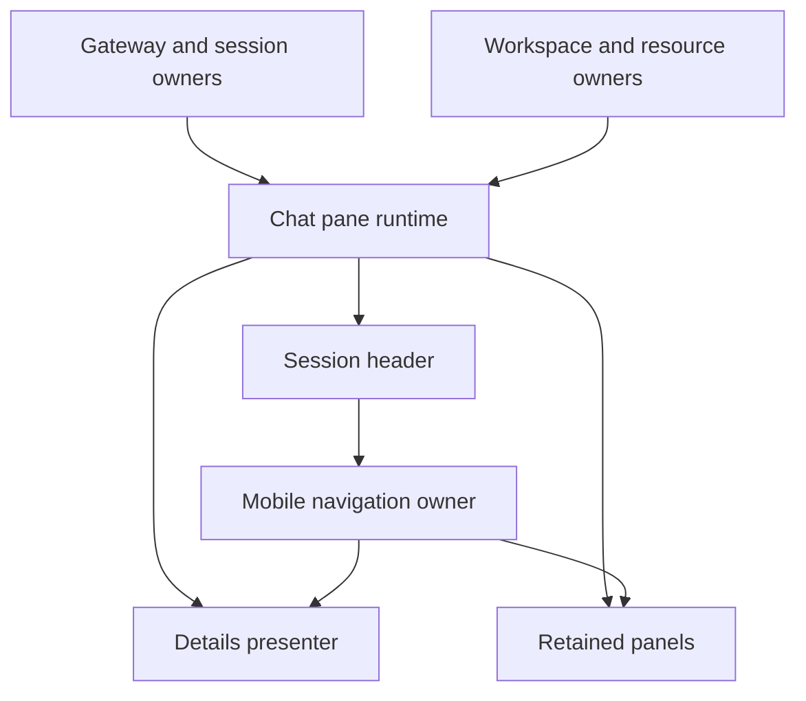

Codex review: needs changes before merge.

## What this changes

This PR connects session headers, Details, and responsive panel navigation to retained pane state.

**Example:** At a 390px viewport, open Files, switch to Details, and return to Files.
- **Before:** Details uses a separate overlay above the mobile Files panel.
- **After:** Details and Files share one sheet while the mounted Files content and conversation draft remain retained.

## Review scores

| Measure | Result | What it means |
|---|---|---|
| **Overall readiness** | 🧂 unranked krab **(1/6)** | The product direction is useful, but existing browser consumers remain broken and the repository-required visual evidence is absent. |
| **Proof confidence** | 🧂 unranked krab **(1/6)** | Real behavior proof is not required for maintainer- or bot-authored pull requests. |
| **Patch quality** | 🦪 silver shellfish **(2/6)** | 3 actionable review findings remain. |

## Product

**Kind:** Feature · **Worth it:** Yes · **Fix scope:** Complete
**User problem:** Session controls and Details use separate desktop and mobile presentations that make panel navigation and retained state harder to follow.
**Reason:** The maintainer-authored direction unifies navigation while preserving existing resource and action owners.

## Merge readiness

⛔ **Needs changes before merge - 3 items remain**

Keep this maintainer-authored PR open; the integration is useful, but incomplete test-helper migrations break existing browser suites.

**Priority:** P2
**Reviewed head:** `2ccc2a68ada3f82dabfbc5e2e2099cc4146f16bf`

## Before merge

- [ ] **Update the Workboard import when moving the alignment helper (P2)** - This PR removes assertSessionSectionCountAlignment from control-ui-e2e.ts and moves it to control-ui-session-section-layout.ts, but this consumer still imports the old export. The Workboard sidebar E2E suite can no longer obtain the function and fails before completing its alignment scenario. Update this import alongside the already-migrated Codex consumer.
- [ ] **Migrate dashboard callers before replacing their menu helper (P2)** - The desktop branch now opens and returns Panel position for every caller. dashboard-presentation-defaults.e2e.test.ts still calls openChatLayoutMenu and searches its result for dashboard-default actions and status, which belong to Dashboard options rather than Panel position. Those scenarios now time out, and an expanded dashboard may have no visible Panel position trigger at all. Migrate the dashboard callers to their actual menu instead of redirecting them to an unrelated surface.
- [ ] **Use reachable mobile controls in the Layout helper consumers (P2)** - The new mobile branch clicks a View menu item immediately after opening session actions, but createMobileHeaderSessionMenu removes both compact:open-view and submenu:view from that menu. Existing callers in mobile-chat-session-menu.e2e.test.ts and chat-session-companion-clear.e2e.test.ts therefore wait for an item that cannot appear. Update those scenarios to use the mobile Panels launcher, Advanced controls, or direct Clear side chat action appropriate to each behavior.

## Findings

- [P2] Update the Workboard import when moving the alignment helper — `ui/src/pages/workboard/workboard-sidebar.e2e.test.ts:9-12`
- [P2] Migrate dashboard callers before replacing their menu helper — `ui/src/test-helpers/chat-layout-menu.ts:74-77`
- [P2] Use reachable mobile controls in the Layout helper consumers — `ui/src/test-helpers/chat-layout-menu.ts:67-71`

### Tests

- Missing end-to-end proof: The supplied summaries do not include inspectable before/after visual artifacts or demonstrate the identified regressions failing on the base and passing after repair.

<strong>Agent review details</strong>

### How this fits together

The Control UI pane consumes session, Gateway, workspace, and presentation owners and renders headers, conversation content, and retained tool panels.

### Technical review

Best possible solution:

Keep the existing pane and resource owners, and complete the test-helper cutover across all affected consumers.

Do we have a high-confidence way to reproduce the issue?

Source establishes the removed export, wrong desktop menu, and hidden mobile action without executing target code; no tests were run during this read-only review.

Is this the best way to solve the issue?

Reusing the existing pane, sharing, placement, and workspace owners fits the requested integration; the smallest remaining repair is to migrate helper consumers to the actual new controls.

Full review comments:

- [P2] Update the Workboard import when moving the alignment helper — `ui/src/pages/workboard/workboard-sidebar.e2e.test.ts:9-12`
  This PR removes assertSessionSectionCountAlignment from control-ui-e2e.ts and moves it to control-ui-session-section-layout.ts, but this consumer still imports the old export. The Workboard sidebar E2E suite can no longer obtain the function and fails before completing its alignment scenario. Update this import alongside the already-migrated Codex consumer.
  Confidence: 1
- [P2] Migrate dashboard callers before replacing their menu helper — `ui/src/test-helpers/chat-layout-menu.ts:74-77`
  The desktop branch now opens and returns Panel position for every caller. dashboard-presentation-defaults.e2e.test.ts still calls openChatLayoutMenu and searches its result for dashboard-default actions and status, which belong to Dashboard options rather than Panel position. Those scenarios now time out, and an expanded dashboard may have no visible Panel position trigger at all. Migrate the dashboard callers to their actual menu instead of redirecting them to an unrelated surface.
  Confidence: 0.99
- [P2] Use reachable mobile controls in the Layout helper consumers — `ui/src/test-helpers/chat-layout-menu.ts:67-71`
  The new mobile branch clicks a View menu item immediately after opening session actions, but createMobileHeaderSessionMenu removes both compact:open-view and submenu:view from that menu. Existing callers in mobile-chat-session-menu.e2e.test.ts and chat-session-companion-clear.e2e.test.ts therefore wait for an item that cannot appear. Update those scenarios to use the mobile Panels launcher, Advanced controls, or direct Clear side chat action appropriate to each behavior.
  Confidence: 0.99

Overall correctness: patch is incorrect
Overall confidence: 0.97

AGENTS.md: found and applied where relevant.

Codex review notes: model internal, reasoning medium; reviewed against [0afb3b35f1e0](https://github.com/openclaw/openclaw/commit/0afb3b35f1e0da355fa298e94d0f5f3058825a68).

### Provenance checked

- `Header controls and navigation` changes intended behavior with a stated reason (1e34f7505111d18b2d800ffb49195365dd9a1dbe: Consolidate layout controls and explain subagent waits using existing roster and sidebar owners; subsequent Solid and native-menu migrations preserved those actions.)
- `Details presentation` changes intended behavior with a stated reason (b883658c8178ce1ea5dced8ffb6da60a612d66e1: Group session context and task progress into one bounded inspector with independent disclosures and existing permission owners; later work added automatic wide-pane docking.)
- `Panel and resource retention` keeps the original intent (2d7d89fce202d9d02bd1bcf9c7d4f5a546fa2bc7: Retain terminal, file, app, and reader resources during same-client transport loss while retiring them on identity or confirmed access changes.)
- `Session-section alignment helper` keeps the original intent (2813c6a2b36c5e1f6a3c3ec542b4fd32b2f19a58: Protect aligned sidebar section counts and nonoverlapping catalog actions; moving the helper should preserve every consumer.)

### Testing

Proof path: in-process harness.

### Security

None.

### Evidence

Acceptance criteria:

- pnpm test:ui:e2e -- ui/src/pages/workboard/workboard-sidebar.e2e.test.ts ui/src/e2e/dashboard-presentation-defaults.e2e.test.ts ui/src/e2e/mobile-chat-session-menu.e2e.test.ts ui/src/e2e/chat-session-companion-clear.e2e.test.ts
- rg -n 'assertSessionSectionCountAlignment|openChatLayoutMenu|closeChatLayoutMenu' ui/src
- git diff --check

What I checked:

- **Pinned introduction and current PR state:** Reviewed the introduced comparison from 67d1589b5ef5c71a7c9eedfc835b31fb9e2bc52a to 2ccc2a68ada3f82dabfbc5e2e2099cc4146f16bf. GitHub still reports that head as an open, cleanly mergeable draft authored by a MEMBER. ([2ccc2a68ada3](https://github.com/openclaw/openclaw/commit/2ccc2a68ada3f82dabfbc5e2e2099cc4146f16bf))
- **Incomplete helper export migration:** The alignment helper moves into control-ui-session-section-layout.ts and the Codex suite updates its import, but workboard-sidebar.e2e.test.ts still imports the removed export from control-ui-e2e.ts. ([`ui/src/pages/workboard/workboard-sidebar.e2e.test.ts:10`](https://github.com/openclaw/openclaw/blob/2ccc2a68ada3f82dabfbc5e2e2099cc4146f16bf/ui/src/pages/workboard/workboard-sidebar.e2e.test.ts#L10), [2ccc2a68ada3](https://github.com/openclaw/openclaw/commit/2ccc2a68ada3f82dabfbc5e2e2099cc4146f16bf))
- **Desktop helper selects the wrong menu:** openChatLayoutMenu now returns Panel position, while dashboard-presentation-defaults.e2e.test.ts still expects dashboard-default actions and status inside its result. ([`ui/src/test-helpers/chat-layout-menu.ts:74`](https://github.com/openclaw/openclaw/blob/2ccc2a68ada3f82dabfbc5e2e2099cc4146f16bf/ui/src/test-helpers/chat-layout-menu.ts#L74), [2ccc2a68ada3](https://github.com/openclaw/openclaw/commit/2ccc2a68ada3f82dabfbc5e2e2099cc4146f16bf))
- **Mobile helper selects a hidden action:** The mobile helper clicks View, but the connected mobile session-menu adapter explicitly removes compact:open-view and submenu:view; mobile-chat-session-menu.e2e.test.ts still calls this helper. ([`ui/src/pages/chat/components/chat-header-session-menu-mobile.tsx:353`](https://github.com/openclaw/openclaw/blob/2ccc2a68ada3f82dabfbc5e2e2099cc4146f16bf/ui/src/pages/chat/components/chat-header-session-menu-mobile.tsx#L353), [2ccc2a68ada3](https://github.com/openclaw/openclaw/commit/2ccc2a68ada3f82dabfbc5e2e2099cc4146f16bf))
- **Supplied proof and discussion:** The complete PR body reports native and mock-Gateway Chromium tests but contains no attached visual evidence; both discussion comments are bot status updates, and there are no review comments or reviews. The supplied body identity is 417efa8de170011131a03835a63e2a9698185240692d1c71b914b94eade1dbd9. ([2ccc2a68ada3](https://github.com/openclaw/openclaw/commit/2ccc2a68ada3f82dabfbc5e2e2099cc4146f16bf))
- **Current-main behavior and feature history:** Fetched main retains the previous header, Layout menu, and Details composition. History connects the original title bar, subsequent mobile refinements, Solid migration, navigation changes, and reconnect retention to several contributors. ([`ui/src/pages/chat/components/chat-pane-header.tsx`](https://github.com/openclaw/openclaw/blob/0afb3b35f1e0da355fa298e94d0f5f3058825a68/ui/src/pages/chat/components/chat-pane-header.tsx), [0afb3b35f1e0](https://github.com/openclaw/openclaw/commit/0afb3b35f1e0da355fa298e94d0f5f3058825a68))

### PR surface

Source +3485, Tests +924, Docs +2, Config +1, Other +2929. Total +7341 across 66 files. Added test files: 4.

View PR surface stats

| Area | Files | Added | Removed | Net |
|---|---:|---:|---:|---:|
| Source | 29 | 4517 | 1032 | +3485 |
| Tests | 26 | 1816 | 892 | +924 |
| Docs | 3 | 41 | 39 | +2 |
| Config | 1 | 2 | 1 | +1 |
| Generated | 0 | 0 | 0 | 0 |
| Other | 7 | 3031 | 102 | +2929 |
| **Total** | **66** | **9407** | **2066** | **+7341** |

### Labels

Label changes:

- add `P2`: This is a useful UI improvement with concrete browser-suite regressions that need focused repair.
- add `rating: 🧂 unranked krab`: Overall readiness is 🧂 unranked krab; proof is 🧂 unranked krab and patch quality is 🦪 silver shellfish.
- add `status: ⏳ waiting on author`: ClawSweeper has contributor-facing work open and is waiting for author action.

Label justifications:

- `P2`: This is a useful UI improvement with concrete browser-suite regressions that need focused repair.
- `rating: 🧂 unranked krab`: Overall readiness is 🧂 unranked krab; proof is 🧂 unranked krab and patch quality is 🦪 silver shellfish.
- `status: ⏳ waiting on author`: ClawSweeper has contributor-facing work open and is waiting for author action.

### Rating scale

6/6 🦀 challenger crab · 5/6 🦞 diamond lobster · 4/6 🐚 platinum hermit · 3/6 🦐 gold shrimp · 2/6 🦪 silver shellfish · 1/6 🧂 unranked krab. Overall follows the weaker of proof and patch quality; ✨ marks media proof (a screenshot, video, or linked artifact) that directly shows the changed behavior.

### Workflow

ClawSweeper edits this one comment on every review. Comment `@clawsweeper re-review` for a fresh review only. Repair and merge execution lanes are retired.

_Reviewed October 18, 2026, 8:19 PM ET / October 19, 2026, 00:19 UTC._

<!-- clawsweeper-verdict:needs-changes item=176653 sha=2ccc2a68ada3f82dabfbc5e2e2099cc4146f16bf confidence=high updated_at=2026-10-19T00:14:38Z reviewed_at=2026-10-19T00:19:41.469Z lease_owner=github-run-39179816788-1 lease_comment_id=6256928572 source_revision=417efa8de170011131a03835a63e2a9698185240692d1c71b914b94eade1dbd9 -->
<!-- clawsweeper-review-state:needs-changes item=176653 sha=2ccc2a68ada3f82dabfbc5e2e2099cc4146f16bf v=1 -->

<!-- clawsweeper-review-version item=176653 reviewed_at=2026-10-19T00:19:41.469Z sha=2ccc2a68ada3f82dabfbc5e2e2099cc4146f16bf source_revision=417efa8de170011131a03835a63e2a9698185240692d1c71b914b94eade1dbd9 lease_owner=github-run-39179816788-1 lease_comment_id=6256928572 v=1 -->

<!-- clawsweeper-review item=176653 -->