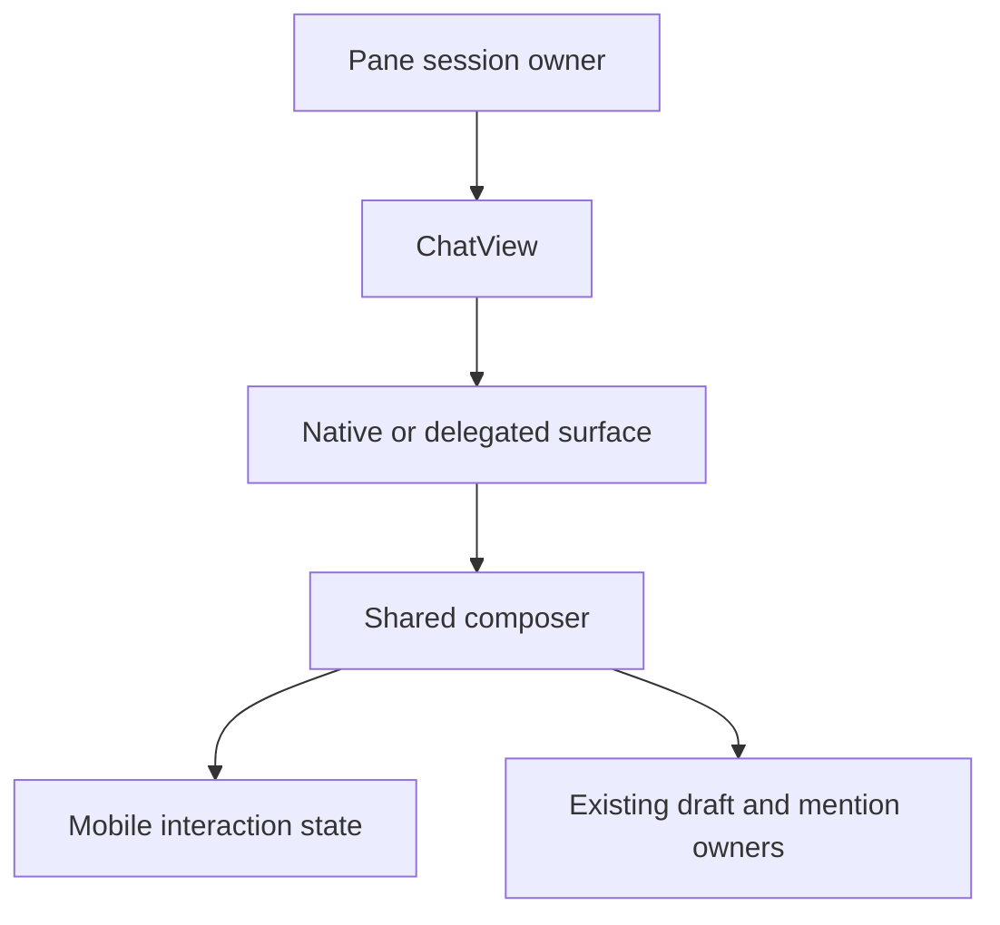

Codex review: needs maintainer review before merge.

## What this changes

Adds compact mobile composer presentation, retained editing across controls and menus, and access to the existing mention operation.

**Example:** At a 430px viewport, select characters 2–8 in a draft and open the Plus menu.
- **Before:** The composer has no dedicated mobile editing state that follows its controls and overlays.
- **After:** The proposed mobile presentation retains the textarea, draft, and selection through menu focus and Escape without sending.

## Review scores

| Measure | Result | What it means |
|---|---|---|
| **Overall readiness** | 🧂 unranked krab **(1/6)** | The inspected implementation is coherent and has focused supporting tests, but required visual and integrated mobile behavior evidence is absent. |
| **Proof confidence** | 🧂 unranked krab **(1/6)** | Real behavior proof is not required for maintainer- or bot-authored pull requests. |
| **Patch quality** | 🐚 platinum hermit **(4/6)** | No actionable review findings were identified. |

## Product

**Kind:** Feature · **Worth it:** Yes · **Fix scope:** Partial
**User problem:** Mobile users need a compact composer that preserves their editing position while they use its controls.
**Reason:** Maintainer authorship establishes direction; the component work has clear value, while the explicitly pending pane integration prevents this head from delivering the full app experience.

## Merge readiness

✅ **Ready for maintainer review**

Keep this maintainer-authored draft open: it contains coherent mobile-composer work that current main does not provide, with no definite introduced regression found.

**Priority:** P2
**Reviewed head:** `798355a2185f934656070c3957636f2c768367cb`

## Before merge

None.

## Findings

None.

### Tests

- Missing end-to-end proof: Missing the integrated mobile pane flow on WebKit with actual keyboard dismissal, retained menu focus and selection, and no unintended send.

<strong>Agent review details</strong>

### How this fits together

The Control UI pane supplies session facts and actions to ChatView and the shared Solid composer; local interaction state controls presentation while existing owners retain drafts, mention lookup, and mutations.

### Technical review

Best possible solution:

Complete the mobile pane bindings while retaining the existing draft, overlay, mention, and mutation owners.

Do we have a high-confidence way to reproduce the issue?

This proposes a new capability; inspected tests exercise retained draft and caret state, menu focus, keyboard dismissal, and send suppression.

Is this the best way to solve the issue?

The implementation reuses the appropriate existing owners, but represents a staged component change rather than a complete application flow.

AGENTS.md: found and applied where relevant.

Codex review notes: model internal, reasoning medium; reviewed against [b518289d703d](https://github.com/openclaw/openclaw/commit/b518289d703d9988025471df97b0f37d8178589c).

### Provenance checked

- `Stable textarea and draft ownership` keeps the original intent (4ad6f7aee2402b8d53f3d28db365ae70d8937cb6: The draft-owner cutover preserved native input, IME, focus, and disclosure identity across unrelated updates.)
- `Mention lookup, caching, and insertion` keeps the original intent (3ca8c08ef47ca567bd844f969f6b6b24611ce5d1: Suggestion state moved to Solid while retaining query caching, same-turn selection, and stale-owner rejection.)
- `Goal actions and recovery` keeps the original intent (7ff232960ab65ed8d9498e42362342dbf245dca9: Resume progress and uncertain-outcome recovery remain visible inline without duplicating continuation requests.)
- `Compact mobile control presentation` changes intended behavior with a stated reason (https://github.com/openclaw/openclaw/pull/130308: Earlier mobile design kept compact controls and primary actions directly accessible; this maintainer-authored proposal deliberately introduces separate compact and editing presentations.)

### Testing

Proof path: in-process harness.

### Security

None.

### Evidence

What I checked:

- **Pinned change and current draft:** Reviewed the introduced merge-base-to-head diff; live GitHub confirms the same head, MEMBER authorship, draft status, and clean mergeability against its stacked base branch. ([798355a2185f](https://github.com/openclaw/openclaw/commit/798355a2185f934656070c3957636f2c768367cb))
- **Interaction owner:** One component-owned interaction factory handles editing, composer-owned overlays, keyboard disappearance, accidental action suppression, and listener cleanup. ([`ui/src/pages/chat/components/chat-composer-mobile-interaction.ts:8`](https://github.com/openclaw/openclaw/blob/798355a2185f934656070c3957636f2c768367cb/ui/src/pages/chat/components/chat-composer-mobile-interaction.ts#L8), [798355a2185f](https://github.com/openclaw/openclaw/commit/798355a2185f934656070c3957636f2c768367cb))
- **Staged integration boundary:** Production callers do not yet supply mobileComposer, mobileKeyboardVisible, or mobileActivities; the body explicitly records complete host integration as pending. ([`ui/src/pages/chat/chat-view.tsx:178`](https://github.com/openclaw/openclaw/blob/798355a2185f934656070c3957636f2c768367cb/ui/src/pages/chat/chat-view.tsx#L178), [798355a2185f](https://github.com/openclaw/openclaw/commit/798355a2185f934656070c3957636f2c768367cb))
- **Shared mention operation:** External lookup shares the existing bounded cache and request owner; insertion rechecks the current directory, recipient, and editable textarea before committing through the existing draft callback. ([`ui/src/pages/chat/components/chat-composer-mention-menu.tsx:417`](https://github.com/openclaw/openclaw/blob/798355a2185f934656070c3957636f2c768367cb/ui/src/pages/chat/components/chat-composer-mention-menu.tsx#L417), [798355a2185f](https://github.com/openclaw/openclaw/commit/798355a2185f934656070c3957636f2c768367cb))
- **Related staged work:** https://github.com/openclaw/openclaw/pull/176378 supplies the activity presenter, https://github.com/openclaw/openclaw/pull/176367 supplies mobile approvals, and the downstream https://github.com/openclaw/openclaw/pull/176505 explicitly consumes this PR's mention operation.
- **Existing main behavior and feature history:** Current-main composer code retains the existing desktop/shared presentation; history identifies the Solid composer migration, draft-owner cutover, suggestion-owner migration, and earlier mention-picker contributions. ([`ui/src/pages/chat/components/chat-composer-view.tsx:228`](https://github.com/openclaw/openclaw/blob/b518289d703d9988025471df97b0f37d8178589c/ui/src/pages/chat/components/chat-composer-view.tsx#L228), [b518289d703d](https://github.com/openclaw/openclaw/commit/b518289d703d9988025471df97b0f37d8178589c))

Likely related people:

- **Peter Steinberger:** Raw commit 4ad6f7aee2402b8d53f3d28db365ae70d8937cb6 adds ui/src/pages/chat/components/chat-composer.tsx:31 relative to its recorded parents. This identifies author metadata, not feature responsibility or a PR merger. (role: source-line author; confidence: high; commits: [4ad6f7aee240](https://github.com/openclaw/openclaw/commit/4ad6f7aee2402b8d53f3d28db365ae70d8937cb6); files: `ui/src/pages/chat/components/chat-composer.tsx`)
- **Vyctor H. Brzezowski:** Raw commit c0233f0e0fc6616bfc65b4b851461fc6d67e8343 adds ui/src/pages/chat/components/chat-composer-mention-menu.ts:254 relative to its recorded parents. This identifies author metadata, not feature responsibility or a PR merger. (role: source-line author; confidence: high; commits: [c0233f0e0fc6](https://github.com/openclaw/openclaw/commit/c0233f0e0fc6616bfc65b4b851461fc6d67e8343); files: `ui/src/pages/chat/components/chat-composer-mention-menu.ts`)

### PR surface

Source +869, Tests +285. Total +1154 across 17 files. Added test files: 2.

View PR surface stats

| Area | Files | Added | Removed | Net |
|---|---:|---:|---:|---:|
| Source | 12 | 1108 | 239 | +869 |
| Tests | 5 | 290 | 5 | +285 |
| Docs | 0 | 0 | 0 | 0 |
| Config | 0 | 0 | 0 | 0 |
| Generated | 0 | 0 | 0 | 0 |
| Other | 0 | 0 | 0 | 0 |
| **Total** | **17** | **1398** | **244** | **+1154** |

### Labels

Label changes:

- add `P2`: This is a useful mobile editing improvement with limited scope and no established urgent regression.
- add `rating: 🧂 unranked krab`: Overall readiness is 🧂 unranked krab; proof is 🧂 unranked krab and patch quality is 🐚 platinum hermit.
- add `status: 👀 ready for maintainer look`: ClawSweeper has no concrete contributor-facing blocker left for this PR.

Label justifications:

- `P2`: This is a useful mobile editing improvement with limited scope and no established urgent regression.
- `rating: 🧂 unranked krab`: Overall readiness is 🧂 unranked krab; proof is 🧂 unranked krab and patch quality is 🐚 platinum hermit.
- `status: 👀 ready for maintainer look`: ClawSweeper has no concrete contributor-facing blocker left for this PR.

### Rank-up moves

Optional improvements that raise the rating; they are not merge blockers.

- Provide the integrated mobile screenshots and keyboard/menu behavior recording described in the proof assessment.

### Rating scale

6/6 🦀 challenger crab · 5/6 🦞 diamond lobster · 4/6 🐚 platinum hermit · 3/6 🦐 gold shrimp · 2/6 🦪 silver shellfish · 1/6 🧂 unranked krab. Overall follows the weaker of proof and patch quality; ✨ marks media proof (a screenshot, video, or linked artifact) that directly shows the changed behavior.

### Workflow

ClawSweeper edits this one comment on every review. Comment `@clawsweeper re-review` for a fresh review only. Repair and merge execution lanes are retired.

_Reviewed October 18, 2026, 5:39 PM ET / 21:39 UTC._

<!-- clawsweeper-verdict:needs-human item=176498 sha=798355a2185f934656070c3957636f2c768367cb confidence=high updated_at=2026-10-18T21:34:30Z reviewed_at=2026-10-18T21:39:19.498Z lease_owner=github-run-39168358624-1 lease_comment_id=6255416861 source_revision=b39bf2b111e73b34cbf5c3832c1b19a75633091d437b4e0db492976b02c15743 hold=not_opted_in findings=0 -->
<!-- clawsweeper-review-state:ready item=176498 sha=798355a2185f934656070c3957636f2c768367cb v=1 -->

<!-- clawsweeper-review-version item=176498 reviewed_at=2026-10-18T21:39:19.498Z sha=798355a2185f934656070c3957636f2c768367cb source_revision=b39bf2b111e73b34cbf5c3832c1b19a75633091d437b4e0db492976b02c15743 lease_owner=github-run-39168358624-1 lease_comment_id=6255416861 v=1 -->

<!-- clawsweeper-review item=176498 -->