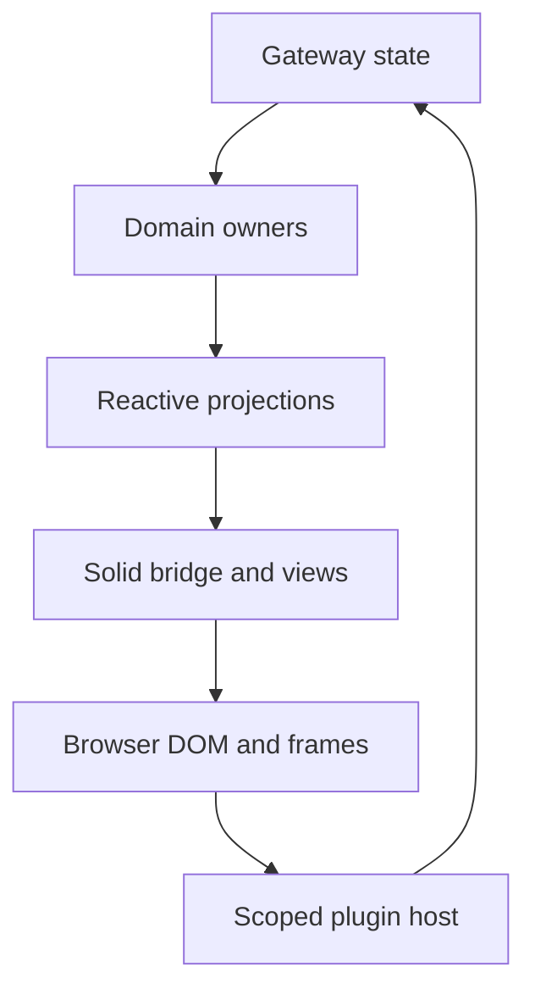

Codex review: needs real behavior proof before merge.

## What this changes

This PR replaces Lit rendering for boards, dashboards, plugin views, Portals, and Systems with Solid 2.

**Example:** Reorder two loaded dashboard widgets containing an unsent draft.
- **Before:** Lit renders the widgets and retains their iframe state.
- **After:** Solid renders the widgets while preserving iframe identity and draft state.

## Review scores

| Measure | Result | What it means |
|---|---|---|
| **Overall readiness** | 🦐 gold shrimp **(3/6)** | Useful migration with inspected visual evidence, one unresolved P2 regression, and incomplete validation of the rewritten authority boundary. |
| **Proof confidence** | 🦐 gold shrimp **(3/6)** | Real behavior proof is necessary before merge. See [Before merge](#before-merge). |
| **Patch quality** | 🦐 gold shrimp **(3/6)** | Security review found an item that needs attention. |

## Product

**Kind:** Refactor · **Worth it:** Yes · **Fix scope:** Complete
**User problem:** Users should retain existing page appearance, widget drafts, iframe identity, and interactions throughout the Solid migration.
**Reason:** The maintainer-directed migration replaces the registered Lit implementations and preserves existing domain and SDK owners without new settings or storage.

## Merge readiness

⛔ **Blocked before merge - 5 items remain**

Keep this PR open: the maintainer-directed migration remains distinct work, but the prior board translation regression is unresolved.

**Priority:** P2
**Reviewed head:** `337bea708f613301aaa9067c74978f4b4015e6e3`

## Before merge

- [ ] **Add real behavior proof** - Authority-chain proof required: supply redacted browser logs or a diagnostic recording showing an active native-plugin request succeeding and retained handles rejected before Gateway I/O after session reassignment, view removal, and registration replacement, including delayed invocation after retirement; screenshots support visual parity, while the inspected retirement tests mock the request boundary. After adding proof, update the PR body; ClawSweeper should re-review automatically. If it does not, the PR author or someone with repository write access can comment `@clawsweeper re-review`.
- [ ] **Use reactive translations throughout the ported board renderers (P2)** - This prior finding remains unresolved: changing the UI language while a pending widget is mounted leaves “Needs approval,” its action labels, and widget menu text in the previous language. These components import t from i18n/index.ts, which reads plain state without subscribing to locale changes; the replaced Lit parent supplied that subscription through I18nController. Use lib/reactive/i18n.ts in board-widget-capabilities.solid.tsx, board-widget-cell-render.solid.tsx, board-widget-cell.solid.tsx, board-mcp-app-content.tsx, board-document.tsx, and the frame's JSX translation expressions.
- [ ] **Resolve security review attention item** - Native-plugin handle retirement needs final-effect validation; no concrete authorization bypass was established.
- [ ] **Resolve merge risk** - The rewritten native-plugin lifecycle must preserve revocation of retained operator-authority handles across session reassignment, registration replacement, and view removal.
- [ ] **Explain or restore the original intent of Board locale refresh** - unknown: The replaced Lit elements inherit automatic locale refresh from OpenClawLitElement; file history was inspected, but the original subscription's introduction was not established.

## Findings

- [P2] Use reactive translations throughout the ported board renderers — `ui/src/components/board/board-widget-capabilities.solid.tsx:3`

### Provenance

- `Board locale refresh` changes intended behavior without addressing why it exists (unknown: The replaced Lit elements inherit automatic locale refresh from OpenClawLitElement; file history was inspected, but the original subscription's introduction was not established.)

### Tests

- Missing end-to-end proof: Missing a browser/Gateway trace showing allowed native-plugin I/O and rejection of retained handles after reassignment, removal, and registration replacement.

<strong>Agent review details</strong>

### How this fits together

The Control UI consumes Gateway state and plugin registrations, renders browser pages, and routes interactions through existing domain and SDK owners.

### Technical review

Best possible solution:

Complete the existing Solid cutover while restoring reactive board translations and preserving the established plugin retirement boundary.

Do we have a high-confidence way to reproduce the issue?

Source establishes the locale regression: mount a pending board widget in English, then change language; nonreactive translation expressions retain English labels despite the locale notification.

Is this the best way to solve the issue?

The bridge-based cutover follows the existing migration architecture, but the board renderers must consume the shared reactive translation adapter.

Full review comments:

- [P2] Use reactive translations throughout the ported board renderers — `ui/src/components/board/board-widget-capabilities.solid.tsx:3`
  This prior finding remains unresolved: changing the UI language while a pending widget is mounted leaves “Needs approval,” its action labels, and widget menu text in the previous language. These components import t from i18n/index.ts, which reads plain state without subscribing to locale changes; the replaced Lit parent supplied that subscription through I18nController. Use lib/reactive/i18n.ts in board-widget-capabilities.solid.tsx, board-widget-cell-render.solid.tsx, board-widget-cell.solid.tsx, board-mcp-app-content.tsx, board-document.tsx, and the frame's JSX translation expressions.
  Confidence: 0.99

Overall correctness: patch is incorrect
Overall confidence: 0.91

AGENTS.md: found and applied where relevant.

Codex review notes: model internal, reasoning medium; reviewed against [072f977edd46](https://github.com/openclaw/openclaw/commit/072f977edd46c7134dbdb05ec00fac03f6cf8069).

### Merge-risk options

**Maintainer options:**
1. **Validate the retained-handle boundary (recommended)**  
   Demonstrate that current native-plugin operations succeed and retired handles cannot reach Gateway effects through the rewritten lifecycle.
2. **Pause the migration**  
   Keep the existing Lit implementation until the native-plugin retirement boundary can be validated.

### Provenance checked

- `Board rendering and retained widgets` keeps the original intent (8a66aa76dd948b381d255bd02b3d4bd9cdfd867f: Provide the session-dashboard grid, tabs, widget cells, and interaction engine; later retention fixes preserve loaded documents across view changes.)
- `Native plugin views` keeps the original intent (6a97159ececbf6c0f5a2180b97d761ba1c5fe4df: Expose experimental native UI through a shared SDK while retaining core identity, send admission, and handle retirement.)
- `External plugin-frame authentication` keeps the original intent (efa8075c6831faf8400e6bc40c4f52f401d449d2: Use scoped frame grants and a browser probe to render authenticated plugin tabs without exposing the shared bearer token.)

### Testing

Proof path: shipped entry point.

### Security

Needs attention: Native-plugin handle retirement needs final-effect validation; no concrete authorization bypass was established.

### Evidence

What I checked:

- **Pinned change and current main:** The introduced comparison contains the Solid migration; fetched main still implements the board view as a Lit element. Live REST confirms the reviewed head remains open and mergeable. ([`ui/src/components/board/board-view.ts:58`](https://github.com/openclaw/openclaw/blob/072f977edd46c7134dbdb05ec00fac03f6cf8069/ui/src/components/board/board-view.ts#L58), [072f977edd46](https://github.com/openclaw/openclaw/commit/072f977edd46c7134dbdb05ec00fac03f6cf8069))
- **Unresolved translation regression:** The new capabilities renderer imports nonreactive t. Its replaced Lit parent inherited automatic locale refresh, whereas the Solid translation adapter explicitly subscribes to locale changes. ([`ui/src/components/board/board-widget-capabilities.solid.tsx:3`](https://github.com/openclaw/openclaw/blob/337bea708f613301aaa9067c74978f4b4015e6e3/ui/src/components/board/board-widget-capabilities.solid.tsx#L3), [337bea708f61](https://github.com/openclaw/openclaw/commit/337bea708f613301aaa9067c74978f4b4015e6e3))
- **Standalone fallback corrected:** PluginViewContent now uses useOptionalApplication and renders the built-in fallback when no plugin registration exists, addressing the prior application-context finding. ([`ui/src/plugins/control-ui-view.solid.tsx:87`](https://github.com/openclaw/openclaw/blob/337bea708f613301aaa9067c74978f4b4015e6e3/ui/src/plugins/control-ui-view.solid.tsx#L87), [337bea708f61](https://github.com/openclaw/openclaw/commit/337bea708f613301aaa9067c74978f4b4015e6e3))
- **Authority boundary:** The port intercepts session and registration transitions synchronously, aborts mounted scopes, and checks connectivity before forwarding retained host requests; the inspected tests substitute a mocked request function. ([`ui/src/plugins/control-ui-view.solid.tsx:129`](https://github.com/openclaw/openclaw/blob/337bea708f613301aaa9067c74978f4b4015e6e3/ui/src/plugins/control-ui-view.solid.tsx#L129), [337bea708f61](https://github.com/openclaw/openclaw/commit/337bea708f613301aaa9067c74978f4b4015e6e3))
- **Existing plugin trust contract:** https://github.com/openclaw/openclaw/pull/134943 explicitly accepts trusted same-origin native modules sharing the operator's authority, while requiring retired view and connection handles to be revoked. ([`ui/src/plugins/control-ui-host.ts:136`](https://github.com/openclaw/openclaw/blob/6a97159ececbf6c0f5a2180b97d761ba1c5fe4df/ui/src/plugins/control-ui-host.ts#L136), [6a97159ececb](https://github.com/openclaw/openclaw/commit/6a97159ececbf6c0f5a2180b97d761ba1c5fe4df))
- **Visual evidence inspected:** Four prepared before/after sheets show matching desktop/mobile and light/dark route layouts. The populated-state comment supplies additional screenshots, but those attachments were unavailable through the browser reader with Cache miss; that inspection limit is not a contributor defect. ([337bea708f61](https://github.com/openclaw/openclaw/commit/337bea708f613301aaa9067c74978f4b4015e6e3))

### PR surface

PR surface statistics unavailable: the file list is incomplete.

### Review metrics

| Metric | Value | Why it matters |
|---|---|---|
| **Production versus test growth** | Production UI net +1,590 LOC; tests/support net +426 LOC | Verified against the pinned introduced diff; the body explains typed bridge bindings and retained-view teardown growth as an accepted migration tradeoff. |

### Labels

Label changes:

- add `rating: 🦐 gold shrimp`: Overall readiness is 🦐 gold shrimp; proof is 🦐 gold shrimp and patch quality is 🦐 gold shrimp.
- remove `rating: 🦪 silver shellfish`: Current PR rating is `rating: 🦐 gold shrimp`, so this older rating label is no longer current.

Label justifications:

- `P2`: This is a substantial planned UI migration with a bounded language-switch regression.
- `merge-risk: 🚨 security-boundary`: The port rewrites the lifetime machinery controlling retained native-plugin handles with operator-wide Gateway authority.
- `rating: 🦐 gold shrimp`: Overall readiness is 🦐 gold shrimp; proof is 🦐 gold shrimp and patch quality is 🦐 gold shrimp.
- `status: 📣 needs proof`: The PR needs real behavior proof before ClawSweeper can clear the contributor ask.
- `proof: 📸 screenshot`: Contributor real behavior proof includes screenshot evidence.

### Rank-up moves

Optional improvements that raise the rating; they are not merge blockers.

- Add final-effect proof showing current native-plugin requests succeed and retired handles are rejected before Gateway I/O; redact IPs, API keys, phone numbers, and non-public endpoints.

### Rating scale

6/6 🦀 challenger crab · 5/6 🦞 diamond lobster · 4/6 🐚 platinum hermit · 3/6 🦐 gold shrimp · 2/6 🦪 silver shellfish · 1/6 🧂 unranked krab. Overall follows the weaker of proof and patch quality; ✨ marks media proof (a screenshot, video, or linked artifact) that directly shows the changed behavior.

### Workflow

ClawSweeper edits this one comment on every review. Comment `@clawsweeper re-review` for a fresh review only. Repair and merge execution lanes are retired.

### History

Review history (16 earlier review cycles; latest 8 shown)

<!-- clawsweeper-review-history v=1 total=16 -->
- reviewed 2026-10-11T14:12:13.136Z sha 7fa0c16b8b895cce6e3f48d671f62014779f6848 :: needs real behavior proof before merge. :: [P2] Use reactive translations in every ported board renderer
- reviewed 2026-10-11T15:13:59.342Z sha 7f8b8ee8ddebfeed828a870fd7ee8cc68e76102c :: needs real behavior proof before merge. :: [P2] Use reactive translations in every ported board renderer
- reviewed 2026-10-11T15:36:48.634Z sha 601dd04c3bf23667b93659f0cf0b5a1d6b0aee60 :: needs real behavior proof before merge. :: [P2] Use reactive translations in every ported board renderer
- reviewed 2026-10-11T16:36:04.321Z sha 6310dca5c001c0b399b5fc2e25f263524eb04d84 :: needs real behavior proof before merge. :: [P2] Use reactive translations throughout the ported board renderers
- reviewed 2026-10-11T16:49:39.963Z sha abf4d18a81524f6cd6b2df937d6ddbc0fcc00106 :: needs real behavior proof before merge. :: [P2] Use reactive translations throughout the ported board renderers
- reviewed 2026-10-11T17:55:53.063Z sha 7ee82b0327193fc88d41bbe6c145036b18801f88 :: needs real behavior proof before merge. :: [P2] Use reactive translations throughout the ported board renderers
- reviewed 2026-10-11T19:27:12.160Z sha 4917d29a4c766d8485edece025f8390952c367fb :: needs real behavior proof before merge. :: [P2] Use reactive translations throughout the ported board renderers
- reviewed 2026-10-11T20:06:55.911Z sha c0b7760b4c5fb273ca242b65e3663d277123bda6 :: needs real behavior proof before merge. :: [P2] Use reactive translations throughout the ported board renderers | [P2] Preserve built-in plugin-view rendering without application context

_Reviewed October 11, 2026, 4:53 PM ET / 20:53 UTC (Revision 17)._

<!-- clawsweeper-security:security-sensitive item=168871 sha=337bea708f613301aaa9067c74978f4b4015e6e3 confidence=high updated_at=2026-10-11T20:48:05Z reviewed_at=2026-10-11T20:53:38.978Z lease_owner=github-run-38173648357-1 lease_comment_id=6113587259 source_revision=43749bca67478c14f711e3183a904a2bbc35182e5ae2cdfddec241f81ab8981c -->
<!-- clawsweeper-verdict:needs-human item=168871 sha=337bea708f613301aaa9067c74978f4b4015e6e3 confidence=high updated_at=2026-10-11T20:48:05Z reviewed_at=2026-10-11T20:53:38.978Z lease_owner=github-run-38173648357-1 lease_comment_id=6113587259 source_revision=43749bca67478c14f711e3183a904a2bbc35182e5ae2cdfddec241f81ab8981c hold=security findings=1 -->
<!-- clawsweeper-review-state:blocked item=168871 sha=337bea708f613301aaa9067c74978f4b4015e6e3 v=1 -->

<!-- clawsweeper-review-version item=168871 reviewed_at=2026-10-11T20:53:38.978Z sha=337bea708f613301aaa9067c74978f4b4015e6e3 source_revision=43749bca67478c14f711e3183a904a2bbc35182e5ae2cdfddec241f81ab8981c lease_owner=github-run-38173648357-1 lease_comment_id=6113587259 v=1 -->

<!-- clawsweeper-review item=168871 -->