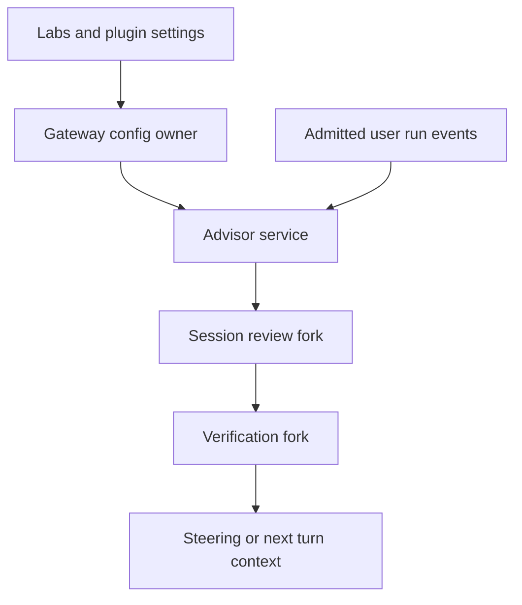

Codex review: needs maintainer review before merge.

## What this changes

Adds a default-off Advisor plugin that reviews ongoing agent work, verifies proposed corrections, and delivers approved advice through active steering or next-turn context.

**Example:** Advisor is enabled with everyToolCalls set to 3 while an agent fixes a README typo.
- **Before:** The agent can continue editing unrelated CI files without automatic feedback.
- **After:** After settled tool calls, Advisor can verify the scope drift and advise the agent to return to the README typo.

## Review scores

| Measure | Result | What it means |
|---|---|---|
| **Overall readiness** | 🐚 platinum hermit **(4/6)** | Coherent, useful implementation with inspected UI proof, reported live review behavior, focused contract coverage, and no actionable findings. |
| **Proof confidence** | 🐚 platinum hermit **(4/6)** ✨ media proof bonus | Sufficient (screenshot): Inspected before/after Labs and plugin-settings screenshots; the body records isolated-Gateway Codex and built-in live reviews preserving requested polling and rejecting false corrections, plus earlier-head steering delivery. Current approval-to-delivery is supported by plugin tests; a fresh positive live case remains optional for this maintainer-authored PR. |
| **Patch quality** | 🐚 platinum hermit **(4/6)** | No actionable review findings were identified. |

## Product

**Kind:** Feature · **Worth it:** Yes · **Fix scope:** Complete
**User problem:** Users must notice when agents drift beyond requests, repeat unproductive work, or make claims unsupported by tool results.
**Reason:** The maintainer-authored experiment provides bounded, verified advice through existing owners, with explicit opt-in, cost disclosure, and documented model limitations.

## Merge readiness

✅ **Ready for maintainer review**

Keep this PR open: it adds distinct, maintainer-approved experimental functionality, and the reviewed patch has no actionable findings. The previous conflict is resolved and the current head’s CI gate passes.

**Priority:** P2
**Reviewed head:** `e29d04b4e3cefe6e07b48316ef6c2ce993821b34`

## Before merge

None.

## Findings

None.

### Tests

- Missing end-to-end proof: A live current-verifier approval followed by steering or next-turn delivery would strengthen coverage; the body identifies earlier-head live delivery and current mocked approval-path coverage.

<strong>Agent review details</strong>

### How this fits together

Labs saves the plugin opt-in through the existing config owner; the plugin consumes admitted user-run events, forks session context for model review, and sends verified advice through existing session workflow APIs.

### Technical review

Best possible solution:

Ship Advisor as the opt-in plugin using the existing session review, steering, and config owners.

Do we have a high-confidence way to reproduce the issue?

This is a new capability rather than a reproducible upstream bug; source inspection confirms the trigger, verification, and delivery paths without executing target code.

Is this the best way to solve the issue?

The plugin placement fits the existing architecture, reuses merged SDK capabilities, and keeps model judgment and optional configuration out of core agent policy.

AGENTS.md: found and applied where relevant.

Codex review notes: model internal, reasoning medium; reviewed against [a97192d2556b](https://github.com/openclaw/openclaw/commit/a97192d2556bfbf28c457dec89655eb0cb5638a5).

### Provenance checked

- `Scalar input rendering and edit preservation` keeps the original intent (https://github.com/openclaw/openclaw/pull/126402: Preserve primitive string identity and prevent rounded 64-bit identifiers; later Solid and ownership refactors retained that contract.)
- `Labs toggles and settings ownership` keeps the original intent (https://github.com/openclaw/openclaw/pull/110359: Provide a discoverable registry-driven home for experimental gates, subsequently using canonical default restoration and config patching.)
- `Interactive elements inside toggle rows` changes intended behavior with a stated reason (eca633a8801b0b884d88fe65e7096a4760102b83: Share presentation primitives across renderers; the previous handler excluded the switch but also toggled when nested links were clicked.)
- `Plugin manifest hint normalization` keeps the original intent (589f28b57aff2fff2af369acae52ab60f8b4d7de: Keep manifest metadata normalization in the shared plugin owner; the new optional hint extends that owner without changing existing hints.)

### Testing

Proof path: shipped entry point.

### Security

None.

### Evidence

What I checked:

- **Introduced patch and current main:** Reviewed the pinned introduced diff. Current main contains the supporting SDK capabilities but has no Advisor plugin or Labs row, so those merged prerequisites do not supersede this PR. ([`extensions/advisor/index.ts:46`](https://github.com/openclaw/openclaw/blob/e29d04b4e3cefe6e07b48316ef6c2ce993821b34/extensions/advisor/index.ts#L46), [e29d04b4e3ce](https://github.com/openclaw/openclaw/commit/e29d04b4e3cefe6e07b48316ef6c2ce993821b34))
- **Current merge state:** GitHub reports the reviewed head as mergeable with clean merge state; the preceding review’s conflict blocker no longer applies. ([e29d04b4e3ce](https://github.com/openclaw/openclaw/commit/e29d04b4e3cefe6e07b48316ef6c2ce993821b34))
- **Exact-head CI:** The current head’s openclaw/ci-gate succeeds; the complete paginated check-run response contains no failed or unfinished checks. ([e29d04b4e3ce](https://github.com/openclaw/openclaw/commit/e29d04b4e3cefe6e07b48316ef6c2ce993821b34))
- **Existing authority owners:** The merged fork owner checks conversation access, session visibility, execution lifetime, and cancellation; steering checks plugin lifetime and adds hidden guidance without sender-owner authority. The contracts and live evidence are recorded in https://github.com/openclaw/openclaw/pull/170146 and https://github.com/openclaw/openclaw/pull/170152. ([`src/gateway/server-plugin-subagent-runtime.ts:208`](https://github.com/openclaw/openclaw/blob/e29d04b4e3cefe6e07b48316ef6c2ce993821b34/src/gateway/server-plugin-subagent-runtime.ts#L208), [e29d04b4e3ce](https://github.com/openclaw/openclaw/commit/e29d04b4e3cefe6e07b48316ef6c2ce993821b34))
- **Inspected visual proof:** Inspected all three prepared screenshots: Labs before, Labs with Advisor enabled and Configure available, and the plugin settings page with the multiline Review instructions field. ([e29d04b4e3ce](https://github.com/openclaw/openclaw/commit/e29d04b4e3cefe6e07b48316ef6c2ce993821b34))
- **Approved additive contract and experimental tradeoff:** The collaborator-authored direction includes three plugin settings and an optional multiline manifest hint. Existing hints and saved preferences retain their behavior; the author explicitly records default-off operation, additional model calls, model-dependent false corrections, and restricted-profile fork limitations. ([`extensions/advisor/openclaw.plugin.json:11`](https://github.com/openclaw/openclaw/blob/e29d04b4e3cefe6e07b48316ef6c2ce993821b34/extensions/advisor/openclaw.plugin.json#L11), [e29d04b4e3ce](https://github.com/openclaw/openclaw/commit/e29d04b4e3cefe6e07b48316ef6c2ce993821b34))

Likely related people:

- **Ayaan Zaidi:** Raw commit ae2be85a519714827e832d64f16afe81c4886b6a adds src/plugins/host-hook-steering.ts:12 relative to its recorded parents. This identifies author metadata, not feature responsibility or a PR merger. (role: source-line author; confidence: high; commits: [ae2be85a5197](https://github.com/openclaw/openclaw/commit/ae2be85a519714827e832d64f16afe81c4886b6a); files: `src/plugins/host-hook-steering.ts`)
- **Peter Steinberger:** Raw commit bf58e95ee3f583c338f48225ad9c5b3479e7d8d7 adds ui/src/components/config-form.scalar-edit.ts:8 relative to its recorded parents. This identifies author metadata, not feature responsibility or a PR merger. (role: source-line author; confidence: high; commits: [bf58e95ee3f5](https://github.com/openclaw/openclaw/commit/bf58e95ee3f583c338f48225ad9c5b3479e7d8d7); files: `ui/src/components/config-form.scalar-edit.ts`)
- **Hiroshi Tanaka:** Raw commit 55f1738d50fb10a7d64caffc4ada6e0cc6cc24c7 adds ui/src/components/config-form.scalar-edit.ts:2 relative to its recorded parents. This identifies author metadata, not feature responsibility or a PR merger. (role: source-line author; confidence: medium; commits: [55f1738d50fb](https://github.com/openclaw/openclaw/commit/55f1738d50fb10a7d64caffc4ada6e0cc6cc24c7); files: `ui/src/components/config-form.scalar-edit.ts`)

### PR surface

Source +756, Tests +1138, Docs +236, Config +18, Generated 0, Other +6. Total +2154 across 31 files. Added test files: 1.

View PR surface stats

| Area | Files | Added | Removed | Net |
|---|---:|---:|---:|---:|
| Source | 15 | 854 | 98 | +756 |
| Tests | 4 | 1143 | 5 | +1138 |
| Docs | 7 | 240 | 4 | +236 |
| Config | 2 | 18 | 0 | +18 |
| Generated | 2 | 3 | 3 | 0 |
| Other | 1 | 6 | 0 | +6 |
| **Total** | **31** | **2264** | **110** | **+2154** |

### Review metrics

| Metric | Value | Why it matters |
|---|---|---|
| **Plugin configuration** | 3 settings | Adds everyToolCalls, everyMinutes, and optional reviewInstructions under the default-off Advisor plugin. |
| **Public manifest metadata** | 1 optional hint | Adds multiline across manifest normalization, protocol serialization, and the existing scalar form renderer. |

### Labels

Label changes:

- add `proof: sufficient`: Contributor real behavior proof is sufficient.
- add `status: 👀 ready for maintainer look`: ClawSweeper has no concrete contributor-facing blocker left for this PR.
- remove `status: ⏳ waiting on author`: Current PR status label is `status: 👀 ready for maintainer look`.

Label justifications:

- `P2`: Useful agent-work improvement with limited blast radius because the plugin is experimental and disabled by default.
- `merge-risk: 🚨 compatibility`: Extends the public plugin manifest and Gateway hint contract with optional multiline metadata; the maintainer-authored direction accepts this additive expansion, and existing fields retain their rendering.
- `rating: 🐚 platinum hermit`: Overall readiness is 🐚 platinum hermit; proof is 🐚 platinum hermit and patch quality is 🐚 platinum hermit.
- `status: 👀 ready for maintainer look`: ClawSweeper has no concrete contributor-facing blocker left for this PR.
- `proof: sufficient`: Contributor real behavior proof is sufficient.
- `proof: 📸 screenshot`: Contributor real behavior proof includes screenshot evidence.

### Rank-up moves

Optional improvements that raise the rating; they are not merge blockers.

- Optionally capture a redacted live run where the current verifier approves a correction and the agent receives it through steering or next-turn fallback.

### Rating scale

6/6 🦀 challenger crab · 5/6 🦞 diamond lobster · 4/6 🐚 platinum hermit · 3/6 🦐 gold shrimp · 2/6 🦪 silver shellfish · 1/6 🧂 unranked krab. Overall follows the weaker of proof and patch quality; ✨ marks media proof (a screenshot, video, or linked artifact) that directly shows the changed behavior.

### Workflow

ClawSweeper edits this one comment on every review. Comment `@clawsweeper re-review` for a fresh review only. Repair and merge execution lanes are retired.

### History

Review history (12 earlier review cycles; latest 8 shown)

<!-- clawsweeper-review-history v=1 total=12 -->
- reviewed 2026-10-12T07:24:59.388Z sha 5b2d9e5e2a0c12a0dddec8fc55535244d3bcee77 :: needs real behavior proof before merge. :: [P1] Disable hosted search when tool calls are denied | [P2] Preserve tool evidence in non-Codex review context | [P3] Describe the current triggers and delivery behavior in Labs
- reviewed 2026-10-12T07:42:03.666Z sha 3d0b0aa8d692a2d3231aa5567c83fc3ab830349e :: needs real behavior proof before merge. :: [P1] Authorize the requested session before forking its context | [P1] Disable hosted search when tool calls are denied | [P2] Preserve tool evidence in built-in review context | [P3] Describe the current triggers and delivery behavior in Labs
- reviewed 2026-10-12T08:43:40.424Z sha 4591b5a977760cecfa1f7bc8753114cde5a69633 :: needs real behavior proof before merge. :: [P1] Authorize the requested session before reading its context | [P1] Disable inherited hosted search in denied forks | [P2] Support reviews after the parent turn releases its inference context | [P2] Preserve tool evidence for built-in Advisor reviews | [P3] Describe tool-start triggers and active steering in Labs
- reviewed 2026-10-12T17:38:26.861Z sha 57008e988e285ce62b725e80c38df2bf357903ce :: needs real behavior proof before merge. :: [P1] Authorize the requested session before reading its context | [P1] Disable inherited hosted search in denied Codex forks | [P1] Remove hosted tools from built-in review requests before dispatch | [P2] Support Codex reviews started after parent cleanup | [P3] Describe the current triggers and delivery behavior in Labs
- reviewed 2026-10-12T18:05:46.077Z sha 57008e988e285ce62b725e80c38df2bf357903ce :: needs real behavior proof before merge. :: [P1] Authorize the requested session before reading its context | [P1] Disable inherited hosted search in denied Codex forks | [P1] Remove hosted tools from built-in review requests before dispatch | [P2] Support Codex reviews started after parent cleanup | [P3] Describe the current triggers and delivery behavior in Labs
- reviewed 2026-10-12T19:26:43.943Z sha 57008e988e285ce62b725e80c38df2bf357903ce :: needs real behavior proof before merge. :: [P1] Authorize the requested session before reading its context | [P1] Disable inherited hosted search in denied Codex forks | [P1] Remove hosted tools from built-in review requests before dispatch | [P2] Support Codex reviews started after parent cleanup | [P2] Preserve ordinary Responses side questions when disabling tools | [P3] Describe tool-start triggers and active steering in Labs
- reviewed 2026-10-14T02:33:29.243Z sha 1b75f3ab75f4e77a349387ef26f661e491ffa922 :: needs maintainer review before merge. :: none
- reviewed 2026-10-14T08:11:49.154Z sha f6931018db5968a3e07402719df7e56e6fbde7f8 :: needs changes before merge. :: none

_Reviewed October 14, 2026, 5:02 AM ET / 09:02 UTC (Revision 13)._

<!-- clawsweeper-verdict:needs-human item=169564 sha=e29d04b4e3cefe6e07b48316ef6c2ce993821b34 confidence=high updated_at=2026-10-14T08:58:13Z reviewed_at=2026-10-14T09:02:52.801Z lease_owner=github-run-38538787670-1 lease_comment_id=6164684506 source_revision=07f630034f26cfe638d602879837752211d8afe2b837941fa4b2d1819c839099 hold=not_opted_in findings=0 -->
<!-- clawsweeper-review-state:ready item=169564 sha=e29d04b4e3cefe6e07b48316ef6c2ce993821b34 v=1 -->

<!-- clawsweeper-review-version item=169564 reviewed_at=2026-10-14T09:02:52.801Z sha=e29d04b4e3cefe6e07b48316ef6c2ce993821b34 source_revision=07f630034f26cfe638d602879837752211d8afe2b837941fa4b2d1819c839099 lease_owner=github-run-38538787670-1 lease_comment_id=6164684506 v=1 -->

<!-- clawsweeper-review item=169564 -->