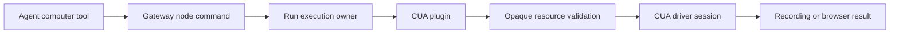

Codex review: found issues before merge. _Reviewed August 15, 2026, 2:55 AM ET / 06:55 UTC._

# ClawSweeper review

## What this changes

This PR enables CUA recording/replay and replaces browser file paths with execution-scoped opaque resource handles and run-owned cleanup.

## Merge readiness

⛔ **Blocked by patch quality or review findings - 10 items remain**

Keep open: four P1 current-head lifecycle and capability defects remain, including the two earlier cleanup blockers, so this branch is not merge-ready.

**Priority:** P1
**Reviewed head:** `42b5519ec99ddc444a0f3ac6f71c1632e2416287`

## Review scores

| Measure | Result | What it means |
|---|---|---|
| **Overall readiness** | 🧂 unranked krab **(1/6)** | The implementation has a sound containment direction but four P1 lifecycle and capability regressions block merge readiness. |
| **Proof confidence** | 🌊 off-meta tidepool | Not applicable: This maintainer-authored PR is exempt from the contributor proof gate; its supplied unit and static checks do not resolve the current P1 defects. |
| **Patch quality** | 🧂 unranked krab **(1/6)** | Security review found an item that needs attention. |

## Verification

| Check | Result | Evidence |
|---|---|---|
| **Real behavior** | Not applicable | Not applicable: This maintainer-authored PR is exempt from the contributor proof gate; its supplied unit and static checks do not resolve the current P1 defects. |
| **Evidence reviewed** | 7 items | Current main does not already implement recording: Current main keeps the four recording actions contract-only, so the central capability is not already solved or released. Harness cleanup is one-sided: The changed tool filters all execution-owned actions without a cleanup callback, while the Codex app-server builds the same tool surface without forwarding one. Failed stop loses the cleanup owner: The changed recording stop path clears active ownership before awaiting the driver; an error leaves retries and terminal close unable to call stop_recording. |
| **Findings** | 4 actionable findings | [P1] Forward terminal cleanup into every executable harness [P1] Retain recording ownership until stop succeeds [P1] Discard unreachable resources on normal completion |
| **Security** | Needs attention | Remove resources after normal completion: The completion path clears resource handles without deleting their directories, retaining potentially sensitive recordings or downloads beyond the execution that owned them. |

## How this fits together

The agent-facing computer tool sends run-bound commands through the Gateway to a paired CUA node, which owns a driver session and temporary resources. The plugin returns bounded observations and opaque handles rather than native paths, then must close that state when the run ends.

## Before merge

- [ ] **Forward terminal cleanup into every executable harness (P1)** - This filter removes all six execution-owned actions when no callback is supplied. Both the Codex app-server and Copilot bridge construct this tool surface without the callback, so CUA advertises recording/browser-file support but those real runtimes silently omit it; carry the terminal owner through each harness instead of hiding the family.
- [ ] **Retain recording ownership until stop succeeds (P1)** - `state.active` is cleared before the driver call. If `stop_recording` throws or returns an error, a retry and terminal close see no active recording and never issue a stop; clear the state only after a successful stop and cover the failure/retry path.
- [ ] **Discard unreachable resources on normal completion (P1)** - Completion calls `dispose(false)`, which drops the handle map but leaves the execution directory on disk. The recording/download data is then unreachable by design, so delete it on completion or transfer it to a durable artifact owner before clearing the map.
- [ ] **Stage host-owned files for browser uploads (P1)** - The new upload contract accepts only execution-owned file handles, but this branch creates them only from browser downloads. That removes normal user-file upload; add an approved attachment or host-file staging path that mints same-execution handles without restoring raw paths.
- [ ] **Resolve security concern: Remove resources after normal completion** - The completion path clears resource handles without deleting their directories, retaining potentially sensitive recordings or downloads beyond the execution that owned them.
- [ ] **Resolve merge risk (P1)** - Merging now removes normal browser upload capability because no approved attachment or file-staging path can mint an acceptable upload handle.
- [ ] **Resolve merge risk (P1)** - Normal completion retains recordings and downloads under the node temp root after their opaque handles are discarded; direct driver declarations were unavailable for an independent stop-contract check.
- [ ] **Improve patch quality** - Forward a terminal cleanup owner into Codex, Copilot, and every other executable computer-tool harness.
- [ ] **Improve patch quality** - Keep recording state through failed stops and remove or transfer resources on every terminal path.
- [ ] **Improve patch quality** - Add a host-owned attachment/file staging path and boundary regressions for browser upload.

## Findings

- [P1] Forward terminal cleanup into every executable harness — `src/agents/tools/computer-tool.ts:1058-1062`
- [P1] Retain recording ownership until stop succeeds — `extensions/cua-computer/src/recording-actions.ts:190-193`
- [P1] Discard unreachable resources on normal completion — `extensions/cua-computer/src/commands.ts:614-615`
- [medium] Remove resources after normal completion — `extensions/cua-computer/src/commands.ts:614`

<strong>Agent review details</strong>

### Security

Needs attention: Opaque-handle containment is strong, but normal completion retains inaccessible recording and download data in the node temp root.

### PR surface

Source +977, Tests +275, Docs +3. Total +1255 across 30 files.

View PR surface stats

| Area | Files | Added | Removed | Net |
|---|---:|---:|---:|---:|
| Source | 20 | 1084 | 107 | +977 |
| Tests | 9 | 757 | 482 | +275 |
| Docs | 1 | 5 | 2 | +3 |
| Config | 0 | 0 | 0 | 0 |
| Generated | 0 | 0 | 0 | 0 |
| Other | 0 | 0 | 0 | 0 |
| **Total** | **30** | **1846** | **591** | **+1255** |

### Review metrics

| Metric | Value | Why it matters |
|---|---|---|
| **Production versus test delta** | production +911/-105 (net +806); tests/support +930/-484 (net +446); docs +5/-2 (net +3) | The feature has substantial justified capability growth, but its new lifecycle owner still has four blocking P1 gaps. |
| **Execution-owned actions** | 6 actions gated by cleanup ownership | All browser-file and recording actions disappear in harnesses that do not receive the new callback. |

### Stored data model

Persistent data-model change detected: `serialized state: extensions/cua-computer/src/browser-actions.test.ts`, `serialized state: extensions/cua-computer/src/recording-actions.test.ts`, `serialized state: extensions/cua-computer/src/recording-actions.ts`, `serialized state: src/agents/tools/computer-tool.context.test.ts`, `serialized state: src/agents/tools/computer-tool.test.ts`, `serialized state: src/plugins/computer-use-contract.test.ts`. Confirm migration or upgrade compatibility proof before merge.

### Merge-risk options

**Maintainer options:**
1. **Repair the shared execution owner (recommended)**  
   Forward terminal cleanup through every executable harness and add focused regressions for failed stop, completion cleanup, and attachment-backed upload handles.
2. **Pause the capability expansion**  
   Keep this PR unmerged if a common lifecycle and attachment-staging owner cannot be completed without a broader design change.

### Technical review

Best possible solution:

Use one terminal lifecycle owner across embedded, Codex, and Copilot harnesses; retain recording ownership until confirmed stop; delete or durably transfer every resource on completion; and add a node-owned attachment staging boundary for uploads.

Do we have a high-confidence way to reproduce the issue?

Yes, source-reproducible: a driver stop rejection followed by retry or close demonstrates lost recording ownership, and a completion close demonstrates the unreachable resource directory; a live CUA node was not run.

Is this the best way to solve the issue?

No. The branch narrows native-path authority correctly, but the replacement needs a shared lifecycle owner and host-owned upload staging rather than selectively hiding actions or accepting only download-derived files.

Full review comments:

- [P1] Forward terminal cleanup into every executable harness — `src/agents/tools/computer-tool.ts:1058-1062`
  This filter removes all six execution-owned actions when no callback is supplied. Both the Codex app-server and Copilot bridge construct this tool surface without the callback, so CUA advertises recording/browser-file support but those real runtimes silently omit it; carry the terminal owner through each harness instead of hiding the family.
  Confidence: 0.98
- [P1] Retain recording ownership until stop succeeds — `extensions/cua-computer/src/recording-actions.ts:190-193`
  `state.active` is cleared before the driver call. If `stop_recording` throws or returns an error, a retry and terminal close see no active recording and never issue a stop; clear the state only after a successful stop and cover the failure/retry path.
  Confidence: 0.99
- [P1] Discard unreachable resources on normal completion — `extensions/cua-computer/src/commands.ts:614-615`
  Completion calls `dispose(false)`, which drops the handle map but leaves the execution directory on disk. The recording/download data is then unreachable by design, so delete it on completion or transfer it to a durable artifact owner before clearing the map.
  Confidence: 0.99
- [P1] Stage host-owned files for browser uploads — `src/agents/tools/computer-tool.ts:582-597`
  The new upload contract accepts only execution-owned file handles, but this branch creates them only from browser downloads. That removes normal user-file upload; add an approved attachment or host-file staging path that mints same-execution handles without restoring raw paths.
  Confidence: 0.98

Overall correctness: patch is incorrect
Overall confidence: 0.98

AGENTS.md: found and applied where relevant.

Codex review notes: model internal, reasoning high; reviewed against [7bb3909e4b5a](https://github.com/openclaw/openclaw/commit/7bb3909e4b5ab98d01deef532d02f3e4f7f10e10).

### Labels

Label justifications:

- `P1`: The PR leaves paired-node browser-file and recording workflows unavailable or incorrectly cleaned up in real agent runtimes.
- `merge-risk: 🚨 compatibility`: Existing browser uploads lose their usable source path when raw file paths are replaced with handles that no attachment flow can mint.
- `merge-risk: 🚨 security-boundary`: Normal completion retains inaccessible recording/download data after the model-facing capability is discarded.
- `merge-risk: 🚨 availability`: A failed recording stop clears the only owner that could retry stop during terminal cleanup.
- `rating: 🧂 unranked krab`: Overall readiness is 🧂 unranked krab; proof is 🌊 off-meta tidepool and patch quality is 🧂 unranked krab.
- `status: ⏳ waiting on author`: ClawSweeper has contributor-facing work open and is waiting for author action. Not applicable: This maintainer-authored PR is exempt from the contributor proof gate; its supplied unit and static checks do not resolve the current P1 defects.

### Evidence

Security concerns:

- [medium] Remove resources after normal completion — `extensions/cua-computer/src/commands.ts:614`
  The completion path clears resource handles without deleting their directories, retaining potentially sensitive recordings or downloads beyond the execution that owned them.
  Confidence: 0.99

What I checked:

- **Current main does not already implement recording:** Current main keeps the four recording actions contract-only, so the central capability is not already solved or released. ([`src/plugins/computer-use-contract.ts:58`](https://github.com/openclaw/openclaw/blob/7bb3909e4b5a/src/plugins/computer-use-contract.ts#L58), [7bb3909e4b5a](https://github.com/openclaw/openclaw/commit/7bb3909e4b5a))
- **Harness cleanup is one-sided:** The changed tool filters all execution-owned actions without a cleanup callback, while the Codex app-server builds the same tool surface without forwarding one. ([`src/agents/tools/computer-tool.ts:1058`](https://github.com/openclaw/openclaw/blob/42b5519ec99d/src/agents/tools/computer-tool.ts#L1058), [42b5519ec99d](https://github.com/openclaw/openclaw/commit/42b5519ec99d))
- **Failed stop loses the cleanup owner:** The changed recording stop path clears active ownership before awaiting the driver; an error leaves retries and terminal close unable to call stop_recording. ([`extensions/cua-computer/src/recording-actions.ts:190`](https://github.com/openclaw/openclaw/blob/42b5519ec99d/extensions/cua-computer/src/recording-actions.ts#L190), [42b5519ec99d](https://github.com/openclaw/openclaw/commit/42b5519ec99d))
- **Normal completion leaves unreachable data:** Completion passes false to resource disposal; disposal clears the in-memory handle map but removes the execution directory only when discard is true. ([`extensions/cua-computer/src/commands.ts:614`](https://github.com/openclaw/openclaw/blob/42b5519ec99d/extensions/cua-computer/src/commands.ts#L614), [42b5519ec99d](https://github.com/openclaw/openclaw/commit/42b5519ec99d))
- **Upload has no host-owned file source:** The browser upload path resolves only registered file handles, and the only file-handle producer captures files from a browser-download directory; the added test covers only download-to-upload. ([`extensions/cua-computer/src/browser-actions.ts:176`](https://github.com/openclaw/openclaw/blob/42b5519ec99d/extensions/cua-computer/src/browser-actions.ts#L176), [42b5519ec99d](https://github.com/openclaw/openclaw/commit/42b5519ec99d))
- **Feature provenance:** The relevant CUA execution owner appears to date to the current feature commit, while the merged CUA v2/browser foundations were authored by the same recent area contributor. ([`extensions/cua-computer/src/recording-actions.ts:190`](https://github.com/openclaw/openclaw/blob/0b9bfc3a52b8/extensions/cua-computer/src/recording-actions.ts#L190), [0b9bfc3a52b8](https://github.com/openclaw/openclaw/commit/0b9bfc3a52b8))

Likely related people:

- **steipete:** Authored the current feature commit and the merged CUA v2 and browser-family foundations. (role: recent CUA feature owner; confidence: high; commits: [0b9bfc3a52b8](https://github.com/openclaw/openclaw/commit/0b9bfc3a52b85ba766549c0e6af7efa575c43528), [aa7a2fbe0dda](https://github.com/openclaw/openclaw/commit/aa7a2fbe0dda294ed77ee062e67208ade5b486ea), [2af5eca07f5e](https://github.com/openclaw/openclaw/commit/2af5eca07f5e6580527caa5c9a3bd1fe53ed89f5); files: `extensions/cua-computer/src/commands.ts`, `extensions/cua-computer/src/recording-actions.ts`, `src/agents/tools/computer-tool.ts`)
- **Dallin Romney:** Authored the earlier direct CUA driver refactor that remains in the central command path. (role: direct-driver refactor contributor; confidence: medium; commits: [e9b25aa21d7d](https://github.com/openclaw/openclaw/commit/e9b25aa21d7dbd56cab438167a27f33689a61957); files: `extensions/cua-computer/src/commands.ts`)

### Rating scale

| Score | Internal tier | Crab rank | Meaning |
|---:|:---:|---|---|
| **6/6** | S | 🦀 challenger crab | Exceptional readiness |
| **5/6** | A | 🦞 diamond lobster | Very strong readiness |
| **4/6** | B | 🐚 platinum hermit | Good normal PR; ordinary maintainer review |
| **3/6** | C | 🦐 gold shrimp | Useful, but confidence is limited |
| **2/6** | D | 🦪 silver shellfish | Proof or implementation needs work |
| **1/6** | F | 🧂 unranked krab | Not merge-ready |
| N/A | NA | 🌊 off-meta tidepool | Rating does not apply |

Overall follows the weaker of proof and patch quality.
Shiny media proof means a screenshot, video, or linked artifact directly shows the changed behavior. Runtime, network, CSP, and security claims still need visible diagnostics.

### Workflow

- ClawSweeper keeps one durable marker-backed review comment per issue or PR.
- Re-runs edit this comment so the latest verdict, findings, and automation markers stay together instead of adding duplicate bot comments.
- A fresh review can be triggered by eligible `@clawsweeper re-review` comments, exact-item GitHub events, scheduled/background review runs, or manual workflow dispatch.
- PR/issue authors and users with repository write access can comment `@clawsweeper re-review` or `@clawsweeper re-run` on an open PR or issue to request a fresh review only.
- Maintainers can also comment `@clawsweeper review` to request a fresh review only.
- Fresh-review commands do not start repair, autofix, rebase, CI repair, or automerge.
- Maintainer-only repair and merge flows require explicit commands such as `@clawsweeper autofix`, `@clawsweeper automerge`, `@clawsweeper fix ci`, or `@clawsweeper address review`.
- Maintainers can comment `@clawsweeper explain` to ask for more context, or `@clawsweeper stop` to stop active automation.

### History

Review history (3 earlier review cycles)

<!-- clawsweeper-review-history v=1 total=3 -->
- reviewed 2026-08-15T05:40:04.236Z sha e26703864b33f28996389c5c31d9fc246cdb3a60 :: found issues before merge. :: [P1] Forward cleanup ownership to every computer-tool runtime | [P1] Discard execution resources after normal completion
- reviewed 2026-08-15T06:21:28.812Z sha 78472966a57fbb792b0356894b741d6ab0f07c07 :: found issues before merge. :: [P1] Propagate terminal cleanup to every computer-tool runtime | [P1] Discard completed execution resources | [P1] Retain recording ownership until stop succeeds | [P1] Provide a host-owned source for upload handles
- reviewed 2026-08-15T06:37:05.405Z sha cebf4dccdf328b9bc37b0a7e1856fe117ee355e2 :: found issues before merge. :: [P1] Propagate cleanup ownership to every computer-tool runtime | [P1] Keep recording ownership until the stop succeeds | [P1] Discard resources after normal completion | [P1] Provide a host-owned source for browser upload handles

<!-- clawsweeper-security:security-sensitive item=124035 sha=42b5519ec99ddc444a0f3ac6f71c1632e2416287 confidence=high updated_at=2026-08-15T06:50:42Z reviewed_at=2026-08-15T06:55:00.261Z lease_owner=github-run-31870396173-1 lease_comment_id=5301021109 source_revision=539ef9a6f82b6438d699302446d7f8716b5e9d2dc695ede05429056f6896305a -->
<!-- clawsweeper-verdict:needs-human item=124035 sha=42b5519ec99ddc444a0f3ac6f71c1632e2416287 confidence=high updated_at=2026-08-15T06:50:42Z reviewed_at=2026-08-15T06:55:00.261Z lease_owner=github-run-31870396173-1 lease_comment_id=5301021109 source_revision=539ef9a6f82b6438d699302446d7f8716b5e9d2dc695ede05429056f6896305a -->

<!-- clawsweeper-review-version item=124035 reviewed_at=2026-08-15T06:55:00.261Z sha=42b5519ec99ddc444a0f3ac6f71c1632e2416287 source_revision=539ef9a6f82b6438d699302446d7f8716b5e9d2dc695ede05429056f6896305a lease_owner=github-run-31870396173-1 lease_comment_id=5301021109 v=1 -->

<!-- clawsweeper-review item=124035 -->