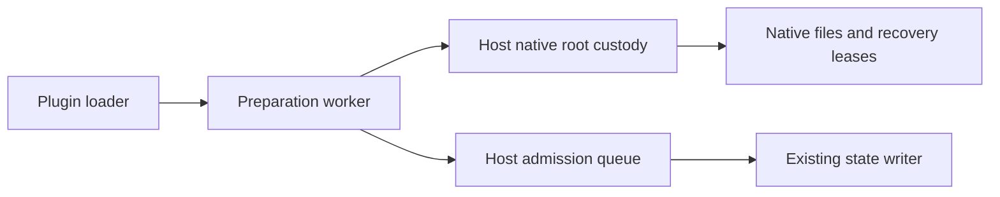

Codex review: needs maintainer review before merge.

## What this changes

This PR moves native-file custody and deferred admission publication to the host so unused preparation workers can retire.

**Example:** An external plugin releases its source artifact while its admission cache still retains addon.node.
- **Before:** The native-file lease keeps the preparation worker alive.
- **After:** The worker retires while independent host leases preserve the native file and pending receipt publication.

## Review scores

| Measure | Result | What it means |
|---|---|---|
| **Overall readiness** | 🦐 gold shrimp **(3/6)** | A coherent lifecycle repair with meaningful real-worker regression coverage and successful exact-head CI; behavioral evidence remains harness-based. |
| **Proof confidence** | 🦐 gold shrimp **(3/6)** | This maintainer-authored PR is outside the ordinary contributor proof gate; supplied evidence covers real-worker retirement, native recovery, unexpected exit, and deferred publication through production owners in test harnesses. |
| **Patch quality** | 🐚 platinum hermit **(4/6)** | No actionable review findings were identified. |

## Product

**Kind:** Bug fix · **Worth it:** Yes · **Fix scope:** Complete
**User problem:** External-plugin preparation can retain an otherwise unused worker solely to preserve native files.
**Reason:** The maintainer-approved direction removes demonstrated lifetime coupling while preserving native recovery and receipt settlement.

## Merge readiness

✅ **Ready for maintainer review**

Keep this PR open: it fixes a retention path still present on main, and review found no concrete introduced defect.

**Priority:** P2
**Reviewed head:** `9a286b3cc212c74e4f2d5c52e9b485393c700601`

## Before merge

None.

## Findings

None.

### Tests

- Missing end-to-end proof: The supplied evidence does not show native-only retirement through a shipped CLI or Gateway entry point, or a red-on-base replay of the new lifecycle regressions.

<strong>Agent review details</strong>

### How this fits together

The plugin loader prepares external source artifacts in workers; captured source, native-file leases, and admission receipts return to host-owned plugin caches.

### Technical review

Best possible solution:

Keep physical native custody and deferred receipt writes with the existing host admission owner while source artifacts alone retain preparation workers.

Do we have a high-confidence way to reproduce the issue?

Current main explicitly registers transferred native leases as worker resources, establishing why admission custody prevents retirement; no target code was executed during this review.

Is this the best way to solve the issue?

The patch fixes the lifetime coupling at its owners, preserves worker isolation and existing publication checks, and removes the replaced callback protocol without adding a competing cache.

AGENTS.md: found and applied where relevant.

Codex review notes: model internal, reasoning medium; reviewed against [d59bc17e1d02](https://github.com/openclaw/openclaw/commit/d59bc17e1d02de9dc39b842065c4f8ea16e41342).

### Provenance checked

- `Preparation-worker isolation and root transfer` changes intended behavior with a stated reason (a99f797f39ce3a02258b0b5dd3b3b2b9485a8c2d: https://github.com/openclaw/openclaw/pull/172750 moved external source capture off the Gateway thread and retained independent native-root custody.)
- `Callback disposal and shared recovery ownership` keeps the original intent (33484c8bc9a8e01bf1b7f22b23c55000bee65c6a: https://github.com/openclaw/openclaw/pull/176034 releases disposed graphs while preserving shared callbacks and independent native roots.)
- `Admission publication and durable native captures` keeps the original intent (9faa93d44c85d807d3c73db2420f4e85c24d3784: https://github.com/openclaw/openclaw/pull/158414 preserves native bytes, commits roots after accepted publication, and defers writes during lifecycle leases.)

### Testing

Proof path: in-process harness.

### Security

None.

### Evidence

What I checked:

- **Current-main retention path:** Current main still wraps transferred native roots with own(), registering them as worker resources independently of source-artifact lifetime. ([`src/plugins/plugin-generation-preparation.worker.ts:51`](https://github.com/openclaw/openclaw/blob/d59bc17e1d02de9dc39b842065c4f8ea16e41342/src/plugins/plugin-generation-preparation.worker.ts#L51), [d59bc17e1d02](https://github.com/openclaw/openclaw/commit/d59bc17e1d02de9dc39b842065c4f8ea16e41342))
- **Independent filesystem custody:** The host allocates physical roots and returns independent leases; codec transfer consumes temporary sender leases without exporting worker disposal callbacks. ([`src/plugins/plugin-generation-native-roots.ts:18`](https://github.com/openclaw/openclaw/blob/9a286b3cc212c74e4f2d5c52e9b485393c700601/src/plugins/plugin-generation-native-roots.ts#L18), [9a286b3cc212](https://github.com/openclaw/openclaw/commit/9a286b3cc212c74e4f2d5c52e9b485393c700601))
- **Deferred publication cutover:** Successful replies transfer publication data into the existing host admission queue; asynchronous requests settle that queue, while synchronous requests enqueue without awaiting writes. ([`src/plugins/plugin-generation-worker.ts:189`](https://github.com/openclaw/openclaw/blob/9a286b3cc212c74e4f2d5c52e9b485393c700601/src/plugins/plugin-generation-worker.ts#L189), [9a286b3cc212](https://github.com/openclaw/openclaw/commit/9a286b3cc212c74e4f2d5c52e9b485393c700601))
- **Existing final write checks preserved:** The unchanged transactional writer rejects publication while a lifecycle lease exists and verifies current plugin root and install-record identity before updating the existing receipt format. ([`src/plugins/installed-plugin-index-store-write.ts:315`](https://github.com/openclaw/openclaw/blob/9a286b3cc212c74e4f2d5c52e9b485393c700601/src/plugins/installed-plugin-index-store-write.ts#L315), [9a286b3cc212](https://github.com/openclaw/openclaw/commit/9a286b3cc212c74e4f2d5c52e9b485393c700601))
- **Existing worker cleanup contract:** The preparation pool uses the same-repository worker-runtime implementation, which invokes releaseResources after confirmed worker retirement and joins artifact cleanup during close. ([`packages/worker-runtime/src/worker-task-pool-retirement.ts`](https://github.com/openclaw/openclaw/blob/9a286b3cc212c74e4f2d5c52e9b485393c700601/packages/worker-runtime/src/worker-task-pool-retirement.ts), [9a286b3cc212](https://github.com/openclaw/openclaw/commit/9a286b3cc212c74e4f2d5c52e9b485393c700601))
- **Reviewed-head CI:** https://github.com/openclaw/openclaw/actions/runs/39215205995 completed successfully on the reviewed head, including build-artifacts and openclaw/ci-gate; detailed log download was blocked by the network allowlist. ([9a286b3cc212](https://github.com/openclaw/openclaw/commit/9a286b3cc212c74e4f2d5c52e9b485393c700601))

Likely related people:

- **Vincent Koc:** Raw commit b81e502d2dd5498e235cad1a67049d845ce17317 adds src/plugins/plugin-native-admission-state.ts:35 relative to its recorded parents. This identifies author metadata, not feature responsibility or a PR merger. (role: source-line author; confidence: high; commits: [b81e502d2dd5](https://github.com/openclaw/openclaw/commit/b81e502d2dd5498e235cad1a67049d845ce17317); files: `src/plugins/plugin-native-admission-state.ts`)
- **Peter Steinberger:** Raw commit 9faa93d44c85d807d3c73db2420f4e85c24d3784 adds src/plugins/plugin-native-admission-state.ts:25 relative to its recorded parents. This identifies author metadata, not feature responsibility or a PR merger. (role: source-line author; confidence: high; commits: [9faa93d44c85](https://github.com/openclaw/openclaw/commit/9faa93d44c85d807d3c73db2420f4e85c24d3784); files: `src/plugins/plugin-native-admission-state.ts`)
- **Krzysztof Kisiel:** Raw commit a99f797f39ce3a02258b0b5dd3b3b2b9485a8c2d adds src/plugins/plugin-generation-preparation.worker.ts:39 relative to its recorded parents. This identifies author metadata, not feature responsibility or a PR merger. (role: source-line author; confidence: high; commits: [a99f797f39ce](https://github.com/openclaw/openclaw/commit/a99f797f39ce3a02258b0b5dd3b3b2b9485a8c2d); files: `src/plugins/plugin-generation-preparation.worker.ts`)

### PR surface

Source +117, Tests +264. Total +381 across 11 files. Added test files: 1.

View PR surface stats

| Area | Files | Added | Removed | Net |
|---|---:|---:|---:|---:|
| Source | 8 | 239 | 122 | +117 |
| Tests | 3 | 303 | 39 | +264 |
| Docs | 0 | 0 | 0 | 0 |
| Config | 0 | 0 | 0 | 0 |
| Generated | 0 | 0 | 0 | 0 |
| Other | 0 | 0 | 0 | 0 |
| **Total** | **11** | **542** | **161** | **+381** |

### Review metrics

| Metric | Value | Why it matters |
|---|---|---|
| **Production versus test growth** | Production net +117 lines; tests net +264 lines. | Growth implements independent host custody and exercises retirement, recovery, publication outcomes, and deferred handoff while removing the worker publication callback path. |

### Labels

Label changes:

- add `P2`: Unnecessary preparation-worker retention is a bounded resource-lifecycle bug without evidence of an urgent user-facing outage.
- add `rating: 🦐 gold shrimp`: Overall readiness is 🦐 gold shrimp; proof is 🦐 gold shrimp and patch quality is 🐚 platinum hermit.
- add `status: 👀 ready for maintainer look`: ClawSweeper has no concrete contributor-facing blocker left for this PR.

Label justifications:

- `P2`: Unnecessary preparation-worker retention is a bounded resource-lifecycle bug without evidence of an urgent user-facing outage.
- `rating: 🦐 gold shrimp`: Overall readiness is 🦐 gold shrimp; proof is 🦐 gold shrimp and patch quality is 🐚 platinum hermit.
- `status: 👀 ready for maintainer look`: ClawSweeper has no concrete contributor-facing blocker left for this PR.

### Rating scale

6/6 🦀 challenger crab · 5/6 🦞 diamond lobster · 4/6 🐚 platinum hermit · 3/6 🦐 gold shrimp · 2/6 🦪 silver shellfish · 1/6 🧂 unranked krab. Overall follows the weaker of proof and patch quality; ✨ marks media proof (a screenshot, video, or linked artifact) that directly shows the changed behavior.

### Workflow

ClawSweeper edits this one comment on every review. Comment `@clawsweeper re-review` for a fresh review only. Repair and merge execution lanes are retired.

_Reviewed October 19, 2026, 3:34 AM ET / 07:34 UTC._

<!-- clawsweeper-verdict:needs-human item=177067 sha=9a286b3cc212c74e4f2d5c52e9b485393c700601 confidence=high updated_at=2026-10-19T07:29:47Z reviewed_at=2026-10-19T07:34:16.656Z lease_owner=github-run-39216229146-1 lease_comment_id=6262025234 source_revision=0f810571484300eaa17071139e4e67dbb073927f6140942d6e152eb1984a45a6 hold=not_opted_in findings=0 -->
<!-- clawsweeper-review-state:ready item=177067 sha=9a286b3cc212c74e4f2d5c52e9b485393c700601 v=1 -->

<!-- clawsweeper-review-version item=177067 reviewed_at=2026-10-19T07:34:16.656Z sha=9a286b3cc212c74e4f2d5c52e9b485393c700601 source_revision=0f810571484300eaa17071139e4e67dbb073927f6140942d6e152eb1984a45a6 lease_owner=github-run-39216229146-1 lease_comment_id=6262025234 v=1 -->

<!-- clawsweeper-review item=177067 -->