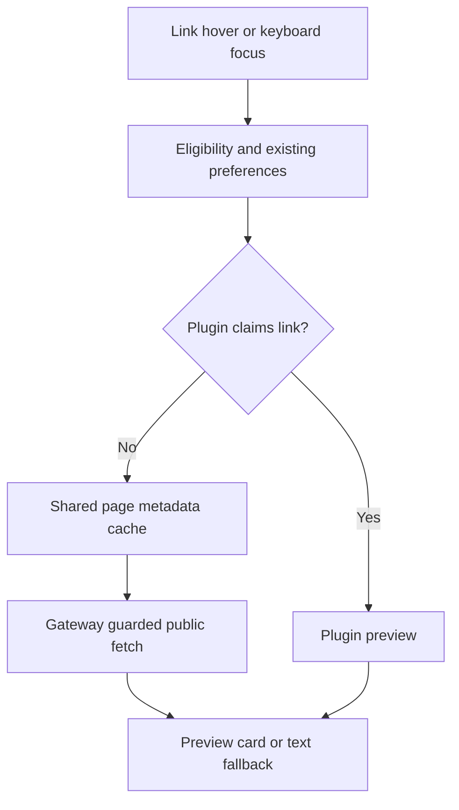

Codex review: needs maintainer review before merge. _Reviewed September 19, 2026, 11:39 AM ET / 15:39 UTC (Revision 5)._

# ClawSweeper review

## What this changes

Adds hover and keyboard-focus previews for ordinary external links using shared Gateway metadata, including bounded descriptions, while preserving plugin previews and the existing fetch opt-out.

## Merge readiness

✅ **Ready for maintainer review**

Keep open: ordinary-link previews remain a distinct requested capability absent from current main. The protected PR contains useful work, and this review found no actionable introduced defect.

**Priority:** P3
**Reviewed head:** `896a695749025aa321453d1a2fb755881805cdee`

## Review scores

| Measure | Result | What it means |
|---|---|---|
| **Overall readiness** | 🐚 platinum hermit **(4/6)** | A coherent implementation with inspected visual evidence, meaningful lifecycle coverage, and no blocking finding. |
| **Proof confidence** | 🐚 platinum hermit **(4/6)** | Not applicable: The bot-authored PR is exempt from the external-contributor proof gate. Inspected mock-Gateway screenshots directly demonstrate the new page-preview rendering; they do not independently prove network safeguards. Reported browser and real-Gateway runs were reviewed against their scenarios but not rerun. |
| **Patch quality** | 🐚 platinum hermit **(4/6)** | No actionable review findings were identified. |

## Verification

| Check | Result | Evidence |
|---|---|---|
| **Real behavior** | Not applicable | Not applicable: The bot-authored PR is exempt from the external-contributor proof gate. Inspected mock-Gateway screenshots directly demonstrate the new page-preview rendering; they do not independently prove network safeguards. Reported browser and real-Gateway runs were reviewed against their scenarios but not rerun. |
| **Evidence reviewed** | 8 items | Current-main necessity: Current main retains plugin-only link target resolution and browser-card-specific page metadata loading; it does not contain the ordinary-link hover path added here. Eligibility and lifecycle: The existing hover owner checks plugin claims, current connection, permissions, and the existing preference; it retires stale activations and excludes explicit external actions, files, downloads, and session links. Security and upgrade behavior: The production fetch owner retains anonymous requests, strict destination checks, resource bounds, and preference revalidation before each outgoing request. This PR adds description extraction without changing those controls; documented existing false opt-outs also disable ordinary-link previews. |
| **Findings** | None | None. |
| **Security** | None | None. |

## How this fits together

The Control UI turns link hover or keyboard focus into preview requests. Its shared hover controller selects plugin previews or anonymous Gateway-fetched page metadata and displays a temporary card.

## Before merge

None.

<strong>Agent review details</strong>

### Security

None.

### PR surface

Source +622, Tests +797, Docs 0. Total +1419 across 27 files.

View PR surface stats

| Area | Files | Added | Removed | Net |
|---|---:|---:|---:|---:|
| Source | 18 | 895 | 273 | +622 |
| Tests | 8 | 832 | 35 | +797 |
| Docs | 1 | 1 | 1 | 0 |
| Config | 0 | 0 | 0 | 0 |
| Generated | 0 | 0 | 0 | 0 |
| Other | 0 | 0 | 0 | 0 |
| **Total** | **27** | **1728** | **309** | **+1419** |

### Review metrics

| Metric | Value | Why it matters |
|---|---|---|
| **Metadata contract** | 1 optional response field; 0 new settings | Descriptions are bounded to 400 UTF-16 units, and the existing automatic-fetch preference controls the added enrichment. |

### Root-cause cluster

Relationship: `fixed_by_candidate`
Canonical: https://github.com/openclaw/openclaw/issues/152442
Summary: This PR implements the linked ordinary-link preview request; the merged browser-card feature is its prerequisite, not a replacement.

Members:
- `canonical`: https://github.com/openclaw/openclaw/issues/152442 - The open feature request specifies the same hover, keyboard, opt-out, and plugin-priority behavior.
- `adjacent_distinct`: https://github.com/openclaw/openclaw/pull/152324 - The merged prerequisite supplies public page metadata for browser cards and explicitly leaves ordinary-link hovers to separate work.

Proposal only: this assessment does not dispatch repair, suppress jobs, mutate sibling items, close, or merge anything.

### Technical review

Best possible solution:

Keep one shared preview lifecycle that respects plugin ownership, existing fetch preferences, accessible navigation, and connection-scoped results.

Do we have a high-confidence way to reproduce the issue?

Not applicable: this is a feature addition; current-main source confirms ordinary links lack the proposed hover path.

Is this the best way to solve the issue?

Yes: extending the existing hover controller and sharing browser-card metadata avoids competing owners while preserving specialized previews and preferences.

AGENTS.md: found and applied where relevant.

Codex review notes: model internal, reasoning medium; reviewed against [3ba1da784f70](https://github.com/openclaw/openclaw/commit/3ba1da784f70f44c006ccf241c53ced502f17497).

### Labels

Label justifications:

- `P3`: This improves link discovery and browsing convenience without repairing a blocked workflow.
- `rating: 🐚 platinum hermit`: Overall readiness is 🐚 platinum hermit; proof is 🐚 platinum hermit and patch quality is 🐚 platinum hermit.
- `status: 👀 ready for maintainer look`: ClawSweeper has no concrete contributor-facing blocker left for this PR. Not applicable: The bot-authored PR is exempt from the external-contributor proof gate. Inspected mock-Gateway screenshots directly demonstrate the new page-preview rendering; they do not independently prove network safeguards. Reported browser and real-Gateway runs were reviewed against their scenarios but not rerun.
- `proof: 📸 screenshot`: Contributor real behavior proof includes screenshot evidence. The bot-authored PR is exempt from the external-contributor proof gate. Inspected mock-Gateway screenshots directly demonstrate the new page-preview rendering; they do not independently prove network safeguards. Reported browser and real-Gateway runs were reviewed against their scenarios but not rerun.

### Evidence

What I checked:

- **Current-main necessity:** Current main retains plugin-only link target resolution and browser-card-specific page metadata loading; it does not contain the ordinary-link hover path added here. ([`ui/src/components/link-reader-target.ts:1`](https://github.com/openclaw/openclaw/blob/3ba1da784f70f44c006ccf241c53ced502f17497/ui/src/components/link-reader-target.ts#L1), [3ba1da784f70](https://github.com/openclaw/openclaw/commit/3ba1da784f70f44c006ccf241c53ced502f17497))
- **Eligibility and lifecycle:** The existing hover owner checks plugin claims, current connection, permissions, and the existing preference; it retires stale activations and excludes explicit external actions, files, downloads, and session links. ([`ui/src/components/link-reader-hovercard.ts:547`](https://github.com/openclaw/openclaw/blob/896a695749025aa321453d1a2fb755881805cdee/ui/src/components/link-reader-hovercard.ts#L547), [896a69574902](https://github.com/openclaw/openclaw/commit/896a695749025aa321453d1a2fb755881805cdee))
- **Security and upgrade behavior:** The production fetch owner retains anonymous requests, strict destination checks, resource bounds, and preference revalidation before each outgoing request. This PR adds description extraction without changing those controls; documented existing false opt-outs also disable ordinary-link previews. ([`src/gateway/control-ui-link-preview.ts:113`](https://github.com/openclaw/openclaw/blob/896a695749025aa321453d1a2fb755881805cdee/src/gateway/control-ui-link-preview.ts#L113), [896a69574902](https://github.com/openclaw/openclaw/commit/896a695749025aa321453d1a2fb755881805cdee))
- **Inspected visual evidence:** Inspected all four prepared images from the captured PR body: desktop dark and narrow light before/after pairs visibly show the added favicon, social image, title, description, and external-open action. These use synthetic data and a mock Gateway; they establish appearance, not live network or authorization behavior. The body reports delivery in the originating chat. ([896a69574902](https://github.com/openclaw/openclaw/commit/896a695749025aa321453d1a2fb755881805cdee))
- **Behavior coverage reviewed:** Read the browser scenarios covering hover, keyboard traversal, explicit navigation, plugin priority, opt-out, touch, and failed lazy loading, plus the real-Gateway sign-in exclusion assertions. The captured body reports eight browser flows and 79 focused tests passing; this read-only review did not execute them. ([`ui/src/e2e/link-hover-preview.e2e.test.ts:53`](https://github.com/openclaw/openclaw/blob/896a695749025aa321453d1a2fb755881805cdee/ui/src/e2e/link-hover-preview.e2e.test.ts#L53), [896a69574902](https://github.com/openclaw/openclaw/commit/896a695749025aa321453d1a2fb755881805cdee))
- **Re-review continuity:** Git tree identities confirm the hover provider, shared metadata cache, and portaled controller are byte-identical to the preceding reviewed head. The supplied completed review contains no findings. Hidden-ancestor dismissal remains implemented by the existing shared presentation controller. ([`ui/src/components/portaled-hovercard.ts:183`](https://github.com/openclaw/openclaw/blob/896a695749025aa321453d1a2fb755881805cdee/ui/src/components/portaled-hovercard.ts#L183), [896a69574902](https://github.com/openclaw/openclaw/commit/896a695749025aa321453d1a2fb755881805cdee))

Likely related people:

- **unknown:** The claimed source-line change could not be verified from bounded local history. (role: source history unknown; confidence: low)
- **RoboClaw:** Raw commit 021fd3416338e851897b4ad1bc315ef93275706a adds src/gateway/control-ui-link-preview.ts:114 relative to its recorded parents. This identifies author metadata, not feature responsibility or a PR merger. (role: source-line author; confidence: high; commits: [021fd3416338](https://github.com/openclaw/openclaw/commit/021fd3416338e851897b4ad1bc315ef93275706a); files: `src/gateway/control-ui-link-preview.ts`)

### Rating scale

| Score | Internal tier | Crab rank | Meaning |
|---:|:---:|---|---|
| **6/6** | S | 🦀 challenger crab | Exceptional readiness |
| **5/6** | A | 🦞 diamond lobster | Very strong readiness |
| **4/6** | B | 🐚 platinum hermit | Good normal PR; ordinary maintainer review |
| **3/6** | C | 🦐 gold shrimp | Useful, but confidence is limited |
| **2/6** | D | 🦪 silver shellfish | Proof or implementation needs work |
| **1/6** | F | 🧂 unranked krab | Not merge-ready |
| N/A | NA | 🌊 off-meta tidepool | Rating does not apply |

Overall follows the weaker of proof and patch quality.
Shiny media proof means a screenshot, video, or linked artifact directly shows the changed behavior. Runtime, network, CSP, and security claims still need visible diagnostics.

### Workflow

- ClawSweeper keeps one durable marker-backed review comment per issue or PR.
- Re-runs edit this comment so the latest verdict, findings, and automation markers stay together instead of adding duplicate bot comments.
- A fresh review can be triggered by eligible `@clawsweeper re-review` comments, exact-item GitHub events, scheduled/background review runs, or manual workflow dispatch.
- PR/issue authors and users with repository write access can comment `@clawsweeper re-review` or `@clawsweeper re-run` on an open PR or issue to request a fresh review only.
- Maintainers can also comment `@clawsweeper review` to request a fresh review only.
- Fresh-review commands do not start repair, autofix, rebase, CI repair, or automerge.
- Maintainer-only repair and merge flows require explicit commands such as `@clawsweeper autofix`, `@clawsweeper automerge`, `@clawsweeper fix ci`, or `@clawsweeper address review`.
- Maintainers can comment `@clawsweeper explain` to ask for more context, or `@clawsweeper stop` to stop active automation.

### History

Review history (4 earlier review cycles)

<!-- clawsweeper-review-history v=1 total=4 -->
- reviewed 2026-09-19T09:42:04.491Z sha e96320bb51463a43050ac89b96416218e8ac97af :: needs maintainer review before merge. :: none
- reviewed 2026-09-19T09:54:36.518Z sha 16cf1d323600d8233db844f7879555055a7036d8 :: needs maintainer review before merge. :: none
- reviewed 2026-09-19T10:34:12.121Z sha 91b4587587a5fcf40b0349cdd052df9d72fdb04a :: needs maintainer review before merge. :: none
- reviewed 2026-09-19T15:10:00.978Z sha f7b88ba25644863e7821eee0a332b16d168b6ded :: needs maintainer review before merge. :: none

<!-- clawsweeper-verdict:needs-human item=152758 sha=896a695749025aa321453d1a2fb755881805cdee confidence=high updated_at=2026-09-19T15:36:36Z reviewed_at=2026-09-19T15:39:35.594Z lease_owner=github-run-35452198847-1 lease_comment_id=5743135003 source_revision=b42a9daa31f5b87bac4e23e904baeba9eafbb78f06079f41f92346452d054f54 live_verification=absent -->
<!-- clawsweeper-review-state:ready item=152758 sha=896a695749025aa321453d1a2fb755881805cdee v=1 -->

<!-- clawsweeper-review-version item=152758 reviewed_at=2026-09-19T15:39:35.594Z sha=896a695749025aa321453d1a2fb755881805cdee source_revision=b42a9daa31f5b87bac4e23e904baeba9eafbb78f06079f41f92346452d054f54 lease_owner=github-run-35452198847-1 lease_comment_id=5743135003 v=1 -->

<!-- clawsweeper-review item=152758 -->