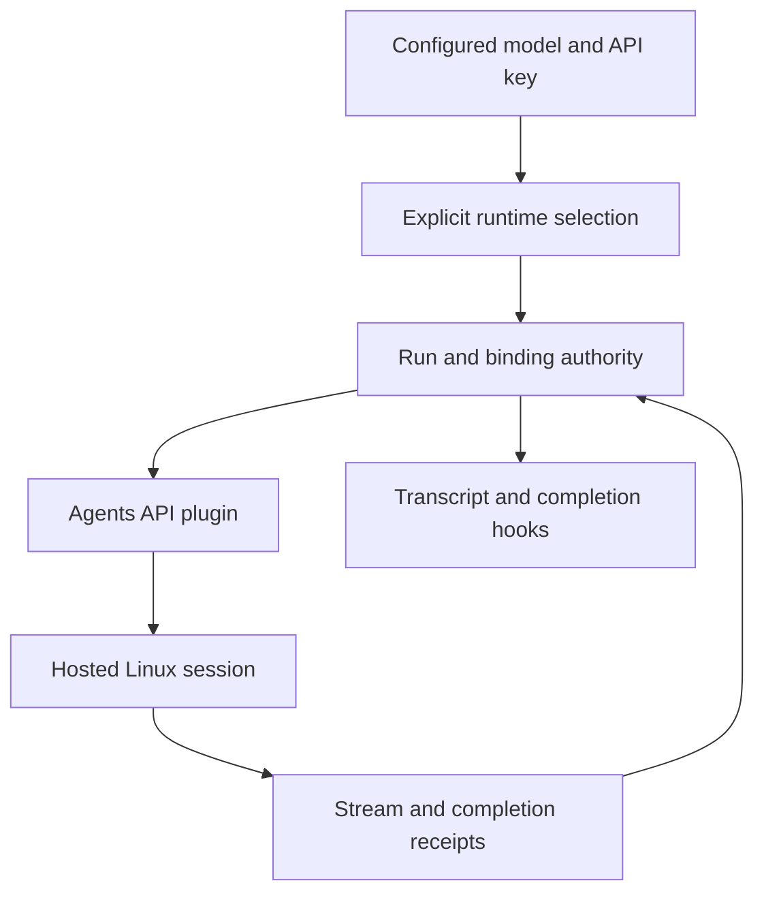

Codex review: needs maintainer review before merge. _Reviewed September 22, 2026, 8:44 PM ET / September 23, 2026, 00:44 UTC (Revision 19)._

# ClawSweeper review

## What this changes

Adds an explicitly selected OpenAI Agents API plugin for persistent hosted Linux sessions, streamed replies, steering, interruption, and OpenClaw transcript integration.

## Merge readiness

✅ **Ready for maintainer review**

Keep open as a useful, distinct implementation. The prior code blockers are resolved, and the new production-path evidence satisfies the outstanding authority-proof requirement. No actionable correctness or security finding remains.

**Priority:** P2
**Reviewed head:** `b549ee1963ac659cf8226bd96fb958cf24baa06e`

## Review scores

| Measure | Result | What it means |
|---|---|---|
| **Overall readiness** | 🐚 platinum hermit **(4/6)** | A coherent plugin implementation with strong production-path evidence and no remaining actionable findings. |
| **Proof confidence** | 🦞 diamond lobster **(5/6)** | Sufficient (live_output): Authority-chain proof required: satisfied by real Docker Gateway execution and cancellation, plus production-client stale-owner rejection before HTTP and strict-writer rejection without transcript changes. The proven runtime matches this head; additive namespaced storage preserves existing formats. Token accounting remains explicitly best effort. |
| **Patch quality** | 🐚 platinum hermit **(4/6)** | No actionable review findings were identified. |

## Verification

| Check | Result | Evidence |
|---|---|---|
| **Real behavior** | Verified | Sufficient (live_output): Authority-chain proof required: satisfied by real Docker Gateway execution and cancellation, plus production-client stale-owner rejection before HTTP and strict-writer rejection without transcript changes. The proven runtime matches this head; additive namespaced storage preserves existing formats. Token accounting remains explicitly best effort. |
| **Evidence reviewed** | 10 items | Reviewed introduction boundary: Reviewed the complete introduced patch from the verified merge base to the original PR head. Base-only test changes were excluded from PR ownership; the stale test merge was not used to infer removals. Current-main necessity: The fetched main tree has no extensions/agentsapi plugin, and its OpenAI runtime documentation describes the existing OpenClaw and Codex routes. The merged prerequisite supplies shared coordination rather than this hosted backend. Release boundary: The supplied latest-release revision also contains no extensions/agentsapi plugin; no shipped replacement was established. |
| **Findings** | None | None. |
| **Security** | None | None. |

## How this fits together

OpenClaw selects an agent runtime from the configured model and authentication route. This plugin sends admitted turns to hosted OpenAI sessions and returns replies through OpenClaw’s transcript and completion-hook owners.

## Before merge

None.

<strong>Agent review details</strong>

### Security

None.

### PR surface

Source +1461, Tests +307, Docs +85, Config +34, Generated 0, Other +10. Total +1897 across 28 files.

View PR surface stats

| Area | Files | Added | Removed | Net |
|---|---:|---:|---:|---:|
| Source | 10 | 1463 | 2 | +1461 |
| Tests | 7 | 323 | 16 | +307 |
| Docs | 5 | 87 | 2 | +85 |
| Config | 3 | 34 | 0 | +34 |
| Generated | 2 | 3 | 3 | 0 |
| Other | 1 | 10 | 0 | +10 |
| **Total** | **28** | **1920** | **23** | **+1897** |

### Review metrics

| Metric | Value | Why it matters |
|---|---|---|
| **Production versus test growth** | Production TypeScript +1,446 net lines; tests +307 net lines | Growth implements the hosted protocol adapter; shared core production growth is limited to 19 lines for the lease assertion. |
| **Runtime selection** | 1 explicit runtime added; 0 automatic-default changes | Existing configurations retain their runtime choice unless the new backend is selected. |

### Technical review

Best possible solution:

Keep hosted protocol handling in the explicitly selected plugin, with shared owners enforcing session identity, lease authority, cancellation, and transcript publication.

Do we have a high-confidence way to reproduce the issue?

Not applicable to the feature request; supplied production-path evidence exercises the new runtime and the previously reported cancellation, lease, and completion-hook defects.

Is this the best way to solve the issue?

Yes. The plugin reuses existing runtime selection, binding coordination, HTTP guards, and transcript owners while keeping the hosted protocol separate.

AGENTS.md: found and applied where relevant.

Codex review notes: model internal, reasoning medium; reviewed against [691da64a73b3](https://github.com/openclaw/openclaw/commit/691da64a73b319c256951db2637dcb718d301b37).

### Labels

Label changes:

- add `proof: sufficient`: Contributor real behavior proof is sufficient. Authority-chain proof required: satisfied by real Docker Gateway execution and cancellation, plus production-client stale-owner rejection before HTTP and strict-writer rejection without transcript changes. The proven runtime matches this head; additive namespaced storage preserves existing formats. Token accounting remains explicitly best effort.
- add `rating: 🐚 platinum hermit`: Overall readiness is 🐚 platinum hermit; proof is 🦞 diamond lobster and patch quality is 🐚 platinum hermit.
- add `status: 👀 ready for maintainer look`: ClawSweeper has no concrete contributor-facing blocker left for this PR. Sufficient (live_output): Authority-chain proof required: satisfied by real Docker Gateway execution and cancellation, plus production-client stale-owner rejection before HTTP and strict-writer rejection without transcript changes. The proven runtime matches this head; additive namespaced storage preserves existing formats. Token accounting remains explicitly best effort.
- remove `rating: 🦐 gold shrimp`: Current PR rating is `rating: 🐚 platinum hermit`, so this older rating label is no longer current.
- remove `merge-risk: 🚨 session-state`: Current PR review selected no merge-risk labels.
- remove `merge-risk: 🚨 security-boundary`: Current PR review selected no merge-risk labels.
- remove `status: 📣 needs proof`: Current PR status label is `status: 👀 ready for maintainer look`.

Label justifications:

- `P2`: This is a bounded, opt-in hosted-runtime capability with meaningful session integration and no established urgent regression.
- `rating: 🐚 platinum hermit`: Overall readiness is 🐚 platinum hermit; proof is 🦞 diamond lobster and patch quality is 🐚 platinum hermit.
- `status: 👀 ready for maintainer look`: ClawSweeper has no concrete contributor-facing blocker left for this PR. Sufficient (live_output): Authority-chain proof required: satisfied by real Docker Gateway execution and cancellation, plus production-client stale-owner rejection before HTTP and strict-writer rejection without transcript changes. The proven runtime matches this head; additive namespaced storage preserves existing formats. Token accounting remains explicitly best effort.
- `proof: sufficient`: Contributor real behavior proof is sufficient. Authority-chain proof required: satisfied by real Docker Gateway execution and cancellation, plus production-client stale-owner rejection before HTTP and strict-writer rejection without transcript changes. The proven runtime matches this head; additive namespaced storage preserves existing formats. Token accounting remains explicitly best effort.

### Evidence

What I checked:

- **Reviewed introduction boundary:** Reviewed the complete introduced patch from the verified merge base to the original PR head. Base-only test changes were excluded from PR ownership; the stale test merge was not used to infer removals. ([b549ee1963ac](https://github.com/openclaw/openclaw/commit/b549ee1963ac659cf8226bd96fb958cf24baa06e))
- **Current-main necessity:** The fetched main tree has no extensions/agentsapi plugin, and its OpenAI runtime documentation describes the existing OpenClaw and Codex routes. The merged prerequisite supplies shared coordination rather than this hosted backend. Public docs: [`docs/providers/openai/runtimes.md`](https://docs.openclaw.ai/providers/openai/runtimes). ([`docs/providers/openai/runtimes.md:13`](https://docs.openclaw.ai/providers/openai/runtimes), [691da64a73b3](https://github.com/openclaw/openclaw/commit/691da64a73b319c256951db2637dcb718d301b37))
- **Release boundary:** The supplied latest-release revision also contains no extensions/agentsapi plugin; no shipped replacement was established. ([ec9c1a13db89](https://github.com/openclaw/openclaw/commit/ec9c1a13db8938e5a3eaa51fca2e981cde2395a9))
- **Authority reaches final effects:** The harness combines host generation/run authority with the captured lease for normal work and retains exact lease authority for cleanup. The client passes that assertion to guarded HTTP dispatch; transcript preparation rechecks it before appending. The shared assertion checks owner phase, persisted token, and expiry. ([`src/agents/harness/native-session/binding-leases.ts:202`](https://github.com/openclaw/openclaw/blob/b549ee1963ac659cf8226bd96fb958cf24baa06e/src/agents/harness/native-session/binding-leases.ts#L202), [b549ee1963ac](https://github.com/openclaw/openclaw/commit/b549ee1963ac659cf8226bd96fb958cf24baa06e))
- **New real behavior and authority proof:** The captured sanitized Docker evidence at https://github.com/openclaw/openclaw/pull/151176#issuecomment-5786959639 shows actual hosted execution, steering, authorized interruption, exactly-once completion hooks, and queued-input cancellation without cancelling the original command. Supplemental production-client evidence shows natural lease expiry, reassignment, stale requests rejected before HTTP, successful successor execution, and strict transcript rejection with unchanged event count and hash. Its explicit exclusions do not negate these exercised owner boundaries. ([64e5ac4638a4](https://github.com/openclaw/openclaw/commit/64e5ac4638a4e5c944a63f129ac1e57ba53d5b13))
- **Proof source identity:** The proven runtime revision differs from the reviewed head only in docs/plugins/reference.md and docs/plugins/reference/agentsapi.md; runtime code and dependencies are identical. The three prepared Slack images were inspected and corroborate historical execution, reuse, and reset, without being treated as authority proof. ([b549ee1963ac](https://github.com/openclaw/openclaw/commit/b549ee1963ac659cf8226bd96fb958cf24baa06e))

Likely related people:

- **unknown:** The claimed source-line change could not be verified from bounded local history. (role: source history unknown; confidence: low)
- **steipete:** Suggested for follow-up; no historical authorship or introduction is verified. (role: unverified routing candidate; confidence: low)

### Rating scale

| Score | Internal tier | Crab rank | Meaning |
|---:|:---:|---|---|
| **6/6** | S | 🦀 challenger crab | Exceptional readiness |
| **5/6** | A | 🦞 diamond lobster | Very strong readiness |
| **4/6** | B | 🐚 platinum hermit | Good normal PR; ordinary maintainer review |
| **3/6** | C | 🦐 gold shrimp | Useful, but confidence is limited |
| **2/6** | D | 🦪 silver shellfish | Proof or implementation needs work |
| **1/6** | F | 🧂 unranked krab | Not merge-ready |
| N/A | NA | 🌊 off-meta tidepool | Rating does not apply |

Overall follows the weaker of proof and patch quality.
Shiny media proof means a screenshot, video, or linked artifact directly shows the changed behavior. Runtime, network, CSP, and security claims still need visible diagnostics.

### Workflow

- ClawSweeper keeps one durable marker-backed review comment per issue or PR.
- Re-runs edit this comment so the latest verdict, findings, and automation markers stay together instead of adding duplicate bot comments.
- A fresh review can be triggered by eligible `@clawsweeper re-review` comments, exact-item GitHub events, scheduled/background review runs, or manual workflow dispatch.
- PR/issue authors and users with repository write access can comment `@clawsweeper re-review` or `@clawsweeper re-run` on an open PR or issue to request a fresh review only.
- Maintainers can also comment `@clawsweeper review` to request a fresh review only.
- Fresh-review commands do not start repair, autofix, rebase, CI repair, or automerge.
- Maintainer-only repair and merge flows require explicit commands such as `@clawsweeper autofix`, `@clawsweeper automerge`, `@clawsweeper fix ci`, or `@clawsweeper address review`.
- Maintainers can comment `@clawsweeper explain` to ask for more context, or `@clawsweeper stop` to stop active automation.

### History

Review history (18 earlier review cycles; latest 8 shown)

<!-- clawsweeper-review-history v=1 total=18 -->
- reviewed 2026-09-18T21:56:32.402Z sha b66c4cab46b7b22a561be2cfe26de63603b489ee :: needs real behavior proof before merge. :: [P1] Reject queued input after interruption | [P1] Retain cancellation authority until disposal actually drains | [P2] Dispatch shared completion hooks before returning the attempt
- reviewed 2026-09-20T22:58:25.006Z sha 60b479b44696fed2e8827adae2b3ad070928ba51 :: needs real behavior proof before merge. :: [P1] Validate the binding lease before remote effects | [P2] Dispatch shared completion hooks before returning the attempt
- reviewed 2026-09-20T23:21:22.718Z sha 60b479b44696fed2e8827adae2b3ad070928ba51 :: needs real behavior proof before merge. :: [P1] Validate the binding lease before remote effects | [P2] Dispatch shared completion hooks before returning the attempt
- reviewed 2026-09-20T23:32:29.038Z sha 60b479b44696fed2e8827adae2b3ad070928ba51 :: needs real behavior proof before merge. :: [P1] Validate the binding lease before remote effects | [P2] Dispatch shared completion hooks before returning the attempt
- reviewed 2026-09-21T00:47:06.977Z sha 60b479b44696fed2e8827adae2b3ad070928ba51 :: needs real behavior proof before merge. :: [P1] Validate the binding lease before remote effects | [P2] Dispatch shared completion hooks before returning the attempt
- reviewed 2026-09-22T21:16:55.252Z sha 1fa242365873efba3a64564b2656326df94d97cc :: needs real behavior proof before merge. :: [P2] Dispatch shared completion hooks before returning the attempt
- reviewed 2026-09-22T21:31:55.848Z sha 4535f9f61d0311b45d69c2a7fd7f9e0c18d42183 :: needs real behavior proof before merge. :: [P1] Resolve the new Zod importer to a complete lockfile entry | [P2] Dispatch shared completion hooks before returning the attempt
- reviewed 2026-09-23T00:08:03.203Z sha b549ee1963ac659cf8226bd96fb958cf24baa06e :: needs real behavior proof before merge. :: none

<!-- clawsweeper-verdict:needs-human item=151176 sha=b549ee1963ac659cf8226bd96fb958cf24baa06e confidence=high updated_at=2026-09-23T00:40:33Z reviewed_at=2026-09-23T00:44:45.488Z lease_owner=github-run-35802929320-1 lease_comment_id=5786990232 source_revision=4397e34f0c1340dab155ed484323b0c517fa8a945e392c82a3b19429e5b48efe live_verification=absent -->
<!-- clawsweeper-review-state:ready item=151176 sha=b549ee1963ac659cf8226bd96fb958cf24baa06e v=1 -->

<!-- clawsweeper-review-version item=151176 reviewed_at=2026-09-23T00:44:45.488Z sha=b549ee1963ac659cf8226bd96fb958cf24baa06e source_revision=4397e34f0c1340dab155ed484323b0c517fa8a945e392c82a3b19429e5b48efe lease_owner=github-run-35802929320-1 lease_comment_id=5786990232 v=1 -->

<!-- clawsweeper-review item=151176 -->