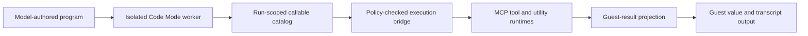

Codex review: needs maintainer review before merge. _Reviewed August 20, 2026, 3:01 PM ET / 19:01 UTC._

# ClawSweeper review

## What this changes

This PR replaces Code Mode’s hidden tool-routing object with direct async tool globals and callable catalog handles, while aligning MCP guest results and migrating one documented persisted Cron trigger pattern.

## Merge readiness

⚠️ **Ready for maintainer review - 3 items remain**

The exact head addresses the prior MCP result-shape blocker and no new concrete correctness defect was found. This maintainer-owned PR remains necessary because current main still exposes the legacy `tools`/`ALL_TOOLS` guest API; merge should wait for the exact merge result and remaining required checks.

**Priority:** P1
**Reviewed head:** `b18c626e9ccc3ab8eb3f0c29a30972608a84b7d9`

## Review scores

| Measure | Result | What it means |
|---|---|---|
| **Overall readiness** | 🐚 platinum hermit **(4/6)** | The patch is a well-covered, coherent implementation of the intended Code Mode contract; final merge confidence depends on the refreshed exact-head merge checks. |
| **Proof confidence** | 🌊 off-meta tidepool | Not applicable: This is maintainer-authored work, so the external-contributor proof gate does not apply; the PR body nevertheless reports after-fix isolated Gateway/stdio-MCP and real OpenAI Responses runs. |
| **Patch quality** | 🐚 platinum hermit **(4/6)** | No actionable review findings were identified. |

## Verification

| Check | Result | Evidence |
|---|---|---|
| **Real behavior** | Not applicable | Not applicable: This is maintainer-authored work, so the external-contributor proof gate does not apply; the PR body nevertheless reports after-fix isolated Gateway/stdio-MCP and real OpenAI Responses runs. |
| **Evidence reviewed** | 7 items | Current-main behavior: Current main still documents guest invocation through `tools.callValue` and `ALL_TOOLS`, so the central direct-global behavior is not already implemented.<br>MCP guest contract: The final head stores a dedicated JSON-safe MCP guest projection containing native content, optional structured content, and error state while keeping the normal agent envelope separate.<br>Owner-boundary consumption: The bridge consumes that projection only for namespace MCP calls and rejects an MCP result that lacks an owned projection rather than leaking internal details. |
| **Findings** | None | None. |
| **Security** | None | None. |


### Live Verification

**Command:** `node scripts/run-vitest.mjs src/agents/code-mode.mcp.test.ts`

**Result:** FAIL (partial) — step 2 `expect_output` `Code Mode MCP namespace`: `expected terminal output was not visible within 30 seconds: "Code Mode MCP namespace"`

```text
node scripts/run-vitest.mjs src/agents/code-mode.mcp.test.ts
runner@runnervm76f27:/tmp/clawsweeper-live-proof-126262-jWYqsH/target$ node scripts/run-vitest.mjs src/agents/code-mode.mcp.test.ts
node scripts/run-vitest.mjs src/agents/code-mode.mcp.test.ts
[test] starting test/vitest/vitest.agents-core.config.ts

 RUN  v4.1.10 /tmp/clawsweeper-live-proof-126262-jWYqsH/target

 ✓  agents-core  src/agents/code-mode.mcp.test.ts (10 tests) 5253ms
     ✓ exposes MCP tools only through the MCP namespace  1163ms
     ✓ preserves native MCP results through bundled materialization and the guest namespace  1728ms
     ✓ rejects MCP namespace results without an owned guest projection  437ms
     ✓ renames MCP namespace identifiers that would be unsafe path segments  442ms

 Test Files  1 passed (1)
      Tests  10 passed (10)
   Start at  19:02:44
   Duration  22.45s (transform 13.81s, setup 984ms, import 15.85s, tests 5.25s, environment 0ms)

[test] passed 1 Vitest shard in 28.37s
runner@runnervm76f27:/tmp/clawsweeper-live-proof-126262-jWYqsH/target$ node scripts/run-vitest.mjs src/agents/code-mode.mcp.test.ts
[test] starting test/vitest/vitest.agents-core.config.ts

 RUN  v4.1.10 /tmp/clawsweeper-live-proof-126262-jWYqsH/target


```

**Assertions:**

- FAIL `expect_output`: Code Mode MCP namespace

## How this fits together

Code Mode executes model-authored JavaScript in an isolated worker and routes authorized calls through a run-scoped tool catalog. MCP tools, resources, and prompts enter through provider runtimes and are projected back to guest code and transcript output.



## Before merge

- [ ] **Resolve merge risk (P1)** - The PR is behind current main and required checks are still in progress, so merge should use a refreshed exact merge result rather than prior branch-only evidence.
- [ ] **Resolve merge risk (P1)** - The hard cut removes the documented guest API; Doctor safely migrates only the recognized Cron trigger idiom, leaving custom or ambiguous persisted scripts for explicit manual remediation.
- [ ] **Complete next step (P2)** - This protected maintainer PR has no identified mechanical repair; it needs exact-merge validation and normal maintainer merge handling.


<details>
<summary><strong>Agent review details</strong></summary>

### Security

None.

### PR surface

Source +712, Tests +1278, Docs +39, Other +29. Total +2058 across 75 files.

<details>
<summary>View PR surface stats</summary>

| Area | Files | Added | Removed | Net |
|---|---:|---:|---:|---:|
| Source | 34 | 1046 | 334 | +712 |
| Tests | 33 | 2085 | 807 | +1278 |
| Docs | 3 | 155 | 116 | +39 |
| Config | 0 | 0 | 0 | 0 |
| Generated | 0 | 0 | 0 | 0 |
| Other | 5 | 36 | 7 | +29 |
| **Total** | **75** | **3322** | **1264** | **+2058** |

</details>

### Review metrics

| Metric | Value | Why it matters |
|---|---|---|
| **Production versus validation LOC** | production +1,029/-324; tests +2,085/-807; test support +53/-17; docs +155/-116 | The feature adds a substantial catalog and migration boundary, with more than twice as many test-line additions as production additions. |
| **Compatibility transition** | 1 guest API hard cut; 1 Doctor migration family | Existing documented Cron trigger scripts have a bounded upgrade path, while unsupported legacy forms require explicit remediation. |

### Stored data model

Persistent data-model change detected: `migration/backfill/repair: src/commands/doctor/cron/index.test.ts`, `migration/backfill/repair: src/commands/doctor/cron/index.ts`, `migration/backfill/repair: src/commands/doctor/cron/legacy-repair.ts`, `migration/backfill/repair: src/commands/doctor/cron/store-migration.ts`, `migration/backfill/repair: src/commands/doctor/cron/trigger-script-migration.ts`, `serialized state: src/agents/agent-bundle-mcp-manager.requester-connect.test.ts`, and 20 more. Confirm migration or upgrade compatibility proof before merge.

### Merge-risk options

**Maintainer options:**
1. **Refresh the merge proof (recommended)**  
   Verify the clean merge result against current main, including the documented Gateway/MCP E2E and Cron Doctor migration, before merging.
2. **Accept the bounded manual-migration path**  
   Merge with the documented decision that custom or ambiguous legacy trigger scripts remain unchanged and are reported for manual conversion.

### Technical review

Best possible solution:

Rebase or verify the clean merge result, rerun the documented Code Mode/MCP and Doctor migration proof on that exact head, then land the single canonical direct-global API with its bounded Doctor migration.

Do we have a high-confidence way to reproduce the issue?

Not applicable as a bug reproduction: this is a new Code Mode contract. The PR body supplies after-fix Gateway/MCP and OpenAI execution evidence, while source and focused tests cover the resulting boundary.

Is this the best way to solve the issue?

Yes. A single run-scoped projection supplies prompt names, guest globals, catalog handles, bridge routing, and replay checks; the Doctor-owned migration is the correct place to repair the documented persisted trigger shape.

AGENTS.md: found and applied where relevant.

Codex review notes: model internal, reasoning high; reviewed against [231405930acc](https://github.com/openclaw/openclaw/commit/231405930acc3cbaf9034984ce32e359f5c54874).

### Labels

Label changes:

- add `rating: 🐚 platinum hermit`: Overall readiness is 🐚 platinum hermit; proof is 🌊 off-meta tidepool and patch quality is 🐚 platinum hermit.
- add `status: 👀 ready for maintainer look`: ClawSweeper has no concrete contributor-facing blocker left for this PR. Not applicable: This is maintainer-authored work, so the external-contributor proof gate does not apply; the PR body nevertheless reports after-fix isolated Gateway/stdio-MCP and real OpenAI Responses runs.
- remove `rating: 🦐 gold shrimp`: Current PR rating is `rating: 🐚 platinum hermit`, so this older rating label is no longer current.
- remove `status: ⏳ waiting on author`: Current PR status label is `status: 👀 ready for maintainer look`.

Label justifications:

- `P1`: This changes the core agent tool-execution path and the persisted Cron trigger experience for active Code Mode users.
- `merge-risk: 🚨 compatibility`: The PR removes the prior guest API and changes persisted trigger scripts through a deliberately narrow migration.
- `rating: 🐚 platinum hermit`: Overall readiness is 🐚 platinum hermit; proof is 🌊 off-meta tidepool and patch quality is 🐚 platinum hermit.
- `status: 👀 ready for maintainer look`: ClawSweeper has no concrete contributor-facing blocker left for this PR. Not applicable: This is maintainer-authored work, so the external-contributor proof gate does not apply; the PR body nevertheless reports after-fix isolated Gateway/stdio-MCP and real OpenAI Responses runs.

### Evidence

What I checked:

- **Current-main behavior:** Current main still documents guest invocation through `tools.callValue` and `ALL_TOOLS`, so the central direct-global behavior is not already implemented. Public docs: [`docs/tools/code-mode.md`](https://docs.openclaw.ai/tools/code-mode). ([`docs/tools/code-mode.md:37`](https://docs.openclaw.ai/tools/code-mode), [231405930acc](https://github.com/openclaw/openclaw/commit/231405930acc))
- **MCP guest contract:** The final head stores a dedicated JSON-safe MCP guest projection containing native content, optional structured content, and error state while keeping the normal agent envelope separate. ([`src/agents/mcp-content.ts:155`](https://github.com/openclaw/openclaw/blob/b18c626e9ccc/src/agents/mcp-content.ts#L155), [b18c626e9ccc](https://github.com/openclaw/openclaw/commit/b18c626e9ccc))
- **Owner-boundary consumption:** The bridge consumes that projection only for namespace MCP calls and rejects an MCP result that lacks an owned projection rather than leaking internal details. ([`src/agents/code-mode-bridge.ts:492`](https://github.com/openclaw/openclaw/blob/b18c626e9ccc/src/agents/code-mode-bridge.ts#L492), [b18c626e9ccc](https://github.com/openclaw/openclaw/commit/b18c626e9ccc))
- **Boundary coverage:** Focused coverage exercises bundled MCP tools, native resource/prompt shapes, resolved failures, metadata stripping, transcript ownership transfer, and external-content framing. ([`src/agents/code-mode.mcp.test.ts:153`](https://github.com/openclaw/openclaw/blob/b18c626e9ccc/src/agents/code-mode.mcp.test.ts#L153), [b18c626e9ccc](https://github.com/openclaw/openclaw/commit/b18c626e9ccc))
- **Implementation boundary:** The updated documentation explicitly distinguishes OpenClaw’s QuickJS-WASI Code Mode from Codex Code Mode; this PR does not depend on the Codex runtime or protocol. Public docs: [`docs/tools/code-mode.md`](https://docs.openclaw.ai/tools/code-mode). ([`docs/tools/code-mode.md:20`](https://docs.openclaw.ai/tools/code-mode), [b18c626e9ccc](https://github.com/openclaw/openclaw/commit/b18c626e9ccc))
- **History and ownership:** Feature history shows sustained Code Mode and MCP work by Peter Steinberger, with earlier Code Mode recovery work by Vincent Koc and requester-scoped MCP work by Ayaan Zaidi. ([`src/agents/code-mode.ts:1`](https://github.com/openclaw/openclaw/blob/b18c626e9ccc/src/agents/code-mode.ts#L1), [b18c626e9ccc](https://github.com/openclaw/openclaw/commit/b18c626e9ccc))

Likely related people:

- **steipete:** Authored the exact-head MCP contract repair and is the dominant contributor in the sampled Code Mode/MCP history. (role: feature owner and recent area contributor; confidence: high; commits: [b18c626e9ccc](https://github.com/openclaw/openclaw/commit/b18c626e9ccc3ab8eb3f0c29a30972608a84b7d9), [e6ca5266afe1](https://github.com/openclaw/openclaw/commit/e6ca5266afe1aa4932f6fee69def268bb7274095), [2d6f8a79c431](https://github.com/openclaw/openclaw/commit/2d6f8a79c4317e1dd21d913931da7ceb60e73596); files: `src/agents/code-mode.ts`, `src/agents/code-mode-bridge.ts`, `src/agents/mcp-content.ts`)
- **Vincent Koc:** History identifies prior work on Code Mode restart recovery and its operator contract. (role: historic Code Mode recovery contributor; confidence: medium; commits: [32036c473dec](https://github.com/openclaw/openclaw/commit/32036c473dec656b16c315581280cc807da2a6aa), [44aaa2f91680](https://github.com/openclaw/openclaw/commit/44aaa2f91680e89969154bfe989e40314fb098a0); files: `src/agents/code-mode-state.ts`, `src/agents/code-mode.ts`)
- **Ayaan Zaidi:** Prior requester-scoped MCP work is directly adjacent to the materialization path changed here. (role: adjacent MCP runtime contributor; confidence: medium; commits: [6a4a54659329](https://github.com/openclaw/openclaw/commit/6a4a5465932970fa6794508bc934fb4cf0f615a7), [7d99de8e32d3](https://github.com/openclaw/openclaw/commit/7d99de8e32d3374c3a9ce9d0c6c0a9669bc3c6ae); files: `src/agents/agent-bundle-mcp-materialize.ts`, `src/agents/agent-bundle-mcp-manager.requester-connect.test.ts`)

### Rank-up moves

Optional improvements that raise the rating; they are not merge blockers.

- Rebase or inspect the clean merge result and wait for all required checks on the exact head.

### Rating scale

| Score | Internal tier | Crab rank | Meaning |
|---:|:---:|---|---|
| **6/6** | S | 🦀 challenger crab | Exceptional readiness |
| **5/6** | A | 🦞 diamond lobster | Very strong readiness |
| **4/6** | B | 🐚 platinum hermit | Good normal PR; ordinary maintainer review |
| **3/6** | C | 🦐 gold shrimp | Useful, but confidence is limited |
| **2/6** | D | 🦪 silver shellfish | Proof or implementation needs work |
| **1/6** | F | 🧂 unranked krab | Not merge-ready |
| N/A | NA | 🌊 off-meta tidepool | Rating does not apply |

Overall follows the weaker of proof and patch quality.
Shiny media proof means a screenshot, video, or linked artifact directly shows the changed behavior. Runtime, network, CSP, and security claims still need visible diagnostics.

### Workflow

- ClawSweeper keeps one durable marker-backed review comment per issue or PR.
- Re-runs edit this comment so the latest verdict, findings, and automation markers stay together instead of adding duplicate bot comments.
- A fresh review can be triggered by eligible `@clawsweeper re-review` comments, exact-item GitHub events, scheduled/background review runs, or manual workflow dispatch.
- PR/issue authors and users with repository write access can comment `@clawsweeper re-review` or `@clawsweeper re-run` on an open PR or issue to request a fresh review only.
- Maintainers can also comment `@clawsweeper review` to request a fresh review only.
- Fresh-review commands do not start repair, autofix, rebase, CI repair, or automerge.
- Maintainer-only repair and merge flows require explicit commands such as `@clawsweeper autofix`, `@clawsweeper automerge`, `@clawsweeper fix ci`, or `@clawsweeper address review`.
- Maintainers can comment `@clawsweeper explain` to ask for more context, or `@clawsweeper stop` to stop active automation.

### History

<details>
<summary>Review history (6 earlier review cycles)</summary>

<!-- clawsweeper-review-history v=1 total=6 -->
- reviewed 2026-08-19T10:00:18.268Z sha 99a95787f15afaa974fbfa6c5404a99fed599798 :: found issues before merge. :: [P2] Reserve worker-private global names
- reviewed 2026-08-19T11:07:43.234Z sha 99a95787f15afaa974fbfa6c5404a99fed599798 :: found issues before merge. :: [P2] Reserve every worker-private global name
- reviewed 2026-08-19T18:38:17.987Z sha 453d0fd5e052433a4d96f64e36e6b529f73ec12f :: found issues before merge. :: [P2] Reserve every worker-private global name | [P1] Migrate stored scripts before removing their guest API
- reviewed 2026-08-20T06:39:38.668Z sha 7bd4b2dcf6afb4b33c239d6cb0f89fb82f7a11c8 :: found issues before merge. :: [P1] Project MCP calls to their declared result shape | [P1] Migrate stored scripts before removing the guest API | [P2] Reserve every worker-private global name
- reviewed 2026-08-20T08:54:36.626Z sha 10eb39224e2a3fdf7f495e4c340c84f598353d81 :: found issues before merge. :: [P1] Project MCP calls to their declared result shape
- reviewed 2026-08-20T14:37:59.136Z sha e83ca73008412294c0cd4e632c086524a59589ee :: needs changes before merge. :: [P1] Materialize MCP calls as their declared result type

</details>

</details>

<!-- clawsweeper-verdict:needs-human item=126262 sha=b18c626e9ccc3ab8eb3f0c29a30972608a84b7d9 confidence=high updated_at=2026-08-20T18:56:55Z reviewed_at=2026-08-20T19:01:55.116Z lease_owner=github-run-32405834950-1 lease_comment_id=5360361795 source_revision=a68cca2fb4091ef7b863131e6325d4cdb52e947dbf8e80b7624f156781b05a91 -->

<!-- clawsweeper-review-version item=126262 reviewed_at=2026-08-20T19:01:55.116Z sha=b18c626e9ccc3ab8eb3f0c29a30972608a84b7d9 source_revision=a68cca2fb4091ef7b863131e6325d4cdb52e947dbf8e80b7624f156781b05a91 lease_owner=github-run-32405834950-1 lease_comment_id=5360361795 v=1 -->

<!-- clawsweeper-review item=126262 -->