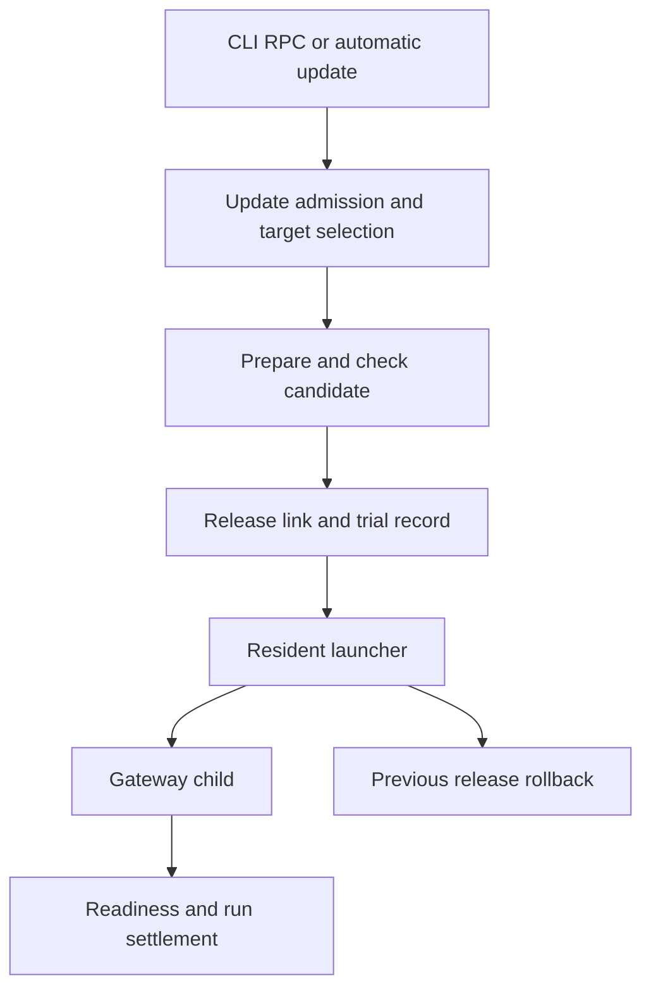

Codex review: blocked before merge.

## What this changes

Git updates prepare a separate release and activate it through a resident launcher that manages startup trials and rollback.

**Example:** A macOS Git update installs a candidate that fails during startup.
- **Before:** Recovery depends on the installed updater and managed-service handoff.
- **After:** The reported run restored the previous release after two attempts and returned HTTP 200.

## Review scores

| Measure | Result | What it means |
|---|---|---|
| **Overall readiness** | 🧂 unranked krab **(1/6)** | The owner-backed feature is useful, but source-confirmed recovery and compatibility failures prevent merging. |
| **Proof confidence** | 🦐 gold shrimp **(3/6)** | Real behavior proof is not required for maintainer- or bot-authored pull requests. |
| **Patch quality** | 🧂 unranked krab **(1/6)** | 14 actionable review findings remain. |

## Product

**Kind:** Feature · **Worth it:** Yes · **Fix scope:** Complete
**User problem:** A failed self-update can leave the Gateway down or waiting for recovery instead of returning automatically to a working release.
**Reason:** The maintainer-authored direction addresses demonstrated recovery failures; its recorded tradeoffs need no second product approval.

## Merge readiness

⛔ **Blocked before merge - 17 items remain**

Keep open: this maintainer-authored redesign has clear recovery value, but introduces blocking launcher, CLI, and compatibility regressions.

**Priority:** P1
**Reviewed head:** `b6e35ce18b56060b7ca27e40df9bd47237dcdf86`

## Before merge

- [ ] **Roll back an active trial before propagating exit 78 (P1)** - A candidate that fails configuration or startup admission exits 78 through the existing startup handlers. This unconditional exit terminates the resident launcher before the active trial is examined, leaving the candidate selected and preventing automatic rollback. Apply terminal-exit behavior only outside an active trial; a trial startup refusal must reach recovery.
- [ ] **Create the initial serving link before enabling forwarding (P1)** - On an unconverted checkout with the Gateway stopped, preparation writes the forwarding marker and a pending trial but never creates prefix/openclaw. Subsequent commands such as gateway start, update status, or --version forward into the launcher's non-Gateway branch, which imports the missing openclaw/dist/entry.js. Establish a link to the existing release before publishing the marker, leaving candidate selection pending.
- [ ] **Support released targets that lack check-release (P1)** - Every candidate must execute this newly added command. The latest stable release, v2026.11.6, has update preflight but no check-release, so selecting that released revision fails validation with an unknown-command result even when its state is compatible. Preserve a supported validation path for released targets instead of requiring them to implement a command introduced by this PR.
- [ ] **Preserve existing update options through the Git route (P1)** - This route consumes Git updates while forwarding only json, channel, and sha. Consequently openclaw update --no-restart still requests a Gateway restart, --tag is ignored, and --timeout no longer controls the operation. Carry the existing options through the owning operation and retain their documented behavior.
- [ ] **Retain Git-to-package channel switching (P1)** - The existing target owner switches a Git installation to a package installation when an explicit non-dev channel is requested. The new route instead persists that channel and always prepares Git; extended-stable then throws unsupported_git_channel, leaving the saved preference changed after failure. Preserve the existing install-kind switch for openclaw update --channel extended-stable and the other explicit package-channel switches.
- [ ] **Read the saved channel when updating without a Gateway (P1)** - Without an explicit --channel, the offline branch receives undefined rather than the configured update.channel and also omits the discovered Git tag. A stopped stable-configured Git installation therefore resolves the default dev channel and prepares main. Resolve the effective channel from the existing config and installation facts before choosing either execution path.
- [ ] **Publish Git worktrees through their Git owner (P2)** - prepareGit registers the worktree at releases/.staging-ID/openclaw, but this filesystem rename moves it without updating Git's administrative registration. Git subsequently lists the missing staging path, and worktree pruning can remove the metadata still referenced by the live release, breaking later Git status and updates. Build at the final path or use Git-aware move or repair during publication.
- [ ] **Reuse the existing worker-backed update-run owner (P1)** - This adds a second implementation of update_runs admission and mutation despite existing createUpdateRunAsync, recordUpdateRunPhaseAsync, and finishUpdateRunAsync operations. Gateway RPC and startup now open synchronous write transactions on the event loop, contrary to the database policy. The existing-only writer also cannot create a missing state database for a fresh checkout. Use the established owner, which already handles worker execution and fresh admission.
- [ ] **Report offline preparation as pending in the chosen output mode (P2)** - When preparation returns pending, this branch prints an unconditional text line and fabricates a succeeded record from the original requested-phase snapshot. Thus --json produces mixed text and JSON, and reports success although activation has not happened and the persisted run remains running. Return the actual prepared state and format it through the selected output mode without claiming activation succeeded.
- [ ] **Adopt the existing campaign before resolving an RPC target (P2)** - The Git RPC path no longer calls the campaign owner's adopt and bindRun operations. If a campaign announced commit A and upstream advances to B before the user requests an untargeted update, this code resolves B instead of the announced target and leaves the campaign unrelated to the run. Preserve campaign target adoption and run binding through the existing lifecycle owner.
- [ ] **Route the update wizard through the same Git operation (P1)** - The cutover is installed only in the parent command action; wizard.ts still calls the legacy updateCommand directly. On a converted installation that path can write a legacy .trial record while writeGitReleaseLauncher deliberately retains format 2. The resident launcher ignores records without phase, so wizard-driven candidates lose deferred activation and trial rollback. Cut the wizard over with the other Git callers.
- [ ] **Keep settling trials produced by the retained legacy publisher (P1)** - A deferred package-to-Git update still uses the retained publisher and format-1 trial. After its later manual Gateway start, announceReady ignores that record because it lacks outcome and runId, while this change removes the Gateway's old settlement call. With no updater left to verify it, two successful starts still exhaust the legacy counter and a subsequent normal start rolls the healthy release and state back. Retain compatible settlement until that publisher is removed.
- [ ] **Mark the actual linked worktree entry point for forwarding (P2)** - For an installation running from a linked worktree outside releases, detectInstall resolves the common main checkout and this code writes its marker there. The installed worktree's forwarder looks beside its own root, where .git is a file, so its existing CLI and service entry points never see that marker and keep starting the old build. Write a marker the actual running entry point can read.
- [ ] **Check restart availability before preparing an RPC trial (P2)** - A foreground Gateway with OPENCLAW_NO_RESPAWN=1 previously refused update.run before starting work, as documented. The new Git path publishes a pending trial and schedules a restart anyway; respawnGatewayProcessForUpdate returns disabled and the run loop resumes the old process in place. The trial cannot activate and blocks subsequent updates. Preserve the admission refusal or explicitly support deferred activation with a visible outcome.
- [ ] **Add data-model compatibility proof** - The review found that existing stored data may not work after upgrade. Show that existing data still loads and works with this change.
- [ ] **Explain or restore the original intent of Update-run persistence** - 2aee2fa5be672aafec93b8dc572d8c4a74f23d83: Move update bookkeeping through existing workers and avoid synchronous Gateway database work.
- [ ] **Explain or restore the original intent of Legacy trial readiness settlement** - 6747b1ec5ae3de93c92c50d37b51c33ee3370d50: A ready Gateway clears the trial so later normal starts cannot roll back a healthy release.

## Findings

- [P1] Roll back an active trial before propagating exit 78 — `src/update/launcher.ts:207-210`
- [P1] Create the initial serving link before enabling forwarding — `src/update/run.ts:190-197`
- [P1] Support released targets that lack check-release — `src/update/run.ts:257-259`

### Provenance

- `Update-run persistence` changes intended behavior without addressing why it exists (2aee2fa5be672aafec93b8dc572d8c4a74f23d83: Move update bookkeeping through existing workers and avoid synchronous Gateway database work.)
- `Legacy trial readiness settlement` changes intended behavior without addressing why it exists (6747b1ec5ae3de93c92c50d37b51c33ee3370d50: A ready Gateway clears the trial so later normal starts cannot roll back a healthy release.)

### Tests

- Low-value test `src/gateway/server-methods/update.test.ts`: The acknowledgement test still iterates managed=false and managed=true, but now unconditionally calls managedPackage in both rows; remove the duplicate row.
- Missing end-to-end proof: The supplied upgrade results do not show populated configuration and session data preserved through upgrade and rollback, or base-red/head-green results for the regressions; redact credentials and private endpoints from that evidence.

<strong>Agent review details</strong>

### How this fits together

CLI, Gateway RPC, and automatic updates select and prepare releases; the launcher starts the Gateway, records trial outcomes, and restores the previous release when startup fails.

### Technical review

Best possible solution:

Complete one Git update path using the existing ledger and release owners while preserving CLI, released-target, and trial-recovery contracts.

Do we have a high-confidence way to reproduce the issue?

The supplied installation results exercise successful replacement and rollback; the additional failing paths are traceable in source, and no target code was executed during this review.

Is this the best way to solve the issue?

Resident supervision is justified, but the smallest coherent stage must reuse existing run and release owners and cut CLI, wizard, RPC, and automatic callers over together.

Full review comments:

- [P1] Roll back an active trial before propagating exit 78 — `src/update/launcher.ts:207-210`
  A candidate that fails configuration or startup admission exits 78 through the existing startup handlers. This unconditional exit terminates the resident launcher before the active trial is examined, leaving the candidate selected and preventing automatic rollback. Apply terminal-exit behavior only outside an active trial; a trial startup refusal must reach recovery.
  Confidence: 0.99
- [P1] Create the initial serving link before enabling forwarding — `src/update/run.ts:190-197`
  On an unconverted checkout with the Gateway stopped, preparation writes the forwarding marker and a pending trial but never creates prefix/openclaw. Subsequent commands such as gateway start, update status, or --version forward into the launcher's non-Gateway branch, which imports the missing openclaw/dist/entry.js. Establish a link to the existing release before publishing the marker, leaving candidate selection pending.
  Confidence: 0.99
- [P1] Support released targets that lack check-release — `src/update/run.ts:257-259`
  Every candidate must execute this newly added command. The latest stable release, v2026.11.6, has update preflight but no check-release, so selecting that released revision fails validation with an unknown-command result even when its state is compatible. Preserve a supported validation path for released targets instead of requiring them to implement a command introduced by this PR.
  Confidence: 0.99
- [P1] Preserve existing update options through the Git route — `src/cli/update-cli.ts:218-222`
  This route consumes Git updates while forwarding only json, channel, and sha. Consequently openclaw update --no-restart still requests a Gateway restart, --tag is ignored, and --timeout no longer controls the operation. Carry the existing options through the owning operation and retain their documented behavior.
  Confidence: 0.99
- [P1] Retain Git-to-package channel switching — `src/update/cli.ts:30-33`
  The existing target owner switches a Git installation to a package installation when an explicit non-dev channel is requested. The new route instead persists that channel and always prepares Git; extended-stable then throws unsupported_git_channel, leaving the saved preference changed after failure. Preserve the existing install-kind switch for openclaw update --channel extended-stable and the other explicit package-channel switches.
  Confidence: 0.99
- [P1] Read the saved channel when updating without a Gateway — `src/update/cli.ts:132-137`
  Without an explicit --channel, the offline branch receives undefined rather than the configured update.channel and also omits the discovered Git tag. A stopped stable-configured Git installation therefore resolves the default dev channel and prepares main. Resolve the effective channel from the existing config and installation facts before choosing either execution path.
  Confidence: 0.98
- [P2] Publish Git worktrees through their Git owner — `src/update/store.ts:56-60`
  prepareGit registers the worktree at releases/.staging-ID/openclaw, but this filesystem rename moves it without updating Git's administrative registration. Git subsequently lists the missing staging path, and worktree pruning can remove the metadata still referenced by the live release, breaking later Git status and updates. Build at the final path or use Git-aware move or repair during publication.
  Confidence: 0.99
- [P1] Reuse the existing worker-backed update-run owner — `src/update/runs.ts:21-30`
  This adds a second implementation of update_runs admission and mutation despite existing createUpdateRunAsync, recordUpdateRunPhaseAsync, and finishUpdateRunAsync operations. Gateway RPC and startup now open synchronous write transactions on the event loop, contrary to the database policy. The existing-only writer also cannot create a missing state database for a fresh checkout. Use the established owner, which already handles worker execution and fresh admission.
  Confidence: 0.99
- [P2] Report offline preparation as pending in the chosen output mode — `src/update/cli.ts:145-149`
  When preparation returns pending, this branch prints an unconditional text line and fabricates a succeeded record from the original requested-phase snapshot. Thus --json produces mixed text and JSON, and reports success although activation has not happened and the persisted run remains running. Return the actual prepared state and format it through the selected output mode without claiming activation succeeded.
  Confidence: 0.99
- [P2] Adopt the existing campaign before resolving an RPC target — `src/gateway/server-methods/update-run.ts:95-100`
  The Git RPC path no longer calls the campaign owner's adopt and bindRun operations. If a campaign announced commit A and upstream advances to B before the user requests an untargeted update, this code resolves B instead of the announced target and leaves the campaign unrelated to the run. Preserve campaign target adoption and run binding through the existing lifecycle owner.
  Confidence: 0.98
- [P1] Route the update wizard through the same Git operation — `src/cli/update-cli.ts:215-224`
  The cutover is installed only in the parent command action; wizard.ts still calls the legacy updateCommand directly. On a converted installation that path can write a legacy .trial record while writeGitReleaseLauncher deliberately retains format 2. The resident launcher ignores records without phase, so wizard-driven candidates lose deferred activation and trial rollback. Cut the wizard over with the other Git callers.
  Confidence: 0.98
- [P1] Keep settling trials produced by the retained legacy publisher — `src/gateway/stale-install.ts:188-192`
  A deferred package-to-Git update still uses the retained publisher and format-1 trial. After its later manual Gateway start, announceReady ignores that record because it lacks outcome and runId, while this change removes the Gateway's old settlement call. With no updater left to verify it, two successful starts still exhaust the legacy counter and a subsequent normal start rolls the healthy release and state back. Retain compatible settlement until that publisher is removed.
  Confidence: 0.96
- [P2] Mark the actual linked worktree entry point for forwarding — `src/update/run.ts:242-246`
  For an installation running from a linked worktree outside releases, detectInstall resolves the common main checkout and this code writes its marker there. The installed worktree's forwarder looks beside its own root, where .git is a file, so its existing CLI and service entry points never see that marker and keep starting the old build. Write a marker the actual running entry point can read.
  Confidence: 0.96
- [P2] Check restart availability before preparing an RPC trial — `src/gateway/server-methods/update-run.ts:128-131`
  A foreground Gateway with OPENCLAW_NO_RESPAWN=1 previously refused update.run before starting work, as documented. The new Git path publishes a pending trial and schedules a restart anyway; respawnGatewayProcessForUpdate returns disabled and the run loop resumes the old process in place. The trial cannot activate and blocks subsequent updates. Preserve the admission refusal or explicitly support deferred activation with a visible outcome.
  Confidence: 0.98

Overall correctness: patch is incorrect
Overall confidence: 0.97

AGENTS.md: found and applied where relevant.

Codex review notes: model internal, reasoning medium; reviewed against [fe48a6f224f9](https://github.com/openclaw/openclaw/commit/fe48a6f224f94c963a2f501e72aefbca38002613).

### Provenance checked

- `Git release preparation and supervision` changes intended behavior with a stated reason (6747b1ec5ae3de93c92c50d37b51c33ee3370d50: Keep running files untouched and recover failed starts through a release link and frozen launcher.)
- `Package release slots and retention` keeps the original intent (b868ed4c21ba046aae5d41bcd9c6c61e530c0a3f: Keep releases intact behind one installation link, with lease-aware retention and atomic switching.)
- `CLI entry points and deferred activation` changes intended behavior with a stated reason (b229b2664537d53a1d8f33f6d777780b54ca3028: Keep existing CLI and service entry points working while honoring deferred activation and install-kind switches.)
- `Launcher-child update respawn` changes intended behavior with a stated reason (8846e9e61db03e1d5997c88c15c80a5798cf8cd0: Give process replacement and shutdown cleanup one successor owner.)

### Testing

Proof path: shipped entry point.

### Security

None.

### Evidence

What I checked:

- **Pinned introduction and clean checkout:** Reviewed the merge-base-to-head changes separately from base movement; GitHub still reports the reviewed head as open and mergeable, and the checkout remains clean. ([b6e35ce18b56](https://github.com/openclaw/openclaw/commit/b6e35ce18b56060b7ca27e40df9bd47237dcdf86))
- **Direction and supplied behavior evidence:** The collaborator-authored body records an isolated macOS upgrade from 2026.11.6, automatic rollback after two candidate starts, repeated successful replacements, and unchanged schema versions during offline inspection; its documented stop and developer-checkout tradeoffs are accepted direction. ([b6e35ce18b56](https://github.com/openclaw/openclaw/commit/b6e35ce18b56060b7ca27e40df9bd47237dcdf86))
- **First-conversion publication ordering:** Forwarding is enabled before an initial serving link is created; non-Gateway launcher invocations then import exclusively through that link. ([`src/update/run.ts:190`](https://github.com/openclaw/openclaw/blob/b6e35ce18b56060b7ca27e40df9bd47237dcdf86/src/update/run.ts#L190), [b6e35ce18b56](https://github.com/openclaw/openclaw/commit/b6e35ce18b56060b7ca27e40df9bd47237dcdf86))
- **Terminal startup failure bypasses recovery:** The launcher propagates exit 78 before examining the active trial; production startup maps configuration and startup-refusal failures to that status. ([`src/update/launcher.ts:209`](https://github.com/openclaw/openclaw/blob/b6e35ce18b56060b7ca27e40df9bd47237dcdf86/src/update/launcher.ts#L209), [b6e35ce18b56](https://github.com/openclaw/openclaw/commit/b6e35ce18b56060b7ca27e40df9bd47237dcdf86))
- **Released candidate command contract:** Release v2026.11.6 provides update admit and preflight but no check-release command, which the new updater invokes unconditionally. ([`src/cli/update-cli.ts:332`](https://github.com/openclaw/openclaw/blob/06afb10d3272cc9deaf38ca6a3b7b839d5935638/src/cli/update-cli.ts#L332), [06afb10d3272](https://github.com/openclaw/openclaw/commit/06afb10d3272cc9deaf38ca6a3b7b839d5935638))
- **Existing CLI and ledger owners:** The intercepted CLI previously forwarded restart, tag, timeout, and other options; update-command-target owns Git-to-package switching, and update-run-write.async already owns worker-backed run admission and mutation. ([`src/cli/update-cli.ts:218`](https://github.com/openclaw/openclaw/blob/b6e35ce18b56060b7ca27e40df9bd47237dcdf86/src/cli/update-cli.ts#L218), [b6e35ce18b56](https://github.com/openclaw/openclaw/commit/b6e35ce18b56060b7ca27e40df9bd47237dcdf86))

Likely related people:

- **Ayaan Zaidi:** Raw commit 6747b1ec5ae3de93c92c50d37b51c33ee3370d50 adds src/infra/git-release-launcher.ts:1 relative to its recorded parents. This identifies author metadata, not feature responsibility or a PR merger. (role: source-line author; confidence: high; commits: [6747b1ec5ae3](https://github.com/openclaw/openclaw/commit/6747b1ec5ae3de93c92c50d37b51c33ee3370d50); files: `src/infra/git-release-launcher.ts`)
- **Peter Steinberger:** Raw commit 8846e9e61db03e1d5997c88c15c80a5798cf8cd0 adds src/infra/process-respawn.ts:63 relative to its recorded parents. This identifies author metadata, not feature responsibility or a PR merger. (role: source-line author; confidence: high; commits: [8846e9e61db0](https://github.com/openclaw/openclaw/commit/8846e9e61db03e1d5997c88c15c80a5798cf8cd0); files: `src/infra/process-respawn.ts`)

### PR surface

Source +2083, Tests -256, Config +2, Other +47. Total +1876 across 48 files. Added test files: 6.

View PR surface stats

| Area | Files | Added | Removed | Net |
|---|---:|---:|---:|---:|
| Source | 27 | 3482 | 1399 | +2083 |
| Tests | 16 | 897 | 1153 | -256 |
| Docs | 0 | 0 | 0 | 0 |
| Config | 1 | 2 | 0 | +2 |
| Generated | 0 | 0 | 0 | 0 |
| Other | 4 | 49 | 2 | +47 |
| **Total** | **48** | **4430** | **2554** | **+1876** |

### Preflight source

Source unknown. Source comparison at the observed PR snapshot only. Completion is self-reported; body, policy, tests, execution, and report bytes are not verified.

### Labels

Label changes:

- add `P1`: The introduced update and startup failures can prevent activation or leave a Gateway unavailable.
- add `merge-risk: 🚨 compatibility`: Existing CLI options, channel switches, released candidate commands, and legacy trial records are not preserved.
- add `merge-risk: 🚨 session-state`: Unsettled legacy trials can roll a healthy release and its state back after ordinary subsequent starts.
- add `merge-risk: 🚨 availability`: Exit-78 handling and first-conversion forwarding can stop recovery or make CLI commands fail.
- add `rating: 🧂 unranked krab`: Overall readiness is 🧂 unranked krab; proof is 🦐 gold shrimp and patch quality is 🧂 unranked krab.
- add `status: ⏳ waiting on author`: ClawSweeper has contributor-facing work open and is waiting for author action.

Label justifications:

- `P1`: The introduced update and startup failures can prevent activation or leave a Gateway unavailable.
- `merge-risk: 🚨 compatibility`: Existing CLI options, channel switches, released candidate commands, and legacy trial records are not preserved.
- `merge-risk: 🚨 availability`: Exit-78 handling and first-conversion forwarding can stop recovery or make CLI commands fail.
- `merge-risk: 🚨 session-state`: Unsettled legacy trials can roll a healthy release and its state back after ordinary subsequent starts.
- `rating: 🧂 unranked krab`: Overall readiness is 🧂 unranked krab; proof is 🦐 gold shrimp and patch quality is 🧂 unranked krab.
- `status: ⏳ waiting on author`: ClawSweeper has contributor-facing work open and is waiting for author action.

### Rating scale

6/6 🦀 challenger crab · 5/6 🦞 diamond lobster · 4/6 🐚 platinum hermit · 3/6 🦐 gold shrimp · 2/6 🦪 silver shellfish · 1/6 🧂 unranked krab. Overall follows the weaker of proof and patch quality; ✨ marks media proof (a screenshot, video, or linked artifact) that directly shows the changed behavior.

### Workflow

ClawSweeper edits this one comment on every review. Comment `@clawsweeper re-review` for a fresh review only. Repair and merge execution lanes are retired.

_Reviewed November 21, 2026, 12:21 PM ET / 17:21 UTC._

<!-- clawsweeper-verdict:needs-human item=203194 sha=b6e35ce18b56060b7ca27e40df9bd47237dcdf86 confidence=high updated_at=2026-11-21T17:11:34Z reviewed_at=2026-11-21T17:21:55.557Z lease_owner=github-run-44928550916-1 lease_comment_id=7066270969 source_revision=81b5b32bca15b10881726c7d34f53ac48ccd38d9c98cf3e927f21c01de1a4762 hold=blocked findings=14 -->
<!-- clawsweeper-review-state:blocked item=203194 sha=b6e35ce18b56060b7ca27e40df9bd47237dcdf86 v=1 -->

<!-- clawsweeper-review-version item=203194 reviewed_at=2026-11-21T17:21:55.557Z sha=b6e35ce18b56060b7ca27e40df9bd47237dcdf86 source_revision=81b5b32bca15b10881726c7d34f53ac48ccd38d9c98cf3e927f21c01de1a4762 lease_owner=github-run-44928550916-1 lease_comment_id=7066270969 v=1 -->

<!-- clawsweeper-review item=203194 -->