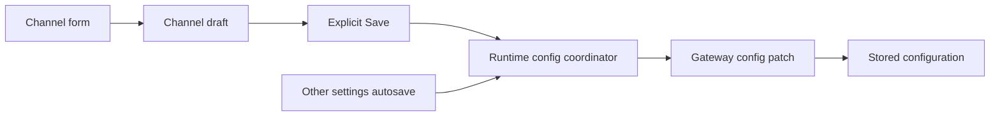

Codex review: needs changes before merge.

## What this changes

This PR isolates unsaved channel settings from autosave and adds explicit Save, discard confirmation, and retained drafts.

**Example:** Enter the partial Telegram token 123456:PARTIAL and wait four seconds.
- **Before:** The shared config draft schedules an automatic write before Save.
- **After:** The token remains in the channel draft until Save.

## Review scores

| Measure | Result | What it means |
|---|---|---|
| **Overall readiness** | 🦐 gold shrimp **(3/6)** | Useful and supported by real UI/Gateway evidence, but two Save-lifecycle defects and a diff-caused CI failure prevent approval. |
| **Proof confidence** | 🐚 platinum hermit **(4/6)** | Sufficient (live_output): Inspected before/after UI screenshots and the PR's isolated real-Gateway observations: editing and navigation produce no credential write, another page's autosave excludes the token, and explicit Save patches only the token while preserving an outside change. |
| **Patch quality** | 🦐 gold shrimp **(3/6)** | 3 actionable review findings remain. |

## Product

**Kind:** Bug fix · **Worth it:** Yes · **Fix scope:** Complete
**User problem:** Channel settings display Save while partially typed credentials can already be written automatically.
**Reason:** Explicit persistence matches the existing form affordance, and maintainer authorship establishes direction for this scoped autosave exception.

## Merge readiness

⛔ **Needs changes before merge - 4 items remain**

Keep this PR open: explicit Save addresses a real UI mismatch, but discarded edits remain retryable, confirmation Save bypasses validation, and new assertions violate a failing CI gate.

**Priority:** P2
**Reviewed head:** `687e59bbdb35d417bca7f225c6caeeb2c76630b1`

## Before merge

- [ ] **Retire the retained patch when channel edits are discarded (P2)** - After a channel Save fails, createConfigPatchCoordinator retains this builder and its captured edits. Choosing Close → Discard removes only configEdits; the Settings sidebar still exposes Retry, which calls runtimeConfig.retry() and runs the old builder. For example, a failed Telegram enabled=false edit can subsequently be persisted after the user discarded it. Tie retry dispatch to the still-current channel edit intent and retire stale recovery when that intent is discarded or replaced.
- [ ] **Validate the form before saving from the close confirmation (P2)** - The confirmation's Save calls saveChannelConfig directly, bypassing ChannelConfig's reportValidity(). With an admitted change plus a Discord mention-alias field showing invalid text such as not-numeric, the scalar editor retains its previous valid model value. Confirmation Save writes the admitted changes and closes the editor, silently dropping the invalid visible draft. Route this Save through the same validated submission boundary as the footer button and keep the editor open when validation fails.
- [ ] **Make the draft conversions satisfy the assertion-safety gate (P2)** - This new production module adds four non-const type assertions without SAFETY invariants and has no allowance in config/assertion-safety-baseline.txt. The repository scanner counts these assertions, and the exact-head baseline job reports assertion-safety failure, blocking openclaw/ci-gate. Preserve or strengthen the actual typed contracts, remove unnecessary assertions, and document any justified invariant without expanding the baseline.
- [ ] **Explain or restore the original intent of Native validation before channel Save** - 01a354adb6087fadbf3d414693f3274858fa935b: Prevent explicit Save from accepting prior valid values while a rendered field contains invalid text.

## Findings

- [P2] Retire the retained patch when channel edits are discarded — `ui/src/pages/channels/channels-page.tsx:290-295`
- [P2] Validate the form before saving from the close confirmation — `ui/src/pages/channels/channels-page.tsx:353`
- [P2] Make the draft conversions satisfy the assertion-safety gate — `ui/src/pages/channels/channel-config-draft.ts:82-87`

### Provenance

- `Native validation before channel Save` changes intended behavior without addressing why it exists (01a354adb6087fadbf3d414693f3274858fa935b: Prevent explicit Save from accepting prior valid values while a rendered field contains invalid text.)

### Tests

- Missing end-to-end proof: The supplied validation does not show red-on-base regression results or cover Discard followed by sidebar Retry and confirmation Save with a visibly invalid scalar.

<strong>Agent review details</strong>

### How this fits together

Channel forms project configuration into editable controls; channel drafts collect edits, and the existing runtime-config coordinator serializes config.patch requests to the Gateway.

### Technical review

Best possible solution:

Keep drafts in the existing channel capability, bind retry eligibility to live edit intent, and route every Save through the existing validated form boundary.

Do we have a high-confidence way to reproduce the issue?

Current main sends channel edits into the shared form draft, whose coordinator autosaves after 800 ms; source establishes the path, and the supplied Gateway observations exercise the changed behavior.

Is this the best way to solve the issue?

Separating explicit channel drafts from shared autosave is appropriate, but retries must respect discarded intent and all Save entry points must preserve native validation.

Full review comments:

- [P2] Retire the retained patch when channel edits are discarded — `ui/src/pages/channels/channels-page.tsx:290-295`
  After a channel Save fails, createConfigPatchCoordinator retains this builder and its captured edits. Choosing Close → Discard removes only configEdits; the Settings sidebar still exposes Retry, which calls runtimeConfig.retry() and runs the old builder. For example, a failed Telegram enabled=false edit can subsequently be persisted after the user discarded it. Tie retry dispatch to the still-current channel edit intent and retire stale recovery when that intent is discarded or replaced.
  Confidence: 0.99
- [P2] Validate the form before saving from the close confirmation — `ui/src/pages/channels/channels-page.tsx:353`
  The confirmation's Save calls saveChannelConfig directly, bypassing ChannelConfig's reportValidity(). With an admitted change plus a Discord mention-alias field showing invalid text such as not-numeric, the scalar editor retains its previous valid model value. Confirmation Save writes the admitted changes and closes the editor, silently dropping the invalid visible draft. Route this Save through the same validated submission boundary as the footer button and keep the editor open when validation fails.
  Confidence: 0.99
- [P2] Make the draft conversions satisfy the assertion-safety gate — `ui/src/pages/channels/channel-config-draft.ts:82-87`
  This new production module adds four non-const type assertions without SAFETY invariants and has no allowance in config/assertion-safety-baseline.txt. The repository scanner counts these assertions, and the exact-head baseline job reports assertion-safety failure, blocking openclaw/ci-gate. Preserve or strengthen the actual typed contracts, remove unnecessary assertions, and document any justified invariant without expanding the baseline.
  Confidence: 0.98

Overall correctness: patch is incorrect
Overall confidence: 0.98

AGENTS.md: found and applied where relevant.

Codex review notes: model internal, reasoning medium; reviewed against [cd56ab1a54c8](https://github.com/openclaw/openclaw/commit/cd56ab1a54c81b3a515388ca1014d2d22deab1cb).

### Provenance checked

- `Channel edits entering shared autosave` changes intended behavior with a stated reason (https://github.com/openclaw/openclaw/pull/107458: Form autosave removed Save-versus-Apply confusion while retaining serialized writes and explicit restart.)
- `Schema coercion and shared write coordination` keeps the original intent (5c81ed5883ceb61af6088eaea8575bc7a9a37574: Runtime-config layering centralized draft hydration, serialization, and write ordering.)
- `Plugin-owned channel configuration presentation` keeps the original intent (0a80f9e0b10e5bec3bbfe342ce8fd70e9135ae86: Move channel-specific presentation into its plugin while keeping schema configuration and authenticated operations with existing owners.)

### Testing

Proof path: shipped entry point.

### Security

None.

### Evidence

Acceptance criteria:

- pnpm --dir ui test src/pages/channels/channels-page.test.ts src/pages/channels/channel-config-draft.test.ts
- pnpm check:assertion-safety --base 4c451a77c68be7e6e24b4900bf22ef1022ef3a9a
- pnpm check:changed
- Verify through the built Control UI that sidebar Retry cannot resurrect discarded channel edits.
- Verify through the built Control UI that confirmation Save retains and focuses an invalid field without writing; correcting it permits Save.

What I checked:

- **Reviewed introduction and current main:** The pinned introduction isolates channel edits from runtimeConfig.patchForm; fetched main retains the shared-draft Save path and does not contain this change. ([`ui/src/pages/channels/channels-page.tsx:274`](https://github.com/openclaw/openclaw/blob/687e59bbdb35d417bca7f225c6caeeb2c76630b1/ui/src/pages/channels/channels-page.tsx#L274), [687e59bbdb35](https://github.com/openclaw/openclaw/commit/687e59bbdb35d417bca7f225c6caeeb2c76630b1))
- **Discard leaves a retryable patch:** The patch coordinator retains failed builders, while channel Discard only removes configEdits; the Settings sidebar exposes runtimeConfig.retry(), which invokes that retained builder. ([`ui/src/lib/config/config-patch-coordinator.ts:23`](https://github.com/openclaw/openclaw/blob/687e59bbdb35d417bca7f225c6caeeb2c76630b1/ui/src/lib/config/config-patch-coordinator.ts#L23), [687e59bbdb35](https://github.com/openclaw/openclaw/commit/687e59bbdb35d417bca7f225c6caeeb2c76630b1))
- **Existing native-validation contract:** https://github.com/openclaw/openclaw/pull/182085 deliberately prevents Save from accepting prior valid values while controls display invalid text; the new confirmation Save calls the mutation directly. ([`ui/src/pages/channels/channels-page.tsx:353`](https://github.com/openclaw/openclaw/blob/01a354adb6087fadbf3d414693f3274858fa935b/ui/src/pages/channels/channels-page.tsx#L353), [01a354adb608](https://github.com/openclaw/openclaw/commit/01a354adb6087fadbf3d414693f3274858fa935b))
- **Assertion-safety CI failure:** The exact-head baseline job reports assertion-safety failure. The new draft module contains four non-const assertions without SAFETY invariants and has no grandfathered allowance; the scanner counts these assertions. Job: https://github.com/openclaw/openclaw/actions/runs/41506215587/job/125487305872. ([`ui/src/pages/channels/channel-config-draft.ts:83`](https://github.com/openclaw/openclaw/blob/687e59bbdb35d417bca7f225c6caeeb2c76630b1/ui/src/pages/channels/channel-config-draft.ts#L83), [687e59bbdb35](https://github.com/openclaw/openclaw/commit/687e59bbdb35d417bca7f225c6caeeb2c76630b1))
- **Supplied behavior and visual proof:** Inspected all four downloaded screenshots: before, footer Save/status, close confirmation, and narrow-screen rejection. The PR body reports isolated real-Gateway frame/file observations showing no credential write before Save and preservation of an outside config change. ([687e59bbdb35](https://github.com/openclaw/openclaw/commit/687e59bbdb35d417bca7f225c6caeeb2c76630b1))
- **Original autosave direction:** https://github.com/openclaw/openclaw/pull/107458 intentionally introduced debounced form autosave; this maintainer-authored PR explicitly explains the narrower channel-form exception. ([`ui/src/lib/config/config-write-coordinator.ts:40`](https://github.com/openclaw/openclaw/blob/d6fc3d34e2010997d4f67807b30c336347808f31/ui/src/lib/config/config-write-coordinator.ts#L40), [d6fc3d34e201](https://github.com/openclaw/openclaw/commit/d6fc3d34e2010997d4f67807b30c336347808f31))

### PR surface

Source +337, Tests +227. Total +564 across 18 files. Added test files: 2.

View PR surface stats

| Area | Files | Added | Removed | Net |
|---|---:|---:|---:|---:|
| Source | 12 | 401 | 64 | +337 |
| Tests | 6 | 258 | 31 | +227 |
| Docs | 0 | 0 | 0 | 0 |
| Config | 0 | 0 | 0 | 0 |
| Generated | 0 | 0 | 0 | 0 |
| Other | 0 | 0 | 0 | 0 |
| **Total** | **18** | **659** | **95** | **+564** |

### Labels

Label changes:

- add `P2`: The change improves channel-setting persistence semantics, with focused correctness repairs needed before merge.
- add `merge-risk: 🚨 compatibility`: A retained retry can write configuration after Discard, and confirmation Save can accept only the previously admitted portion of a visibly invalid form.
- add `proof: sufficient`: Contributor real behavior proof is sufficient.
- add `rating: 🦐 gold shrimp`: Overall readiness is 🦐 gold shrimp; proof is 🐚 platinum hermit and patch quality is 🦐 gold shrimp.
- add `status: ⏳ waiting on author`: ClawSweeper has contributor-facing work open and is waiting for author action.

Label justifications:

- `P2`: The change improves channel-setting persistence semantics, with focused correctness repairs needed before merge.
- `merge-risk: 🚨 compatibility`: A retained retry can write configuration after Discard, and confirmation Save can accept only the previously admitted portion of a visibly invalid form.
- `rating: 🦐 gold shrimp`: Overall readiness is 🦐 gold shrimp; proof is 🐚 platinum hermit and patch quality is 🦐 gold shrimp.
- `status: ⏳ waiting on author`: ClawSweeper has contributor-facing work open and is waiting for author action.
- `proof: sufficient`: Contributor real behavior proof is sufficient.

### Rating scale

6/6 🦀 challenger crab · 5/6 🦞 diamond lobster · 4/6 🐚 platinum hermit · 3/6 🦐 gold shrimp · 2/6 🦪 silver shellfish · 1/6 🧂 unranked krab. Overall follows the weaker of proof and patch quality; ✨ marks media proof (a screenshot, video, or linked artifact) that directly shows the changed behavior.

### Workflow

ClawSweeper edits this one comment on every review. Comment `@clawsweeper re-review` for a fresh review only. Repair and merge execution lanes are retired.

_Reviewed November 2, 2026, 2:20 PM ET / 19:20 UTC._

<!-- clawsweeper-verdict:needs-changes item=191398 sha=687e59bbdb35d417bca7f225c6caeeb2c76630b1 confidence=high updated_at=2026-11-02T19:14:21Z reviewed_at=2026-11-02T19:20:45.986Z lease_owner=github-run-41507849070-1 lease_comment_id=6586092917 source_revision=4bc77bd2761ab9273cb71e638bb504751cf374558bb50f590cb671f78051a3a4 -->
<!-- clawsweeper-review-state:needs-changes item=191398 sha=687e59bbdb35d417bca7f225c6caeeb2c76630b1 v=1 -->

<!-- clawsweeper-review-version item=191398 reviewed_at=2026-11-02T19:20:45.986Z sha=687e59bbdb35d417bca7f225c6caeeb2c76630b1 source_revision=4bc77bd2761ab9273cb71e638bb504751cf374558bb50f590cb671f78051a3a4 lease_owner=github-run-41507849070-1 lease_comment_id=6586092917 v=1 -->

<!-- clawsweeper-review item=191398 -->