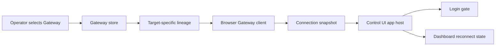

Codex review: needs maintainer review before merge. _Reviewed July 31, 2026, 8:32 PM ET / August 1, 2026, 00:32 UTC._

# ClawSweeper review

## What this changes

The PR resets Control UI connection lineage when an operator selects a different Gateway so the replacement target begins as a first connection rather than inheriting the prior target’s dashboard session.

## Merge readiness

⚠️ **Ready for maintainer review - 3 items remain**

This is a valid, focused P1 Control UI regression fix: current main lets a successful session from Gateway A make newly selected Gateway B look like an established reconnect. The branch repairs that state at the Gateway-store owner and covers both the snapshot and real app-host rendering decisions. Keep it open because it carries the protected `maintainer` label and remains behind current main; land only after an exact-head refresh and required checks pass.

**Priority:** P1
**Reviewed head:** `2a1fe006af044c98a67498815714a5195b8903a3`
**Owner decision:** Required. See [Decision needed](#decision-needed).

## Review scores

| Measure | Result | What it means |
|---|---|---|
| **Overall readiness** | 🐚 platinum hermit **(4/6)** | A focused owner-boundary repair with strong reported browser evidence and regression coverage; it needs only the normal refreshed-head merge gates. |
| **Proof confidence** | 🦞 diamond lobster **(5/6)** | Sufficient (live_output): The PR body provides after-fix real Chrome and localhost WebSocket matrix evidence for Gateway switching, login-gate behavior, replacement-session reconnects, and unchanged-target retries; focused tests supplement that proof. |
| **Patch quality** | 🐚 platinum hermit **(4/6)** | No actionable review findings were identified. |

## Verification

| Check | Result | Evidence |
|---|---|---|
| **Real behavior** | Verified | Sufficient (live_output): The PR body provides after-fix real Chrome and localhost WebSocket matrix evidence for Gateway switching, login-gate behavior, replacement-session reconnects, and unchanged-target retries; focused tests supplement that proof. |
| **Evidence reviewed** | 5 items | Current-main defect: After any client receives hello, current main sets the shared `everConnected` flag. Both a new client start and its close phase then use that shared flag, so a replacement Gateway inherits the previous Gateway’s reconnect/offline classification. Owner-boundary repair: The branch resets `everConnected` only when the existing `gatewayUrlChanged` selection predicate is true, before replacing the browser client. Same-URL credential, session, retry, and event-gap paths retain their prior lineage. Focused regression coverage: The branch adds direct cases for replacement initial connect, retryable and terminal failures, replacement hello followed by a drop, unchanged-URL resubmission, and app-host login-gate/dashboard rendering. |
| **Findings** | None | None. |
| **Security** | None | None. |

## How this fits together

The Control UI Gateway store owns the browser Gateway client and publishes connection snapshots to the app host. The app host uses those snapshots to show the login gate for a first connection or retain the dashboard for a dropped session that was established for the same Gateway.

## Decision needed

| Question | Recommendation |
|---|---|
| After the branch is refreshed against current main and its exact-head required checks pass, should this targeted Gateway-lineage repair be approved for landing? | **Refresh and land:** Rebase or refresh the branch, require the exact-head checks to pass, then merge the owner-boundary fix. |

Why: The patch is technically sound from the reviewed source and evidence, but the protected `maintainer` label requires explicit human handling rather than automated closure or merge.

## Before merge

- [ ] **Resolve merge risk (P1)** - The PR is behind current main. GitHub currently reports it cleanly mergeable, but its exact rebased head and remaining required checks should be reviewed before landing.
- [ ] **Complete next step (P2)** - The protected `maintainer` label and behind-base state require an explicit maintainer approval after exact-head CI, not a ClawSweeper repair job.

<strong>Agent review details</strong>

### Security

None.

### PR surface

Source +4, Tests +162. Total +166 across 3 files.

View PR surface stats

| Area | Files | Added | Removed | Net |
|---|---:|---:|---:|---:|
| Source | 1 | 5 | 1 | +4 |
| Tests | 2 | 162 | 0 | +162 |
| Docs | 0 | 0 | 0 | 0 |
| Config | 0 | 0 | 0 | 0 |
| Generated | 0 | 0 | 0 | 0 |
| Other | 0 | 0 | 0 | 0 |
| **Total** | **3** | **167** | **1** | **+166** |

### Review metrics

None.

### Stored data model

Persistent data-model change detected: `serialized state: ui/src/app/app-host.gateway-lineage.test.ts`. Confirm migration or upgrade compatibility proof before merge.

### Merge-risk options

**Maintainer options:**
1. **Decide the mitigation before merge**  
   Land the target-specific `everConnected` reset after refreshing the branch onto current main, preserving the existing unchanged-target reconnect semantics and the focused owner/app-host regression coverage.
2. **Pause or close**  
   Do not merge this PR until maintainers decide whether the risk is worth taking.

### Technical review

Best possible solution:

Land the target-specific `everConnected` reset after refreshing the branch onto current main, preserving the existing unchanged-target reconnect semantics and the focused owner/app-host regression coverage.

Do we have a high-confidence way to reproduce the issue?

Yes. On current main, connect Gateway A through hello, then select a different URL for Gateway B: the shared `everConnected` flag makes B publish `reconnecting` on start or retryable failure instead of the first-connection `connecting` state; the branch adds regression cases for that sequence.

Is this the best way to solve the issue?

Yes. Resetting lineage in `ui/src/app/gateway-store.ts` when the authoritative URL-selection predicate changes is the narrowest owner-level repair; app-host-only gating would leave the snapshot contract incorrect for sibling consumers.

AGENTS.md: found and applied where relevant.

Codex review notes: model internal, reasoning high; reviewed against [e8d546c8da8d](https://github.com/openclaw/openclaw/commit/e8d546c8da8d76f19e8e5df6df08f6ecc79a4123).

### Labels

Label changes:

- add `P1`: Selecting an unreachable replacement Gateway can keep the prior Gateway’s dashboard mounted and hide the login/error path needed to recover.
- add `proof: sufficient`: Contributor real behavior proof is sufficient. The PR body provides after-fix real Chrome and localhost WebSocket matrix evidence for Gateway switching, login-gate behavior, replacement-session reconnects, and unchanged-target retries; focused tests supplement that proof.
- add `rating: 🐚 platinum hermit`: Overall readiness is 🐚 platinum hermit; proof is 🦞 diamond lobster and patch quality is 🐚 platinum hermit.
- add `status: 👀 ready for maintainer look`: ClawSweeper has no concrete contributor-facing blocker left for this PR. Sufficient (live_output): The PR body provides after-fix real Chrome and localhost WebSocket matrix evidence for Gateway switching, login-gate behavior, replacement-session reconnects, and unchanged-target retries; focused tests supplement that proof.

Label justifications:

- `P1`: Selecting an unreachable replacement Gateway can keep the prior Gateway’s dashboard mounted and hide the login/error path needed to recover.
- `rating: 🐚 platinum hermit`: Overall readiness is 🐚 platinum hermit; proof is 🦞 diamond lobster and patch quality is 🐚 platinum hermit.
- `status: 👀 ready for maintainer look`: ClawSweeper has no concrete contributor-facing blocker left for this PR. Sufficient (live_output): The PR body provides after-fix real Chrome and localhost WebSocket matrix evidence for Gateway switching, login-gate behavior, replacement-session reconnects, and unchanged-target retries; focused tests supplement that proof.
- `proof: sufficient`: Contributor real behavior proof is sufficient. The PR body provides after-fix real Chrome and localhost WebSocket matrix evidence for Gateway switching, login-gate behavior, replacement-session reconnects, and unchanged-target retries; focused tests supplement that proof.

### Evidence

What I checked:

- **Current-main defect:** After any client receives hello, current main sets the shared `everConnected` flag. Both a new client start and its close phase then use that shared flag, so a replacement Gateway inherits the previous Gateway’s reconnect/offline classification. ([`ui/src/app/gateway-store.ts:341`](https://github.com/openclaw/openclaw/blob/e8d546c8da8d/ui/src/app/gateway-store.ts#L341), [e8d546c8da8d](https://github.com/openclaw/openclaw/commit/e8d546c8da8d))
- **Owner-boundary repair:** The branch resets `everConnected` only when the existing `gatewayUrlChanged` selection predicate is true, before replacing the browser client. Same-URL credential, session, retry, and event-gap paths retain their prior lineage. ([`ui/src/app/gateway-store.ts:276`](https://github.com/openclaw/openclaw/blob/2a1fe006af04/ui/src/app/gateway-store.ts#L276), [2a1fe006af04](https://github.com/openclaw/openclaw/commit/2a1fe006af04))
- **Focused regression coverage:** The branch adds direct cases for replacement initial connect, retryable and terminal failures, replacement hello followed by a drop, unchanged-URL resubmission, and app-host login-gate/dashboard rendering. ([`ui/src/app/gateway-store.test.ts:227`](https://github.com/openclaw/openclaw/blob/2a1fe006af04/ui/src/app/gateway-store.test.ts#L227), [2a1fe006af04](https://github.com/openclaw/openclaw/commit/2a1fe006af04))
- **Current behavior provenance:** The existing Gateway-selection predicate and phase logic are attributed to the recent Control UI change that established this surface, making the lineage reset a direct follow-up at the same owner boundary. ([`ui/src/app/gateway-store.ts:273`](https://github.com/openclaw/openclaw/blob/6b40ad6a66c0/ui/src/app/gateway-store.ts#L273), [6b40ad6a66c0](https://github.com/openclaw/openclaw/commit/6b40ad6a66c0))
- **Branch and release provenance:** The candidate is commit `2a1fe006af044c98a67498815714a5195b8903a3` from 2026-07-31T15:42:57-07:00, is not on current main, and is not contained in any local release tag. ([`ui/src/app/gateway-store.ts:276`](https://github.com/openclaw/openclaw/blob/2a1fe006af04/ui/src/app/gateway-store.ts#L276), [2a1fe006af04](https://github.com/openclaw/openclaw/commit/2a1fe006af04))

Likely related people:

- **steipete:** Current Gateway-selection and connection-phase lines blame to this contributor’s recent Control UI work; the PR also continues that same owner-level state-machine surface. (role: recent area contributor; confidence: high; commits: [6b40ad6a66c0](https://github.com/openclaw/openclaw/commit/6b40ad6a66c0c84e8f689e523b8df85056f55d5a), [2a1fe006af04](https://github.com/openclaw/openclaw/commit/2a1fe006af044c98a67498815714a5195b8903a3); files: `ui/src/app/gateway-store.ts`, `ui/src/app/gateway-store.test.ts`)

### Rank-up moves

Optional improvements that raise the rating; they are not merge blockers.

- Refresh the branch against current main and confirm the exact rebased head completes required CI before merging.

### Rating scale

| Score | Internal tier | Crab rank | Meaning |
|---:|:---:|---|---|
| **6/6** | S | 🦀 challenger crab | Exceptional readiness |
| **5/6** | A | 🦞 diamond lobster | Very strong readiness |
| **4/6** | B | 🐚 platinum hermit | Good normal PR; ordinary maintainer review |
| **3/6** | C | 🦐 gold shrimp | Useful, but confidence is limited |
| **2/6** | D | 🦪 silver shellfish | Proof or implementation needs work |
| **1/6** | F | 🧂 unranked krab | Not merge-ready |
| N/A | NA | 🌊 off-meta tidepool | Rating does not apply |

Overall follows the weaker of proof and patch quality.
Shiny media proof means a screenshot, video, or linked artifact directly shows the changed behavior. Runtime, network, CSP, and security claims still need visible diagnostics.

### Workflow

- ClawSweeper keeps one durable marker-backed review comment per issue or PR.
- Re-runs edit this comment so the latest verdict, findings, and automation markers stay together instead of adding duplicate bot comments.
- A fresh review can be triggered by eligible `@clawsweeper re-review` comments, exact-item GitHub events, scheduled/background review runs, or manual workflow dispatch.
- PR/issue authors and users with repository write access can comment `@clawsweeper re-review` or `@clawsweeper re-run` on an open PR or issue to request a fresh review only.
- Maintainers can also comment `@clawsweeper review` to request a fresh review only.
- Fresh-review commands do not start repair, autofix, rebase, CI repair, or automerge.
- Maintainer-only repair and merge flows require explicit commands such as `@clawsweeper autofix`, `@clawsweeper automerge`, `@clawsweeper fix ci`, or `@clawsweeper address review`.
- Maintainers can comment `@clawsweeper explain` to ask for more context, or `@clawsweeper stop` to stop active automation.

<!-- clawsweeper-verdict:needs-human item=117125 sha=2a1fe006af044c98a67498815714a5195b8903a3 confidence=high updated_at=2026-08-01T00:29:07Z reviewed_at=2026-08-01T00:32:11.919Z lease_owner=github-run-30675609094-1 lease_comment_id=5148591665 source_revision=36fbf5981912f7f6a25e1f150a92859e8574295892d2b6c5c500a952daa71c3f -->

<!-- clawsweeper-review-version item=117125 reviewed_at=2026-08-01T00:32:11.919Z sha=2a1fe006af044c98a67498815714a5195b8903a3 source_revision=36fbf5981912f7f6a25e1f150a92859e8574295892d2b6c5c500a952daa71c3f lease_owner=github-run-30675609094-1 lease_comment_id=5148591665 v=1 -->

<!-- clawsweeper-review item=117125 -->