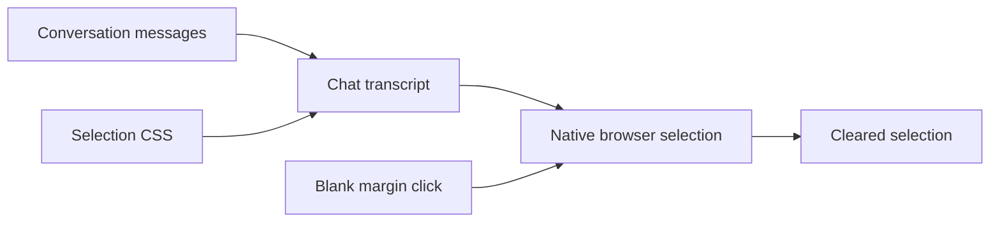

Codex review: needs maintainer review before merge.

## What this changes

Restore native text deselection when users click blank space beside chat messages while keeping avatars and message footers nonselectable.

**Example:** Select “Checking the guard implementation before editing.” and click the blank transcript margin.
- **Before:** The text remains highlighted.
- **After:** The selection clears.

## Review scores

| Measure | Result | What it means |
|---|---|---|
| **Overall readiness** | 🦞 diamond lobster **(5/6)** | A focused repair with inspected before/after proof, meaningful existing browser coverage, and no outstanding review finding. |
| **Proof confidence** | 🦞 diamond lobster **(5/6)** ✨ media proof bonus | Sufficient (screenshot): Inspected screenshots show the production Control UI in Chromium with synthetic conversation data clearing the previously stuck selection after a blank-space click; the current-head consolidation preserves that CSS behavior, and Safari remains explicitly unverified. |
| **Patch quality** | 🦞 diamond lobster **(5/6)** | No actionable review findings were identified. |

## Product

**Kind:** Bug fix · **Worth it:** Yes · **Fix scope:** Complete
**User problem:** Selected chat text stays highlighted after clicking blank transcript space.
**Reason:** The maintainer-authored direction fixes a demonstrated interaction regression with a focused change and preserves the earlier text-selection contract.

## Regression provenance

Regression provenance — suspected predecessor, not a causality claim: source commit `debc7123f743` by Vyctor H. Brzezowski; no PR verified.

Possible regression — suspected (reviewed change). No predecessor PR is attributed.

## Merge readiness

✅ **Ready for maintainer review**

This PR fixes a current Control UI bug with a small CSS change. The earlier consolidation finding is resolved, and no new actionable defect was found; exact-head CI remains pending.

**Priority:** P2
**Reviewed head:** `241a53fad0bbfcee1efd35faaf9003019c684172`

## Before merge

None.

## Findings

None.

<strong>Agent review details</strong>

### How this fits together

The Control UI renders conversation text and message chrome inside the transcript; its CSS controls how native browser selection responds to dragging, Select All, and blank-space clicks.

### Technical review

Best possible solution:

Retain the shared native-selection rule and narrow chrome exclusions, then land this focused fix once its existing CI gates pass.

Do we have a high-confidence way to reproduce the issue?

Current-main CSS exposes the reported native-selection failure, and the supplied Chromium before/after evidence supports the reproduction; no target code was executed during this read-only review.

Is this the best way to solve the issue?

The patch repairs the CSS owner directly, preserves targeted chrome exclusions, and extends existing browser coverage without adding selection-clearing JavaScript or new state.

AGENTS.md: found and applied where relevant.

Codex review notes: model internal, reasoning medium; reviewed against [8a35cf6b3311](https://github.com/openclaw/openclaw/commit/8a35cf6b3311196d4e44811e07e00deff05a6d15).

### Provenance checked

- `Transcript selection policy` changes intended behavior with a stated reason (49e32cbda0c277b83bf3a77d2d618f7427ccec1c: Exclude transcript chrome and media from selection while retaining selectable message and reasoning text.)
- `Blank-space browser assertion` changes intended behavior with a stated reason (4d8806c8c2e297af9bc06f5cc73d4b0a3a8f949b: Preserve existing blank-space behavior while constraining double-click drags to their source message.)
- `Form-controls browser expectation` keeps the original intent (2e72edbdc2f0a8e4b0a9e8090c0f636da5e664c5: Consolidate browser coverage while retaining existing contracts; the changed expectation follows the repaired transcript selection policy.)

### Testing

Proof path: shipped entry point.

### Security

None.

### Evidence

What I checked:

- **Reviewed PR introduction:** The introduced diff changes selection CSS and existing browser coverage without adding handlers, state, configuration, or dependencies. ([`ui/src/styles/chat/startup-layout.css:195`](https://github.com/openclaw/openclaw/blob/241a53fad0bbfcee1efd35faaf9003019c684172/ui/src/styles/chat/startup-layout.css#L195), [241a53fad0bb](https://github.com/openclaw/openclaw/commit/241a53fad0bbfcee1efd35faaf9003019c684172))
- **Current main still contains the cause:** Fetched main still applies user-select: none to the transcript root, preventing native blank-space deselection. ([`ui/src/styles/chat/startup-layout.css:82`](https://github.com/openclaw/openclaw/blob/8a35cf6b3311196d4e44811e07e00deff05a6d15/ui/src/styles/chat/startup-layout.css#L82), [8a35cf6b3311](https://github.com/openclaw/openclaw/commit/8a35cf6b3311196d4e44811e07e00deff05a6d15))
- **Previous finding resolved:** The new commit moves the transcript selector into the existing text-selection rule, implementing the earlier review's requested consolidation without changing budgets. ([`ui/src/styles/chat/startup-layout.css:196`](https://github.com/openclaw/openclaw/blob/241a53fad0bbfcee1efd35faaf9003019c684172/ui/src/styles/chat/startup-layout.css#L196), [241a53fad0bb](https://github.com/openclaw/openclaw/commit/241a53fad0bbfcee1efd35faaf9003019c684172))
- **Inspected visual proof:** The downloaded before/after screenshots visibly show the same passage selected before and cleared afterward; the body identifies the production Control UI, synthetic data, Chromium, and the blank-space gesture. https://github.com/user-attachments/assets/b76d5f9a-3d1d-46c6-b111-8a93d53e114d and https://github.com/user-attachments/assets/ecae2af1-3fff-433b-ae3a-d3e64e7ab170.
- **Original selection contract:** https://github.com/openclaw/openclaw/pull/181196 excluded transcript chrome and media; this PR explains the resulting deselection problem and retains focused exclusions plus existing media, metadata, and reasoning coverage. ([`ui/src/styles/chat/startup-layout.css:199`](https://github.com/openclaw/openclaw/blob/49e32cbda0c277b83bf3a77d2d618f7427ccec1c/ui/src/styles/chat/startup-layout.css#L199), [49e32cbda0c2](https://github.com/openclaw/openclaw/commit/49e32cbda0c277b83bf3a77d2d618f7427ccec1c))
- **Related work overlaps:** https://github.com/openclaw/openclaw/pull/182713 addresses the same root CSS behavior and additionally changes selection-toolbar gesture admission; its broader scope makes it an overlapping candidate rather than an equivalent patch.

Likely related people:

- **Vyctor H. Brzezowski:** Raw commit 098188527dabeb968f987ce28b1b2a1546cfeee2 adds ui/src/styles/chat/grouped.css:136 relative to its recorded parents. This identifies author metadata, not feature responsibility or a PR merger. (role: source-line author; confidence: high; commits: [098188527dab](https://github.com/openclaw/openclaw/commit/098188527dabeb968f987ce28b1b2a1546cfeee2); files: `ui/src/styles/chat/grouped.css`)
- **RoboClaw:** Raw commit 49e32cbda0c277b83bf3a77d2d618f7427ccec1c adds ui/src/styles/chat/startup-layout.css:196 relative to its recorded parents. This identifies author metadata, not feature responsibility or a PR merger. (role: source-line author; confidence: high; commits: [49e32cbda0c2](https://github.com/openclaw/openclaw/commit/49e32cbda0c277b83bf3a77d2d618f7427ccec1c); files: `ui/src/styles/chat/startup-layout.css`)
- **Peter Steinberger:** Raw commit 1acbd6aea048f16a53c7a6f0498bace1a1f5f84c adds ui/src/styles/chat/grouped.css:38 relative to its recorded parents. This identifies author metadata, not feature responsibility or a PR merger. (role: source-line author; confidence: medium; commits: [1acbd6aea048](https://github.com/openclaw/openclaw/commit/1acbd6aea048f16a53c7a6f0498bace1a1f5f84c); files: `ui/src/styles/chat/grouped.css`)

### PR surface

Source +3, Tests +7. Total +10 across 4 files. Added test files: 0.

View PR surface stats

| Area | Files | Added | Removed | Net |
|---|---:|---:|---:|---:|
| Source | 2 | 6 | 3 | +3 |
| Tests | 2 | 13 | 6 | +7 |
| Docs | 0 | 0 | 0 | 0 |
| Config | 0 | 0 | 0 | 0 |
| Generated | 0 | 0 | 0 | 0 |
| Other | 0 | 0 | 0 | 0 |
| **Total** | **4** | **19** | **9** | **+10** |

### Preflight source

Source unknown. Source comparison at the observed PR snapshot only. Completion is self-reported; body, policy, tests, execution, and report bytes are not verified.

### Labels

Label changes:

- add `rating: 🦞 diamond lobster`: Overall readiness is 🦞 diamond lobster; proof is 🦞 diamond lobster and patch quality is 🦞 diamond lobster. Replaced prior `rating: 🦪 silver shellfish`.
- add `status: 👀 ready for maintainer look`: ClawSweeper has no concrete contributor-facing blocker left for this PR.
- remove `rating: 🦪 silver shellfish`: Current PR rating is `rating: 🦞 diamond lobster`, so this older rating label is no longer current.
- remove `status: ⏳ waiting on author`: Current PR status label is `status: 👀 ready for maintainer look`.

Label justifications:

- `P2`: Stuck text selection is a bounded chat interaction bug with demonstrated user impact.
- `rating: 🦞 diamond lobster`: Overall readiness is 🦞 diamond lobster; proof is 🦞 diamond lobster and patch quality is 🦞 diamond lobster. Replaced prior `rating: 🦪 silver shellfish`.
- `status: 👀 ready for maintainer look`: ClawSweeper has no concrete contributor-facing blocker left for this PR.
- `proof: sufficient`: Contributor real behavior proof is sufficient.
- `proof: 📸 screenshot`: Contributor real behavior proof includes screenshot evidence.

### Rating scale

6/6 🦀 challenger crab · 5/6 🦞 diamond lobster · 4/6 🐚 platinum hermit · 3/6 🦐 gold shrimp · 2/6 🦪 silver shellfish · 1/6 🧂 unranked krab. Overall follows the weaker of proof and patch quality; ✨ marks media proof (a screenshot, video, or linked artifact) that directly shows the changed behavior.

### Workflow

ClawSweeper edits this one comment on every review. Comment `@clawsweeper re-review` for a fresh review only. Repair and merge execution lanes are retired.

### History

Review history (1 earlier review cycle)

<!-- clawsweeper-review-history v=1 total=1 -->
- reviewed 2026-11-14T19:29:19.687Z sha b227a9630261fdb2cdd81276ffd9767c50b0efb6 :: needs changes before merge. :: [P2] Consolidate selection declarations to pass the CSS budget

_Reviewed November 16, 2026, 8:45 PM ET / November 17, 2026, 01:45 UTC (Revision 2)._

<!-- clawsweeper-verdict:needs-human item=199123 sha=241a53fad0bbfcee1efd35faaf9003019c684172 confidence=high updated_at=2026-11-17T01:41:08Z reviewed_at=2026-11-17T01:45:31.474Z lease_owner=github-run-43997340889-1 lease_comment_id=6935198656 source_revision=507a11af13cf509f8054d3b174a3d7e93885dd2a1438bed9f15846d9741762cb hold=not_opted_in findings=0 -->
<!-- clawsweeper-review-state:ready item=199123 sha=241a53fad0bbfcee1efd35faaf9003019c684172 v=1 -->

<!-- clawsweeper-review-version item=199123 reviewed_at=2026-11-17T01:45:31.474Z sha=241a53fad0bbfcee1efd35faaf9003019c684172 source_revision=507a11af13cf509f8054d3b174a3d7e93885dd2a1438bed9f15846d9741762cb lease_owner=github-run-43997340889-1 lease_comment_id=6935198656 v=1 -->

<!-- clawsweeper-review item=199123 -->