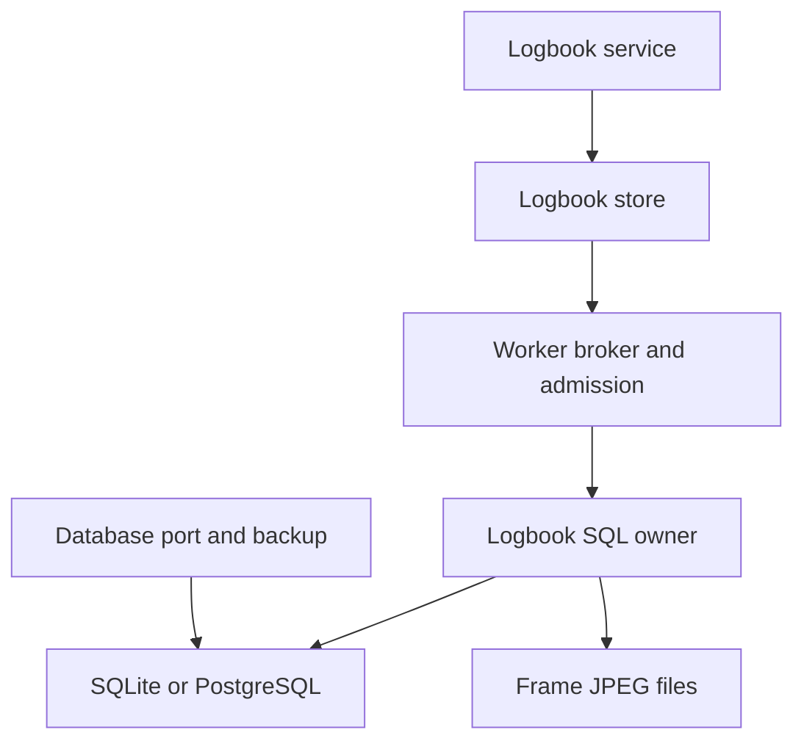

Codex review: blocked before merge.

## What this changes

This PR adds PostgreSQL runtime storage, bidirectional database ports, and matched backups for Logbook.

**Example:** An operator selects database.engine: postgres and ports an existing Logbook installation.
- **Before:** Logbook continues using SQLite and is unavailable to the PostgreSQL port provider.
- **After:** Logbook metadata uses PostgreSQL while frame JPEGs remain at their existing file paths.

## Review scores

| Measure | Result | What it means |
|---|---|---|
| **Overall readiness** | 🦪 silver shellfish **(2/6)** | Useful shared-owner implementation with meaningful SQL coverage, but the missed production pruning envelope blocks correctness and existing-installation compatibility remains unproven. |
| **Proof confidence** | 🦐 gold shrimp **(3/6)** | Real behavior proof is not required for maintainer- or bot-authored pull requests. |
| **Patch quality** | 🦪 silver shellfish **(2/6)** | 1 actionable review finding remain. |

## Product

**Kind:** Feature · **Worth it:** Yes · **Fix scope:** Complete
**User problem:** Operators selecting PostgreSQL cannot currently use it for Logbook metadata, ports, or matched backups.
**Reason:** The maintainer-authored direction follows the existing database-family rollout and preserves the SQLite default and local frame artifacts.

## Merge readiness

⛔ **Blocked before merge - 2 items remain**

Keep this PR open: it adds useful, maintainer-directed PostgreSQL support, but the production pruning path bypasses required write admission.

**Priority:** P2
**Reviewed head:** `c9772323903078038707eaac9897cfa826d0b381`

## Before merge

- [ ] **Route retention pruning through the engine write envelope (P2)** - With PostgreSQL selected, every pruneFrames command now requests transaction admission here, but LogbookStore.pruneFrames still calls this.worker.execute directly at store.ts:246. It therefore omits runEngineStoreOperation's write-admission factory, and the broker's default handler rejects the request with 'SQLite domain operation requires its own admission'. Scheduled retention cannot remove expired frames, even though the direct-backend test passes with admission mocked. Keep the frame-I/O queue and dispatch pruning through executeWorker.
- [ ] **Add data-model compatibility proof** - The review found that existing stored data may not work after upgrade. Show that existing data still loads and works with this change.

## Findings

- [P2] Route retention pruning through the engine write envelope — `extensions/logbook/src/store.worker.ts:673-675`

### Tests

- Missing end-to-end proof: Add real-broker PostgreSQL pruning coverage that fails on the reviewed head, and supply a latest-stable upgrade/port run preserving settings, rows, allocation marks, and frame files.

<strong>Agent review details</strong>

### How this fits together

The Logbook service sends capture, analysis, timeline, and retention operations to its worker; the shared database engine selects SQLite or PostgreSQL, while the family provider supplies port and backup contracts.

### Technical review

Best possible solution:

Keep all Logbook writes, including retention pruning, under the existing engine-operation admission owner.

Do we have a high-confidence way to reproduce the issue?

Source establishes the failure: PostgreSQL pruning reaches a transaction-admission request through a direct worker call whose default broker admission refuses domain writes; no target code was executed.

Is this the best way to solve the issue?

Reusing the existing engine and family-provider contracts is appropriate, but pruning must use the same host envelope as the other PostgreSQL writes.

Full review comments:

- [P2] Route retention pruning through the engine write envelope — `extensions/logbook/src/store.worker.ts:673-675`
  With PostgreSQL selected, every pruneFrames command now requests transaction admission here, but LogbookStore.pruneFrames still calls this.worker.execute directly at store.ts:246. It therefore omits runEngineStoreOperation's write-admission factory, and the broker's default handler rejects the request with 'SQLite domain operation requires its own admission'. Scheduled retention cannot remove expired frames, even though the direct-backend test passes with admission mocked. Keep the frame-I/O queue and dispatch pruning through executeWorker.
  Confidence: 0.99

Overall correctness: patch is incorrect
Overall confidence: 0.96

AGENTS.md: found and applied where relevant.

Codex review notes: model internal, reasoning medium; reviewed against [12ec309f9b0b](https://github.com/openclaw/openclaw/commit/12ec309f9b0ba17ddc227451d896f70c956d2f48).

### Provenance checked

- `Worker ownership and frame-operation ordering` keeps the original intent (8e7d9dd401bb69fba7fb55b8ff66fa9714f0cd59: Move SQL off the application thread while retaining capture, preview, pruning, and shutdown ordering.)
- `Schema admission reuse` keeps the original intent (bb7d32e55d48a85c6a08b374064e7a45d1e52b9c: Reuse physical-database admission across handles and worker reopens instead of repeating schema validation.)
- `Sampled-frame selection` keeps the original intent (0b68857e50bf1491c8046b12de4991d3fbcfa59c: Select the same chronological sample in one SQL statement while transferring less metadata.)
- `Engine selection and family dispatch` keeps the original intent (d6f6f76abbe0e62ed38c43095f7f2d0209521d48: Provide one lazy family registry for database ports, discovery, and matched PostgreSQL backups.)

### Testing

Proof path: in-process harness.

### Security

None.

### Evidence

Acceptance criteria:

- node scripts/test-database-conformance.mjs --engine postgres --connection postgresql://postgres@127.0.0.1:5432/postgres -- extensions/logbook/src/postgres-store.test.ts --maxWorkers=1
- pnpm test extensions/logbook/src/store.test.ts extensions/logbook/src/store-frame-io.test.ts --maxWorkers=1
- git diff --check

What I checked:

- **Current main still lacks Logbook PostgreSQL selection:** Fetched main opens Logbook with no database engine input and registers Logbook without PostgreSQL support. ([`src/infra/database-engine/registry.ts:16`](https://github.com/openclaw/openclaw/blob/12ec309f9b0ba17ddc227451d896f70c956d2f48/src/infra/database-engine/registry.ts#L16), [12ec309f9b0b](https://github.com/openclaw/openclaw/commit/12ec309f9b0ba17ddc227451d896f70c956d2f48))
- **Pruning misses the new host write envelope:** LogbookStore.pruneFrames calls worker.execute directly instead of executeWorker, which supplies runEngineStoreOperation and PostgreSQL write admission. ([`extensions/logbook/src/store.ts:246`](https://github.com/openclaw/openclaw/blob/c9772323903078038707eaac9897cfa826d0b381/extensions/logbook/src/store.ts#L246), [c97723239030](https://github.com/openclaw/openclaw/commit/c9772323903078038707eaac9897cfa826d0b381))
- **The broker rejects the missed admission:** Without a caller-supplied admission factory, the broker installs an admission handler that throws 'SQLite domain operation requires its own admission'; the new PostgreSQL worker requests transaction admission before pruning. ([`src/infra/sqlite-worker-broker-reply.ts:161`](https://github.com/openclaw/openclaw/blob/c9772323903078038707eaac9897cfa826d0b381/src/infra/sqlite-worker-broker-reply.ts#L161), [c97723239030](https://github.com/openclaw/openclaw/commit/c9772323903078038707eaac9897cfa826d0b381))
- **Runtime tests bypass the affected integration:** The PostgreSQL suite invokes createSqliteWorkerBackend directly and mocks requestSqliteWorkerOperationAdmission, so its successful pruning assertion cannot detect the missing LogbookStore envelope. ([`extensions/logbook/src/postgres-store.test.ts:14`](https://github.com/openclaw/openclaw/blob/c9772323903078038707eaac9897cfa826d0b381/extensions/logbook/src/postgres-store.test.ts#L14), [c97723239030](https://github.com/openclaw/openclaw/commit/c9772323903078038707eaac9897cfa826d0b381))
- **Meaningful port and backup coverage:** The added fixture exercises real PostgreSQL materialization, reverse porting, backup and restore, exact retained rows, all four deleted-maximum allocation marks, and unchanged frame paths and bytes. ([`src/infra/database-engine/logbook-port.postgres.test.ts:101`](https://github.com/openclaw/openclaw/blob/c9772323903078038707eaac9897cfa826d0b381/src/infra/database-engine/logbook-port.postgres.test.ts#L101), [c97723239030](https://github.com/openclaw/openclaw/commit/c9772323903078038707eaac9897cfa826d0b381))
- **Existing family-provider direction:** The merged prerequisite explicitly identifies Logbook as a subsequent consumer of the generic family registry: https://github.com/openclaw/openclaw/pull/172677. ([`src/infra/database-engine/port-provider.ts:14`](https://github.com/openclaw/openclaw/blob/d6f6f76abbe0e62ed38c43095f7f2d0209521d48/src/infra/database-engine/port-provider.ts#L14), [d6f6f76abbe0](https://github.com/openclaw/openclaw/commit/d6f6f76abbe0e62ed38c43095f7f2d0209521d48))

### PR surface

Source +342, Tests +485, Docs +7, Config 0, Generated +453, Other +72. Total +1359 across 25 files. Added test files: 2.

View PR surface stats

| Area | Files | Added | Removed | Net |
|---|---:|---:|---:|---:|
| Source | 14 | 536 | 194 | +342 |
| Tests | 5 | 487 | 2 | +485 |
| Docs | 1 | 16 | 9 | +7 |
| Config | 1 | 1 | 1 | 0 |
| Generated | 1 | 453 | 0 | +453 |
| Other | 3 | 73 | 1 | +72 |
| **Total** | **25** | **1566** | **207** | **+1359** |

### Labels

Label changes:

- add `P2`: This is an opt-in storage improvement with a concrete PostgreSQL retention defect and limited blast radius.
- add `rating: 🦪 silver shellfish`: Overall readiness is 🦪 silver shellfish; proof is 🦐 gold shrimp and patch quality is 🦪 silver shellfish.
- add `status: ⏳ waiting on author`: ClawSweeper has contributor-facing work open and is waiting for author action.

Label justifications:

- `P2`: This is an opt-in storage improvement with a concrete PostgreSQL retention defect and limited blast radius.
- `rating: 🦪 silver shellfish`: Overall readiness is 🦪 silver shellfish; proof is 🦐 gold shrimp and patch quality is 🦪 silver shellfish.
- `status: ⏳ waiting on author`: ClawSweeper has contributor-facing work open and is waiting for author action.

### Rating scale

6/6 🦀 challenger crab · 5/6 🦞 diamond lobster · 4/6 🐚 platinum hermit · 3/6 🦐 gold shrimp · 2/6 🦪 silver shellfish · 1/6 🧂 unranked krab. Overall follows the weaker of proof and patch quality; ✨ marks media proof (a screenshot, video, or linked artifact) that directly shows the changed behavior.

### Workflow

ClawSweeper edits this one comment on every review. Comment `@clawsweeper re-review` for a fresh review only. Repair and merge execution lanes are retired.

_Reviewed October 15, 2026, 2:55 AM ET / 06:55 UTC._

<!-- clawsweeper-verdict:needs-human item=172842 sha=c9772323903078038707eaac9897cfa826d0b381 confidence=high updated_at=2026-10-15T06:51:32Z reviewed_at=2026-10-15T06:55:13.491Z lease_owner=github-run-38694881440-1 lease_comment_id=6186297153 source_revision=294492c1d4609d667d1557c19b74c33c75bd877097dacb83b3c488cb26e0a184 hold=blocked findings=1 -->
<!-- clawsweeper-review-state:blocked item=172842 sha=c9772323903078038707eaac9897cfa826d0b381 v=1 -->

<!-- clawsweeper-review-version item=172842 reviewed_at=2026-10-15T06:55:13.491Z sha=c9772323903078038707eaac9897cfa826d0b381 source_revision=294492c1d4609d667d1557c19b74c33c75bd877097dacb83b3c488cb26e0a184 lease_owner=github-run-38694881440-1 lease_comment_id=6186297153 v=1 -->

<!-- clawsweeper-review item=172842 -->