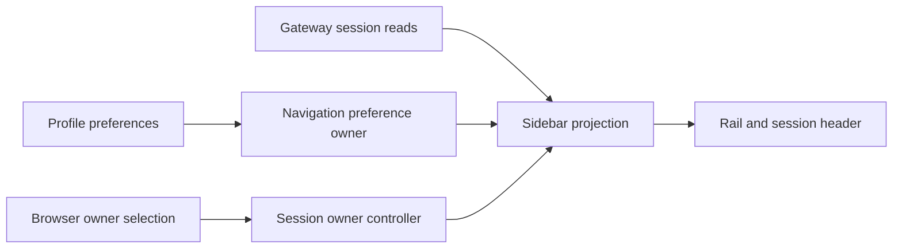

Codex review: blocked before merge.

## What this changes

This PR starts personal rails empty, renders recognizable shortcut icons, and consolidates session ownership controls into one header.

**Example:** A saved Release notes shortcut is outside the loaded session list.
- **Before:** The rail displays a generic pushpin.
- **After:** The shortcut resolves in the background and displays RN.

## Review scores

| Measure | Result | What it means |
|---|---|---|
| **Overall readiness** | 🦐 gold shrimp **(3/6)** | Strong visual proof and no remaining discrete finding; the persisted-preference upgrade gate prevents a merge-ready verdict. |
| **Proof confidence** | 🦞 diamond lobster **(5/6)** ✨ media proof bonus | Sufficient (screenshot): Inspected screenshots exercise the production Control UI with synthetic mock-Gateway data on desktop and mobile and demonstrate the changed rail and header; the handoff also records focused Chromium proof for the latest Inbox fixture correction, but expressly leaves latest-stable preference compatibility unproven. |
| **Patch quality** | 🐚 platinum hermit **(4/6)** | No actionable review findings were identified. |

## Product

**Kind:** Feature · **Worth it:** Yes · **Fix scope:** Complete
**User problem:** Repeated pushpin icons obscure shortcut identity, while multiple header rows and competing owner controls clutter session navigation.
**Reason:** The maintainer-directed change gives recognizable shortcuts and one owner-selection control while reducing production code.

## Merge readiness

⛔ **Blocked before merge - 1 item remains**

Keep this PR open: it delivers an approved sidebar redesign with clear user value, and the earlier actionable regressions are addressed.

**Priority:** P2
**Reviewed head:** `d66722d10049a7afe61542c6272d83f7631d11da`

## Before merge

- [ ] **Add data-model compatibility proof** - The review found that existing stored data may not work after upgrade. Show that existing data still loads and works with this change.

## Findings

None.

### Tests

- Missing end-to-end proof: Supply a v2026.10.1-to-candidate upgrade run covering the accepted absent-key All owners transition, saved shortcuts, unrelated settings, and reload.

<strong>Agent review details</strong>

### How this fits together

The Control UI sidebar combines Gateway session descriptors and profile preferences with browser-local owner selections to render navigation and session lists.

### Technical review

Best possible solution:

Land the approved single-owner rail after demonstrating the intended stable-release upgrade behavior.

Do we have a high-confidence way to reproduce the issue?

Current-main source and the inspected before screenshot establish the default pins, generic unloaded-shortcut glyphs, and competing owner controls; no target code was run during this review.

Is this the best way to solve the issue?

The redesign removes competing selection and import paths, reuses existing preference and session owners, and has explicit maintainer direction for its changed defaults.

AGENTS.md: found and applied where relevant.

Codex review notes: model internal, reasoning medium; reviewed against [b5a9b9b41c34](https://github.com/openclaw/openclaw/commit/b5a9b9b41c343f4a11c44dd511a49c348f63d704).

### Provenance checked

- `Personal rail defaults, navigation scope, and shared-pin import` changes intended behavior with a stated reason (fd018170c94387e843076b259ee54d8998ba935f: Separate personal navigation from shared session metadata and seed existing accessible navigation once.)
- `Owner-filter persistence and default` changes intended behavior with a stated reason (bfb052942dd96246b2ce5ed3e6808af7bb0618a5: Preserve browser-local owner and involvement choices across reloads, reconnects, and identity changes; the current handoff explicitly accepts the changed absent-key default.)
- `Owner picker placement and filter indicator` changes intended behavior with a stated reason (5bc7904344cbe9afb40040df17c1476ded8ebfd5: Keep filtering and display choices together with searchable owner avatars; this PR moves owner selection to the title and limits the panel indicator to status.)
- `Unloaded shortcut labels` keeps the original intent (2fd1e7545b65c8623419ece9d57472210a8e34ad: Avoid unrelated session-count error labels on unloaded session and plugin shortcuts.)

### Testing

Proof path: shipped entry point.

### Security

None.

### Evidence

What I checked:

- **Verified PR introduction:** Reviewed the pinned merge-base-to-head changes; the latest commit changes only the pending-Inbox test support to use the active rail view. ([`ui/src/e2e/native-module-boundaries.test-support.ts:106`](https://github.com/openclaw/openclaw/blob/d66722d10049a7afe61542c6272d83f7631d11da/ui/src/e2e/native-module-boundaries.test-support.ts#L106), [d66722d10049](https://github.com/openclaw/openclaw/commit/d66722d10049a7afe61542c6272d83f7631d11da))
- **Inspected visual proof:** Downloaded before/after screenshots directly show generic pins replaced by session artwork and RN, the single My sessions header, the mobile drawer, and an empty fresh rail.
- **Accepted preference transition:** The full maintainer handoff acknowledges the stable absent-key All owners choice becoming My sessions, retains that direction, and expressly does not claim stable-upgrade preservation proof. ([`ui/src/components/app-sidebar-session-types.ts:401`](https://github.com/openclaw/openclaw/blob/d66722d10049a7afe61542c6272d83f7631d11da/ui/src/components/app-sidebar-session-types.ts#L401), [d66722d10049](https://github.com/openclaw/openclaw/commit/d66722d10049a7afe61542c6272d83f7631d11da))
- **Stable storage contract:** v2026.10.1 reads an absent owner-filter key as All owners and removes the key when that choice is saved; the candidate instead defaults absence to the signed-in owner and stores explicit all. ([`ui/src/components/app-sidebar-session-types.ts:393`](https://github.com/openclaw/openclaw/blob/e178c39e9aae3fa440735217f9aef9574f286677/ui/src/components/app-sidebar-session-types.ts#L393), [e178c39e9aae](https://github.com/openclaw/openclaw/commit/e178c39e9aae3fa440735217f9aef9574f286677))
- **Upgrade coverage boundary:** The browser upgrade suite preserves unrelated settings and exercises v2026.9.9 pending shortcuts, but does not exercise the latest stable release's absent-key owner choice. ([`ui/src/e2e/sidebar-navigation-upgrade.e2e.test.ts:113`](https://github.com/openclaw/openclaw/blob/d66722d10049a7afe61542c6272d83f7631d11da/ui/src/e2e/sidebar-navigation-upgrade.e2e.test.ts#L113), [d66722d10049](https://github.com/openclaw/openclaw/commit/d66722d10049a7afe61542c6272d83f7631d11da))
- **Existing main behavior and related work:** Fetched main retains the default destination pins. The merged rail implementation at https://github.com/openclaw/openclaw/pull/168325 and label repair at https://github.com/openclaw/openclaw/pull/169068 provide the foundation but do not implement this redesign. ([`ui/src/app-navigation.ts:59`](https://github.com/openclaw/openclaw/blob/b5a9b9b41c343f4a11c44dd511a49c348f63d704/ui/src/app-navigation.ts#L59), [b5a9b9b41c34](https://github.com/openclaw/openclaw/commit/b5a9b9b41c343f4a11c44dd511a49c348f63d704))

Likely related people:

- **Peter Steinberger:** Raw commit 59c439535085b7755c626997b16334dd28872924 adds ui/src/components/app-sidebar-session-filter-summary.ts:100 relative to its recorded parents. This identifies author metadata, not feature responsibility or a PR merger. (role: source-line author; confidence: high; commits: [59c439535085](https://github.com/openclaw/openclaw/commit/59c439535085b7755c626997b16334dd28872924); files: `ui/src/components/app-sidebar-session-filter-summary.ts`)
- **Vyctor H. Brzezowski:** Raw commit 5bc7904344cbe9afb40040df17c1476ded8ebfd5 adds ui/src/components/app-sidebar-session-menu-renderers.ts:485 relative to its recorded parents. This identifies author metadata, not feature responsibility or a PR merger. (role: source-line author; confidence: high; commits: [5bc7904344cb](https://github.com/openclaw/openclaw/commit/5bc7904344cbe9afb40040df17c1476ded8ebfd5); files: `ui/src/components/app-sidebar-session-menu-renderers.ts`)

### PR surface

PR surface statistics unavailable: the file list is incomplete.

### Review metrics

| Metric | Value | Why it matters |
|---|---|---|
| **Production versus test changes** | Production +819/-1355; tests and support +1710/-2244. | Both shrink overall as competing scope controls, automatic imports, obsolete menus, and their coverage are removed. |

### Labels

Label changes:

- remove `status: ⏳ waiting on author`: Current PR status no longer selects a status label.

Label justifications:

- `P2`: A useful sidebar improvement with a limited Control UI blast radius.
- `merge-risk: 🚨 compatibility`: Persisted owner-choice semantics change; the maintainer accepted the All-to-My sessions transition, but acceptance does not waive upgrade validation.
- `rating: 🦐 gold shrimp`: Overall readiness is 🦐 gold shrimp; proof is 🦞 diamond lobster and patch quality is 🐚 platinum hermit.
- `proof: sufficient`: Contributor real behavior proof is sufficient.
- `proof: 📸 screenshot`: Contributor real behavior proof includes screenshot evidence.

### Rating scale

6/6 🦀 challenger crab · 5/6 🦞 diamond lobster · 4/6 🐚 platinum hermit · 3/6 🦐 gold shrimp · 2/6 🦪 silver shellfish · 1/6 🧂 unranked krab. Overall follows the weaker of proof and patch quality; ✨ marks media proof (a screenshot, video, or linked artifact) that directly shows the changed behavior.

### Workflow

ClawSweeper edits this one comment on every review. Comment `@clawsweeper re-review` for a fresh review only. Repair and merge execution lanes are retired.

### History

Review history (11 earlier review cycles; latest 8 shown)

<!-- clawsweeper-review-history v=1 total=11 -->
- reviewed 2026-10-11T11:20:32.162Z sha 8c2c9a8c55b7f128ac694c71768fdcff1b8d5305 :: blocked before merge. :: [P3] Retain the dev-branch name truncation rule
- reviewed 2026-10-11T11:58:20.169Z sha 6516f623e9a0d95ec8c38d3d540ddb11fe5f877b :: blocked before merge. :: [P3] Retain the dev-branch name truncation rule
- reviewed 2026-10-11T12:16:09.523Z sha c0bde46e4abd4c405b4696696deee045ad6d1483 :: blocked before merge. :: [P2] Migrate the remaining transient-menu tests to the new rail menu | [P3] Retain the dev-branch name truncation rule
- reviewed 2026-10-11T12:53:37.510Z sha 3f4c228c9229b5176d299a74e2c24451c507a341 :: blocked before merge. :: [P2] Migrate callers that expect default rail destination links | [P2] Use the replacement collapse action in the dictation test | [P2] Migrate Workboard layout coverage off the removed reorder grip | [P2] Keep the plugin assertion helper from collapsing active Pages
- reviewed 2026-10-11T13:33:24.163Z sha 38f37d9c2a1798f9671adb07b58585af2a8b823d :: blocked before merge. :: none
- reviewed 2026-10-11T13:58:59.725Z sha be930a1d9efe88696995ad437fb7582d4a9a2613 :: blocked before merge. :: none
- reviewed 2026-10-11T15:00:26.840Z sha 4e3e306cbcf71b06c2c73b9811fe248715677d82 :: blocked before merge. :: none
- reviewed 2026-10-11T15:59:17.369Z sha e91573e0fa573bab5ff1f9fd654f5baa93cb0177 :: blocked before merge. :: none

_Reviewed October 11, 2026, 12:32 PM ET / 16:32 UTC (Revision 12)._

<!-- clawsweeper-verdict:needs-human item=168997 sha=d66722d10049a7afe61542c6272d83f7631d11da confidence=high updated_at=2026-10-11T16:27:21Z reviewed_at=2026-10-11T16:32:12.930Z lease_owner=github-run-38155471947-1 lease_comment_id=6111143637 source_revision=647c30a23ae718eda0e749e54afede423950ff10ac8bd94474c96e4f52a9a578 hold=blocked findings=0 -->
<!-- clawsweeper-review-state:blocked item=168997 sha=d66722d10049a7afe61542c6272d83f7631d11da v=1 -->

<!-- clawsweeper-review-version item=168997 reviewed_at=2026-10-11T16:32:12.930Z sha=d66722d10049a7afe61542c6272d83f7631d11da source_revision=647c30a23ae718eda0e749e54afede423950ff10ac8bd94474c96e4f52a9a578 lease_owner=github-run-38155471947-1 lease_comment_id=6111143637 v=1 -->

<!-- clawsweeper-review item=168997 -->