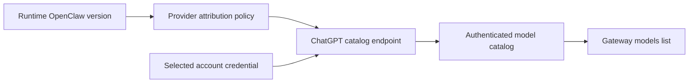

Codex review: needs maintainer review before merge.

## What this changes

This PR replaces npm-based ChatGPT discovery version selection with the OpenClaw request-attribution version and a validated fallback.

**Example:** ChatGPT model discovery runs with npm unavailable.
- **Before:** Discovery falls back to Codex 0.169.0, potentially omitting models requiring a newer client.
- **After:** The supplied Gateway trace sends client_version=2026.11.5, receives HTTP 200, and publishes openai/gpt-6.2-sol as available.

## Review scores

| Measure | Result | What it means |
|---|---|---|
| **Overall readiness** | 🦞 diamond lobster **(5/6)** | Focused owner-level repair with shipped Gateway evidence, regression coverage, green exact-head CI, and no open findings. |
| **Proof confidence** | 🦞 diamond lobster **(5/6)** | Sufficient (logs): The supplied exact-head authenticated Gateway trace exercises the changed endpoint with npm blocked, records ChatGPT accepting 2026.11.5, and shows the returned model published by models.list; prerelease selection has controlled coverage and the fallback has historical live evidence. |
| **Patch quality** | 🦞 diamond lobster **(5/6)** | No actionable review findings were identified. |

## Product

**Kind:** Bug fix · **Worth it:** Yes · **Fix scope:** Complete
**User problem:** ChatGPT users can miss newer models when npm is unavailable.
**Reason:** Removing an unrelated availability dependency has clear user value; the maintainer-authored PR records the deliberate visibility-policy change.

## Merge readiness

✅ **Ready for maintainer review**

This PR addresses a current model-discovery failure with a focused change, sufficient Gateway proof, and no actionable findings.

**Priority:** P2
**Reviewed head:** `4cb3239f490d52d30400297cdec495d17aa50a94`

## Before merge

None.

## Findings

None.

<strong>Agent review details</strong>

### How this fits together

The OpenAI plugin turns authenticated ChatGPT catalog responses into model rows published by the Gateway; this change controls the catalog request's client_version.

### Technical review

Best possible solution:

Use the existing attribution owner for npm-independent discovery and preserve actionable native Codex compatibility errors.

Do we have a high-confidence way to reproduce the issue?

Current-main source deterministically falls back to 0.169.0 after npm failure, and the listing contract models omission above that version; this review executed no target code.

Is this the best way to solve the issue?

The patch directly removes the failing dependency, reuses the existing version owner, and completes the associated cleanup without unnecessary production machinery.

AGENTS.md: found and applied where relevant.

Codex review notes: model internal, reasoning medium; reviewed against [07baab52b414](https://github.com/openclaw/openclaw/commit/07baab52b4147001e9b6060ea4371d383aabd683).

### Provenance checked

- `Discovery client-version selection` changes intended behavior with a stated reason (1680f54504807c2e25de05314e5ff959e513fa25: https://github.com/openclaw/openclaw/pull/201130 used the newest published Codex version to expose launched models while retaining a released-runtime ceiling.)
- `Bundled-version equality contract and test routing` changes intended behavior with a stated reason (825d6f7f1f14e341bd404ce2a2e6f5e0002ffb61: https://github.com/openclaw/openclaw/pull/113615 synchronized discovery eligibility with the managed Codex dependency; that equality becomes obsolete when discovery stops using its version.)
- `Offline worker catalog fixture` keeps the original intent (177372634b6af178ab1922d0695cce5ac8c621cb: https://github.com/openclaw/openclaw/pull/201325 modeled the npm request while preserving rejection of unexpected remote traffic; removing the unused route retains that isolation.)

### Testing

Proof path: shipped entry point.

### Security

None.

### Evidence

What I checked:

- **Current main retains the failure path:** The fetched main resolver still queries npm and returns bundled version 0.169.0 when the lookup fails. ([`extensions/openai/codex-client-version.ts:59`](https://github.com/openclaw/openclaw/blob/07baab52b4147001e9b6060ea4371d383aabd683/extensions/openai/codex-client-version.ts#L59), [07baab52b414](https://github.com/openclaw/openclaw/commit/07baab52b4147001e9b6060ea4371d383aabd683))
- **Smallest complete cutover:** The pinned introduced diff reuses the existing attribution policy at the endpoint owner and removes the registry resolver, version cache, obsolete pin contract, mocks, and fixture routes. ([`extensions/openai/base-url.ts:6`](https://github.com/openclaw/openclaw/blob/4cb3239f490d52d30400297cdec495d17aa50a94/extensions/openai/base-url.ts#L6), [4cb3239f490d](https://github.com/openclaw/openclaw/commit/4cb3239f490d52d30400297cdec495d17aa50a94))
- **Exact-head Gateway proof:** @daniel-lxs supplied an authenticated isolated-Gateway trace for the reviewed head: npm blocked, client_version=2026.11.5, HTTP 200, and openai/gpt-6.2-sol available in models.list. Source: https://github.com/openclaw/openclaw/pull/201493#issuecomment-6994852090. ([4cb3239f490d](https://github.com/openclaw/openclaw/commit/4cb3239f490d52d30400297cdec495d17aa50a94))
- **Prior intent and accepted replacement:** https://github.com/openclaw/openclaw/pull/201130 intentionally used a real published Codex ceiling; this maintainer-authored PR explains removing that dependency and records the replacement policy while retaining native-runtime update diagnostics. ([`src/plugins/AGENTS.md:48`](https://github.com/openclaw/openclaw/blob/4cb3239f490d52d30400297cdec495d17aa50a94/src/plugins/AGENTS.md#L48), [4cb3239f490d](https://github.com/openclaw/openclaw/commit/4cb3239f490d52d30400297cdec495d17aa50a94))
- **Historical fallback evidence:** https://github.com/openclaw/openclaw/pull/200811 reports a same-account live comparison where 99.0.0 returned the same newer models as supported Codex versions; https://github.com/openclaw/openclaw/pull/200870 reverted that implementation. ([0a27bd7f85fa](https://github.com/openclaw/openclaw/commit/0a27bd7f85fa6af2964182a8c54a709b143fdefe))
- **Personally inspected dependency contract:** OpenClaw's ChatGPT discovery relies on the Codex models wire contract; the sibling ModelsClient appends client_version to the models request. This source establishes request shape, while the supplied Gateway trace establishes calendar-version acceptance. ([`codex-rs/codex-api/src/endpoint/models.rs:39`](https://github.com/openai/codex/blob/d32063f96c2dff1dc96af839b3952abb6acfeda4/codex-rs/codex-api/src/endpoint/models.rs#L39), [d32063f96c2d](https://github.com/openai/codex/commit/d32063f96c2dff1dc96af839b3952abb6acfeda4))

Likely related people:

- **Ayaan Zaidi:** Raw commit cbaa9abada322a516ede6864ca0f924bca6845b1 adds extensions/openai/base-url.ts:32 relative to its recorded parents. This identifies author metadata, not feature responsibility or a PR merger. (role: source-line author; confidence: high; commits: [cbaa9abada32](https://github.com/openclaw/openclaw/commit/cbaa9abada322a516ede6864ca0f924bca6845b1); files: `extensions/openai/base-url.ts`)

### PR surface

Source -61, Tests -118, Docs +3. Total -176 across 16 files. Added test files: 0.

View PR surface stats

| Area | Files | Added | Removed | Net |
|---|---:|---:|---:|---:|
| Source | 2 | 14 | 75 | -61 |
| Tests | 11 | 49 | 167 | -118 |
| Docs | 3 | 11 | 8 | +3 |
| Config | 0 | 0 | 0 | 0 |
| Generated | 0 | 0 | 0 | 0 |
| Other | 0 | 0 | 0 | 0 |
| **Total** | **16** | **74** | **250** | **-176** |

### Preflight source

Source unknown. Source comparison at the observed PR snapshot only. Completion is self-reported; body, policy, tests, execution, and report bytes are not verified.

### Root-cause cluster

Relationship: `same_root_cause`
Canonical: https://github.com/openclaw/openclaw/issues/201480
Summary: This PR implements the npm-independent discovery repair requested by the linked issue.

Members:
- `canonical`: https://github.com/openclaw/openclaw/issues/201480 - The issue identifies the same registry-failure fallback and requests the version-selection behavior implemented here.

Proposal only: this assessment does not dispatch repair, suppress jobs, mutate sibling items, close, or merge anything.

### Labels

Label changes:

- add `proof: sufficient`: Contributor real behavior proof is sufficient.
- add `rating: 🦞 diamond lobster`: Overall readiness is 🦞 diamond lobster; proof is 🦞 diamond lobster and patch quality is 🦞 diamond lobster.
- remove `rating: 🧂 unranked krab`: Current PR rating is `rating: 🦞 diamond lobster`, so this older rating label is no longer current.

Label justifications:

- `P2`: Registry failure can hide newly available subscription models while existing model choices remain usable.
- `rating: 🦞 diamond lobster`: Overall readiness is 🦞 diamond lobster; proof is 🦞 diamond lobster and patch quality is 🦞 diamond lobster.
- `status: 👀 ready for maintainer look`: ClawSweeper has no concrete contributor-facing blocker left for this PR.
- `proof: sufficient`: Contributor real behavior proof is sufficient.

### Rating scale

6/6 🦀 challenger crab · 5/6 🦞 diamond lobster · 4/6 🐚 platinum hermit · 3/6 🦐 gold shrimp · 2/6 🦪 silver shellfish · 1/6 🧂 unranked krab. Overall follows the weaker of proof and patch quality; ✨ marks media proof (a screenshot, video, or linked artifact) that directly shows the changed behavior.

### Workflow

ClawSweeper edits this one comment on every review. Comment `@clawsweeper re-review` for a fresh review only. Repair and merge execution lanes are retired.

### History

Review history (1 earlier review cycle)

<!-- clawsweeper-review-history v=1 total=1 -->
- reviewed 2026-11-18T22:54:05.772Z sha 4cb3239f490d52d30400297cdec495d17aa50a94 :: needs maintainer review before merge. :: none

_Reviewed November 18, 2026, 6:42 PM ET / 23:42 UTC (Revision 2)._

<!-- clawsweeper-verdict:needs-human item=201493 sha=4cb3239f490d52d30400297cdec495d17aa50a94 confidence=high updated_at=2026-11-18T23:37:48Z reviewed_at=2026-11-18T23:42:19.398Z lease_owner=github-run-44422290288-1 lease_comment_id=6994857366 source_revision=e927ee1905c87fc038846f87700e90cf940b0d6771f4a19749d0d6937edec4b2 hold=not_opted_in findings=0 -->
<!-- clawsweeper-review-state:ready item=201493 sha=4cb3239f490d52d30400297cdec495d17aa50a94 v=1 -->

<!-- clawsweeper-review-version item=201493 reviewed_at=2026-11-18T23:42:19.398Z sha=4cb3239f490d52d30400297cdec495d17aa50a94 source_revision=e927ee1905c87fc038846f87700e90cf940b0d6771f4a19749d0d6937edec4b2 lease_owner=github-run-44422290288-1 lease_comment_id=6994857366 v=1 -->

<!-- clawsweeper-review item=201493 -->