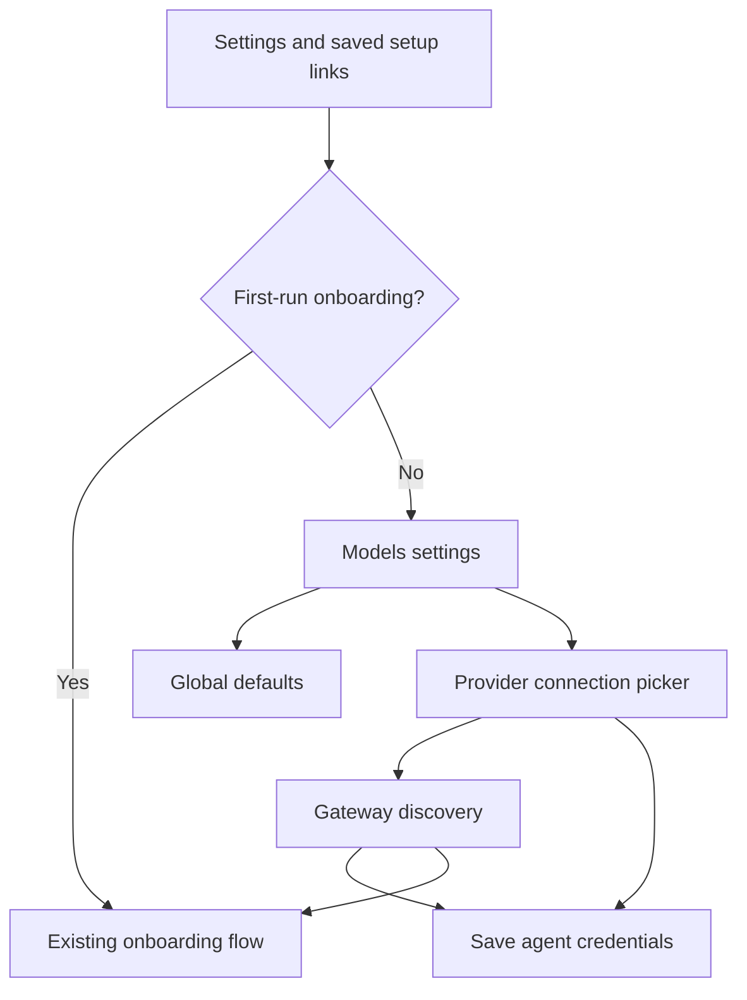

Codex review: needs maintainer review before merge. _Reviewed September 18, 2026, 11:30 AM ET / 15:30 UTC (Revision 19)._

# ClawSweeper review

## What this changes

Consolidates provider connection and discovery in Models settings, clarifies global versus agent scope, preserves setup drafts, and redirects existing setup links.

## Merge readiness

✅ **Ready for maintainer review**

The consolidation remains useful and the previous browser-test finding is resolved. No remaining blocking patch defect was identified; required CI still gates landing.

**Priority:** P2
**Reviewed head:** `4656f7ed97b68f7cba559a124250fc2342992943`

## Review scores

| Measure | Result | What it means |
|---|---|---|
| **Overall readiness** | 🐚 platinum hermit **(4/6)** | A coherent consolidation with useful visual evidence and focused regression coverage; the previous blocker is resolved. |
| **Proof confidence** | 🐚 platinum hermit **(4/6)** ✨ media proof bonus | Sufficient (screenshot): Inspected browser screenshots demonstrate the changed Models layout and grouped connection presentation. Reported synthetic Gateway runs and inspected coverage supplement routing, draft, and reconnect behavior; the latest test-only commit preserves the captured rendering source. This maintainer-associated PR does not claim live-provider authentication proof. |
| **Patch quality** | 🐚 platinum hermit **(4/6)** | No actionable review findings were identified. |

## Verification

| Check | Result | Evidence |
|---|---|---|
| **Real behavior** | Verified | Sufficient (screenshot): Inspected browser screenshots demonstrate the changed Models layout and grouped connection presentation. Reported synthetic Gateway runs and inspected coverage supplement routing, draft, and reconnect behavior; the latest test-only commit preserves the captured rendering source. This maintainer-associated PR does not claim live-provider authentication proof. |
| **Evidence reviewed** | 9 items | Previous finding resolved: The only change since the previous reviewed head replaces the guided-sign-in tests' direct setup navigation with installSetupGateway/openModelSetup. Both cases retain their activation, guided input, and completion assertions. Current main still has separate setup: Current main loads Model Setup directly for both ordinary and first-run visits; it does not contain this PR's Models redirect. The merged shared-login work at https://github.com/openclaw/openclaw/pull/148864 supplies reused infrastructure rather than superseding the consolidation. Latest release comparison: The supplied latest release, v2026.9.4, also retains the separate setup route, so the requested consolidation is not already shipped. |
| **Findings** | None | None. |
| **Security** | None | None. |

## How this fits together

Models settings displays Gateway-provided model defaults and agent-specific provider credentials. Its connection and discovery dialogs reuse existing Gateway operations to save credentials or explicitly activate a model.

## Before merge

None.

<strong>Agent review details</strong>

### Security

None.

### PR surface

Source +815, Tests +1447, Docs +2. Total +2264 across 72 files.

View PR surface stats

| Area | Files | Added | Removed | Net |
|---|---:|---:|---:|---:|
| Source | 25 | 1447 | 632 | +815 |
| Tests | 43 | 1924 | 477 | +1447 |
| Docs | 4 | 6 | 4 | +2 |
| Config | 0 | 0 | 0 | 0 |
| Generated | 0 | 0 | 0 | 0 |
| Other | 0 | 0 | 0 | 0 |
| **Total** | **72** | **3377** | **1113** | **+2264** |

### Review metrics

| Metric | Value | Why it matters |
|---|---|---|
| **Production versus test growth** | Production net +815 lines; tests and test support net +1,447 lines | Production growth implements grouped connection presentation and embedded discovery; test growth covers the cutover, scope preservation, and recovery. |

### Root-cause cluster

Relationship: `fixed_by_candidate`
Canonical: https://github.com/openclaw/openclaw/issues/147586
Summary: This PR implements the paired consolidation request; merged shared-login work is supporting infrastructure.

Members:
- `canonical`: https://github.com/openclaw/openclaw/issues/147586 - The open paired issue defines the same single-entry Models workflow and scope clarification.
- `partial_overlap`: https://github.com/openclaw/openclaw/pull/148864 - Merged shared credential-login infrastructure is reused, but does not consolidate the settings destinations.
- `adjacent_distinct`: https://github.com/openclaw/openclaw/pull/151417 - The merged browser-budget fixture repair addresses separate CI integration work.

Proposal only: this assessment does not dispatch repair, suppress jobs, mutate sibling items, close, or merge anything.

### Technical review

Best possible solution:

Keep one Models home with clearly separated global defaults and agent access, while reusing credential-only login and explicit setup activation.

Do we have a high-confidence way to reproduce the issue?

Not applicable to the primary UX improvement; current-main source and the inspected before capture establish the overlapping setup destinations. The prior test-routing defect is repaired in the current head.

Is this the best way to solve the issue?

Yes. The patch consolidates presentation around existing credential and setup owners while preserving first-run routing, saved settings, and explicit model activation.

AGENTS.md: found and applied where relevant.

Codex review notes: model internal, reasoning medium; reviewed against [7592a8dd7d61](https://github.com/openclaw/openclaw/commit/7592a8dd7d61ce8c1ab9efa6791d119b00fd3765).

### Labels

Label changes:

- add `rating: 🐚 platinum hermit`: Overall readiness is 🐚 platinum hermit; proof is 🐚 platinum hermit and patch quality is 🐚 platinum hermit.
- add `status: 👀 ready for maintainer look`: ClawSweeper has no concrete contributor-facing blocker left for this PR. Sufficient (screenshot): Inspected browser screenshots demonstrate the changed Models layout and grouped connection presentation. Reported synthetic Gateway runs and inspected coverage supplement routing, draft, and reconnect behavior; the latest test-only commit preserves the captured rendering source. This maintainer-associated PR does not claim live-provider authentication proof.
- remove `rating: 🦐 gold shrimp`: Current PR rating is `rating: 🐚 platinum hermit`, so this older rating label is no longer current.
- remove `status: ⏳ waiting on author`: Current PR status label is `status: 👀 ready for maintainer look`.

Label justifications:

- `P2`: This is a bounded improvement to model configuration usability, without evidence of an urgent user-facing regression.
- `rating: 🐚 platinum hermit`: Overall readiness is 🐚 platinum hermit; proof is 🐚 platinum hermit and patch quality is 🐚 platinum hermit.
- `status: 👀 ready for maintainer look`: ClawSweeper has no concrete contributor-facing blocker left for this PR. Sufficient (screenshot): Inspected browser screenshots demonstrate the changed Models layout and grouped connection presentation. Reported synthetic Gateway runs and inspected coverage supplement routing, draft, and reconnect behavior; the latest test-only commit preserves the captured rendering source. This maintainer-associated PR does not claim live-provider authentication proof.
- `proof: sufficient`: Contributor real behavior proof is sufficient. Inspected browser screenshots demonstrate the changed Models layout and grouped connection presentation. Reported synthetic Gateway runs and inspected coverage supplement routing, draft, and reconnect behavior; the latest test-only commit preserves the captured rendering source. This maintainer-associated PR does not claim live-provider authentication proof.
- `proof: 📸 screenshot`: Contributor real behavior proof includes screenshot evidence. Inspected browser screenshots demonstrate the changed Models layout and grouped connection presentation. Reported synthetic Gateway runs and inspected coverage supplement routing, draft, and reconnect behavior; the latest test-only commit preserves the captured rendering source. This maintainer-associated PR does not claim live-provider authentication proof.

### Evidence

What I checked:

- **Previous finding resolved:** The only change since the previous reviewed head replaces the guided-sign-in tests' direct setup navigation with installSetupGateway/openModelSetup. Both cases retain their activation, guided input, and completion assertions. ([`ui/src/e2e/model-setup-codex-sign-in.e2e.test.ts:113`](https://github.com/openclaw/openclaw/blob/4656f7ed97b68f7cba559a124250fc2342992943/ui/src/e2e/model-setup-codex-sign-in.e2e.test.ts#L113), [4656f7ed97b6](https://github.com/openclaw/openclaw/commit/4656f7ed97b68f7cba559a124250fc2342992943))
- **Current main still has separate setup:** Current main loads Model Setup directly for both ordinary and first-run visits; it does not contain this PR's Models redirect. The merged shared-login work at https://github.com/openclaw/openclaw/pull/148864 supplies reused infrastructure rather than superseding the consolidation. ([`ui/src/pages/model-setup/route.ts:13`](https://github.com/openclaw/openclaw/blob/7592a8dd7d61ce8c1ab9efa6791d119b00fd3765/ui/src/pages/model-setup/route.ts#L13), [7592a8dd7d61](https://github.com/openclaw/openclaw/commit/7592a8dd7d61ce8c1ab9efa6791d119b00fd3765))
- **Latest release comparison:** The supplied latest release, v2026.9.4, also retains the separate setup route, so the requested consolidation is not already shipped. ([`ui/src/pages/model-setup/route.ts:13`](https://github.com/openclaw/openclaw/blob/3a9d69db306cd7f081e06254cb89c4bcc14a7107/ui/src/pages/model-setup/route.ts#L13), [3a9d69db306c](https://github.com/openclaw/openclaw/commit/3a9d69db306cd7f081e06254cb89c4bcc14a7107))
- **Preserved entry points and settings:** First-run markers retain onboarding; ordinary setup links redirect to Models. Credential saving continues through the existing login/key mutation owners, while discovery activation remains explicit. Browser coverage checks agent-targeted activation and preservation of global defaults. ([`ui/src/pages/model-setup/route.ts:16`](https://github.com/openclaw/openclaw/blob/4656f7ed97b68f7cba559a124250fc2342992943/ui/src/pages/model-setup/route.ts#L16), [4656f7ed97b6](https://github.com/openclaw/openclaw/commit/4656f7ed97b68f7cba559a124250fc2342992943))
- **Reconnect and access-loss coverage:** The embedded discovery tests cover auth and preparation reconnects, preserving the admitted session and draft without another start or cancellation. Reduced operator access removes input and produces no additional wizard.next request. Source retains current connection, agent intent, recovery scope, and admin checks. ([`ui/src/e2e/model-providers.discovery.e2e.test.ts:16`](https://github.com/openclaw/openclaw/blob/4656f7ed97b68f7cba559a124250fc2342992943/ui/src/e2e/model-providers.discovery.e2e.test.ts#L16), [4656f7ed97b6](https://github.com/openclaw/openclaw/commit/4656f7ed97b68f7cba559a124250fc2342992943))
- **Inspected visual evidence:** Inspected all four prepared screenshots. The before/after Models captures visibly replace separate setup/add-provider entries with scoped provider access and search; the method captures show the grouped picker retaining the shared sign-in action. Images are linked in the captured PR body and discussion. The body reports originating-chat delivery; that private destination was not independently inspected. The current head changes only a test relative to the refreshed capture revision. ([f4fba6d7a33b](https://github.com/openclaw/openclaw/commit/f4fba6d7a33b858ecafbf5b9db073525ae2e69d7))

Likely related people:

- **steipete:** Suggested for follow-up; no historical authorship or introduction is verified. (role: unverified routing candidate; confidence: low)
- **obviyus:** Suggested for follow-up; no historical authorship or introduction is verified. (role: unverified routing candidate; confidence: low)

### Rating scale

| Score | Internal tier | Crab rank | Meaning |
|---:|:---:|---|---|
| **6/6** | S | 🦀 challenger crab | Exceptional readiness |
| **5/6** | A | 🦞 diamond lobster | Very strong readiness |
| **4/6** | B | 🐚 platinum hermit | Good normal PR; ordinary maintainer review |
| **3/6** | C | 🦐 gold shrimp | Useful, but confidence is limited |
| **2/6** | D | 🦪 silver shellfish | Proof or implementation needs work |
| **1/6** | F | 🧂 unranked krab | Not merge-ready |
| N/A | NA | 🌊 off-meta tidepool | Rating does not apply |

Overall follows the weaker of proof and patch quality.
Shiny media proof means a screenshot, video, or linked artifact directly shows the changed behavior. Runtime, network, CSP, and security claims still need visible diagnostics.

### Workflow

- ClawSweeper keeps one durable marker-backed review comment per issue or PR.
- Re-runs edit this comment so the latest verdict, findings, and automation markers stay together instead of adding duplicate bot comments.
- A fresh review can be triggered by eligible `@clawsweeper re-review` comments, exact-item GitHub events, scheduled/background review runs, or manual workflow dispatch.
- PR/issue authors and users with repository write access can comment `@clawsweeper re-review` or `@clawsweeper re-run` on an open PR or issue to request a fresh review only.
- Maintainers can also comment `@clawsweeper review` to request a fresh review only.
- Fresh-review commands do not start repair, autofix, rebase, CI repair, or automerge.
- Maintainer-only repair and merge flows require explicit commands such as `@clawsweeper autofix`, `@clawsweeper automerge`, `@clawsweeper fix ci`, or `@clawsweeper address review`.
- Maintainers can comment `@clawsweeper explain` to ask for more context, or `@clawsweeper stop` to stop active automation.

### History

Review history (18 earlier review cycles; latest 8 shown)

<!-- clawsweeper-review-history v=1 total=18 -->
- reviewed 2026-09-15T17:12:52.329Z sha dd58a97dc28aff3e3f1d8663e8a045e9699c974b :: needs maintainer review before merge. :: none
- reviewed 2026-09-15T17:32:46.133Z sha 06ac6cb849aaeddf6c131bdc1339c34585d3936d :: needs maintainer review before merge. :: none
- reviewed 2026-09-15T18:12:01.804Z sha 10d986300d2f0e17850053035980c6a9fcc84ba3 :: blocked before merge. :: none
- reviewed 2026-09-15T18:32:25.302Z sha fb6c4f011dcb4507e8335906f06d26d54605cf1c :: needs maintainer review before merge. :: none
- reviewed 2026-09-15T19:17:17.805Z sha 3c3a06ffdfb3f313c1188108f93634cafbdaacd3 :: needs maintainer review before merge. :: none
- reviewed 2026-09-15T19:26:50.359Z sha 3c3a06ffdfb3f313c1188108f93634cafbdaacd3 :: needs maintainer review before merge. :: none
- reviewed 2026-09-15T20:28:16.306Z sha 3c3a06ffdfb3f313c1188108f93634cafbdaacd3 :: blocked before merge. :: none
- reviewed 2026-09-18T06:12:09.890Z sha f4fba6d7a33b858ecafbf5b9db073525ae2e69d7 :: blocked before merge. :: [P2] Migrate the remaining guided-sign-in browser test to discovery

<!-- clawsweeper-verdict:needs-human item=147794 sha=4656f7ed97b68f7cba559a124250fc2342992943 confidence=high updated_at=2026-09-18T15:26:51Z reviewed_at=2026-09-18T15:30:48.727Z lease_owner=github-run-35362197803-1 lease_comment_id=5732208701 source_revision=5c305ee003d30edea2b75b15fb6e60db65110efa2f37954a2043d6994a9695ab live_verification=absent -->
<!-- clawsweeper-review-state:ready item=147794 sha=4656f7ed97b68f7cba559a124250fc2342992943 v=1 -->

<!-- clawsweeper-review-version item=147794 reviewed_at=2026-09-18T15:30:48.727Z sha=4656f7ed97b68f7cba559a124250fc2342992943 source_revision=5c305ee003d30edea2b75b15fb6e60db65110efa2f37954a2043d6994a9695ab lease_owner=github-run-35362197803-1 lease_comment_id=5732208701 v=1 -->

<!-- clawsweeper-review item=147794 -->