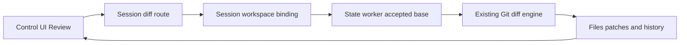

Codex review: needs maintainer review before merge.

## What this changes

Use the managed workspace’s accepted upstream base for local Review diffs and commit history.

**Example:** A workspace accepts an upstream commit adding upstream.txt while origin/HEAD remains stale, then adds task.txt.
- **Before:** Review shows task.txt and upstream.txt, totaling two added lines.
- **After:** Review shows only task.txt, totaling one added line.

## Review scores

| Measure | Result | What it means |
|---|---|---|
| **Overall readiness** | 🦐 gold shrimp **(3/6)** | A focused, correct repair with meaningful integration coverage and the prior finding resolved; supplied behavior evidence remains harness-based. |
| **Proof confidence** | 🦐 gold shrimp **(3/6)** | This maintainer-authored PR is outside the ordinary contributor proof gate: supplied integration tests exercise the real local diff owner and Git, while inspected screenshots render those results through a mocked Gateway rather than a running Gateway. |
| **Patch quality** | 🐚 platinum hermit **(4/6)** | No actionable review findings were identified. |

## Product

**Kind:** Bug fix · **Worth it:** Yes · **Fix scope:** Complete
**User problem:** Review attributes accepted upstream changes and commits to the current task.
**Reason:** The maintainer-authored direction restores the documented task-review contract without adding configuration or another state owner.

## Merge readiness

✅ **Ready for maintainer review**

This PR fixes a concrete Review baseline mismatch still present on main; the prior reset finding is resolved, and no actionable introduced defect remains.

**Priority:** P2
**Reviewed head:** `79697e8233fd92023c8980af2a5d520dcc015c99`

## Before merge

None.

## Findings

None.

### Tests

- Missing end-to-end proof: The supplied evidence does not exercise the changed route through a running Gateway; the new reset regression’s pre-fix failure is not separately demonstrated.

<strong>Agent review details</strong>

### How this fits together

The sessions.diff Gateway route resolves the session checkout, reads its managed workspace baseline, and asks the existing Git diff engine for files, patches, and branch history.

### Technical review

Best possible solution:

Keep the accepted-base selection in the existing workspace owner and pass its recorded fact to the existing diff engine, as this PR does.

Do we have a high-confidence way to reproduce the issue?

Current main omits the stored accepted base, and the supplied real-Git regression constructs stale default refs that expose upstream.txt alongside task.txt; no target code was executed during this review.

Is this the best way to solve the issue?

The patch restores the missing input at the local route, preserves existing diff semantics, and uses a separate read-only adapter because the provisioning owner reconciles state and excludes archived sessions.

AGENTS.md: found and applied where relevant.

Codex review notes: model internal, reasoning medium; reviewed against [9ab0718cb8b7](https://github.com/openclaw/openclaw/commit/9ab0718cb8b74192eb62b34bff882b00b679b72b).

### Provenance checked

- `Local Review baseline selection` changes intended behavior with a stated reason (2cccdd175dd502311c933319fba3c0b8ec28176e: The earlier refactor retained session and workspace authority across asynchronous reads; the existing Git engine already supported explicit repository bases.)
- `Review documentation` keeps the original intent (ab26b89a6aa19bc50702f6dc505c47714f2776b1: Review follows the session’s prepared checkout and avoids showing unrelated agent workspace files.)
- `Projection worker reads` keeps the original intent (cd326f915580c3e3c5c915bf4416e68a1c843089: Projection persistence and reads moved off the Gateway thread; the new narrow query uses that existing worker boundary.)

### Testing

Proof path: in-process harness.

### Security

None.

### Evidence

What I checked:

- **Introduced change:** The pinned introduced diff supplies baseCommit to the existing diff engine through a narrow worker-backed reader; it adds no alternate diff implementation. ([`src/gateway/server-methods/sessions-diff.ts:109`](https://github.com/openclaw/openclaw/blob/79697e8233fd92023c8980af2a5d520dcc015c99/src/gateway/server-methods/sessions-diff.ts#L109), [79697e8233fd](https://github.com/openclaw/openclaw/commit/79697e8233fd92023c8980af2a5d520dcc015c99))
- **Current main still omits the accepted base:** Main’s local route passes only cwd and sessionKey, leaving base selection to shared branch refs. ([`src/gateway/server-methods/sessions-diff.ts:95`](https://github.com/openclaw/openclaw/blob/9ab0718cb8b74192eb62b34bff882b00b679b72b/src/gateway/server-methods/sessions-diff.ts#L95), [9ab0718cb8b7](https://github.com/openclaw/openclaw/commit/9ab0718cb8b74192eb62b34bff882b00b679b72b))
- **Existing diff contract:** The existing engine already accepts an explicit base for all changes, history, and commit admission, while uncommitted content compares against HEAD and individual commits compare against their first parent. ([`src/sessions/session-diff.runtime.ts:304`](https://github.com/openclaw/openclaw/blob/79697e8233fd92023c8980af2a5d520dcc015c99/src/sessions/session-diff.runtime.ts#L304), [79697e8233fd](https://github.com/openclaw/openclaw/commit/79697e8233fd92023c8980af2a5d520dcc015c99))
- **Prior finding resolved:** The revision removes projection lifecycle equality while retaining agent, session, and registry binding checks; the added integration regression performs a real same-session reset and immediately reads Review without reconciling the projection. ([`src/gateway/server-methods/sessions-diff-reset.test.ts:92`](https://github.com/openclaw/openclaw/blob/79697e8233fd92023c8980af2a5d520dcc015c99/src/gateway/server-methods/sessions-diff-reset.test.ts#L92), [79697e8233fd](https://github.com/openclaw/openclaw/commit/79697e8233fd92023c8980af2a5d520dcc015c99))
- **Accepted-base producer:** The merged refresh feature at https://github.com/openclaw/openclaw/pull/174532 records the accepted base in the existing projection; this PR connects Review to that recorded fact. ([`src/gateway/worker-environments/local-workspace-state.ts:268`](https://github.com/openclaw/openclaw/blob/23173ed1f61ba6f210e3e7af0a33d87471400ccb/src/gateway/worker-environments/local-workspace-state.ts#L268), [23173ed1f61b](https://github.com/openclaw/openclaw/commit/23173ed1f61ba6f210e3e7af0a33d87471400ccb))
- **Inspected visual evidence:** The downloaded before/after images show two files becoming one, matching the stated synthetic Git scenario; the body explicitly identifies the browser as a mocked-Gateway harness. ([79697e8233fd](https://github.com/openclaw/openclaw/commit/79697e8233fd92023c8980af2a5d520dcc015c99))

Likely related people:

- **Peter Steinberger:** Raw commit 2cccdd175dd502311c933319fba3c0b8ec28176e adds src/gateway/server-methods/sessions-diff.ts:86 relative to its recorded parents. This identifies author metadata, not feature responsibility or a PR merger. (role: source-line author; confidence: high; commits: [2cccdd175dd5](https://github.com/openclaw/openclaw/commit/2cccdd175dd502311c933319fba3c0b8ec28176e); files: `src/gateway/server-methods/sessions-diff.ts`)

### PR surface

Source +87, Tests +251, Docs 0. Total +338 across 6 files. Added test files: 1.

View PR surface stats

| Area | Files | Added | Removed | Net |
|---|---:|---:|---:|---:|
| Source | 3 | 88 | 1 | +87 |
| Tests | 2 | 251 | 0 | +251 |
| Docs | 1 | 1 | 1 | 0 |
| Config | 0 | 0 | 0 | 0 |
| Generated | 0 | 0 | 0 | 0 |
| Other | 0 | 0 | 0 | 0 |
| **Total** | **6** | **340** | **2** | **+338** |

### Review metrics

| Metric | Value | Why it matters |
|---|---|---|
| **Production versus test changes** | Production +88/−1; tests +251/−0 | The added reader avoids reconciliation and large projection payloads; tests cover baseline selection and the distinct reset lifecycle failure. |

### Labels

Label changes:

- add `proof: 📸 screenshot`: Contributor real behavior proof includes screenshot evidence.
- add `status: 👀 ready for maintainer look`: ClawSweeper has no concrete contributor-facing blocker left for this PR.
- remove `merge-risk: 🚨 compatibility`: Current PR review selected no merge-risk labels.
- remove `status: ⏳ waiting on author`: Current PR status label is `status: 👀 ready for maintainer look`.

Label justifications:

- `P2`: Incorrect task diffs and history affect managed workspaces after base refresh, with limited blast radius.
- `rating: 🦐 gold shrimp`: Overall readiness is 🦐 gold shrimp; proof is 🦐 gold shrimp and patch quality is 🐚 platinum hermit.
- `status: 👀 ready for maintainer look`: ClawSweeper has no concrete contributor-facing blocker left for this PR.
- `proof: 📸 screenshot`: Contributor real behavior proof includes screenshot evidence.

### Rank-up moves

Optional improvements that raise the rating; they are not merge blockers.

- Optionally capture Review through a running Gateway after accepting a refreshed base with stale default refs, with private paths and credentials redacted.

### Rating scale

6/6 🦀 challenger crab · 5/6 🦞 diamond lobster · 4/6 🐚 platinum hermit · 3/6 🦐 gold shrimp · 2/6 🦪 silver shellfish · 1/6 🧂 unranked krab. Overall follows the weaker of proof and patch quality; ✨ marks media proof (a screenshot, video, or linked artifact) that directly shows the changed behavior.

### Workflow

ClawSweeper edits this one comment on every review. Comment `@clawsweeper re-review` for a fresh review only. Repair and merge execution lanes are retired.

### History

Review history (1 earlier review cycle)

<!-- clawsweeper-review-history v=1 total=1 -->
- reviewed 2026-10-18T02:28:13.451Z sha 4cac4949990795b321553847b00e41c2af4ed325 :: needs changes before merge. :: [P2] Keep Review available after a same-session reset

_Reviewed October 17, 2026, 10:40 PM ET / October 18, 2026, 02:40 UTC (Revision 2)._

<!-- clawsweeper-verdict:needs-human item=176001 sha=79697e8233fd92023c8980af2a5d520dcc015c99 confidence=high updated_at=2026-10-18T02:36:39Z reviewed_at=2026-10-18T02:40:15.698Z lease_owner=github-run-39090651797-1 lease_comment_id=6244784766 source_revision=6ed41a7a8836e8809073b8d3c7a3ada555f0d59f3eb6f1612440c32ab957f883 hold=not_opted_in findings=0 -->
<!-- clawsweeper-review-state:ready item=176001 sha=79697e8233fd92023c8980af2a5d520dcc015c99 v=1 -->

<!-- clawsweeper-review-version item=176001 reviewed_at=2026-10-18T02:40:15.698Z sha=79697e8233fd92023c8980af2a5d520dcc015c99 source_revision=6ed41a7a8836e8809073b8d3c7a3ada555f0d59f3eb6f1612440c32ab957f883 lease_owner=github-run-39090651797-1 lease_comment_id=6244784766 v=1 -->

<!-- clawsweeper-review item=176001 -->