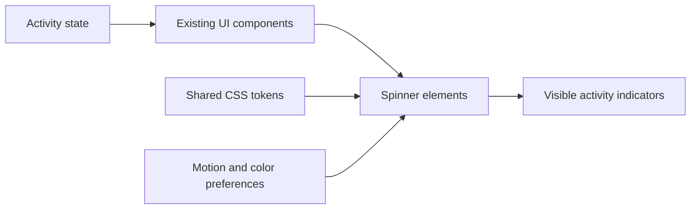

Codex review: needs maintainer review before merge.

## What this changes

This PR unifies Control UI spinner styling around fuller arcs, shared timing and stroke tokens, and accessible motion variants.

**Example:** A running session appears in the sidebar.
- **Before:** A thin quarter arc rotates every 1.6 seconds over a pale track.
- **After:** A solid three-quarter arc rotates every 0.9 seconds; reduced motion displays a stationary closed ring.

## Review scores

| Measure | Result | What it means |
|---|---|---|
| **Overall readiness** | 🐚 platinum hermit **(4/6)** | A focused, owner-directed presentation improvement with strong comparative images, existing-boundary assertions, and no concrete introduced defect. |
| **Proof confidence** | 🦞 diamond lobster **(5/6)** ✨ media proof bonus | Sufficient (screenshot): Inspected before/after Safari frame sequences exercise real Control UI sidebar components with synthetic activity data across four themes; the inspected Chromium accessibility capture shows forced-color gaps and reduced-motion rings. The body clearly identifies secondary surfaces not visually checked. Recordings were not independently inspected because this environment lacks ffmpeg, but the directly inspected visual evidence supports the changed presentation. |
| **Patch quality** | 🐚 platinum hermit **(4/6)** | No actionable review findings were identified. |

## Product

**Kind:** Preference · **Worth it:** Yes · **Fix scope:** Complete
**User problem:** Thin, pale, slowly rotating activity indicators can look inactive, especially beside sidebar avatars.
**Reason:** The maintainer-authored direction is explicit, the visual improvement is demonstrated, and implementation stays within existing presentation owners.

## Merge readiness

✅ **Ready for maintainer review**

Keep this maintainer-authored visual improvement open for normal landing; the inspected before/after evidence supports clearer activity indicators, and no actionable introduced defect was found.

**Priority:** P3
**Reviewed head:** `2612b791ef8ab1c96c076c76858bc28aa9029816`

## Before merge

None.

## Findings

None.

<strong>Agent review details</strong>

### How this fits together

Control UI components render existing activity state, and shared CSS turns those indicators into animated arcs or stationary accessible rings.

### Technical review

Best possible solution:

Land the shared CSS token change through normal repository gates while preserving the existing component and activity-state owners.

Do we have a high-confidence way to reproduce the issue?

Current-main CSS establishes the earlier thin, slow indicators, and the supplied before/after browser captures show the perceived visibility difference; this review executed no target code.

Is this the best way to solve the issue?

Shared tokens in the existing stylesheet owner are a proportionate solution, and removing local overrides avoids competing spinner policies without changing activity logic.

AGENTS.md: found and applied where relevant.

Codex review notes: model internal, reasoning medium; reviewed against [e7be356ac57f](https://github.com/openclaw/openclaw/commit/e7be356ac57f58bf1a464617b4f39c6e334c91ff).

### Provenance checked

- `Sidebar ring visibility` changes intended behavior with a stated reason (a1d62cfc56c1d9c46c796f34de90958b298ffbb7: The calmer sidebar design deliberately lightened the progress track; https://github.com/openclaw/openclaw/pull/188141 records that choice.)
- `Paired-avatar trace` changes intended behavior with a stated reason (d9dd26fb6c5ecbad864a7d96ad50d63629d4b358: https://github.com/openclaw/openclaw/pull/144696 introduced the fitted outline to keep participant faces stationary while showing shared activity; this PR retains that geometry and explains its new arc and timing.)
- `Accent-based activity color` keeps the original intent (4d3f1f14e4a0ec210ace981b38cb71f23c024847: https://github.com/openclaw/openclaw/pull/131191 established theme-accent activity indicators; the patch preserves that ownership and color contract.)
- `Task progress styling` changes intended behavior with a stated reason (b9c2e13b97c98b0f15b923c9e0a7e66b8720f1a5: Earlier Details work reused canonical spinner styling, and https://github.com/openclaw/openclaw/pull/181843 subsequently aligned active and pending marker contours; this PR deliberately changes spinner weight and color while retaining marker slots.)
- `Composer and automation overrides` changes intended behavior with a stated reason (64853b1a9d505dc3980e4bedfc39ee79c043ffbf: Composer history introduced muted local spinner styling, and commit 901967444973e337666420edda69a2a691192768 added similar automation styling; this PR explicitly replaces those differences with shared accent-colored indicators.)
- `Loading and setup spinner timing` changes intended behavior with a stated reason (73149b26822ada60cdba47a3546704bdec94f2a9: Earlier cleanup consolidated shared rotation keyframes while preserving local appearance and durations; this PR explicitly standardizes those presentation differences without replacing their component owners.)

### Testing

Proof path: shipped entry point.

### Security

None.

### Evidence

What I checked:

- **Exact introduced patch:** The introduced diff changes spinner CSS and extends existing browser assertions without adding runtime state, dependencies, configuration, or execution authority. ([`ui/src/styles/base.css:358`](https://github.com/openclaw/openclaw/blob/2612b791ef8ab1c96c076c76858bc28aa9029816/ui/src/styles/base.css#L358), [2612b791ef8a](https://github.com/openclaw/openclaw/commit/2612b791ef8ab1c96c076c76858bc28aa9029816))
- **Current main retains the earlier appearance:** Fetched main still defines a 1.6-second round spinner, a pale track, and a 3.2-second background variant, so the central visual change is not already implemented there. ([`ui/src/styles/components.css:3113`](https://github.com/openclaw/openclaw/blob/e7be356ac57f58bf1a464617b4f39c6e334c91ff/ui/src/styles/components.css#L3113), [e7be356ac57f](https://github.com/openclaw/openclaw/commit/e7be356ac57f58bf1a464617b4f39c6e334c91ff))
- **Inspected visual proof:** The four prepared Safari image sequences show before/after sidebar indicators in Absolutely dark/light, CRT dark, and Beacon light. The separately inspected accessibility image shows open arcs in forced colors and closed rings with reduced motion: https://github.com/user-attachments/assets/3f3914ea-75a5-4693-9325-700a3d53775d. ([2612b791ef8a](https://github.com/openclaw/openclaw/commit/2612b791ef8ab1c96c076c76858bc28aa9029816))
- **Existing behavior preserved:** Queued and offscreen indicators remain paused, background work retains 60% opacity and half-speed rotation, and reduced-motion paired avatars retain their solid outline. ([`ui/src/styles/components.css:3130`](https://github.com/openclaw/openclaw/blob/2612b791ef8ab1c96c076c76858bc28aa9029816/ui/src/styles/components.css#L3130), [2612b791ef8a](https://github.com/openclaw/openclaw/commit/2612b791ef8ab1c96c076c76858bc28aa9029816))
- **Direction, discussion, and merge state:** The author has MEMBER association; the body explicitly chooses the new appearance and documents its limits. Live REST reads confirm the reviewed head remains open and cleanly mergeable, with no human review requesting a different direction. Supplied exact-head check context reports no failed checks. ([2612b791ef8a](https://github.com/openclaw/openclaw/commit/2612b791ef8ab1c96c076c76858bc28aa9029816))
- **Policy and inspection limits:** Read the complete root and UI AGENTS files and applied the simplification and test-value guidance. No maintainer-notes directory exists. Some historical content searches encountered unavailable objects; path history and targeted blame remained usable. Additional media downloads could not write to scratch, and ffmpeg was unavailable; these review-environment limits do not invalidate the inspected images. The checkout remained clean. ([`ui/AGENTS.md:1`](https://github.com/openclaw/openclaw/blob/2612b791ef8ab1c96c076c76858bc28aa9029816/ui/AGENTS.md#L1), [2612b791ef8a](https://github.com/openclaw/openclaw/commit/2612b791ef8ab1c96c076c76858bc28aa9029816))

Likely related people:

- **Peter Steinberger:** Raw commit d9dd26fb6c5ecbad864a7d96ad50d63629d4b358 adds ui/src/styles/components.css:314 relative to its recorded parents. This identifies author metadata, not feature responsibility or a PR merger. (role: source-line author; confidence: high; commits: [d9dd26fb6c5e](https://github.com/openclaw/openclaw/commit/d9dd26fb6c5ecbad864a7d96ad50d63629d4b358); files: `ui/src/styles/components.css`)

### PR surface

Source +36, Tests +13. Total +49 across 22 files. Added test files: 0.

View PR surface stats

| Area | Files | Added | Removed | Net |
|---|---:|---:|---:|---:|
| Source | 20 | 107 | 71 | +36 |
| Tests | 2 | 14 | 1 | +13 |
| Docs | 0 | 0 | 0 | 0 |
| Config | 0 | 0 | 0 | 0 |
| Generated | 0 | 0 | 0 | 0 |
| Other | 0 | 0 | 0 | 0 |
| **Total** | **22** | **121** | **72** | **+49** |

### Labels

Label changes:

- add `P3`: This is bounded visual polish for activity indicators, with no demonstrated broken agent workflow or stored-state impact.
- add `proof: sufficient`: Contributor real behavior proof is sufficient.
- add `proof: 📸 screenshot`: Contributor real behavior proof includes screenshot evidence.
- add `rating: 🐚 platinum hermit`: Overall readiness is 🐚 platinum hermit; proof is 🦞 diamond lobster and patch quality is 🐚 platinum hermit.
- add `status: 👀 ready for maintainer look`: ClawSweeper has no concrete contributor-facing blocker left for this PR.

Label justifications:

- `P3`: This is bounded visual polish for activity indicators, with no demonstrated broken agent workflow or stored-state impact.
- `rating: 🐚 platinum hermit`: Overall readiness is 🐚 platinum hermit; proof is 🦞 diamond lobster and patch quality is 🐚 platinum hermit.
- `status: 👀 ready for maintainer look`: ClawSweeper has no concrete contributor-facing blocker left for this PR.
- `proof: sufficient`: Contributor real behavior proof is sufficient.
- `proof: 📸 screenshot`: Contributor real behavior proof includes screenshot evidence.

### Rating scale

6/6 🦀 challenger crab · 5/6 🦞 diamond lobster · 4/6 🐚 platinum hermit · 3/6 🦐 gold shrimp · 2/6 🦪 silver shellfish · 1/6 🧂 unranked krab. Overall follows the weaker of proof and patch quality; ✨ marks media proof (a screenshot, video, or linked artifact) that directly shows the changed behavior.

### Workflow

ClawSweeper edits this one comment on every review. Comment `@clawsweeper re-review` for a fresh review only. Repair and merge execution lanes are retired.

_Reviewed October 31, 2026, 7:21 PM ET / 23:21 UTC._

<!-- clawsweeper-verdict:needs-human item=189847 sha=2612b791ef8ab1c96c076c76858bc28aa9029816 confidence=high updated_at=2026-10-31T23:17:56Z reviewed_at=2026-10-31T23:21:37.811Z lease_owner=github-run-41251824302-1 lease_comment_id=6550471352 source_revision=8b78961e9e8fde0e8bbb79e13e3dad1a0c7c9f90ae2c73466e73da7477aba449 hold=not_opted_in findings=0 -->
<!-- clawsweeper-review-state:ready item=189847 sha=2612b791ef8ab1c96c076c76858bc28aa9029816 v=1 -->

<!-- clawsweeper-review-version item=189847 reviewed_at=2026-10-31T23:21:37.811Z sha=2612b791ef8ab1c96c076c76858bc28aa9029816 source_revision=8b78961e9e8fde0e8bbb79e13e3dad1a0c7c9f90ae2c73466e73da7477aba449 lease_owner=github-run-41251824302-1 lease_comment_id=6550471352 v=1 -->

<!-- clawsweeper-review item=189847 -->