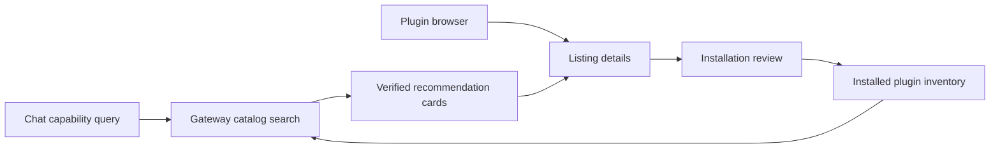

Codex review: blocked before merge. _Reviewed September 9, 2026, 9:57 PM ET / September 10, 2026, 01:57 UTC (Revision 28)._

# ClawSweeper review

## What this changes

Unifies installed and available plugin browsing and adds chat recommendation cards that show installation status and open the existing installation review.

## Regression provenance

Possible regression — suspected (reviewed change). No predecessor PR is attributed.

## Merge readiness

⛔ **Blocked before merge - 5 items remain**

This remains useful, distinct work with substantial behavior evidence. Earlier catalog findings are addressed, but one asynchronous inspection race remains.

**Priority:** P2
**Reviewed head:** `a58ce1f4aaefc6a84c80aa9fd63fb5154b95bc36`

## Review scores

| Measure | Result | What it means |
|---|---|---|
| **Overall readiness** | 🦐 gold shrimp **(3/6)** | Strong behavior evidence supports useful work, but the stale-inspection race prevents merge readiness. |
| **Proof confidence** | 🦞 diamond lobster **(5/6)** ✨ media proof bonus | Sufficient (linked_artifact): Supplied live Control UI observations cover real-model recommendation generation, installation review, successful installation, and refreshed Installed status; inspected before/after images corroborate the card change. Video decoding was unavailable to this reviewer, as detailed in evidence. |
| **Patch quality** | 🦐 gold shrimp **(3/6)** | 1 actionable review finding remain. |

## Verification

| Check | Result | Evidence |
|---|---|---|
| **Real behavior** | Verified | Sufficient (linked_artifact): Supplied live Control UI observations cover real-model recommendation generation, installation review, successful installation, and refreshed Installed status; inspected before/after images corroborate the card change. Video decoding was unavailable to this reviewer, as detailed in evidence. |
| **Evidence reviewed** | 13 items | Pinned branch and complete changed-path inventory: Local comparison recovered all 86 introduced paths beyond the truncated supplied inventory. GitHub REST confirmed that the PR remains open and unmerged at the pinned head, targeting its stack parent. Introduced stale-inspection overwrite: The optional catalog response checks only connection scope and plugin ID before replacing the entire inspection captured earlier. A newer inspection for the same plugin can therefore be overwritten by an older request. Late-finding continuity verified: The previous reviewed revision contains the identical showDetails enrichment block. Local comparison could not read that historical object; the pinned GitHub contents endpoint supplied the historical source instead. |
| **Findings** | 1 actionable finding | [P2] [P2] Fence catalog enrichment to its originating inspection |
| **Security** | None | None. |

## How this fits together

Control UI combines ClawHub listings with Gateway-owned plugin inventory. Chat capability queries produce recommendation cards that lead operators into plugin details and the existing installation workflow.

## Before merge

- [ ] **\[P2\] Fence catalog enrichment to its originating inspection (P2)** - If ClawHub is slow, a configuration autosave or reopening the same plugin can complete a newer `plugins.inspect` while an earlier catalog request remains pending. The older response passes this plugin-ID check and replaces the newer inspection with its captured `inspection`, restoring stale component tabs and access details. Preserve a request generation or exact inspection identity through enrichment, and cover the out-of-order completion. Late finding: this block is unchanged from the previous reviewed revision.
- [ ] **Resolve merge risk (P1)** - Video playback and final artwork inspection were limited by unavailable local decoding and attachment retrieval; the assessment preserves the supplied live-run evidence.
- [ ] **Complete next step (P2)** - Fence optional catalog enrichment to its originating inspection and verify that delayed responses cannot overwrite newer local details.
- [ ] **Review config compatibility** - Confirm compatibility and upgrade impact for the changed config or default surface before merge.
- [ ] **Add data-model compatibility proof** - Confirm migration or upgrade compatibility proof before merge.

## Findings

- [P2] [P2] Fence catalog enrichment to its originating inspection — `ui/src/pages/plugins/plugins-page.ts:523-524`

<strong>Agent review details</strong>

### Security

None.

### PR surface

PR surface statistics unavailable: the file list is incomplete.

### Review metrics

| Metric | Value | Why it matters |
|---|---|---|
| **Production versus test growth** | TypeScript/CSS production net +766; tests/support net +1,062 | Growth has a stated purpose in unified discovery, recommendation rendering, and wizard safeguards; generated Swift, docs, and JSON are excluded. |
| **New input surface** | 1 optional message object; 1 optional catalog version parameter; 0 configuration options | The additions extend existing tool and Gateway contracts without adding an operator policy knob. |

### Stored data model

Persistent data-model change detected: `unknown-truncated-pull-files`. Confirm migration or upgrade compatibility proof before merge.

### Merge-risk options

**Maintainer options:**
1. **Decide the mitigation before merge**  
   Keep local inspection authoritative and allow optional catalog enrichment to update only the still-current inspection request.
2. **Pause or close**  
   Do not merge this PR until maintainers decide whether the risk is worth taking.

### Technical review

Best possible solution:

Keep local inspection authoritative and allow optional catalog enrichment to update only the still-current inspection request.

Do we have a high-confidence way to reproduce the issue?

Yes, at source level on the PR head: delay an initial catalog enrichment, refresh the same plugin's inspection, then resolve the older enrichment. Its plugin-ID guard permits overwriting the newer inspection; no runtime reproduction was executed.

Is this the best way to solve the issue?

Mostly yes: the branch reuses existing catalog, consent, and persistence owners. The remaining race needs request-level fencing rather than a new compatibility mode.

Full review comments:

- [P2] [P2] Fence catalog enrichment to its originating inspection — `ui/src/pages/plugins/plugins-page.ts:523-524`
  If ClawHub is slow, a configuration autosave or reopening the same plugin can complete a newer `plugins.inspect` while an earlier catalog request remains pending. The older response passes this plugin-ID check and replaces the newer inspection with its captured `inspection`, restoring stale component tabs and access details. Preserve a request generation or exact inspection identity through enrichment, and cover the out-of-order completion. Late finding: this block is unchanged from the previous reviewed revision.
  Confidence: 0.97
  Late finding: first raised on code an earlier review cycle already covered.

Overall correctness: patch is incorrect
Overall confidence: 0.94

AGENTS.md: found and applied where relevant.

Codex review notes: model internal, reasoning medium; reviewed against [fb9addf62115](https://github.com/openclaw/openclaw/commit/fb9addf62115a74dfa655e3a1da0a332e54d8330).

### Labels

Label changes:

- add `rating: 🦐 gold shrimp`: Overall readiness is 🦐 gold shrimp; proof is 🦞 diamond lobster and patch quality is 🦐 gold shrimp.
- add `status: ⏳ waiting on author`: ClawSweeper has contributor-facing work open and is waiting for author action. Sufficient (linked_artifact): Supplied live Control UI observations cover real-model recommendation generation, installation review, successful installation, and refreshed Installed status; inspected before/after images corroborate the card change. Video decoding was unavailable to this reviewer, as detailed in evidence.
- remove `rating: 🐚 platinum hermit`: Current PR rating is `rating: 🦐 gold shrimp`, so this older rating label is no longer current.
- remove `status: 👀 ready for maintainer look`: Current PR status label is `status: ⏳ waiting on author`.
- remove `proof: 🎥 video`: Current real behavior proof evidence kind is linked_artifact.

Label justifications:

- `P2`: This improves plugin discovery, with one bounded race affecting refreshed plugin detail presentation.
- `rating: 🦐 gold shrimp`: Overall readiness is 🦐 gold shrimp; proof is 🦞 diamond lobster and patch quality is 🦐 gold shrimp.
- `status: ⏳ waiting on author`: ClawSweeper has contributor-facing work open and is waiting for author action. Sufficient (linked_artifact): Supplied live Control UI observations cover real-model recommendation generation, installation review, successful installation, and refreshed Installed status; inspected before/after images corroborate the card change. Video decoding was unavailable to this reviewer, as detailed in evidence.
- `proof: sufficient`: Contributor real behavior proof is sufficient. Supplied live Control UI observations cover real-model recommendation generation, installation review, successful installation, and refreshed Installed status; inspected before/after images corroborate the card change. Video decoding was unavailable to this reviewer, as detailed in evidence.

### Evidence

What I checked:

- **Pinned branch and complete changed-path inventory:** Local comparison recovered all 86 introduced paths beyond the truncated supplied inventory. GitHub REST confirmed that the PR remains open and unmerged at the pinned head, targeting its stack parent. ([a58ce1f4aaef](https://github.com/openclaw/openclaw/commit/a58ce1f4aaefc6a84c80aa9fd63fb5154b95bc36))
- **Introduced stale-inspection overwrite:** The optional catalog response checks only connection scope and plugin ID before replacing the entire inspection captured earlier. A newer inspection for the same plugin can therefore be overwritten by an older request. ([`ui/src/pages/plugins/plugins-page.ts:523`](https://github.com/openclaw/openclaw/blob/a58ce1f4aaefc6a84c80aa9fd63fb5154b95bc36/ui/src/pages/plugins/plugins-page.ts#L523), [a58ce1f4aaef](https://github.com/openclaw/openclaw/commit/a58ce1f4aaefc6a84c80aa9fd63fb5154b95bc36))
- **Late-finding continuity verified:** The previous reviewed revision contains the identical showDetails enrichment block. Local comparison could not read that historical object; the pinned GitHub contents endpoint supplied the historical source instead. ([`ui/src/pages/plugins/plugins-page.ts:523`](https://github.com/openclaw/openclaw/blob/68dbc1a11d3ef3bf7b157e1cfd4164958c863dda/ui/src/pages/plugins/plugins-page.ts#L523), [68dbc1a11d3e](https://github.com/openclaw/openclaw/commit/68dbc1a11d3ef3bf7b157e1cfd4164958c863dda))
- **Existing tests expose the missing interleaving:** Tests separately cover inspection refresh after autosave and local settings appearing before delayed catalog enrichment, but do not combine those operations. Inspection components control visible detail tabs, making stale replacement observable. ([`ui/src/pages/plugins/plugins-page.routing.test.ts:285`](https://github.com/openclaw/openclaw/blob/a58ce1f4aaefc6a84c80aa9fd63fb5154b95bc36/ui/src/pages/plugins/plugins-page.routing.test.ts#L285), [a58ce1f4aaef](https://github.com/openclaw/openclaw/commit/a58ce1f4aaefc6a84c80aa9fd63fb5154b95bc36))
- **Prior catalog findings addressed:** The join retains installed published packages omitted by remote search, while Uncategorized renders without responsive truncation and retains pagination. Swift models include the added typed fields; discovery detail remains a dictionary capable of carrying auditUrl. ([`src/plugins/catalog-discovery.test.ts:306`](https://github.com/openclaw/openclaw/blob/a58ce1f4aaefc6a84c80aa9fd63fb5154b95bc36/src/plugins/catalog-discovery.test.ts#L306), [a58ce1f4aaef](https://github.com/openclaw/openclaw/commit/a58ce1f4aaefc6a84c80aa9fd63fb5154b95bc36))
- **Compatibility disposition supported by source:** Wizard edits stay in an isolated draft and apply through the existing config.set operation with a snapshot base hash and dispatch guard. Tests distinguish deletion from explicit null and preserve untouched concurrent values. No new configuration option or database schema is introduced; ui/AGENTS.md explicitly couples the UI and Gateway release. ([`ui/src/pages/plugins/install-wizard-controller.ts:236`](https://github.com/openclaw/openclaw/blob/a58ce1f4aaefc6a84c80aa9fd63fb5154b95bc36/ui/src/pages/plugins/install-wizard-controller.ts#L236), [a58ce1f4aaef](https://github.com/openclaw/openclaw/commit/a58ce1f4aaefc6a84c80aa9fd63fb5154b95bc36))

Likely related people:

- **Patrick-Erichsen:** Suggested for follow-up; no historical authorship or introduction is verified. (role: unverified routing candidate; confidence: low)
- **steipete:** Suggested for follow-up; no historical authorship or introduction is verified. (role: unverified routing candidate; confidence: low)

### Rank-up moves

Optional improvements that raise the rating; they are not merge blockers.

- Fence optional enrichment to the current inspection request and add an out-of-order response regression.

### Rating scale

| Score | Internal tier | Crab rank | Meaning |
|---:|:---:|---|---|
| **6/6** | S | 🦀 challenger crab | Exceptional readiness |
| **5/6** | A | 🦞 diamond lobster | Very strong readiness |
| **4/6** | B | 🐚 platinum hermit | Good normal PR; ordinary maintainer review |
| **3/6** | C | 🦐 gold shrimp | Useful, but confidence is limited |
| **2/6** | D | 🦪 silver shellfish | Proof or implementation needs work |
| **1/6** | F | 🧂 unranked krab | Not merge-ready |
| N/A | NA | 🌊 off-meta tidepool | Rating does not apply |

Overall follows the weaker of proof and patch quality.
Shiny media proof means a screenshot, video, or linked artifact directly shows the changed behavior. Runtime, network, CSP, and security claims still need visible diagnostics.

### Workflow

- ClawSweeper keeps one durable marker-backed review comment per issue or PR.
- Re-runs edit this comment so the latest verdict, findings, and automation markers stay together instead of adding duplicate bot comments.
- A fresh review can be triggered by eligible `@clawsweeper re-review` comments, exact-item GitHub events, scheduled/background review runs, or manual workflow dispatch.
- PR/issue authors and users with repository write access can comment `@clawsweeper re-review` or `@clawsweeper re-run` on an open PR or issue to request a fresh review only.
- Maintainers can also comment `@clawsweeper review` to request a fresh review only.
- Fresh-review commands do not start repair, autofix, rebase, CI repair, or automerge.
- Maintainer-only repair and merge flows require explicit commands such as `@clawsweeper autofix`, `@clawsweeper automerge`, `@clawsweeper fix ci`, or `@clawsweeper address review`.
- Maintainers can comment `@clawsweeper explain` to ask for more context, or `@clawsweeper stop` to stop active automation.

### History

Review history (27 earlier review cycles; latest 8 shown)

<!-- clawsweeper-review-history v=1 total=27 -->
- reviewed 2026-09-09T20:08:13.072Z sha ab51621e2c66b26b419fcc83ceed7062a0710f60 :: blocked before merge. :: [P2] Retain installed matches absent from the remote result | [P2] Expose later pages from the Uncategorized shelf | [P2] Exclude unexpandable shelves from responsive card limits | [P2] Regenerate Swift models for the added protocol fields | [P2] Give the installed-card fixture its canonical package identity
- reviewed 2026-09-09T20:31:58.220Z sha ffb03b5a95472d6a343911318d4f33a3aa72a4f5 :: blocked before merge. :: [P2] Retain installed matches absent from the remote result | [P2] Expose later pages from the Uncategorized shelf | [P2] Exclude unexpandable shelves from responsive card limits | [P2] Regenerate Swift models for the added protocol fields | [P2] Give the installed-card fixture its canonical package identity
- reviewed 2026-09-09T20:59:07.309Z sha b6cc7e7ba74489f8f0143bb274851f62322321e5 :: blocked before merge. :: [P2] Retain installed matches absent from the remote result | [P2] Expose later pages from the Uncategorized shelf | [P2] Exclude unexpandable shelves from responsive card limits | [P2] Regenerate Swift models for the added protocol fields | [P2] Give the installed-card fixture its canonical package identity
- reviewed 2026-09-09T21:20:10.200Z sha daf1aac0cfea14812cf444509e470cce98e95c38 :: blocked before merge. :: [P2] Retain installed matches absent from the remote result | [P2] Expose later pages from the Uncategorized shelf | [P2] Exclude unexpandable shelves from responsive card limits | [P2] Regenerate Swift models for the added protocol fields | [P2] Give the installed-card fixture its canonical package identity
- reviewed 2026-09-09T21:46:08.270Z sha 75b21efd505689752ca25c9d417f3d03c83b2d9f :: blocked before merge. :: none
- reviewed 2026-09-09T22:16:57.252Z sha 8a186175f75258792505be00414b5261429b32ba :: blocked before merge. :: none
- reviewed 2026-09-09T22:58:13.537Z sha e332784d3d5ef326c1c92c11454a91ded1aa21af :: blocked before merge. :: none
- reviewed 2026-09-09T23:08:59.098Z sha 68dbc1a11d3ef3bf7b157e1cfd4164958c863dda :: blocked before merge. :: none

<!-- clawsweeper-verdict:needs-human item=142782 sha=a58ce1f4aaefc6a84c80aa9fd63fb5154b95bc36 confidence=high updated_at=2026-09-10T01:53:07Z reviewed_at=2026-09-10T01:57:30.144Z lease_owner=github-run-34427129755-1 lease_comment_id=5611476556 source_revision=a3ba2a7b77d2567611b884c36289016f18e433b1f8db69dc3aee1ab14daadcc7 live_verification=absent -->
<!-- clawsweeper-review-state:blocked item=142782 sha=a58ce1f4aaefc6a84c80aa9fd63fb5154b95bc36 v=1 -->

<!-- clawsweeper-review-version item=142782 reviewed_at=2026-09-10T01:57:30.144Z sha=a58ce1f4aaefc6a84c80aa9fd63fb5154b95bc36 source_revision=a3ba2a7b77d2567611b884c36289016f18e433b1f8db69dc3aee1ab14daadcc7 lease_owner=github-run-34427129755-1 lease_comment_id=5611476556 v=1 -->

<!-- clawsweeper-review item=142782 -->