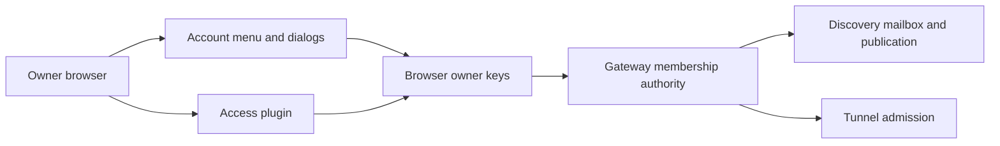

Codex review: needs real behavior proof before merge.

## What this changes

Adds Labs-gated account actions, remote-access setup, recovery-kit saving, browser approval, device management, and an Access page.

**Example:** An owner invites owner@example.test as an operator.
- **Before:** The Gateway supports signed membership changes, but the Control UI has no invitation workflow.
- **After:** The owner creates an invitation on Access, approves the request, and can later remove the member.

## Review scores

| Measure | Result | What it means |
|---|---|---|
| **Overall readiness** | 🦐 gold shrimp **(3/6)** | Useful implementation with inspected live evidence for Access, but local approval authority proof and attribution of failing current-head checks remain unresolved. |
| **Proof confidence** | 🦐 gold shrimp **(3/6)** | Real behavior proof is necessary before merge. See [Before merge](#before-merge). |
| **Patch quality** | 🦐 gold shrimp **(3/6)** | Security review found an item that needs attention. |

## Product

**Kind:** Feature · **Worth it:** Yes · **Fix scope:** Complete
**User problem:** Owners need an in-product way to configure remote access, retain recovery material, approve browsers, and manage invited people.
**Reason:** The feature completes already-merged foundations, remains opt-in, and its direction is established by the maintainer-authored change.

## Merge readiness

⛔ **Blocked before merge - 3 items remain**

This PR completes useful, maintainer-directed UI for the merged OpenClaw ID foundations; the previous name-check finding is fixed, and no new discrete correctness defect was established.

**Priority:** P2
**Reviewed head:** `608a551cc82a78e25f6033728bd053d34cedaa85`

## Before merge

- [ ] **Add real behavior proof** - Authority-chain proof required: inspected staging screenshots and recorded outcomes cover Access invitations, approval, removal, forbidden signers and removed-browser rejection at 9977465. The SAS screenshot exercises the claw loader; the new local Control UI notification, dialog and owner-approval.ts path still has mocked transport coverage. Supply sanitized live output or a recording with diagnostics showing successful local approval and rejection when the approver is revoked or expires before membership submission or sealed handoff; redact credentials, IPs and non-public endpoints. After adding proof, update the PR body, then request a new review with `@clawsweeper re-review`. The PR author or someone with repository write access can request it.
- [ ] **Resolve security review attention item** - No concrete authorization bypass was established, but local-approver final-effect coverage remains incomplete.
- [ ] **Resolve merge risk** - Before merge, the PR owner must establish that a revoked or expired local approver cannot admit another browser or release its sealed handoff.

## Findings

None.

### Tests

- Missing end-to-end proof: The supplied staging proof does not show the new local Control UI approver succeeding and then refusing membership submission or sealed handoff after its authority is revoked or expires.

<strong>Agent review details</strong>

### How this fits together

The Control UI and bundled Access plugin turn owner actions into browser-signed requests; the existing Gateway membership authority decides admission and enforces removal.

### Technical review

Best possible solution:

Complete the Labs-gated UI over the existing Gateway authority while preserving browser-held keys and feature-off behavior.

Do we have a high-confidence way to reproduce the issue?

This is a feature addition; current main contains the Gateway foundations but lacks these Control UI surfaces.

Is this the best way to solve the issue?

The UI adapters and bundled Access plugin appropriately reuse the existing membership authority; the simplification pass found no concrete need for replacement architecture.

AGENTS.md: found and applied where relevant.

Codex review notes: model internal, reasoning medium; reviewed against [e27b909e49d3](https://github.com/openclaw/openclaw/commit/e27b909e49d33bd723a2cfc10e944845f00249b7).

### Merge-risk options

**Maintainer options:**
1. **Verify local approval at the final effects (recommended)**  
   The PR owner supplies allowed-browser approval and revoked-or-expired approver rejection through the local Control UI, including membership submission and sealed-handoff delivery.

### Provenance checked

- `Gateway membership and feature-off contract` keeps the original intent (428ca7daffc9b805a865700012cae906ae316071: Establish one Gateway membership authority behind the disabled-by-default Labs switch.)
- `Account-menu avatar and layout` keeps the original intent (e40ffa377444c2459bb18b9f7389d7a62423d951: Keep the avatar node stable across menu rebuilds and preserve readable phone rows.)
- `Native bundled plugin UI` keeps the original intent (de50262a1f962343bd85272c75ecb5c1ddebf017: Allow native bundled plugin UI without requiring the custom-plugin Labs opt-in.)
- `Control UI performance ceilings` changes intended behavior with a stated reason (8751edc4b9f205bd4dec81416cf0ab46c7a0c38c: Existing ceilings constrain boot growth; the current maintainer explicitly accepts measured sidebar and account-menu overhead with bounded headroom.)

### Testing

Proof path: shipped entry point.

### Security

Needs attention: No concrete authorization bypass was established, but local-approver final-effect coverage remains incomplete.

### Evidence

What I checked:

- **Introduced scope and current-main boundary:** The pinned introduction diff adds the browser approval owner and Access plugin; the fetched main tree contains none of the new OpenClaw ID UI directories. The merged foundations are https://github.com/openclaw/openclaw/pull/192335 and https://github.com/openclaw/openclaw/pull/192345. ([`ui/src/lib/openclaw-id/owner-approval.ts:1`](https://github.com/openclaw/openclaw/blob/608a551cc82a78e25f6033728bd053d34cedaa85/ui/src/lib/openclaw-id/owner-approval.ts#L1), [608a551cc82a](https://github.com/openclaw/openclaw/commit/608a551cc82a78e25f6033728bd053d34cedaa85))
- **Previous finding resolved:** The acquired account link code is passed directly into checkName, avoiding the deferred Solid signal read; the updated regression expects check_name with synthetic-code. The redundant kit-export test and its production-only export were also removed. ([`ui/src/components/openclaw-id/make-reachable-dialog.tsx:177`](https://github.com/openclaw/openclaw/blob/0200592f231773bf6107bd5a124fb77a36216ba3/ui/src/components/openclaw-id/make-reachable-dialog.tsx#L177), [0200592f2317](https://github.com/openclaw/openclaw/commit/0200592f231773bf6107bd5a124fb77a36216ba3))
- **Authority remains Gateway-owned:** Local approval submits the signed membership change before sending the sealed handoff. The existing device-mail relay checks the caller and exact active certificate immediately before network I/O; source inspection established no concrete bypass. ([`src/gateway/openclaw-id/device-mail-relay.ts:58`](https://github.com/openclaw/openclaw/blob/608a551cc82a78e25f6033728bd053d34cedaa85/src/gateway/openclaw-id/device-mail-relay.ts#L58), [608a551cc82a](https://github.com/openclaw/openclaw/commit/608a551cc82a78e25f6033728bd053d34cedaa85))
- **Live evidence coverage:** The full PR body records staging invitation, approval, removal, forbidden-signer and removed-browser outcomes. Inspected attachments show pending and approved Access states, device removal, and loader rejection. The SAS screenshot shows the claw loader rather than the new local Control UI approver: https://github.com/openclaw/openclaw/pull/192352. ([`ui/src/lib/openclaw-id/owner-approval.test.ts:213`](https://github.com/openclaw/openclaw/blob/608a551cc82a78e25f6033728bd053d34cedaa85/ui/src/lib/openclaw-id/owner-approval.test.ts#L213), [608a551cc82a](https://github.com/openclaw/openclaw/commit/608a551cc82a78e25f6033728bd053d34cedaa85))
- **Prior proof remains applicable:** GitHub content identities confirm owner-approval.ts has the same blob at the staging-proof revision, the previous reviewed head, and this head. Its tests use mocked Gateway/mailbox transport and do not exercise approver revocation or certificate expiry through the final production effects. ([`ui/src/lib/openclaw-id/owner-approval.ts:363`](https://github.com/openclaw/openclaw/blob/608a551cc82a78e25f6033728bd053d34cedaa85/ui/src/lib/openclaw-id/owner-approval.ts#L363), [608a551cc82a](https://github.com/openclaw/openclaw/commit/608a551cc82a78e25f6033728bd053d34cedaa85))
- **Accepted performance tradeoff:** The maintainer-authored PR and commit explicitly approve measured Chat boot and CSS budget increases after removing the accidental config-form boot dependency; this accepted tradeoff is not re-raised. ([`scripts/check-control-ui-performance.mts:62`](https://github.com/openclaw/openclaw/blob/8751edc4b9f205bd4dec81416cf0ab46c7a0c38c/scripts/check-control-ui-performance.mts#L62), [8751edc4b9f2](https://github.com/openclaw/openclaw/commit/8751edc4b9f205bd4dec81416cf0ab46c7a0c38c))

Likely related people:

- **Josh Lehman:** Raw commit 428ca7daffc9b805a865700012cae906ae316071 adds src/gateway/openclaw-id/device-mail-relay.ts:1 relative to its recorded parents. This identifies author metadata, not feature responsibility or a PR merger. (role: source-line author; confidence: high; commits: [428ca7daffc9](https://github.com/openclaw/openclaw/commit/428ca7daffc9b805a865700012cae906ae316071); files: `src/gateway/openclaw-id/device-mail-relay.ts`)

### PR surface

PR surface statistics unavailable: the file list is incomplete.

### Preflight source

Source unknown. Source comparison at the observed PR snapshot only. Completion is self-reported; body, policy, tests, execution, and report bytes are not verified.

### Labels

Label changes:

No label changes.

Label justifications:

- `P2`: This is an opt-in feature completing usable remote-access management, without evidence of an urgent released regression.
- `merge-risk: 🚨 security-boundary`: The new local browser flow signs owner-device grants and releases enrollment material across a device trust boundary.
- `rating: 🦐 gold shrimp`: Overall readiness is 🦐 gold shrimp; proof is 🦐 gold shrimp and patch quality is 🦐 gold shrimp.
- `status: 📣 needs proof`: The PR needs real behavior proof before ClawSweeper can clear the contributor ask.
- `proof: 📸 screenshot`: Contributor real behavior proof includes screenshot evidence.

### Rank-up moves

Optional improvements that raise the rating; they are not merge blockers.

- Prove successful local Control UI approval and final-effect rejection after approver revocation or expiry.
- Have the CI owner classify the failing current-head checks from their diagnostics before assigning repairs.

### Rating scale

6/6 🦀 challenger crab · 5/6 🦞 diamond lobster · 4/6 🐚 platinum hermit · 3/6 🦐 gold shrimp · 2/6 🦪 silver shellfish · 1/6 🧂 unranked krab. Overall follows the weaker of proof and patch quality; ✨ marks media proof (a screenshot, video, or linked artifact) that directly shows the changed behavior.

### Workflow

ClawSweeper edits this one comment on every review. Comment `@clawsweeper re-review` for a fresh review only. Repair and merge execution lanes are retired.

### History

Review history (9 earlier review cycles; latest 8 shown)

<!-- clawsweeper-review-history v=1 total=9 -->
- reviewed 2026-11-04T09:39:12.997Z sha a93e0c5a86170d6e642a604c57f676dacb6f12bb :: needs real behavior proof before merge. :: none
- reviewed 2026-11-05T22:33:00.598Z sha 2cf0aed0b99fb9d5dfe68d8ec05ba05efff46239 :: needs real behavior proof before merge. :: none
- reviewed 2026-11-06T01:05:42.091Z sha 90a2c765e10799dce65c5cffc2539b878a46f71a :: needs real behavior proof before merge. :: none
- reviewed 2026-11-06T15:00:47.504Z sha 25d1354888eb7a65af51716223f4c63167535df8 :: needs real behavior proof before merge. :: [P2] [P2] Regenerate the complete plugin inventory
- reviewed 2026-11-06T15:17:05.853Z sha 0080431a0d3dac8940961f08e3efc7a06c109efe :: needs real behavior proof before merge. :: none
- reviewed 2026-11-06T15:42:15.973Z sha 9977465a40a99ccc7ea11fa7b8a8c7d80c32e9ba :: needs real behavior proof before merge. :: [P2] [P2] Restore the existing Control UI boot asset budgets
- reviewed 2026-11-06T18:13:39.122Z sha dfa0d582e27dba7abe7438ff795c2abefe50f842 :: needs real behavior proof before merge. :: [P3] Pass the acquired link code directly to the initial name check
- reviewed 2026-11-06T18:24:34.347Z sha 8751edc4b9f205bd4dec81416cf0ab46c7a0c38c :: needs real behavior proof before merge. :: [P3] Pass the acquired link code directly to the initial name check

_Reviewed November 6, 2026, 1:48 PM ET / 18:48 UTC (Revision 10)._

<!-- clawsweeper-security:security-sensitive item=192352 sha=608a551cc82a78e25f6033728bd053d34cedaa85 confidence=high updated_at=2026-11-06T18:40:24Z reviewed_at=2026-11-06T18:48:26.723Z lease_owner=github-run-42272696475-1 lease_comment_id=6692542931 source_revision=ea3f72c4b37880239e6900faf658fa85917a30fb8213761b9a1ba93e791e12c8 -->
<!-- clawsweeper-verdict:needs-human item=192352 sha=608a551cc82a78e25f6033728bd053d34cedaa85 confidence=high updated_at=2026-11-06T18:40:24Z reviewed_at=2026-11-06T18:48:26.723Z lease_owner=github-run-42272696475-1 lease_comment_id=6692542931 source_revision=ea3f72c4b37880239e6900faf658fa85917a30fb8213761b9a1ba93e791e12c8 hold=security findings=0 -->
<!-- clawsweeper-review-state:blocked item=192352 sha=608a551cc82a78e25f6033728bd053d34cedaa85 v=1 -->

<!-- clawsweeper-review-version item=192352 reviewed_at=2026-11-06T18:48:26.723Z sha=608a551cc82a78e25f6033728bd053d34cedaa85 source_revision=ea3f72c4b37880239e6900faf658fa85917a30fb8213761b9a1ba93e791e12c8 lease_owner=github-run-42272696475-1 lease_comment_id=6692542931 v=1 -->

<!-- clawsweeper-review item=192352 -->