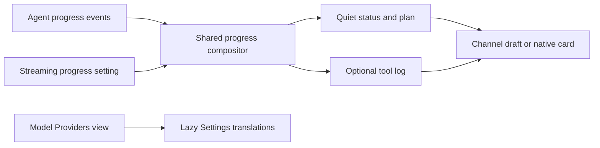

Codex review: blocked before merge. _Reviewed September 4, 2026, 1:48 PM ET / 17:48 UTC._

# ClawSweeper review

## What this changes

This PR makes bundled channel progress drafts quiet by default while retaining authored status, reasoning, plans, approvals, and failures, and moves Model Providers translation copy into the Control UI’s lazy Settings catalog.

## Merge readiness

⛔ **Blocked before merge - 5 items remain**

The shared-compositor approach is coherent and preserves the public SDK’s omitted default, but the active exact-head CI gate is failing; keep this maintainer-owned PR open until that gate is green.

**Priority:** P1
**Reviewed head:** `fb6096efaf4883f3dd02a8fe971e97ea84d909b1`

## Review scores

| Measure | Result | What it means |
|---|---|---|
| **Overall readiness** | 🐚 platinum hermit **(4/6)** | A coherent cross-channel repair with meaningful focused coverage, pending only exact-head CI validation. |
| **Proof confidence** | 🐚 platinum hermit **(4/6)** | Not applicable: Focused mock-Gateway and compositor evidence covers the changed presentation path; fresh Telegram Test Server rendering was waived after membership preflight failed. |
| **Patch quality** | 🐚 platinum hermit **(4/6)** | No actionable review findings were identified. |

## Verification

| Check | Result | Evidence |
|---|---|---|
| **Real behavior** | Not applicable | Not applicable: Focused mock-Gateway and compositor evidence covers the changed presentation path; fresh Telegram Test Server rendering was waived after membership preflight failed. |
| **Evidence reviewed** | 6 items | Shared presentation owner: The compositor gives bundled progress mode a quiet default while continuing to render reasoning independently; routine tool rows require the explicit log mode, while attention rows and plans remain visible. Public SDK compatibility: The exported resolver retains its omitted default of true, and bundled callers provide their resolved quiet-mode default explicitly; public-barrel tests cover omitted and forwarded undefined arguments. Telegram owner path: Telegram derives the default from the resolved streaming mode, making progress-mode drafts quiet unless toolProgress is enabled. |
| **Findings** | None | None. |
| **Security** | None | None. |

## How this fits together

Channel streaming sends agent progress through a shared draft compositor before each channel renders a temporary preview or native card. Separately, the Control UI loads Model Providers text only when that Settings view opens.

## Before merge

- [ ] **Resolve merge risk (P1)** - Existing unconfigured progress-mode users will no longer see routine tool rows unless they enable the existing streaming.progress.toolProgress setting; this is intentional but compatibility-sensitive.
- [ ] **Resolve merge risk (P1)** - The exact reviewed head has a failed openclaw/ci-gate run, and the failure detail was unavailable to this read-only reviewer.
- [ ] **Resolve merge risk (P1)** - Fresh Telegram Test Server rendering was waived after its membership preflight failed; mock-Gateway coverage does not independently prove Telegram’s live rendering behavior.
- [ ] **Complete next step (P2)** - Resolve the exact-head openclaw/ci-gate failure and obtain a green required-check run before merge.
- [ ] **Add data-model compatibility proof** - Confirm migration or upgrade compatibility proof before merge.

<strong>Agent review details</strong>

### Security

None.

### PR surface

Source +242, Tests +1463, Docs +29, Generated 0, Other +178. Total +1912 across 71 files.

View PR surface stats

| Area | Files | Added | Removed | Net |
|---|---:|---:|---:|---:|
| Source | 29 | 762 | 520 | +242 |
| Tests | 31 | 2733 | 1270 | +1463 |
| Docs | 7 | 97 | 68 | +29 |
| Config | 0 | 0 | 0 | 0 |
| Generated | 2 | 18 | 18 | 0 |
| Other | 2 | 179 | 1 | +178 |
| **Total** | **71** | **3789** | **1877** | **+1912** |

### Review metrics

| Metric | Value | Why it matters |
|---|---|---|
| **Production vs test delta** | production +743/−505; tests/QA +2930/−1285 | The cross-channel presentation refactor has justified production growth, but its breadth makes exact-head CI particularly important before merge. |

### Stored data model

Persistent data-model change detected: `migration/backfill/repair: extensions/telegram/src/doctor.ts`, `unknown-data-model-change: extensions/telegram/src/doctor.ts`. Confirm migration or upgrade compatibility proof before merge.

### Merge-risk options

**Maintainer options:**
1. **Accept the approved quiet default after validation (recommended)**  
   Merge after exact-head required checks pass, accepting that the existing toolProgress setting is now the opt-in for rolling routine tool rows.

### Technical review

Best possible solution:

Keep one shared quiet-default compositor path and the SDK’s omitted true contract, then merge only after exact-head CI is green; restore live Telegram rendering evidence when its test prerequisite is available.

Do we have a high-confidence way to reproduce the issue?

Yes: focused compositor and mock-Gateway channel cases provide a high-confidence exercise path for quiet and opt-in progress behavior, though fresh Telegram Test Server rendering was not completed after membership preflight failed.

Is this the best way to solve the issue?

Yes: a shared compositor with explicit bundled defaults is the most maintainable repair, and retaining the SDK resolver’s omitted default avoids changing third-party plugin behavior.

AGENTS.md: found and applied where relevant.

Codex review notes: model internal, reasoning high; reviewed against [832ce3c68b76](https://github.com/openclaw/openclaw/commit/832ce3c68b761e90f8b9087a1b65629cbbdfffaf).

### Labels

Label changes:

- add `rating: 🐚 platinum hermit`: Overall readiness is 🐚 platinum hermit; proof is 🐚 platinum hermit and patch quality is 🐚 platinum hermit.
- remove `rating: 🦐 gold shrimp`: Current PR rating is `rating: 🐚 platinum hermit`, so this older rating label is no longer current.

Label justifications:

- `P1`: This repairs an active user-facing default across multiple channel progress presentations.
- `merge-risk: 🚨 compatibility`: The intentional quiet default changes what existing unconfigured progress-mode users see until they enable the existing tool-log setting.
- `rating: 🐚 platinum hermit`: Overall readiness is 🐚 platinum hermit; proof is 🐚 platinum hermit and patch quality is 🐚 platinum hermit.
- `status: 👀 ready for maintainer look`: ClawSweeper has no concrete contributor-facing blocker left for this PR. Not applicable: Focused mock-Gateway and compositor evidence covers the changed presentation path; fresh Telegram Test Server rendering was waived after membership preflight failed.
- `proof: telegram-e2e`: This PR needs Telegram Test Server proof with the repository E2E skill. Quiet and detailed Telegram progress rendering is user-visible and should receive Test Server proof when the membership prerequisite is restored.

### Evidence

What I checked:

- **Shared presentation owner:** The compositor gives bundled progress mode a quiet default while continuing to render reasoning independently; routine tool rows require the explicit log mode, while attention rows and plans remain visible. ([`src/channels/progress-draft-compositor.ts:107`](https://github.com/openclaw/openclaw/blob/fb6096efaf4883f3dd02a8fe971e97ea84d909b1/src/channels/progress-draft-compositor.ts#L107), [fb6096efaf48](https://github.com/openclaw/openclaw/commit/fb6096efaf4883f3dd02a8fe971e97ea84d909b1))
- **Public SDK compatibility:** The exported resolver retains its omitted default of true, and bundled callers provide their resolved quiet-mode default explicitly; public-barrel tests cover omitted and forwarded undefined arguments. ([`src/channels/streaming.ts:825`](https://github.com/openclaw/openclaw/blob/fb6096efaf4883f3dd02a8fe971e97ea84d909b1/src/channels/streaming.ts#L825), [fb6096efaf48](https://github.com/openclaw/openclaw/commit/fb6096efaf4883f3dd02a8fe971e97ea84d909b1))
- **Telegram owner path:** Telegram derives the default from the resolved streaming mode, making progress-mode drafts quiet unless toolProgress is enabled. ([`extensions/telegram/src/bot-message-dispatch-turn.ts:55`](https://github.com/openclaw/openclaw/blob/fb6096efaf4883f3dd02a8fe971e97ea84d909b1/extensions/telegram/src/bot-message-dispatch-turn.ts#L55), [fb6096efaf48](https://github.com/openclaw/openclaw/commit/fb6096efaf4883f3dd02a8fe971e97ea84d909b1))
- **Focused behavioral coverage:** Quiet-default, explicit tool-log, attention, resolution, and failure behavior are exercised in compositor tests; channel QA covers native and non-native progress presentations through the mock Gateway boundary. ([`src/channels/progress-draft-compositor.quiet.test.ts:18`](https://github.com/openclaw/openclaw/blob/fb6096efaf4883f3dd02a8fe971e97ea84d909b1/src/channels/progress-draft-compositor.quiet.test.ts#L18), [fb6096efaf48](https://github.com/openclaw/openclaw/commit/fb6096efaf4883f3dd02a8fe971e97ea84d909b1))
- **Current PR state:** The reviewed head is not an ancestor of fetched main, so it is still unmerged; supplied exact-head checks report openclaw/ci-gate as failed. ([fb6096efaf48](https://github.com/openclaw/openclaw/commit/fb6096efaf4883f3dd02a8fe971e97ea84d909b1))
- **Codex protocol gate:** Direct sibling inspection found Codex plan statuses and reasoning event identity/delta fields; this PR consumes those generic channel-facing presentations rather than changing the Codex implementation.

Likely related people:

- **steipete:** Suggested for follow-up; no historical authorship or introduction is verified. (role: unverified routing candidate; confidence: low)
- **obviyus:** Suggested for follow-up; no historical authorship or introduction is verified. (role: unverified routing candidate; confidence: low)

### Rank-up moves

Optional improvements that raise the rating; they are not merge blockers.

- Resolve the exact-head CI gate failure.

### Rating scale

| Score | Internal tier | Crab rank | Meaning |
|---:|:---:|---|---|
| **6/6** | S | 🦀 challenger crab | Exceptional readiness |
| **5/6** | A | 🦞 diamond lobster | Very strong readiness |
| **4/6** | B | 🐚 platinum hermit | Good normal PR; ordinary maintainer review |
| **3/6** | C | 🦐 gold shrimp | Useful, but confidence is limited |
| **2/6** | D | 🦪 silver shellfish | Proof or implementation needs work |
| **1/6** | F | 🧂 unranked krab | Not merge-ready |
| N/A | NA | 🌊 off-meta tidepool | Rating does not apply |

Overall follows the weaker of proof and patch quality.
Shiny media proof means a screenshot, video, or linked artifact directly shows the changed behavior. Runtime, network, CSP, and security claims still need visible diagnostics.

### Workflow

- ClawSweeper keeps one durable marker-backed review comment per issue or PR.
- Re-runs edit this comment so the latest verdict, findings, and automation markers stay together instead of adding duplicate bot comments.
- A fresh review can be triggered by eligible `@clawsweeper re-review` comments, exact-item GitHub events, scheduled/background review runs, or manual workflow dispatch.
- PR/issue authors and users with repository write access can comment `@clawsweeper re-review` or `@clawsweeper re-run` on an open PR or issue to request a fresh review only.
- Maintainers can also comment `@clawsweeper review` to request a fresh review only.
- Fresh-review commands do not start repair, autofix, rebase, CI repair, or automerge.
- Maintainer-only repair and merge flows require explicit commands such as `@clawsweeper autofix`, `@clawsweeper automerge`, `@clawsweeper fix ci`, or `@clawsweeper address review`.
- Maintainers can comment `@clawsweeper explain` to ask for more context, or `@clawsweeper stop` to stop active automation.

### History

Review history (7 earlier review cycles)

<!-- clawsweeper-review-history v=1 total=7 -->
- reviewed 2026-09-03T14:27:29.013Z sha 8c77cbb3450f95fd00c450b622a1351cdb0be534 :: blocked before merge. :: [P2] Retain approval-row cleanup after resolution
- reviewed 2026-09-03T16:16:00.140Z sha 81ed1e4c75c3434a604182d0e42595ec88218829 :: blocked before merge. :: [P1] Reserve an attention slot when plan rows fill the draft | [P1] Preserve the established Slack compact fallback
- reviewed 2026-09-03T18:20:19.072Z sha 2f0795b7eb11f641f36931e7e3ba019697362b33 :: blocked before merge. :: [P1] Reserve an attention slot when plan rows fill the draft | [P1] Preserve the established Slack compact fallback | [P2] Make the Telegram Doctor remedy mode-aware
- reviewed 2026-09-04T03:57:48.776Z sha 5e9f67d6b218fa922ebdb99305bc3eb8c26b69e5 :: blocked before merge. :: [P1] Route Teams reasoning through the compositor’s reasoning path | [P1] Do not flip unconfigured progress defaults without approved upgrade scope
- reviewed 2026-09-04T09:16:33.789Z sha 7bd849c7037701aae1dd8b84556736dacf1be187 :: blocked before merge. :: none
- reviewed 2026-09-04T09:47:14.400Z sha 7bd849c7037701aae1dd8b84556736dacf1be187 :: blocked before merge. :: [P1] Preserve the resolver’s omitted-default SDK contract
- reviewed 2026-09-04T16:43:42.438Z sha 06d6444bef4d01d6714ce8ac79c70ab1c5f74fb0 :: blocked before merge. :: none

<!-- clawsweeper-verdict:needs-human item=137342 sha=fb6096efaf4883f3dd02a8fe971e97ea84d909b1 confidence=high updated_at=2026-09-04T17:44:32Z reviewed_at=2026-09-04T17:48:22.940Z lease_owner=github-run-33901976787-1 lease_comment_id=5544339067 source_revision=e808dd5345179bef75e41c488a01e18de88113e417907ff6397efad6e81f0a69 live_verification=absent -->
<!-- clawsweeper-review-state:blocked item=137342 sha=fb6096efaf4883f3dd02a8fe971e97ea84d909b1 v=1 -->

<!-- clawsweeper-review-version item=137342 reviewed_at=2026-09-04T17:48:22.940Z sha=fb6096efaf4883f3dd02a8fe971e97ea84d909b1 source_revision=e808dd5345179bef75e41c488a01e18de88113e417907ff6397efad6e81f0a69 lease_owner=github-run-33901976787-1 lease_comment_id=5544339067 v=1 -->

<!-- clawsweeper-review item=137342 -->