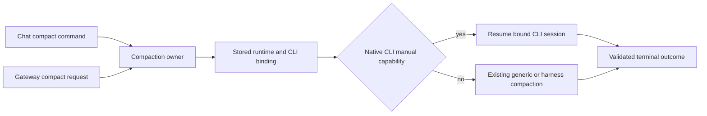

Codex review: needs real behavior proof before merge. _Reviewed August 14, 2026, 11:41 AM ET / 15:41 UTC._

# ClawSweeper review

## What this changes

This PR lets chat and Gateway manual compaction resume a Claude CLI-owned session and run its native `/compact` command without requiring an Anthropic API key.

## Merge readiness

⛔ **Blocked until stronger real behavior proof is added - 6 items remain**

Keep open: current main still sends locked native sessions to a visible generic-compaction failure, while this PR introduces the owner-bound native path. The latest head needs current-head real behavior proof and maintainer acceptance of the public plugin capability.

**Priority:** P1
**Reviewed head:** `cf2d4fe7051b67b2d56377b66c23675c888b8df0`
**Owner decision:** Required. See [Decision needed](#decision-needed).

## Review scores

| Measure | Result | What it means |
|---|---|---|
| **Overall readiness** | 🦐 gold shrimp **(3/6)** | The patch has a coherent owner boundary and focused coverage, but current-head real behavior proof and plugin-contract approval are still required. |
| **Proof confidence** | 🦐 gold shrimp **(3/6)** | Needs stronger real behavior proof before merge: Redacted live Gateway logs demonstrate earlier heads, but the latest head changed control-operation environment handling and needs its own redacted after-fix run. After adding proof, update the PR body; ClawSweeper should re-review automatically. If it does not, the PR author or someone with repository write access can comment `@clawsweeper re-review`. |
| **Patch quality** | 🐚 platinum hermit **(4/6)** | No actionable review findings were identified. |

## Verification

| Check | Result | Evidence |
|---|---|---|
| **Real behavior** | Needs proof | Needs stronger real behavior proof before merge: Redacted live Gateway logs demonstrate earlier heads, but the latest head changed control-operation environment handling and needs its own redacted after-fix run. After adding proof, update the PR body; ClawSweeper should re-review automatically. If it does not, the PR author or someone with repository write access can comment `@clawsweeper re-review`. |
| **Evidence reviewed** | 8 items | Current-main gap: Current main returns model-selection-locked failure before any CLI-native compaction path for locked harness sessions; it has no manual compaction capability on the Anthropic CLI backend. Owner-bound PR route: The PR resolves one compatible persisted CLI binding, resumes it before generic model preparation, and returns a visible result for absent capability or binding. Both entry points carry the binding: The Gateway path and chat command both resolve and pass the same persisted CLI target into compaction. |
| **Findings** | None | None. |
| **Security** | None | None. |

## How this fits together

Chat commands and Gateway session requests both enter the embedded compaction owner with stored runtime, binding, and auth-profile facts. The change chooses a native CLI control operation when that backend owns the transcript; otherwise existing generic or harness compaction remains responsible.

## Decision needed

| Question | Recommendation |
|---|---|
| Should OpenClaw make the new atomic `manualCompaction` CLI-backend capability the supported public plugin contract for explicit native session compaction? | **Adopt the atomic capability:** Accept the generic owner boundary after current-head real behavior proof shows the Claude implementation works. |

Why: This is an externally visible plugin API direction, not merely an internal repair, and the repository policy requires maintainer-visible acceptance for such contract changes.

## Before merge

- [ ] **Add real behavior proof** - Needs stronger real behavior proof before merge: Redacted live Gateway logs demonstrate earlier heads, but the latest head changed control-operation environment handling and needs its own redacted after-fix run. After adding proof, update the PR body; ClawSweeper should re-review automatically. If it does not, the PR author or someone with repository write access can comment `@clawsweeper re-review`.
- [ ] **Resolve merge risk (P1)** - The current head lacks after-fix proof through a real bound Claude CLI session; earlier redacted logs do not cover the latest control-environment change.
- [ ] **Resolve merge risk (P1)** - `manualCompaction` is a new public CLI-backend contract, so its long-term plugin compatibility needs explicit owner approval.
- [ ] **Resolve merge risk (P1)** - The bug fix adds production +539/-157 (net +382); the cross-cutting owner handoff and control boundary justify growth only if the generic SDK contract is accepted.
- [ ] **Complete next step (P2)** - The contributor must provide current-head real behavior proof, and a maintainer must decide whether to accept the new public plugin contract.

<strong>Agent review details</strong>

### Security

None.

### PR surface

Source +397, Tests +1064, Docs +39. Total +1500 across 32 files.

View PR surface stats

| Area | Files | Added | Removed | Net |
|---|---:|---:|---:|---:|
| Source | 17 | 554 | 157 | +397 |
| Tests | 13 | 1107 | 43 | +1064 |
| Docs | 2 | 45 | 6 | +39 |
| Config | 0 | 0 | 0 | 0 |
| Generated | 0 | 0 | 0 | 0 |
| Other | 0 | 0 | 0 | 0 |
| **Total** | **32** | **1706** | **206** | **+1500** |

### Review metrics

| Metric | Value | Why it matters |
|---|---|---|
| **Production versus test delta** | production +539/-157 (net +382); tests/support +1122/-43 (net +1079); docs +45/-6 | The positive production growth is substantial for a bug fix and is acceptable only if the generic ownership boundary is retained deliberately. |
| **Plugin API surface** | 1 optional CLI-backend capability added | `manualCompaction` expands the public backend contract and needs explicit compatibility ownership. |

### Stored data model

Persistent data-model change detected: `serialized state: extensions/anthropic/cli-backend.ts`, `serialized state: extensions/anthropic/cli-shared.test.ts`, `serialized state: src/agents/cli-runner.reliability.test.ts`, `serialized state: src/agents/cli-runner/execute.supervisor-capture.test.ts`, `serialized state: src/agents/embedded-agent-runner/compact.ts`, `serialized state: src/agents/session-runtime-compat.test.ts`, and 9 more. Confirm migration or upgrade compatibility proof before merge.

### Merge-risk options

**Maintainer options:**
1. **Require current-head proof and contract sign-off (recommended)**  
   Before merge, post redacted current-head output showing a persisted Claude CLI session compacts with subscription authentication and no Anthropic API key, then obtain owner approval for the plugin API.
2. **Pause the new SDK surface**  
   If maintainers do not want explicit native compaction to become a plugin contract, pause this PR and decide a narrower supported design.

### Technical review

Best possible solution:

Adopt one atomic plugin-owned manual-compaction capability only after its contract is approved and the current head demonstrates a redacted no-API-key native compaction using a persisted subscription-authenticated session.

Do we have a high-confidence way to reproduce the issue?

Yes for current main: a Claude CLI-owned session with a persisted binding reaches the locked generic-compaction branch, and the supplied prior live runs show the affected no-API-key scenario. No current-head after-fix run is available.

Is this the best way to solve the issue?

Yes conditionally: routing the request at the compaction owner to the transcript-owning backend is the clean boundary, but accepting the public plugin capability and proving the latest head remain necessary.

AGENTS.md: found and applied where relevant.

Codex review notes: model internal, reasoning high; reviewed against [621220aea9ba](https://github.com/openclaw/openclaw/commit/621220aea9baa22b002be1f4cd10230be2767f3d).

### Labels

Label changes:

- add `rating: 🦐 gold shrimp`: Overall readiness is 🦐 gold shrimp; proof is 🦐 gold shrimp and patch quality is 🐚 platinum hermit.
- remove `rating: 🦪 silver shellfish`: Current PR rating is `rating: 🦐 gold shrimp`, so this older rating label is no longer current.

Label justifications:

- `P1`: This repairs a broken manual compaction workflow for active Claude CLI sessions.
- `merge-risk: 🚨 compatibility`: The PR adds a public CLI-backend capability and changes how existing persisted sessions select compaction behavior.
- `merge-risk: 🚨 auth-provider`: Manual compaction now prefers the session binding’s authentication profile over generic Anthropic API authentication.
- `merge-risk: 🚨 session-state`: The path resumes and mutates a persisted native CLI transcript selected from session bindings.
- `rating: 🦐 gold shrimp`: Overall readiness is 🦐 gold shrimp; proof is 🦐 gold shrimp and patch quality is 🐚 platinum hermit.
- `status: 📣 needs proof`: The PR needs real behavior proof before ClawSweeper can clear the contributor ask. Needs stronger real behavior proof before merge: Redacted live Gateway logs demonstrate earlier heads, but the latest head changed control-operation environment handling and needs its own redacted after-fix run. After adding proof, update the PR body; ClawSweeper should re-review automatically. If it does not, the PR author or someone with repository write access can comment `@clawsweeper re-review`.

### Evidence

What I checked:

- **Current-main gap:** Current main returns model-selection-locked failure before any CLI-native compaction path for locked harness sessions; it has no manual compaction capability on the Anthropic CLI backend. ([`src/agents/embedded-agent-runner/compact.ts:124`](https://github.com/openclaw/openclaw/blob/621220aea9ba/src/agents/embedded-agent-runner/compact.ts#L124), [621220aea9ba](https://github.com/openclaw/openclaw/commit/621220aea9ba))
- **Owner-bound PR route:** The PR resolves one compatible persisted CLI binding, resumes it before generic model preparation, and returns a visible result for absent capability or binding. ([`src/agents/embedded-agent-runner/compact.ts:76`](https://github.com/openclaw/openclaw/blob/cf2d4fe7051b/src/agents/embedded-agent-runner/compact.ts#L76), [cf2d4fe7051b](https://github.com/openclaw/openclaw/commit/cf2d4fe7051b))
- **Both entry points carry the binding:** The Gateway path and chat command both resolve and pass the same persisted CLI target into compaction. ([`src/gateway/server-methods/sessions-compaction-runner.ts:98`](https://github.com/openclaw/openclaw/blob/cf2d4fe7051b/src/gateway/server-methods/sessions-compaction-runner.ts#L98), [cf2d4fe7051b](https://github.com/openclaw/openclaw/commit/cf2d4fe7051b))
- **Prior finding addressed:** The latest head suppresses skill environment overrides for control operations; preparation also supplies no Claude-skills plugin arguments for those operations. ([`src/agents/cli-runner/execute.ts:339`](https://github.com/openclaw/openclaw/blob/cf2d4fe7051b/src/agents/cli-runner/execute.ts#L339), [cf2d4fe7051b](https://github.com/openclaw/openclaw/commit/cf2d4fe7051b))
- **CLI protocol dependency signal:** The changed Anthropic backend owns the external Claude CLI control command and accepts only its claimed positive JSONL completion records. ([`extensions/anthropic/cli-backend.ts:153`](https://github.com/openclaw/openclaw/blob/cf2d4fe7051b/extensions/anthropic/cli-backend.ts#L153), [cf2d4fe7051b](https://github.com/openclaw/openclaw/commit/cf2d4fe7051b))
- **Current-head proof gap:** The latest commit is cf2d4fe (2026-08-14T08:32:01-07:00), while the supplied redacted live Gateway proof names an earlier head; the PR still carries the needs-proof label. ([cf2d4fe7051b](https://github.com/openclaw/openclaw/commit/cf2d4fe7051b))

Likely related people:

- **steipete:** Current-main blame ties the locked-harness compaction behavior to Peter Steinberger’s commit 508b35d. (role: feature owner; confidence: high; commits: [508b35d9278c](https://github.com/openclaw/openclaw/commit/508b35d9278c2d95638d69ea59a4d712f5bcfb3d); files: `src/agents/embedded-agent-runner/compact.ts`, `extensions/anthropic/cli-backend.ts`)
- **Josh Lehman:** Josh Lehman most recently changed the current-main compaction owner in c23c188. (role: recent area contributor; confidence: medium; commits: [c23c188902f1](https://github.com/openclaw/openclaw/commit/c23c188902f192db138bea2f1dbc9e9ebc55b173); files: `src/agents/embedded-agent-runner/compact.ts`)

### Rank-up moves

Optional improvements that raise the rating; they are not merge blockers.

- Post redacted current-head native-compaction output with no Anthropic API key and a persisted subscription-authenticated CLI binding.
- Obtain owner acceptance of the public `manualCompaction` contract.

### Rating scale

| Score | Internal tier | Crab rank | Meaning |
|---:|:---:|---|---|
| **6/6** | S | 🦀 challenger crab | Exceptional readiness |
| **5/6** | A | 🦞 diamond lobster | Very strong readiness |
| **4/6** | B | 🐚 platinum hermit | Good normal PR; ordinary maintainer review |
| **3/6** | C | 🦐 gold shrimp | Useful, but confidence is limited |
| **2/6** | D | 🦪 silver shellfish | Proof or implementation needs work |
| **1/6** | F | 🧂 unranked krab | Not merge-ready |
| N/A | NA | 🌊 off-meta tidepool | Rating does not apply |

Overall follows the weaker of proof and patch quality.
Shiny media proof means a screenshot, video, or linked artifact directly shows the changed behavior. Runtime, network, CSP, and security claims still need visible diagnostics.

### Workflow

- ClawSweeper keeps one durable marker-backed review comment per issue or PR.
- Re-runs edit this comment so the latest verdict, findings, and automation markers stay together instead of adding duplicate bot comments.
- A fresh review can be triggered by eligible `@clawsweeper re-review` comments, exact-item GitHub events, scheduled/background review runs, or manual workflow dispatch.
- PR/issue authors and users with repository write access can comment `@clawsweeper re-review` or `@clawsweeper re-run` on an open PR or issue to request a fresh review only.
- Maintainers can also comment `@clawsweeper review` to request a fresh review only.
- Fresh-review commands do not start repair, autofix, rebase, CI repair, or automerge.
- Maintainer-only repair and merge flows require explicit commands such as `@clawsweeper autofix`, `@clawsweeper automerge`, `@clawsweeper fix ci`, or `@clawsweeper address review`.
- Maintainers can comment `@clawsweeper explain` to ask for more context, or `@clawsweeper stop` to stop active automation.

### History

Review history (13 earlier review cycles; latest 8 shown)

<!-- clawsweeper-review-history v=1 total=13 -->
- reviewed 2026-08-09T23:50:47.353Z sha f7009f5a3a38369c7eacd68da27d985da3b6fcf5 :: needs real behavior proof before merge. :: [P1] Gate the public manual-compaction SDK contract
- reviewed 2026-08-10T02:44:11.855Z sha 8888bff6d8ffb843ccfe334fbddc7f4ab6df32dd :: needs changes before merge. :: [P1] Forward the session's selected auth profile | [P1] Preserve paired-node placement for native compaction
- reviewed 2026-08-10T02:52:13.640Z sha 8888bff6d8ffb843ccfe334fbddc7f4ab6df32dd :: found issues before merge. :: [P1] Forward the persisted auth profile | [P1] Preserve paired-node placement | [P1] Make manual compaction imply native ownership
- reviewed 2026-08-10T20:01:46.981Z sha 8888bff6d8ffb843ccfe334fbddc7f4ab6df32dd :: needs changes before merge. :: [P1] Forward the session's selected auth profile | [P1] Preserve paired-node placement for native compaction
- reviewed 2026-08-11T04:07:11.699Z sha b85069c23b390d8b6fd50b0500f001c653a89871 :: needs changes before merge. :: [P1] Resume the persisted CLI session for control compaction | [P1] Preserve boolean compatibility for CLI backend ownership
- reviewed 2026-08-11T05:58:36.279Z sha c8b92f16b34573d1163fc27120ab66bcd0b29687 :: needs changes before merge. :: [P1] Reject stale unlocked harness bindings across providers | [P1] Keep control compaction from losing its native resume
- reviewed 2026-08-11T06:58:57.367Z sha bec2ab7026a45d4c5ec652a06571440e0848891e :: needs real behavior proof before merge. :: none
- reviewed 2026-08-14T15:22:12.610Z sha 0b4be1e4b67d56ad4c1e6216fa968f71e3a8a3ea :: needs real behavior proof before merge. :: [P2] Skip skill environment overrides for control operations

<!-- clawsweeper-verdict:needs-human item=120496 sha=cf2d4fe7051b67b2d56377b66c23675c888b8df0 confidence=high updated_at=2026-08-14T15:35:24Z reviewed_at=2026-08-14T15:41:04.968Z lease_owner=github-run-31815129747-1 lease_comment_id=5295179969 source_revision=4bfd570cb2d706f2a5047587aadb5eafd733eebb47bf65e957bc17d65ca7dbb4 -->

<!-- clawsweeper-review-version item=120496 reviewed_at=2026-08-14T15:41:04.968Z sha=cf2d4fe7051b67b2d56377b66c23675c888b8df0 source_revision=4bfd570cb2d706f2a5047587aadb5eafd733eebb47bf65e957bc17d65ca7dbb4 lease_owner=github-run-31815129747-1 lease_comment_id=5295179969 v=1 -->

<!-- clawsweeper-review item=120496 -->