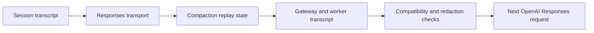

Codex review: needs maintainer review before merge. _Reviewed August 8, 2026, 2:50 PM ET / 18:50 UTC._

# ClawSweeper review

## What this changes

This PR persists opaque OpenAI Responses compaction state across compatible turns, worker transcripts, and Gateway restarts while removing it from public display and diagnostic payloads.

## Merge readiness

⚠️ **Ready for maintainer review - 4 items remain**

Keep this maintainer-owned PR open. The prior worker-replay omission blocker is repaired, but merge readiness still needs a maintainer decision on exact-head external-provider proof and the required direct Codex source audit.

**Priority:** P1
**Reviewed head:** `d0510aed9c04614445638dc1ec361e20cda68cff`
**Owner decision:** Required. See [Decision needed](#decision-needed).

## Review scores

| Measure | Result | What it means |
|---|---|---|
| **Overall readiness** | 🦐 gold shrimp **(3/6)** | The patch has strong source and CI coverage, while independent exact-head external-provider and Codex-contract evidence remains incomplete. |
| **Proof confidence** | 🦐 gold shrimp **(3/6)** | Not applicable: This maintainer-authored PR is exempt from the external-contributor proof gate, but its supplied paid live runs predate the final head and do not replace the required exact-head external-contract validation. |
| **Patch quality** | 🐚 platinum hermit **(4/6)** | No actionable review findings were identified. |

## Verification

| Check | Result | Evidence |
|---|---|---|
| **Real behavior** | Not applicable | Not applicable: This maintainer-authored PR is exempt from the external-contributor proof gate, but its supplied paid live runs predate the final head and do not replace the required exact-head external-contract validation. |
| **Evidence reviewed** | 5 items | Prior finding repaired: Both worker launch and terminal projection paths now report whole-replay omission through redacted payload.large diagnostics while preserving inference success; focused tests cover the launch and terminal paths. Worker boundary: Replay projection checks raw replay size and the complete transcript-commit frame before retaining the optional replay field, preventing oversized ciphertext from invalidating a worker frame. Persistence and privacy boundary: Transcript sanitization retains only route-fenced valid OpenAI Responses replay state, while public transcript updates strip providerReplay before delivery. |
| **Findings** | None | None. |
| **Security** | None | None. |

## How this fits together

Responses transports convert session transcripts into provider requests, then Gateway and worker paths persist the resulting messages. The PR carries provider-owned compaction state through that flow so compatible future requests can resume server-compressed history without exposing ciphertext to users.

## Decision needed

| Question | Recommendation |
|---|---|
| Should this maintainer-owned replay change be rebased and held for direct Codex-source and exact-head authenticated Responses proof before merge? | **Rebase and reprove:** Refresh against current main, inspect the sibling Codex contract directly, and record an exact-head authenticated Responses compaction/restart result before merge. |

Why: The patch is source-coherent, but repository policy requires direct Codex inspection for this Codex-backed behavior and the available live proof predates the final head.

## Before merge

- [ ] **Resolve merge risk (P1)** - The branch is behind current main; GitHub reports it cleanly mergeable, but the merged result still needs an exact-head rebase/refresh review.
- [ ] **Resolve merge risk (P1)** - The direct Codex source audit and exact-head authenticated Responses restart proof are unavailable, leaving external contract and live-provider behavior unverified.
- [ ] **Complete next step (P2)** - A maintainer must decide whether the remaining direct-Codex and exact-head external-proof gap is closed before merge.

<strong>Agent review details</strong>

### Security

None.

### PR surface

Source +906, Tests +5219, Docs +152, Other +3. Total +6280 across 62 files.

View PR surface stats

| Area | Files | Added | Removed | Net |
|---|---:|---:|---:|---:|
| Source | 30 | 1189 | 283 | +906 |
| Tests | 27 | 5321 | 102 | +5219 |
| Docs | 3 | 221 | 69 | +152 |
| Config | 0 | 0 | 0 | 0 |
| Generated | 0 | 0 | 0 | 0 |
| Other | 2 | 5 | 2 | +3 |
| **Total** | **62** | **6736** | **456** | **+6280** |

### Review metrics

| Metric | Value | Why it matters |
|---|---|---|
| **Production and test delta** | production +1,193/-284; tests +5,322/-103; docs +221/-69 | The substantial production growth is tied to provider replay, persistence, retry attribution, frame safety, and redaction boundaries, so merge review should confirm those contracts together. |

### Stored data model

Persistent data-model change detected: `durable storage schema: packages/gateway-protocol/src/schema/worker-admission.test.ts`, `durable storage schema: packages/gateway-protocol/src/schema/worker-admission.ts`, `durable storage schema: packages/gateway-protocol/src/schema/worker-inference.ts`, `durable storage schema: src/gateway/worker-environments/inference-runtime.test.ts`, `durable storage schema: src/gateway/worker-environments/inference-runtime.ts`, `durable storage schema: src/gateway/worker-environments/inference-terminal-message.ts`, and 29 more. Confirm migration or upgrade compatibility proof before merge.

### Merge-risk options

**Maintainer options:**
1. **Refresh external proof before merge (recommended)**  
   Rebase the branch and obtain direct Codex-contract inspection plus an exact-head authenticated Responses compaction/restart trace.
2. **Accept the evidence gap**  
   A maintainer may merge based on the extensive source and CI evidence while explicitly accepting that the final head lacks independent live-provider proof.

### Technical review

Best possible solution:

Retain the transport-owned replay design, rebase onto current main, and merge only after direct Codex contract inspection plus exact-head authenticated compaction/restart evidence confirm the documented behavior.

Do we have a high-confidence way to reproduce the issue?

No live current-head reproduction was independently run in this read-only review; the added Gateway E2E and focused worker tests provide a clear source-level reproduction path.

Is this the best way to solve the issue?

Unclear for merge readiness: the owner boundary and prior-finding repair are sound in source, but direct Codex-contract inspection and exact-head external-provider proof remain required.

AGENTS.md: found and applied where relevant.

Codex review notes: model internal, reasoning high; reviewed against [82f6280fa86a](https://github.com/openclaw/openclaw/commit/82f6280fa86aff339c3d0a06b6e39b119182b4f0).

### Labels

Label changes:

- add `status: 👀 ready for maintainer look`: ClawSweeper has no concrete contributor-facing blocker left for this PR. Not applicable: This maintainer-authored PR is exempt from the external-contributor proof gate, but its supplied paid live runs predate the final head and do not replace the required exact-head external-contract validation.
- remove `status: ⏳ waiting on author`: Current PR status label is `status: 👀 ready for maintainer look`.

Label justifications:

- `P1`: A failure can silently lose authoritative context in long-running OpenAI Responses sessions.
- `merge-risk: 🚨 session-state`: The patch writes, retains, and replays opaque session state through Gateway and worker transcript boundaries.
- `merge-risk: 🚨 auth-provider`: Replay eligibility and recovery are fenced by provider route, model, session, and authentication identity.
- `rating: 🦐 gold shrimp`: Overall readiness is 🦐 gold shrimp; proof is 🦐 gold shrimp and patch quality is 🐚 platinum hermit.
- `status: 👀 ready for maintainer look`: ClawSweeper has no concrete contributor-facing blocker left for this PR. Not applicable: This maintainer-authored PR is exempt from the external-contributor proof gate, but its supplied paid live runs predate the final head and do not replace the required exact-head external-contract validation.

### Evidence

What I checked:

- **Prior finding repaired:** Both worker launch and terminal projection paths now report whole-replay omission through redacted payload.large diagnostics while preserving inference success; focused tests cover the launch and terminal paths. ([`src/gateway/worker-environments/inference-runtime.ts:771`](https://github.com/openclaw/openclaw/blob/d0510aed9c04/src/gateway/worker-environments/inference-runtime.ts#L771), [d0510aed9c04](https://github.com/openclaw/openclaw/commit/d0510aed9c04))
- **Worker boundary:** Replay projection checks raw replay size and the complete transcript-commit frame before retaining the optional replay field, preventing oversized ciphertext from invalidating a worker frame. ([`src/worker/transcript-message.ts:47`](https://github.com/openclaw/openclaw/blob/d0510aed9c04/src/worker/transcript-message.ts#L47), [d0510aed9c04](https://github.com/openclaw/openclaw/commit/d0510aed9c04))
- **Persistence and privacy boundary:** Transcript sanitization retains only route-fenced valid OpenAI Responses replay state, while public transcript updates strip providerReplay before delivery. ([`src/agents/transcript-redact.ts:280`](https://github.com/openclaw/openclaw/blob/d0510aed9c04/src/agents/transcript-redact.ts#L280), [d0510aed9c04](https://github.com/openclaw/openclaw/commit/d0510aed9c04))
- **Current-main necessity:** Current main 82f6280fa86aff339c3d0a06b6e39b119182b4f0 does not contain the new compaction replay symbols, so the central behavior is not already implemented or released. ([`packages/ai/src/transports/openai-responses-compaction-replay.ts:30`](https://github.com/openclaw/openclaw/blob/d0510aed9c04/packages/ai/src/transports/openai-responses-compaction-replay.ts#L30), [d0510aed9c04](https://github.com/openclaw/openclaw/commit/d0510aed9c04))
- **Codex contract gap:** The required sibling ../codex checkout was absent and network resolution prevented obtaining it, so the direct Codex compaction/catalog contract was not independently verified.

Likely related people:

- **steipete:** All supplied commits for the replay repair, including the latest persistence-boundary hardening, are attributed to steipete; related current-main transport history also points to this area. (role: recent area contributor; confidence: high; commits: [f536c07ba8fb](https://github.com/openclaw/openclaw/commit/f536c07ba8fbe1217a0d9e52b1cc9bbfdfe218f8), [e2179acd8f81](https://github.com/openclaw/openclaw/commit/e2179acd8f81160bc799783954fbd3e17299b417), [d0510aed9c04](https://github.com/openclaw/openclaw/commit/d0510aed9c04614445638dc1ec361e20cda68cff); files: `packages/ai/src/transports/openai-responses-compaction-replay.ts`, `src/worker/transcript-message.ts`)

### Rank-up moves

Optional improvements that raise the rating; they are not merge blockers.

- Rebase onto current main and repeat the authenticated compaction/restart proof on that head.
- Inspect the matching sibling Codex source before making a merge or proof-sufficiency decision.

### Rating scale

| Score | Internal tier | Crab rank | Meaning |
|---:|:---:|---|---|
| **6/6** | S | 🦀 challenger crab | Exceptional readiness |
| **5/6** | A | 🦞 diamond lobster | Very strong readiness |
| **4/6** | B | 🐚 platinum hermit | Good normal PR; ordinary maintainer review |
| **3/6** | C | 🦐 gold shrimp | Useful, but confidence is limited |
| **2/6** | D | 🦪 silver shellfish | Proof or implementation needs work |
| **1/6** | F | 🧂 unranked krab | Not merge-ready |
| N/A | NA | 🌊 off-meta tidepool | Rating does not apply |

Overall follows the weaker of proof and patch quality.
Shiny media proof means a screenshot, video, or linked artifact directly shows the changed behavior. Runtime, network, CSP, and security claims still need visible diagnostics.

### Workflow

- ClawSweeper keeps one durable marker-backed review comment per issue or PR.
- Re-runs edit this comment so the latest verdict, findings, and automation markers stay together instead of adding duplicate bot comments.
- A fresh review can be triggered by eligible `@clawsweeper re-review` comments, exact-item GitHub events, scheduled/background review runs, or manual workflow dispatch.
- PR/issue authors and users with repository write access can comment `@clawsweeper re-review` or `@clawsweeper re-run` on an open PR or issue to request a fresh review only.
- Maintainers can also comment `@clawsweeper review` to request a fresh review only.
- Fresh-review commands do not start repair, autofix, rebase, CI repair, or automerge.
- Maintainer-only repair and merge flows require explicit commands such as `@clawsweeper autofix`, `@clawsweeper automerge`, `@clawsweeper fix ci`, or `@clawsweeper address review`.
- Maintainers can comment `@clawsweeper explain` to ask for more context, or `@clawsweeper stop` to stop active automation.

### History

Review history (7 earlier review cycles)

<!-- clawsweeper-review-history v=1 total=7 -->
- reviewed 2026-08-08T04:48:39.525Z sha 5fc5d69ea8da100c4c78b49846b7c371f15e7896 :: found issues before merge. :: [P2] Invalidate rejected persisted compaction state
- reviewed 2026-08-08T05:50:07.237Z sha f414883730d9a7d4e7433f1ae954779613868929 :: needs changes before merge. :: [P2] Fence suppression tombstones by replay identity
- reviewed 2026-08-08T07:42:37.243Z sha f3c09a778c2a9e85fd7bebbce29982ade8a9363e :: found issues before merge. :: [P2] Fence suppression tombstones by replay identity | [P2] Avoid tombstoning compaction after an ambiguous encrypted retry
- reviewed 2026-08-08T13:48:34.072Z sha 3e6cd3bc34b916b42f4559b71773ed08184b75b6 :: needs changes before merge. :: [P2] Persist suppression only after retry recovery
- reviewed 2026-08-08T15:47:27.155Z sha 20244ef40dc1ebdc91c70d9dee900529548b9ed0 :: found issues before merge. :: [P1] Recover rejected compaction on ChatGPT transports
- reviewed 2026-08-08T16:42:37.134Z sha 85fc0f4fad493e350e0e8400753af625e408060f :: found issues before merge. :: [P1] Route canonical Azure Responses through staged recovery
- reviewed 2026-08-08T18:41:58.764Z sha d0510aed9c04614445638dc1ec361e20cda68cff :: needs changes before merge. :: [P2] Report embedded-worker replay omissions

<!-- clawsweeper-verdict:needs-human item=120457 sha=d0510aed9c04614445638dc1ec361e20cda68cff confidence=high updated_at=2026-08-08T18:45:17Z reviewed_at=2026-08-08T18:50:07.958Z lease_owner=github-run-31272669183-1 lease_comment_id=5227572108 source_revision=a50739a78e5147ea2de13588ee03290fd1ce2808e228ab9a09117515ea4f69b8 -->

<!-- clawsweeper-review-version item=120457 reviewed_at=2026-08-08T18:50:07.958Z sha=d0510aed9c04614445638dc1ec361e20cda68cff source_revision=a50739a78e5147ea2de13588ee03290fd1ce2808e228ab9a09117515ea4f69b8 lease_owner=github-run-31272669183-1 lease_comment_id=5227572108 v=1 -->

<!-- clawsweeper-review item=120457 -->