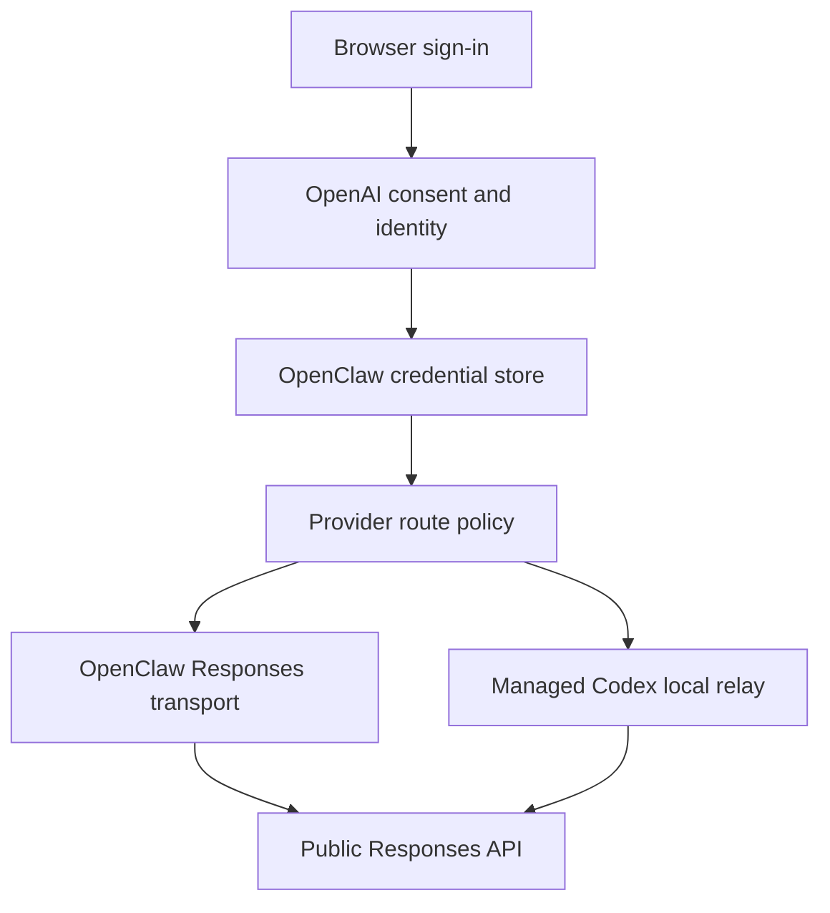

Codex review: needs real behavior proof before merge. _Reviewed September 14, 2026, 6:28 PM ET / 22:28 UTC._

# ClawSweeper review

## What this changes

Adds ChatGPT token-sharing sign-in, provider-owned credential routing, and a host-managed Responses relay for Codex while preserving separate API-key and Codex subscription choices.

## Merge readiness

⛔ **Blocked before merge - 9 items remain**

Keep open as a meaningful preview that current main does not provide. The contributor clearly documents the simulated evidence and outstanding prerequisites; neither closure nor merge readiness is supported.

**Priority:** P2
**Reviewed head:** `d018af44a1bb4f5c7e7fb5a09e2f1442809760f9`
**Owner decision:** Required. See [Decision needed](#decision-needed).

## Review scores

| Measure | Result | What it means |
|---|---|---|
| **Overall readiness** | 🦐 gold shrimp **(3/6)** | The patch has coherent ownership and useful partial evidence, but live integration and authority-boundary coverage remain incomplete. |
| **Proof confidence** | 🦐 gold shrimp **(3/6)** | Needs stronger real behavior proof before merge: Authority-chain proof required: inspected screenshots establish both callback messages under signed fixtures, and the body reports native Codex wire-contract success against a simulated upstream. Neither establishes approved OpenAI sign-in, refresh, and allowance use or composed rejection before inference for withdrawn/reassigned credentials and stale turns. These are explicitly acknowledged coverage gaps, independent of the video inspection limitation. After adding proof, update the PR body; ClawSweeper should re-review automatically. If it does not, the PR author or someone with repository write access can comment `@clawsweeper re-review`. |
| **Patch quality** | 🦐 gold shrimp **(3/6)** | Security review found an item that needs attention. |

## Verification

| Check | Result | Evidence |
|---|---|---|
| **Real behavior** | Needs proof | Needs stronger real behavior proof before merge: Authority-chain proof required: inspected screenshots establish both callback messages under signed fixtures, and the body reports native Codex wire-contract success against a simulated upstream. Neither establishes approved OpenAI sign-in, refresh, and allowance use or composed rejection before inference for withdrawn/reassigned credentials and stale turns. These are explicitly acknowledged coverage gaps, independent of the video inspection limitation. After adding proof, update the PR body; ClawSweeper should re-review automatically. If it does not, the PR author or someone with repository write access can comment `@clawsweeper re-review`. |
| **Evidence reviewed** | 10 items | Introduced scope verified: The local merge-base-to-head comparison recovers all 99 introduced paths, including those omitted from the supplied file list. The checkout matches the pinned original head; endpoint drift was not treated as PR-owned work. Diff whitespace checks passed. Current-main necessity: Current main’s provider contract offers OAuth, device-code, and API-key methods without token sharing. Searches of current OpenAI source and docs found neither new grant marker. The bounded GitHub title search returned this PR alone, establishing no canonical replacement. Registration remains deliberately disabled: The production client ID is unset, and login rejects before opening the browser without it. The captured PR body explicitly states that approved registration, real consent, inference, refresh, and allowance charging remain unverified. No release implementation is established; inspection of the supplied latest-release tag could not retrieve its source object. |
| **Findings** | None | None. |
| **Security** | Needs attention | Complete final-effect authority proof: The source rechecks authority before network I/O, but supplied rejection tests mock the credential owner and transport. Demonstrate that an identity-only or reassigned profile, withdrawn sharing, and retired turn generation cannot send inference through the real composed boundary, including a 401 refresh retry. |

## How this fits together

The OpenAI plugin turns sign-in results into credentials managed by OpenClaw’s existing auth store. Agent execution selects an eligible endpoint; managed Codex requests pass through a local relay that supplies the selected bearer before sending inference to OpenAI.

## Decision needed

| Question | Recommendation |
|---|---|
| Should OpenClaw sponsor this bundled token-sharing preview and its provider-policy SDK expansion, contingent on approved registration and production proof? | **Sponsor the gated preview:** Retain the draft while provider, SDK, and security owners settle the contract and approved-client evidence. |

Why: The new grant family, supported SDK contract, and OpenAI registration require explicit product and owner acceptance that source review cannot supply.

## Before merge

- [ ] **Add real behavior proof** - Needs stronger real behavior proof before merge: Authority-chain proof required: inspected screenshots establish both callback messages under signed fixtures, and the body reports native Codex wire-contract success against a simulated upstream. Neither establishes approved OpenAI sign-in, refresh, and allowance use or composed rejection before inference for withdrawn/reassigned credentials and stale turns. These are explicitly acknowledged coverage gaps, independent of the video inspection limitation. After adding proof, update the PR body; ClawSweeper should re-review automatically. If it does not, the PR author or someone with repository write access can comment `@clawsweeper re-review`.
- [ ] **Resolve security concern: Complete final-effect authority proof** - The source rechecks authority before network I/O, but supplied rejection tests mock the credential owner and transport. Demonstrate that an identity-only or reassigned profile, withdrawn sharing, and retired turn generation cannot send inference through the real composed boundary, including a 401 refresh retry.
- [ ] **Resolve merge risk (P1)** - The new sign-in choice currently terminates at the deliberately unset client ID; production registration and allowance behavior remain unverified.
- [ ] **Resolve merge risk (P1)** - The new provider-policy contract replaces shared credential eligibility logic, but supported SDK semantics and fresh-install versus existing-profile compatibility have not been accepted and fully demonstrated.
- [ ] **Resolve merge risk (P1)** - Mocked rejection tests do not establish that withdrawn consent, profile reassignment, or stale turn admission blocks physical inference after refresh in the composed production path.
- [ ] **Complete next step (P2)** - Keep the preview unmerged until owners accept the contract and approved-client, authority, and upgrade proof is supplied. Redact tokens, IP addresses, private endpoints, and personal data; attach required visible-flow screenshots and update the PR body to trigger review, or ask a maintainer for @clawsweeper re-review if needed.
- [ ] **Resolve maintainer decision** - Resolve the maintainer decision shown above before merge.
- [ ] **Review config compatibility** - Confirm compatibility and upgrade impact for the changed config or default surface before merge.
- [ ] **Add data-model compatibility proof** - Confirm migration or upgrade compatibility proof before merge.

## Findings

- [medium] Complete final-effect authority proof — `extensions/codex/src/app-server/inference-proxy.ts:177`

<strong>Agent review details</strong>

### Security

Needs attention: No concrete bypass or supply-chain defect was established, but the new bearer boundary needs composed revocation proof and security-owner involvement.

### PR surface

PR surface statistics unavailable: the file list is incomplete.

### Review metrics

| Metric | Value | Why it matters |
|---|---|---|
| **Credential contract** | 1 sign-in method and 1 provider-policy hook added | The preview introduces both a user choice and a supported routing contract requiring explicit acceptance. |
| **Production versus tests** | Production net +1,388; tests net +1,264 | The body justifies production growth through consent, grant routing, and the existing relay’s bearer boundary. |

### Stored data model

Persistent data-model change detected: `unknown-truncated-pull-files`. Confirm migration or upgrade compatibility proof before merge.

### Merge-risk options

**Maintainer options:**
1. **Hold the preview at its declared prerequisites (recommended)**  
   Keep the draft unmerged until registration, SDK acceptance, existing-profile compatibility, and final-effect authorization proof are complete.
2. **Establish the supported contract**  
   Document the provider-policy hook and refresh exports, then demonstrate unchanged API-key and Codex subscription behavior alongside the new grant.

### Technical review

Best possible solution:

Keep consent and refresh with their existing owners, establish a documented SDK contract, and enable the preview only with approved-client, authority-boundary, and existing-profile compatibility proof.

Do we have a high-confidence way to reproduce the issue?

Not applicable: this adds a new sign-in capability rather than repairing an established failure; no definite introduced runtime defect was established.

Is this the best way to solve the issue?

Unclear. Provider-owned grant policy and reuse of the existing refresh owner are coherent, but SDK acceptance and real consent-to-inference evidence are needed to establish the complete solution.

AGENTS.md: found and applied where relevant.

Codex review notes: model internal, reasoning medium; reviewed against [1b0b0fd60cb1](https://github.com/openclaw/openclaw/commit/1b0b0fd60cb1b7341fe4395470219e8c91079638).

### Labels

Label justifications:

- `P2`: This is a bounded provider capability proposal without evidence of an urgent existing-user regression.
- `merge-risk: 🚨 compatibility`: A new SDK policy hook replaces shared credential classification and needs documented semantics plus existing-profile compatibility proof.
- `merge-risk: 🚨 security-boundary`: The host now supplies persisted OAuth authority to native inference, while composed revocation and reassignment rejection remains unproven.
- `rating: 🦐 gold shrimp`: Overall readiness is 🦐 gold shrimp; proof is 🦐 gold shrimp and patch quality is 🦐 gold shrimp.
- `status: 📣 needs proof`: The PR needs real behavior proof before ClawSweeper can clear the contributor ask. Needs stronger real behavior proof before merge: Authority-chain proof required: inspected screenshots establish both callback messages under signed fixtures, and the body reports native Codex wire-contract success against a simulated upstream. Neither establishes approved OpenAI sign-in, refresh, and allowance use or composed rejection before inference for withdrawn/reassigned credentials and stale turns. These are explicitly acknowledged coverage gaps, independent of the video inspection limitation. After adding proof, update the PR body; ClawSweeper should re-review automatically. If it does not, the PR author or someone with repository write access can comment `@clawsweeper re-review`.
- `proof: 📸 screenshot`: Contributor real behavior proof includes screenshot evidence. Authority-chain proof required: inspected screenshots establish both callback messages under signed fixtures, and the body reports native Codex wire-contract success against a simulated upstream. Neither establishes approved OpenAI sign-in, refresh, and allowance use or composed rejection before inference for withdrawn/reassigned credentials and stale turns. These are explicitly acknowledged coverage gaps, independent of the video inspection limitation.

### Evidence

Security concerns:

- [medium] Complete final-effect authority proof — `extensions/codex/src/app-server/inference-proxy.ts:177`
  The source rechecks authority before network I/O, but supplied rejection tests mock the credential owner and transport. Demonstrate that an identity-only or reassigned profile, withdrawn sharing, and retired turn generation cannot send inference through the real composed boundary, including a 401 refresh retry.
  Confidence: 0.9

What I checked:

- **Introduced scope verified:** The local merge-base-to-head comparison recovers all 99 introduced paths, including those omitted from the supplied file list. The checkout matches the pinned original head; endpoint drift was not treated as PR-owned work. Diff whitespace checks passed. ([d018af44a1bb](https://github.com/openclaw/openclaw/commit/d018af44a1bb4f5c7e7fb5a09e2f1442809760f9))
- **Current-main necessity:** Current main’s provider contract offers OAuth, device-code, and API-key methods without token sharing. Searches of current OpenAI source and docs found neither new grant marker. The bounded GitHub title search returned this PR alone, establishing no canonical replacement. ([`extensions/openai/provider-contract-api.ts:75`](https://github.com/openclaw/openclaw/blob/1b0b0fd60cb1b7341fe4395470219e8c91079638/extensions/openai/provider-contract-api.ts#L75), [1b0b0fd60cb1](https://github.com/openclaw/openclaw/commit/1b0b0fd60cb1b7341fe4395470219e8c91079638))
- **Registration remains deliberately disabled:** The production client ID is unset, and login rejects before opening the browser without it. The captured PR body explicitly states that approved registration, real consent, inference, refresh, and allowance charging remain unverified. No release implementation is established; inspection of the supplied latest-release tag could not retrieve its source object. ([`extensions/openai/token-sharing.ts:12`](https://github.com/openclaw/openclaw/blob/d018af44a1bb4f5c7e7fb5a09e2f1442809760f9/extensions/openai/token-sharing.ts#L12), [d018af44a1bb](https://github.com/openclaw/openclaw/commit/d018af44a1bb4f5c7e7fb5a09e2f1442809760f9))
- **Inspected callback proof:** Both downloaded screenshots visibly show the production callback’s sharing-granted and identity-only messages. They support those visible outcomes under signed fixtures, not real OpenAI consent or inference. Video preparation failed with 'ffprobe failed: spawnSync ffprobe ENOENT'; the fallback attachment open returned 'Cache miss'. This reviewer-side video limitation does not negate the inspected screenshots. Assessment preserves the supplied context revision 9e07c3533f8785cb2f4991b3486f1afe6c18cbff7e5f7a7f8544505f3324b13e. ([d018af44a1bb](https://github.com/openclaw/openclaw/commit/d018af44a1bb4f5c7e7fb5a09e2f1442809760f9))
- **Authority checks and proof boundary:** The relay restricts OAuth to public Responses, strips native account/project headers, and rechecks admitted-turn and credential authority through beforeRequest. Credential tests cover deletion, sharing withdrawal, subject replacement, and pending refresh generations; relay rejection tests mock transport and credential resolution, so the composed persistence-to-network rejection boundary remains unproven. ([`extensions/codex/src/app-server/inference-proxy.ts:153`](https://github.com/openclaw/openclaw/blob/d018af44a1bb4f5c7e7fb5a09e2f1442809760f9/extensions/codex/src/app-server/inference-proxy.ts#L153), [d018af44a1bb](https://github.com/openclaw/openclaw/commit/d018af44a1bb4f5c7e7fb5a09e2f1442809760f9))
- **Affirmative Codex dependency signal:** The branch creates a private native model provider and relies on native HTTP Responses and automatic local summarization. The PR additionally claims a Codex 0.154.0 simulated-upstream run; these are explicit dependency-contract signals requiring direct Codex inspection. ([`extensions/codex/src/app-server/inference-routing.ts:264`](https://github.com/openclaw/openclaw/blob/d018af44a1bb4f5c7e7fb5a09e2f1442809760f9/extensions/codex/src/app-server/inference-routing.ts#L264), [d018af44a1bb](https://github.com/openclaw/openclaw/commit/d018af44a1bb4f5c7e7fb5a09e2f1442809760f9))

Likely related people:

- **steipete:** Suggested for follow-up; no historical authorship or introduction is verified. (role: unverified routing candidate; confidence: low)
- **obviyus:** Suggested for follow-up; no historical authorship or introduction is verified. (role: unverified routing candidate; confidence: low)

### Rank-up moves

Optional improvements that raise the rating; they are not merge blockers.

- Add approved-client CLI sign-in, consent, inference, refresh, and allowance evidence; include screenshots for visible flows and redacted logs or traces for runtime behavior.
- Prove allowed inference and rejection before physical I/O for withdrawn sharing, reassigned profiles, and retired turns, including refresh retries.
- Obtain SDK/security-owner acceptance, document the new contract, and complete relevant type, contract, and existing-profile upgrade checks.

### Rating scale

| Score | Internal tier | Crab rank | Meaning |
|---:|:---:|---|---|
| **6/6** | S | 🦀 challenger crab | Exceptional readiness |
| **5/6** | A | 🦞 diamond lobster | Very strong readiness |
| **4/6** | B | 🐚 platinum hermit | Good normal PR; ordinary maintainer review |
| **3/6** | C | 🦐 gold shrimp | Useful, but confidence is limited |
| **2/6** | D | 🦪 silver shellfish | Proof or implementation needs work |
| **1/6** | F | 🧂 unranked krab | Not merge-ready |
| N/A | NA | 🌊 off-meta tidepool | Rating does not apply |

Overall follows the weaker of proof and patch quality.
Shiny media proof means a screenshot, video, or linked artifact directly shows the changed behavior. Runtime, network, CSP, and security claims still need visible diagnostics.

### Workflow

- ClawSweeper keeps one durable marker-backed review comment per issue or PR.
- Re-runs edit this comment so the latest verdict, findings, and automation markers stay together instead of adding duplicate bot comments.
- A fresh review can be triggered by eligible `@clawsweeper re-review` comments, exact-item GitHub events, scheduled/background review runs, or manual workflow dispatch.
- PR/issue authors and users with repository write access can comment `@clawsweeper re-review` or `@clawsweeper re-run` on an open PR or issue to request a fresh review only.
- Maintainers can also comment `@clawsweeper review` to request a fresh review only.
- Fresh-review commands do not start repair, autofix, rebase, CI repair, or automerge.
- Maintainer-only repair and merge flows require explicit commands such as `@clawsweeper autofix`, `@clawsweeper automerge`, `@clawsweeper fix ci`, or `@clawsweeper address review`.
- Maintainers can comment `@clawsweeper explain` to ask for more context, or `@clawsweeper stop` to stop active automation.

<!-- clawsweeper-security:security-sensitive item=148567 sha=d018af44a1bb4f5c7e7fb5a09e2f1442809760f9 confidence=high updated_at=2026-09-14T22:23:55Z reviewed_at=2026-09-14T22:28:49.349Z lease_owner=github-run-34903744930-1 lease_comment_id=5671631501 source_revision=9e07c3533f8785cb2f4991b3486f1afe6c18cbff7e5f7a7f8544505f3324b13e live_verification=absent -->
<!-- clawsweeper-verdict:needs-human item=148567 sha=d018af44a1bb4f5c7e7fb5a09e2f1442809760f9 confidence=high updated_at=2026-09-14T22:23:55Z reviewed_at=2026-09-14T22:28:49.349Z lease_owner=github-run-34903744930-1 lease_comment_id=5671631501 source_revision=9e07c3533f8785cb2f4991b3486f1afe6c18cbff7e5f7a7f8544505f3324b13e live_verification=absent -->
<!-- clawsweeper-review-state:blocked item=148567 sha=d018af44a1bb4f5c7e7fb5a09e2f1442809760f9 v=1 -->

<!-- clawsweeper-review-version item=148567 reviewed_at=2026-09-14T22:28:49.349Z sha=d018af44a1bb4f5c7e7fb5a09e2f1442809760f9 source_revision=9e07c3533f8785cb2f4991b3486f1afe6c18cbff7e5f7a7f8544505f3324b13e lease_owner=github-run-34903744930-1 lease_comment_id=5671631501 v=1 -->

<!-- clawsweeper-review item=148567 -->