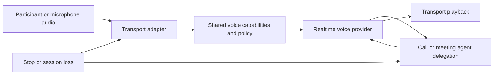

Codex review: blocked before merge. _Reviewed September 12, 2026, 7:46 PM ET / 23:46 UTC (Revision 3)._

# ClawSweeper review

## What this changes

Shares GPT Live provider selection, delegation, and interruption handling across meetings, phone calls, and Talk, while separating managed meeting input from assistant audio and preserving explicit capture commands.

## Merge readiness

⛔ **Blocked before merge - 4 items remain**

The previous custom-input blocker is fixed, and no new blocking defect was found. This PR still provides meaningful meeting, phone-call, and Talk behavior beyond the merged Discord work.

**Priority:** P2
**Reviewed head:** `3306dcd799f5a30bf829bb5f3e20accc3dc345cd`

## Review scores

| Measure | Result | What it means |
|---|---|---|
| **Overall readiness** | 🐚 platinum hermit **(4/6)** | The compatibility blocker is repaired, the shared implementation has meaningful regression coverage, and the reported live boundary proof supports normal mergeable quality. |
| **Proof confidence** | 🦞 diamond lobster **(5/6)** | Sufficient (live_output): The captured body reports production meeting-engine delegation through the real Live API and real Chromium/WebRTC isolation under restrictive CSP. These support the shared provider and browser boundaries; actual meeting-room audibility and Apple acoustics remain explicitly outside that proof. |
| **Patch quality** | 🐚 platinum hermit **(4/6)** | No actionable review findings were identified. |

## Verification

| Check | Result | Evidence |
|---|---|---|
| **Real behavior** | Verified | Sufficient (live_output): The captured body reports production meeting-engine delegation through the real Live API and real Chromium/WebRTC isolation under restrictive CSP. These support the shared provider and browser boundaries; actual meeting-room audibility and Apple acoustics remain explicitly outside that proof. |
| **Evidence reviewed** | 9 items | Previous finding resolved: The repair returns the native transport when an explicit input command exists. Both local and paired-node Chrome callers pass the normalized override flag. The GitHub commit patch confirms these changes were added after the previously reviewed head. Compatibility regression coverage: The 12-cell matrix checks provider-bound PCM across local/node, agent/bidi, and default/output-only/custom-input configurations. It exercises production launch, transport, and engine code with simulated browser, process, node, and provider boundaries; it is supplemental regression coverage, not an actual meeting-room run. Shipped input contract and documented upgrade behavior: The v2026.9.4 transport sends the configured input command into native capture. Current documentation explicitly preserves that provider-input behavior and explains that selecting Live requires managed isolated capture. |
| **Findings** | None | None. |
| **Security** | None | None. |

## How this fits together

OpenClaw’s realtime voice layer connects participant or microphone audio to voice providers and delegates requests to the configured agent. Meeting, telephone, browser, and Apple adapters retain responsibility for their audio transport and session cleanup.

## Before merge

- [ ] **Resolve merge risk (P1)** - Managed Chrome configurations now depend on browser playback capture; actual Meet, Teams, and Zoom rooms and physical virtual-device audibility remain unverified, so platform-specific capture failures could interrupt existing managed sessions.
- [ ] **Resolve merge risk (P1)** - Apple microphone echo and interruption behavior has source and regression coverage but no reported physical-device acoustic verification.
- [ ] **Review config compatibility** - Confirm compatibility and upgrade impact for the changed config or default surface before merge.
- [ ] **Add data-model compatibility proof** - Confirm migration or upgrade compatibility proof before merge.

<strong>Agent review details</strong>

### Security

None.

### PR surface

PR surface statistics unavailable: the file list is incomplete.

### Review metrics

| Metric | Value | Why it matters |
|---|---|---|
| **Production versus regression coverage** | Net production +957 lines; tests and test support +1,961 lines | Production growth has a stated purpose in browser audio isolation and shared voice lifecycle handling, with most added code devoted to regression coverage. |
| **Input compatibility matrix** | 12 routes across 2 hosts, 2 modes, and 3 input configurations | The matrix directly covers the previously reported custom-input regression and its default and output-only siblings. |

### Stored data model

Persistent data-model change detected: `unknown-truncated-pull-files`. Confirm migration or upgrade compatibility proof before merge.

### Merge-risk options

**Maintainer options:**
1. **Accept the documented boundary coverage (recommended)**  
   Use the existing live API, Chromium isolation, and configuration regression evidence while retaining the explicitly disclosed physical-platform limitations.
2. **Verify a deployed meeting setup**  
   Check participant input, remote audibility, interruption, and cleanup in a supported managed Chrome meeting before broad rollout.

### Technical review

Best possible solution:

Keep one shared capability and interruption policy, preserve explicit capture commands, and retain the documented deployment limits for managed capture and native audio.

Do we have a high-confidence way to reproduce the issue?

Not applicable to the feature request. The previous custom-input defect has a concrete regression matrix and is repaired in the reviewed source; this review did not execute tests.

Is this the best way to solve the issue?

Yes. Extending the existing voice owner and retaining transport-specific adapters avoids competing policy implementations, and the repair preserves the shipped explicit-input contract.

AGENTS.md: found and applied where relevant.

Codex review notes: model internal, reasoning medium; reviewed against [51caa9442e47](https://github.com/openclaw/openclaw/commit/51caa9442e47b91a88c8f382000e4bac0c7e6743).

### Labels

Label changes:

- add `rating: 🐚 platinum hermit`: Overall readiness is 🐚 platinum hermit; proof is 🦞 diamond lobster and patch quality is 🐚 platinum hermit.
- add `status: 👀 ready for maintainer look`: ClawSweeper has no concrete contributor-facing blocker left for this PR. Sufficient (live_output): The captured body reports production meeting-engine delegation through the real Live API and real Chromium/WebRTC isolation under restrictive CSP. These support the shared provider and browser boundaries; actual meeting-room audibility and Apple acoustics remain explicitly outside that proof.
- remove `rating: 🦐 gold shrimp`: Current PR rating is `rating: 🐚 platinum hermit`, so this older rating label is no longer current.
- remove `status: ⏳ waiting on author`: Current PR status label is `status: 👀 ready for maintainer look`.

Label justifications:

- `P2`: This is a bounded voice capability improvement with preserved provider defaults and no demonstrated urgent production outage.
- `merge-risk: 🚨 compatibility`: Managed meeting input changes its capture path, and shared SDK capability behavior reaches multiple consumers despite the repaired custom-input contract.
- `rating: 🐚 platinum hermit`: Overall readiness is 🐚 platinum hermit; proof is 🦞 diamond lobster and patch quality is 🐚 platinum hermit.
- `status: 👀 ready for maintainer look`: ClawSweeper has no concrete contributor-facing blocker left for this PR. Sufficient (live_output): The captured body reports production meeting-engine delegation through the real Live API and real Chromium/WebRTC isolation under restrictive CSP. These support the shared provider and browser boundaries; actual meeting-room audibility and Apple acoustics remain explicitly outside that proof.
- `proof: sufficient`: Contributor real behavior proof is sufficient. The captured body reports production meeting-engine delegation through the real Live API and real Chromium/WebRTC isolation under restrictive CSP. These support the shared provider and browser boundaries; actual meeting-room audibility and Apple acoustics remain explicitly outside that proof.

### Evidence

What I checked:

- **Previous finding resolved:** The repair returns the native transport when an explicit input command exists. Both local and paired-node Chrome callers pass the normalized override flag. The GitHub commit patch confirms these changes were added after the previously reviewed head. ([`src/meeting-bot/realtime-browser-audio-transport.ts:25`](https://github.com/openclaw/openclaw/blob/3306dcd799f5a30bf829bb5f3e20accc3dc345cd/src/meeting-bot/realtime-browser-audio-transport.ts#L25), [3306dcd799f5](https://github.com/openclaw/openclaw/commit/3306dcd799f5a30bf829bb5f3e20accc3dc345cd))
- **Compatibility regression coverage:** The 12-cell matrix checks provider-bound PCM across local/node, agent/bidi, and default/output-only/custom-input configurations. It exercises production launch, transport, and engine code with simulated browser, process, node, and provider boundaries; it is supplemental regression coverage, not an actual meeting-room run. ([`src/meeting-bot/chrome-transport.test.ts:365`](https://github.com/openclaw/openclaw/blob/3306dcd799f5a30bf829bb5f3e20accc3dc345cd/src/meeting-bot/chrome-transport.test.ts#L365), [3306dcd799f5](https://github.com/openclaw/openclaw/commit/3306dcd799f5a30bf829bb5f3e20accc3dc345cd))
- **Shipped input contract and documented upgrade behavior:** The v2026.9.4 transport sends the configured input command into native capture. Current documentation explicitly preserves that provider-input behavior and explains that selecting Live requires managed isolated capture. Public docs: [`docs/plugins/meeting-plugins.md`](https://docs.openclaw.ai/plugins/meeting-plugins). ([`docs/plugins/meeting-plugins.md:139`](https://docs.openclaw.ai/plugins/meeting-plugins), [3306dcd799f5](https://github.com/openclaw/openclaw/commit/3306dcd799f5a30bf829bb5f3e20accc3dc345cd))
- **Still necessary on current main:** The fetched main meeting engine still creates its bridge with function tools and lacks the proposed native consult wiring. https://github.com/openclaw/openclaw/pull/146289 is verified merged, but its Discord implementation does not supersede this cross-surface work. ([`src/meeting-bot/realtime-engine.ts:492`](https://github.com/openclaw/openclaw/blob/51caa9442e47b91a88c8f382000e4bac0c7e6743/src/meeting-bot/realtime-engine.ts#L492), [51caa9442e47](https://github.com/openclaw/openclaw/commit/51caa9442e47b91a88c8f382000e4bac0c7e6743))
- **Live evidence and its scope:** The captured PR body reports real GPT Live delegation with 120,000 PCM bytes and zero suppressed input bytes, plus real Chromium/WebRTC isolation under restrictive CSP with approximately 61.7 dB local-microphone rejection. The live test invokes the production meeting engine and provider with a synthetic consult response. The body explicitly excludes actual meeting rooms, physical-device audibility, and Apple acoustics; these observations were not rerun during this read-only review. ([`extensions/openai/realtime-meeting.live.test.ts:69`](https://github.com/openclaw/openclaw/blob/3306dcd799f5a30bf829bb5f3e20accc3dc345cd/extensions/openai/realtime-meeting.live.test.ts#L69), [3306dcd799f5](https://github.com/openclaw/openclaw/commit/3306dcd799f5a30bf829bb5f3e20accc3dc345cd))
- **Delegation ownership and cancellation:** Meeting delegation retains configured toolsAllow and meeting cancellation through the existing consult owner. Voice Call checks active bridge ownership after transcript persistence and before consultation; its regression covers completion, cancellation, closure, disabled tools, and late delegation. ([`extensions/voice-call/src/webhook/realtime-handler.delegation.test.ts:10`](https://github.com/openclaw/openclaw/blob/3306dcd799f5a30bf829bb5f3e20accc3dc345cd/extensions/voice-call/src/webhook/realtime-handler.delegation.test.ts#L10), [3306dcd799f5](https://github.com/openclaw/openclaw/commit/3306dcd799f5a30bf829bb5f3e20accc3dc345cd))

Likely related people:

- **steipete:** Suggested for follow-up; no historical authorship or introduction is verified. (role: unverified routing candidate; confidence: low)
- **unknown:** The claimed source-line change could not be verified from bounded local history. (role: source history unknown; confidence: low)

### Rank-up moves

Optional improvements that raise the rating; they are not merge blockers.

- A supported managed meeting run confirming participant input and remote audibility would reduce the remaining deployment risk.

### Rating scale

| Score | Internal tier | Crab rank | Meaning |
|---:|:---:|---|---|
| **6/6** | S | 🦀 challenger crab | Exceptional readiness |
| **5/6** | A | 🦞 diamond lobster | Very strong readiness |
| **4/6** | B | 🐚 platinum hermit | Good normal PR; ordinary maintainer review |
| **3/6** | C | 🦐 gold shrimp | Useful, but confidence is limited |
| **2/6** | D | 🦪 silver shellfish | Proof or implementation needs work |
| **1/6** | F | 🧂 unranked krab | Not merge-ready |
| N/A | NA | 🌊 off-meta tidepool | Rating does not apply |

Overall follows the weaker of proof and patch quality.
Shiny media proof means a screenshot, video, or linked artifact directly shows the changed behavior. Runtime, network, CSP, and security claims still need visible diagnostics.

### Workflow

- ClawSweeper keeps one durable marker-backed review comment per issue or PR.
- Re-runs edit this comment so the latest verdict, findings, and automation markers stay together instead of adding duplicate bot comments.
- A fresh review can be triggered by eligible `@clawsweeper re-review` comments, exact-item GitHub events, scheduled/background review runs, or manual workflow dispatch.
- PR/issue authors and users with repository write access can comment `@clawsweeper re-review` or `@clawsweeper re-run` on an open PR or issue to request a fresh review only.
- Maintainers can also comment `@clawsweeper review` to request a fresh review only.
- Fresh-review commands do not start repair, autofix, rebase, CI repair, or automerge.
- Maintainer-only repair and merge flows require explicit commands such as `@clawsweeper autofix`, `@clawsweeper automerge`, `@clawsweeper fix ci`, or `@clawsweeper address review`.
- Maintainers can comment `@clawsweeper explain` to ask for more context, or `@clawsweeper stop` to stop active automation.

### History

Review history (2 earlier review cycles)

<!-- clawsweeper-review-history v=1 total=2 -->
- reviewed 2026-09-12T23:05:01.816Z sha 1c1f09ef8a04526f2e7cd701ea59a61f745549ea :: blocked before merge. :: [P1] Preserve explicitly configured meeting input commands
- reviewed 2026-09-12T23:25:24.925Z sha 64e7023b28b1a30943623aaf2b6afe79cf83b7ba :: blocked before merge. :: [P1] [P1] Preserve explicitly configured meeting input commands

<!-- clawsweeper-verdict:needs-human item=146546 sha=3306dcd799f5a30bf829bb5f3e20accc3dc345cd confidence=high updated_at=2026-09-12T23:43:04Z reviewed_at=2026-09-12T23:46:42.574Z lease_owner=github-run-34726067068-1 lease_comment_id=5649462828 source_revision=286698fb586c2345dce0cb366eaff5601fa6826aaaaa813308fa542b160ee913 live_verification=absent -->
<!-- clawsweeper-review-state:blocked item=146546 sha=3306dcd799f5a30bf829bb5f3e20accc3dc345cd v=1 -->

<!-- clawsweeper-review-version item=146546 reviewed_at=2026-09-12T23:46:42.574Z sha=3306dcd799f5a30bf829bb5f3e20accc3dc345cd source_revision=286698fb586c2345dce0cb366eaff5601fa6826aaaaa813308fa542b160ee913 lease_owner=github-run-34726067068-1 lease_comment_id=5649462828 v=1 -->

<!-- clawsweeper-review item=146546 -->