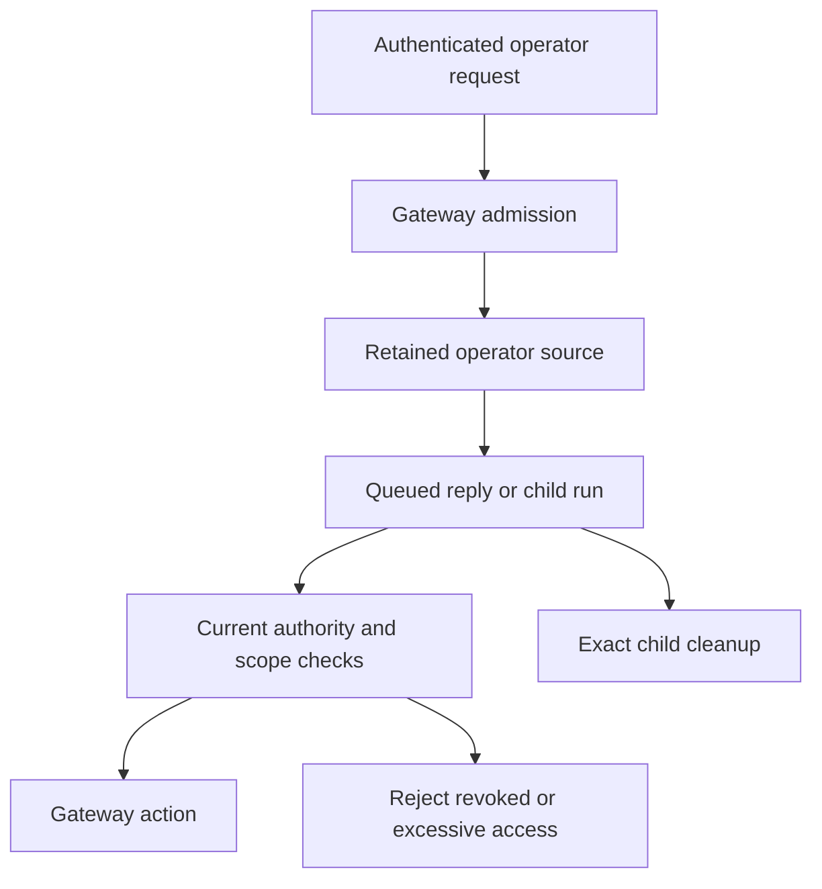

Codex review: blocked before merge. _Reviewed September 21, 2026, 1:29 AM ET / 05:29 UTC (Revision 7)._

# ClawSweeper review

## What this changes

Preserves the initiating operator’s permissions and revocation checks through queued replies, child runs, later Gateway actions, and failed-spawn cleanup.

## Merge readiness

⛔ **Blocked before merge - 2 items remain**

This remains a useful, unmerged fix. The prior scoped-dispatch and steering findings are resolved; the previous generic config/default blocker is unsupported by the pinned diff. No new blocking defect was established.

**Priority:** P2
**Reviewed head:** `92630e8eaff2932d747920945807c8e2dad75424`

## Review scores

| Measure | Result | What it means |
|---|---|---|
| **Overall readiness** | 🐚 platinum hermit **(4/6)** | A coherent authority repair with meaningful positive and negative boundary coverage and resolved prior findings. |
| **Proof confidence** | 🐚 platinum hermit **(4/6)** ✨ media proof bonus | Sufficient (linked_artifact): The captured body reports remote before/after runs through registered Gateway admission and SDK dispatch, including denied writes and revoked-source rejection before worker-intent storage or provisioning. Inspected boundary coverage supports those claims and child cleanup settlement; no live deployment or reviewer execution is claimed. |
| **Patch quality** | 🐚 platinum hermit **(4/6)** | No actionable review findings were identified. |

## Verification

| Check | Result | Evidence |
|---|---|---|
| **Real behavior** | Verified | Sufficient (linked_artifact): The captured body reports remote before/after runs through registered Gateway admission and SDK dispatch, including denied writes and revoked-source rejection before worker-intent storage or provisioning. Inspected boundary coverage supports those claims and child cleanup settlement; no live deployment or reviewer execution is claimed. |
| **Evidence reviewed** | 10 items | Pinned introduction and live identity: Reviewed the merge-base-to-head changes. The raw test-merge record has the supplied base followed by the exact PR head as parents. REST inspection confirms the PR remains open, unmerged, assigned to shakkernerd, and at the reviewed head. Still necessary on main: Fetched main still uses the earlier admitted-run structure without the operator carrier, and its in-process dispatcher lacks the new retained-source composition. The new operator authority module is absent from both fetched main and v2026.9.5. No supplied related PR is a merged replacement. Scoped SDK finding resolved: Dispatch preserves a matching authenticated client and intersects its scopes with the retained source. Recapture preserves that narrower ceiling. Registered plugin SDK cases cover both intersection directions, reject unauthorized writes before their handler, and reject subsequent calls after original-source revocation. |
| **Findings** | None | None. |
| **Security** | None | None. |

## How this fits together

The Gateway authenticates operator requests and admits agent work that can outlive the original connection. This change carries that authorization source through queues and delegation so later actions retain the original permission ceiling.

## Before merge

- [ ] **Review config compatibility** - Confirm compatibility and upgrade impact for the changed config or default surface before merge.
- [ ] **Add data-model compatibility proof** - Confirm migration or upgrade compatibility proof before merge.

<strong>Agent review details</strong>

### Security

None.

### PR surface

PR surface statistics unavailable: the file list is incomplete.

### Review metrics

| Metric | Value | Why it matters |
|---|---|---|
| **Production versus regression coverage** | Production net +1,291 lines; tests and test support net +2,016 lines | The body justifies production growth through source custody across existing owners and explains the supporting owner-boundary extractions. |

### Stored data model

Persistent data-model change detected: `unknown-truncated-pull-files`. Confirm migration or upgrade compatibility proof before merge.

### Technical review

Best possible solution:

Keep authorization attached to its original source while queues, child lifetimes, and exact-target cleanup remain with their existing owners.

Do we have a high-confidence way to reproduce the issue?

Yes, through registered Gateway admission followed by tool dispatch after request completion; the supplied before/after results and current-main source establish the path. This read-only review did not execute it.

Is this the best way to solve the issue?

Yes. Carrying a host-issued source restriction through existing admission and dispatch owners addresses the lost-authority boundary while preserving narrower SDK permissions and bounded cleanup.

AGENTS.md: found and applied where relevant.

Codex review notes: model internal, reasoning medium; reviewed against [90a39a0547e8](https://github.com/openclaw/openclaw/commit/90a39a0547e833231a1419aa52716327a86bf777).

### Labels

Label justifications:

- `P2`: This repairs operator permission continuity in queued and delegated work without evidence of an active emergency.
- `rating: 🐚 platinum hermit`: Overall readiness is 🐚 platinum hermit; proof is 🐚 platinum hermit and patch quality is 🐚 platinum hermit.
- `status: 👀 ready for maintainer look`: ClawSweeper has no concrete contributor-facing blocker left for this PR. Sufficient (linked_artifact): The captured body reports remote before/after runs through registered Gateway admission and SDK dispatch, including denied writes and revoked-source rejection before worker-intent storage or provisioning. Inspected boundary coverage supports those claims and child cleanup settlement; no live deployment or reviewer execution is claimed.
- `proof: sufficient`: Contributor real behavior proof is sufficient. The captured body reports remote before/after runs through registered Gateway admission and SDK dispatch, including denied writes and revoked-source rejection before worker-intent storage or provisioning. Inspected boundary coverage supports those claims and child cleanup settlement; no live deployment or reviewer execution is claimed.

### Evidence

What I checked:

- **Pinned introduction and live identity:** Reviewed the merge-base-to-head changes. The raw test-merge record has the supplied base followed by the exact PR head as parents. REST inspection confirms the PR remains open, unmerged, assigned to shakkernerd, and at the reviewed head. ([92630e8eaff2](https://github.com/openclaw/openclaw/commit/92630e8eaff2932d747920945807c8e2dad75424))
- **Still necessary on main:** Fetched main still uses the earlier admitted-run structure without the operator carrier, and its in-process dispatcher lacks the new retained-source composition. The new operator authority module is absent from both fetched main and v2026.9.5. No supplied related PR is a merged replacement. ([`src/agents/admitted-run-context.ts:32`](https://github.com/openclaw/openclaw/blob/90a39a0547e833231a1419aa52716327a86bf777/src/agents/admitted-run-context.ts#L32), [90a39a0547e8](https://github.com/openclaw/openclaw/commit/90a39a0547e833231a1419aa52716327a86bf777))
- **Scoped SDK finding resolved:** Dispatch preserves a matching authenticated client and intersects its scopes with the retained source. Recapture preserves that narrower ceiling. Registered plugin SDK cases cover both intersection directions, reject unauthorized writes before their handler, and reject subsequent calls after original-source revocation. ([`src/gateway/server-plugin-in-process-dispatch.ts:399`](https://github.com/openclaw/openclaw/blob/92630e8eaff2932d747920945807c8e2dad75424/src/gateway/server-plugin-in-process-dispatch.ts#L399), [92630e8eaff2](https://github.com/openclaw/openclaw/commit/92630e8eaff2932d747920945807c8e2dad75424))
- **Steering finding resolved:** Compatibility uses profile, normalized scopes, and opaque original-source identity without including the signal identity. Queue and steering coverage accepts a fresh signal for the same source while separating different principals, scope ceilings, and sources. ([`src/auto-reply/reply/reply-tool-authority.ts:323`](https://github.com/openclaw/openclaw/blob/92630e8eaff2932d747920945807c8e2dad75424/src/auto-reply/reply/reply-tool-authority.ts#L323), [92630e8eaff2](https://github.com/openclaw/openclaw/commit/92630e8eaff2932d747920945807c8e2dad75424))
- **Authority proof and final effects:** The supplied body at sourceRevision 4768877a35fabddae3ced557ac64b69011e13af22d72143f2ad8548436de6d8f records before/after registered Gateway and SDK validation, including allowed controls and revoked-source denial. Source inspection corroborates the worker-preparation scenario: it uses registered dispatch, the actual service and SQLite, asserting no stored intent or provisioning call after revocation. The reported child-boundary results additionally cover delayed launch and cleanup before fixture teardown. These are contributor-reported remote executions, not executions performed by this review. ([`src/gateway/worker-environments/service-prepare.test.ts:253`](https://github.com/openclaw/openclaw/blob/92630e8eaff2932d747920945807c8e2dad75424/src/gateway/worker-environments/service-prepare.test.ts#L253), [92630e8eaff2](https://github.com/openclaw/openclaw/commit/92630e8eaff2932d747920945807c8e2dad75424))
- **Cleanup remains narrowly owned:** Failed-spawn cleanup uses the existing lifecycle dispatcher, permits only session deletion and chat abort, and checks the captured Gateway, child session identity, lifecycle revision, and accepted run. Rollback coverage checks terminal settlement and preservation of the parent session after source revocation. ([`src/agents/subagents/spawn/subagent-spawn-cleanup.ts:16`](https://github.com/openclaw/openclaw/blob/92630e8eaff2932d747920945807c8e2dad75424/src/agents/subagents/spawn/subagent-spawn-cleanup.ts#L16), [92630e8eaff2](https://github.com/openclaw/openclaw/commit/92630e8eaff2932d747920945807c8e2dad75424))

Likely related people:

- **shakkernerd:** Suggested for follow-up; no historical authorship or introduction is verified. (role: unverified routing candidate; confidence: low)
- **vincentkoc:** Suggested for follow-up; no historical authorship or introduction is verified. (role: unverified routing candidate; confidence: low)

### Rating scale

| Score | Internal tier | Crab rank | Meaning |
|---:|:---:|---|---|
| **6/6** | S | 🦀 challenger crab | Exceptional readiness |
| **5/6** | A | 🦞 diamond lobster | Very strong readiness |
| **4/6** | B | 🐚 platinum hermit | Good normal PR; ordinary maintainer review |
| **3/6** | C | 🦐 gold shrimp | Useful, but confidence is limited |
| **2/6** | D | 🦪 silver shellfish | Proof or implementation needs work |
| **1/6** | F | 🧂 unranked krab | Not merge-ready |
| N/A | NA | 🌊 off-meta tidepool | Rating does not apply |

Overall follows the weaker of proof and patch quality.
Shiny media proof means a screenshot, video, or linked artifact directly shows the changed behavior. Runtime, network, CSP, and security claims still need visible diagnostics.

### Workflow

- ClawSweeper keeps one durable marker-backed review comment per issue or PR.
- Re-runs edit this comment so the latest verdict, findings, and automation markers stay together instead of adding duplicate bot comments.
- A fresh review can be triggered by eligible `@clawsweeper re-review` comments, exact-item GitHub events, scheduled/background review runs, or manual workflow dispatch.
- PR/issue authors and users with repository write access can comment `@clawsweeper re-review` or `@clawsweeper re-run` on an open PR or issue to request a fresh review only.
- Maintainers can also comment `@clawsweeper review` to request a fresh review only.
- Fresh-review commands do not start repair, autofix, rebase, CI repair, or automerge.
- Maintainer-only repair and merge flows require explicit commands such as `@clawsweeper autofix`, `@clawsweeper automerge`, `@clawsweeper fix ci`, or `@clawsweeper address review`.
- Maintainers can comment `@clawsweeper explain` to ask for more context, or `@clawsweeper stop` to stop active automation.

### History

Review history (6 earlier review cycles)

<!-- clawsweeper-review-history v=1 total=6 -->
- reviewed 2026-09-20T19:48:21.233Z sha c73b316e5055ffce796e2b21b19596c67fac66e7 :: needs real behavior proof before merge. :: [P1] Preserve scoped SDK dispatch when retaining operator authority
- reviewed 2026-09-20T21:34:40.069Z sha c73b316e5055ffce796e2b21b19596c67fac66e7 :: needs real behavior proof before merge. :: [P1] Preserve scoped SDK dispatch when retaining operator authority
- reviewed 2026-09-20T22:28:03.820Z sha c73b316e5055ffce796e2b21b19596c67fac66e7 :: needs real behavior proof before merge. :: [P1] Preserve scoped SDK dispatch when retaining operator authority
- reviewed 2026-09-21T01:09:47.485Z sha c73b316e5055ffce796e2b21b19596c67fac66e7 :: needs real behavior proof before merge. :: [P1] Preserve scoped SDK dispatch when retaining operator authority
- reviewed 2026-09-21T02:54:50.643Z sha 7ad858a472908169550c31ce82a2c1a0f21c126e :: needs real behavior proof before merge. :: [P2] Treat a new signal on the same source as compatible steering
- reviewed 2026-09-21T04:29:57.896Z sha 92630e8eaff2932d747920945807c8e2dad75424 :: blocked before merge. :: none

<!-- clawsweeper-verdict:needs-human item=153989 sha=92630e8eaff2932d747920945807c8e2dad75424 confidence=high updated_at=2026-09-21T05:25:22Z reviewed_at=2026-09-21T05:29:25.546Z lease_owner=github-run-35564371609-1 lease_comment_id=5755804893 source_revision=4768877a35fabddae3ced557ac64b69011e13af22d72143f2ad8548436de6d8f live_verification=absent -->
<!-- clawsweeper-review-state:blocked item=153989 sha=92630e8eaff2932d747920945807c8e2dad75424 v=1 -->

<!-- clawsweeper-review-version item=153989 reviewed_at=2026-09-21T05:29:25.546Z sha=92630e8eaff2932d747920945807c8e2dad75424 source_revision=4768877a35fabddae3ced557ac64b69011e13af22d72143f2ad8548436de6d8f lease_owner=github-run-35564371609-1 lease_comment_id=5755804893 v=1 -->

<!-- clawsweeper-review item=153989 -->