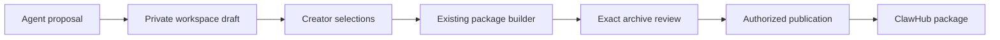

Codex review: needs changes before merge.

## What this changes

Adds private Claw proposals, selectable package contents, exact-file review, and explicit publication through the creator’s ClawHub account.

**Example:** Publish @maker/public-researcher@0.1.0 without workspace/checklist.md or @maker/github.
- **Before:** Creators cannot exclude individual proposal files and dependencies through the draft review API.
- **After:** Review choices rebuild the archive without those items and bind publication to its reviewed contents.

## Review scores

| Measure | Result | What it means |
|---|---|---|
| **Overall readiness** | 🦪 silver shellfish **(2/6)** | Strong publication-authority evidence supports the feature, but two confirmed selection defects still block readiness. |
| **Proof confidence** | 🦞 diamond lobster **(5/6)** ✨ media proof bonus | Sufficient (linked_artifact): The companion’s linked receipt exercises draft creation, saving, review, and publication through a built Gateway with real signed WebSocket and HTTP transports; it records one authorized upload and zero uploads for forbidden or revoked callers, with ClawHub storage/finalization explicitly covered separately. |
| **Patch quality** | 🦪 silver shellfish **(2/6)** | 2 actionable review findings remain. |

## Product

**Kind:** Feature · **Worth it:** Yes · **Fix scope:** Complete
**User problem:** Creators need to turn a useful agent into a shareable package without copying private workspace context or publishing unreviewed contents.
**Reason:** Maintainer authorship establishes direction, and bounded authored proposals plus explicit archive review provide clear value beyond the existing local project builder.

## Merge readiness

⛔ **Needs changes before merge - 3 items remain**

Keep this PR open: the maintainer-approved feature is useful, but both previously reported selection defects remain unresolved.

**Priority:** P2
**Reviewed head:** `6dd02ce68f827c5adc4de90e03de4b83ad124e93`

## Before merge

- [ ] **Clear the avatar reference when excluding its workspace file (P2)** - For a valid proposal with agent.identity.avatar set to images/avatar.svg and workspace.files mapping workspace/avatar.svg to that destination, excluding file:workspace/avatar.svg removes the mapping and source file but retains the avatar reference. The existing manifest validator then rejects the rebuilt package because the avatar no longer matches a managed destination, so a supported checkbox action prevents review and publication. Clear the corresponding avatar reference when its mapping is excluded and cover the rebuilt archive. This previously reported finding remains unresolved.
- [ ] **Include profile extension requirements in dependency choices (P2)** - A valid profiles/openclaw.yml can declare extensions containing a plugin such as @maker/github@2.0.0 while manifest.packages is empty. This loop emits no dependency choice for that plugin, although the existing Add planner treats the profile extension as an installation requirement. Supplying its exclusion ID is also rejected as unknown. Creators therefore cannot remove that dependency independently while keeping the profile’s other settings. Enumerate profile extensions through the same selection owner and remove the selected extension from the rebuilt profile; duplicating it in manifest.packages is invalid under the existing collision contract. This previously reported finding remains unresolved.
- [ ] **Explain or restore the original intent of Profile extension requirements** - https://github.com/openclaw/openclaw/pull/115962: Declare extension-backed plugin requirements in profiles/openclaw.yml without duplicating them in portable packages.

## Findings

- [P2] Clear the avatar reference when excluding its workspace file — `src/claws/draft-choices.ts:102-104`
- [P2] Include profile extension requirements in dependency choices — `src/claws/draft-choices.ts:67-74`

### Provenance

- `Profile extension requirements` changes intended behavior without addressing why it exists (https://github.com/openclaw/openclaw/pull/115962: Declare extension-backed plugin requirements in profiles/openclaw.yml without duplicating them in portable packages.)

### Tests

- Missing end-to-end proof: The committed tests do not cover avatar exclusion or profile-only extension selection, and red/green regression evidence for those cases is absent.

<strong>Agent review details</strong>

### How this fits together

Administrator Gateway methods accept agent-authored draft artifacts, apply creator selections, invoke the existing deterministic Claw builder, and send the reviewed archive to ClawHub.

### Technical review

Best possible solution:

Keep the existing builder and selection owner, clear references to excluded avatar files, and expose profile extensions as selectable dependencies.

Do we have a high-confidence way to reproduce the issue?

Both selection failures follow directly from the current selection logic and existing manifest/profile contracts; no target code or tests were executed.

Is this the best way to solve the issue?

The proposal is a coherent backend stage using established owners, but selections must preserve manifest validity and cover dependencies declared through the existing profile format.

Full review comments:

- [P2] Clear the avatar reference when excluding its workspace file — `src/claws/draft-choices.ts:102-104`
  For a valid proposal with agent.identity.avatar set to images/avatar.svg and workspace.files mapping workspace/avatar.svg to that destination, excluding file:workspace/avatar.svg removes the mapping and source file but retains the avatar reference. The existing manifest validator then rejects the rebuilt package because the avatar no longer matches a managed destination, so a supported checkbox action prevents review and publication. Clear the corresponding avatar reference when its mapping is excluded and cover the rebuilt archive. This previously reported finding remains unresolved.
  Confidence: 0.99
- [P2] Include profile extension requirements in dependency choices — `src/claws/draft-choices.ts:67-74`
  A valid profiles/openclaw.yml can declare extensions containing a plugin such as @maker/github@2.0.0 while manifest.packages is empty. This loop emits no dependency choice for that plugin, although the existing Add planner treats the profile extension as an installation requirement. Supplying its exclusion ID is also rejected as unknown. Creators therefore cannot remove that dependency independently while keeping the profile’s other settings. Enumerate profile extensions through the same selection owner and remove the selected extension from the rebuilt profile; duplicating it in manifest.packages is invalid under the existing collision contract. This previously reported finding remains unresolved.
  Confidence: 0.99

Overall correctness: patch is incorrect
Overall confidence: 0.97

AGENTS.md: found and applied where relevant.

Codex review notes: model internal, reasoning medium; reviewed against [79ffb0507edf](https://github.com/openclaw/openclaw/commit/79ffb0507edfa83117abd1b32eab3af8909d3c5a).

### Provenance checked

- `Deterministic package construction` keeps the original intent (https://github.com/openclaw/openclaw/pull/117037: Provide one maintained local authoring path that builds only validated immutable package contents.)
- `Conflict-safe workspace saves` keeps the original intent (https://github.com/openclaw/openclaw/pull/104885: Serialize file saves and preserve content-hash conflict detection across alternate workspace routes.)
- `ClawHub transport deadlines and write replay` keeps the original intent (https://github.com/openclaw/openclaw/pull/109092: Keep response deadlines active and preserve read-only retries without replaying potentially committed writes.)
- `Native protocol generation` keeps the original intent (https://github.com/openclaw/openclaw/pull/162251: Generate native models from canonical schemas during existing build entry points.)

### Testing

Proof path: shipped entry point.

### Security

None.

### Evidence

Acceptance criteria:

- pnpm test src/claws/draft.test.ts src/gateway/server-methods/claws-drafts.test.ts --maxWorkers=1
- pnpm tsgo:core
- git diff --check

What I checked:

- **Pinned introduction and current main:** Reviewed the merge-base-to-head changes; current main lacks draft-choices.ts, so the publishing workflow remains distinct work. ([`src/claws/draft-choices.ts:43`](https://github.com/openclaw/openclaw/blob/6dd02ce68f827c5adc4de90e03de4b83ad124e93/src/claws/draft-choices.ts#L43), [6dd02ce68f82](https://github.com/openclaw/openclaw/commit/6dd02ce68f827c5adc4de90e03de4b83ad124e93))
- **Avatar exclusion violates the existing manifest contract:** Selection removes workspace mappings without clearing agent.identity.avatar; schema validation requires every local avatar to match a remaining workspace destination. ([`src/claws/schema.ts:589`](https://github.com/openclaw/openclaw/blob/6dd02ce68f827c5adc4de90e03de4b83ad124e93/src/claws/schema.ts#L589), [6dd02ce68f82](https://github.com/openclaw/openclaw/commit/6dd02ce68f827c5adc4de90e03de4b83ad124e93))
- **Profile extensions are real dependency requirements:** The review list enumerates manifest.packages only, while the existing Add planner independently processes openClawProfile.extensions and rejects duplicate portable/profile declarations. ([`src/claws/lifecycle.ts:502`](https://github.com/openclaw/openclaw/blob/6dd02ce68f827c5adc4de90e03de4b83ad124e93/src/claws/lifecycle.ts#L502), [6dd02ce68f82](https://github.com/openclaw/openclaw/commit/6dd02ce68f827c5adc4de90e03de4b83ad124e93))
- **Prior findings checked against the current source:** The earlier selection source was retrieved through GitHub after the earlier commit was unavailable locally; intervening type and iteration changes do not repair either reported behavior. ([`src/claws/draft-choices.ts:67`](https://github.com/openclaw/openclaw/blob/0d546f389d734a03cf5398db7e6b4718846927dd/src/claws/draft-choices.ts#L67), [0d546f389d73](https://github.com/openclaw/openclaw/commit/0d546f389d734a03cf5398db7e6b4718846927dd))
- **Production publication-authority receipt:** The receipt linked from https://github.com/openclaw/openclaw/pull/173377 records real signed WebSocket requests to a built Gateway: the active administrator produced one package POST; non-admin, synthetic, disconnected, and revoked-device callers produced zero. Changed publication owners match the receipt’s blob identities; transport and inherited authority changes were inspected. ([`.github/pr-proof/claw-creator/authority-receipt.json`](https://github.com/openclaw/openclaw/blob/135ac4f40843889045a6bc2fc215a6fff1a32377/.github/pr-proof/claw-creator/authority-receipt.json), [135ac4f40843](https://github.com/openclaw/openclaw/commit/135ac4f40843889045a6bc2fc215a6fff1a32377))
- **Proof media inspected:** All four prepared screenshots were inspected; they show catalog attribution, discovery, and Add behavior, while the linked terminal receipt supplies publication-authority evidence.

### PR surface

Source +829, Tests +438, Docs +64, Other 0. Total +1331 across 20 files. Added test files: 2.

View PR surface stats

| Area | Files | Added | Removed | Net |
|---|---:|---:|---:|---:|
| Source | 15 | 832 | 3 | +829 |
| Tests | 2 | 438 | 0 | +438 |
| Docs | 2 | 64 | 0 | +64 |
| Config | 0 | 0 | 0 | 0 |
| Generated | 0 | 0 | 0 | 0 |
| Other | 1 | 2 | 2 | 0 |
| **Total** | **20** | **1336** | **5** | **+1331** |

### Labels

Label changes:

- add `rating: 🦪 silver shellfish`: Overall readiness is 🦪 silver shellfish; proof is 🦞 diamond lobster and patch quality is 🦪 silver shellfish.
- remove `rating: 🦐 gold shrimp`: Current PR rating is `rating: 🦪 silver shellfish`, so this older rating label is no longer current.

Label justifications:

- `P2`: Two bounded selection defects affect an optional Labs publishing workflow.
- `rating: 🦪 silver shellfish`: Overall readiness is 🦪 silver shellfish; proof is 🦞 diamond lobster and patch quality is 🦪 silver shellfish.
- `status: ⏳ waiting on author`: ClawSweeper has contributor-facing work open and is waiting for author action.
- `proof: sufficient`: Contributor real behavior proof is sufficient.

### Rating scale

6/6 🦀 challenger crab · 5/6 🦞 diamond lobster · 4/6 🐚 platinum hermit · 3/6 🦐 gold shrimp · 2/6 🦪 silver shellfish · 1/6 🧂 unranked krab. Overall follows the weaker of proof and patch quality; ✨ marks media proof (a screenshot, video, or linked artifact) that directly shows the changed behavior.

### Workflow

ClawSweeper edits this one comment on every review. Comment `@clawsweeper re-review` for a fresh review only. Repair and merge execution lanes are retired.

### History

Review history (4 earlier review cycles)

<!-- clawsweeper-review-history v=1 total=4 -->
- reviewed 2026-10-15T18:25:38.658Z sha b0be8e0b8d8805b0f5496834ce1426779e4ae241 :: needs real behavior proof before merge. :: [P2] Allow conflict-safe saves across the advertised draft size
- reviewed 2026-10-16T03:40:14.461Z sha 2f5e81e5097bd72e7ca8d7488ab67a69d8ecdec2 :: needs maintainer review before merge. :: none
- reviewed 2026-10-20T06:54:21.286Z sha 0d546f389d734a03cf5398db7e6b4718846927dd :: needs changes before merge. :: [P2] [P2] Clear the avatar reference when excluding its workspace file | [P2] [P2] Include profile extension requirements in dependency choices
- reviewed 2026-10-20T07:03:03.116Z sha 0d546f389d734a03cf5398db7e6b4718846927dd :: needs changes before merge. :: [P2] Clear the avatar reference when excluding its workspace file | [P2] Include profile extension requirements in dependency choices

_Reviewed October 20, 2026, 3:18 AM ET / 07:18 UTC (Revision 5)._

<!-- clawsweeper-verdict:needs-changes item=173346 sha=6dd02ce68f827c5adc4de90e03de4b83ad124e93 confidence=high updated_at=2026-10-20T07:13:05Z reviewed_at=2026-10-20T07:18:13.738Z lease_owner=github-run-39384991256-1 lease_comment_id=6285489331 source_revision=934111b4e52c6bd548e1b369780e7dd64dd7b8178d465f0f1874570d54e90480 -->
<!-- clawsweeper-review-state:needs-changes item=173346 sha=6dd02ce68f827c5adc4de90e03de4b83ad124e93 v=1 -->

<!-- clawsweeper-review-version item=173346 reviewed_at=2026-10-20T07:18:13.738Z sha=6dd02ce68f827c5adc4de90e03de4b83ad124e93 source_revision=934111b4e52c6bd548e1b369780e7dd64dd7b8178d465f0f1874570d54e90480 lease_owner=github-run-39384991256-1 lease_comment_id=6285489331 v=1 -->

<!-- clawsweeper-review item=173346 -->