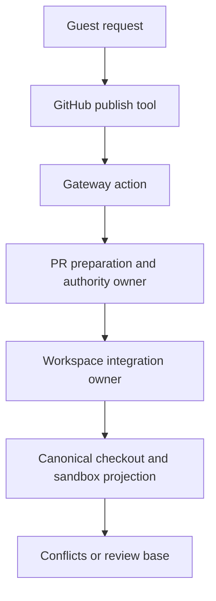

Codex review: needs maintainer review before merge.

## What this changes

Allows prepared PR workspaces to integrate their verified target branch while preserving saved work and the accepted PR head.

**Example:** A prepared PR targets integration-bot-target-1101, whose delivery-mode.txt conflicts with saved work.
- **Before:** refresh_base refuses because the workspace already continues an existing PR.
- **After:** refresh_base returns the delivery-mode.txt conflict at base b978c563cc74d8e9f7316a8729c3d16edb88c4a8 for resolution and subsequent same-PR publication.

## Review scores

| Measure | Result | What it means |
|---|---|---|
| **Overall readiness** | 🦞 diamond lobster **(5/6)** | A focused, useful repair supported by shipped-entry-point evidence, real-owner regression controls, unchanged persisted formats, and successful exact-head gates. |
| **Proof confidence** | 🦞 diamond lobster **(5/6)** ✨ media proof bonus | Sufficient (screenshot): Inspected native before/after captures exercise github_publish through a retained prepared conversation, replacing the refusal with verified-target conflicts; linked live GitHub results corroborate later publication, and production-path controls establish private-PR rejection and revocation before workspace changes. |
| **Patch quality** | 🦞 diamond lobster **(5/6)** | No actionable review findings were identified. |

## Product

**Kind:** Bug fix · **Worth it:** Yes · **Fix scope:** Complete
**User problem:** Guests recovering or importing a PR cannot integrate its target branch because refresh_base redirects them to preparation, which does not merge destination-only changes.
**Reason:** Restores the documented contribution workflow with maintainer-authored direction, existing actions, and no new configuration or public API.

## Merge readiness

✅ **Ready for maintainer review**

This PR fixes a confirmed workflow refusal still present on current main; no actionable introduced defect or unresolved merge concern was found.

**Priority:** P2
**Reviewed head:** `ee73c0e5de4a6151c388bfe3b60e0f99a947385c`

## Before merge

None.

## Findings

None.

<strong>Agent review details</strong>

### How this fits together

The github_publish tool dispatches Gateway actions that verify requester and publisher authority, then coordinate the canonical Git checkout and sandbox projection to return conflicts or an exact review base.

### Technical review

Best possible solution:

Land the focused repair through the existing preparation and workspace integration owners while retaining source-head, authority, staging, and recovery protections.

Do we have a high-confidence way to reproduce the issue?

Current main contains the unconditional bound-PR refusal described in https://github.com/openclaw/openclaw/issues/190201, and the inspected baseline capture shows that exact error; no target code was executed during this review.

Is this the best way to solve the issue?

The patch addresses the owning refusal with existing verification and integration operations, preserves preparation's destination-only contract, and keeps remote-head acceptance separate from base integration.

AGENTS.md: found and applied where relevant.

Codex review notes: model internal, reasoning medium; reviewed against [6129cfa7bebc](https://github.com/openclaw/openclaw/commit/6129cfa7bebcdc42ca1291c23fe255fde16829b0).

### Provenance checked

- `Bound-PR base-refresh refusal` changes intended behavior with a stated reason (9218dca35cbf1a326b91ffb422a631d6dc19ee8f: The original import feature isolated associated PRs until their continuation paths existed; https://github.com/openclaw/openclaw/pull/178233 describes the association as selection rather than authority.)
- `Preparation versus destination integration` keeps the original intent (18e94f273c100d61888219a853ad7ffad6c160a1: https://github.com/openclaw/openclaw/pull/186451 intentionally reconciled destination and review comparison without merging destination-only changes or disturbing saved work.)
- `Publication receipt and accepted-head matching` changes intended behavior with a stated reason (b0e4320bc0408259418cd04a2651294b5607dcf7: Original-PR publication preserves the existing PR and accepted branch history; matching its head branch rather than its former destination preserves that intent after retargeting.)
- `Private preparation ownership` keeps the original intent (484419f1a36d3b372d7a0beddd7b679358257a38: https://github.com/openclaw/openclaw/pull/180155 localized preparation with its consumer while retaining shared algorithms and authorization contracts.)

### Testing

Proof path: shipped entry point.

### Security

None.

### Evidence

What I checked:

- **Current-main defect remains:** Current main still rejects every refresh_base request with an existing PR binding before workspace integration; preparation separately updates source or review comparison. ([`src/gateway/server-methods/sessions-github.ts:216`](https://github.com/openclaw/openclaw/blob/6129cfa7bebcdc42ca1291c23fe255fde16829b0/src/gateway/server-methods/sessions-github.ts#L216), [6129cfa7bebc](https://github.com/openclaw/openclaw/commit/6129cfa7bebcdc42ca1291c23fe255fde16829b0))
- **Verified introduction and smallest complete fix:** The pinned introduced diff routes bound refresh through existing PR verification and integration owners, retains accepted-head metadata, separates pending source and base operations, and repairs receipt matching and review ancestry without adding another integration owner. ([`src/gateway/github-pr-workspace-preparation.ts:368`](https://github.com/openclaw/openclaw/blob/ee73c0e5de4a6151c388bfe3b60e0f99a947385c/src/gateway/github-pr-workspace-preparation.ts#L368), [ee73c0e5de4a](https://github.com/openclaw/openclaw/commit/ee73c0e5de4a6151c388bfe3b60e0f99a947385c))
- **Final-effect authority controls:** Registered-action controls exercise an unlinked guest against a maintainer-prepared private PR, revocation after base fetching, and revocation during pending-conflict recovery; they compare binding, canonical and projection heads, indexes, and file bytes. The fixture dispatches the actual tool and Gateway request with real authorization, Git, and storage owners. ([`src/gateway/github-pr-workspace-preparation.test.ts:91`](https://github.com/openclaw/openclaw/blob/ee73c0e5de4a6151c388bfe3b60e0f99a947385c/src/gateway/github-pr-workspace-preparation.test.ts#L91), [ee73c0e5de4a](https://github.com/openclaw/openclaw/commit/ee73c0e5de4a6151c388bfe3b60e0f99a947385c))
- **Inspected behavior proof:** Downloaded before/after screenshots show the same session-published PR changing from the bound-PR refusal to target-base conflicts. The final commit changes only authorization tests and their allocation, preserving the production implementation exercised by the live proof. The external-fork after image and video were absent from prepared artifacts, and browser fetches returned Cache miss; neither is claimed as inspected. ([`src/gateway/github-pr-workspace-refresh.test.ts:334`](https://github.com/openclaw/openclaw/blob/ee73c0e5de4a6151c388bfe3b60e0f99a947385c/src/gateway/github-pr-workspace-refresh.test.ts#L334), [ee73c0e5de4a](https://github.com/openclaw/openclaw/commit/ee73c0e5de4a6151c388bfe3b60e0f99a947385c))
- **Live completion independently corroborated:** Both linked disposable PRs are merged. GitHub comparison confirms the displayed integrated target b978c563cc74d8e9f7316a8729c3d16edb88c4a8 is an ancestor of both final demo heads, supporting the reported completion beyond the screenshot's conflict result. ([72ef59b562a2](https://github.com/shakkernerd/openclaw-guest-pr-demo/commit/72ef59b562a22c86e9c070fe7164897dc810c487))
- **Exact-head gates:** Live REST reads show successful exact-head CI, dependency-review, and security-sensitive-review status gates, with completed changed-code checks; GitHub reports the reviewed head mergeable and clean. ([ee73c0e5de4a](https://github.com/openclaw/openclaw/commit/ee73c0e5de4a6151c388bfe3b60e0f99a947385c))

Likely related people:

- **Shakker:** Raw commit 9218dca35cbf1a326b91ffb422a631d6dc19ee8f adds src/gateway/github-pr-workspace-preparation.ts:40 relative to its recorded parents. This identifies author metadata, not feature responsibility or a PR merger. (role: source-line author; confidence: high; commits: [9218dca35cbf](https://github.com/openclaw/openclaw/commit/9218dca35cbf1a326b91ffb422a631d6dc19ee8f); files: `src/gateway/github-pr-workspace-preparation.ts`)

### PR surface

Source +46, Tests +155, Docs +13, Other +2. Total +216 across 10 files. Added test files: 0.

View PR surface stats

| Area | Files | Added | Removed | Net |
|---|---:|---:|---:|---:|
| Source | 5 | 102 | 56 | +46 |
| Tests | 2 | 158 | 3 | +155 |
| Docs | 2 | 16 | 3 | +13 |
| Config | 0 | 0 | 0 | 0 |
| Generated | 0 | 0 | 0 | 0 |
| Other | 1 | 2 | 0 | +2 |
| **Total** | **10** | **278** | **62** | **+216** |

### Review metrics

| Metric | Value | Why it matters |
|---|---|---|
| **Production versus regression coverage** | Production +102/-56 lines; tests +158/-3 lines | The growth reuses existing owners and fixtures to cover bound refresh, staging preservation, recovery, same-PR publication, and distinct authorization failures. |

### Root-cause cluster

Relationship: `fixed_by_candidate`
Canonical: https://github.com/openclaw/openclaw/issues/190201
Summary: This PR directly repairs the bound-workspace refusal established by the linked issue.

Members:
- `canonical`: https://github.com/openclaw/openclaw/issues/190201 - Documents the same registered-action reproduction and unconditional handler guard.

Proposal only: this assessment does not dispatch repair, suppress jobs, mutate sibling items, close, or merge anything.

### Labels

Label changes:

No label changes.

Label justifications:

- `P2`: Repairs a reproducible managed-sandbox PR integration workflow refusal without demonstrated data loss or broader runtime outage.
- `rating: 🦞 diamond lobster`: Overall readiness is 🦞 diamond lobster; proof is 🦞 diamond lobster and patch quality is 🦞 diamond lobster.
- `status: 👀 ready for maintainer look`: ClawSweeper has no concrete contributor-facing blocker left for this PR.
- `proof: sufficient`: Contributor real behavior proof is sufficient.
- `proof: 📸 screenshot`: Contributor real behavior proof includes screenshot evidence.

### Rating scale

6/6 🦀 challenger crab · 5/6 🦞 diamond lobster · 4/6 🐚 platinum hermit · 3/6 🦐 gold shrimp · 2/6 🦪 silver shellfish · 1/6 🧂 unranked krab. Overall follows the weaker of proof and patch quality; ✨ marks media proof (a screenshot, video, or linked artifact) that directly shows the changed behavior.

### Workflow

ClawSweeper edits this one comment on every review. Comment `@clawsweeper re-review` for a fresh review only. Repair and merge execution lanes are retired.

### History

Review history (2 earlier review cycles)

<!-- clawsweeper-review-history v=1 total=2 -->
- reviewed 2026-11-01T10:28:14.445Z sha d797c14276f3327227e13556557cc58f88db9c71 :: needs real behavior proof before merge. :: none
- reviewed 2026-11-01T11:29:53.698Z sha ee73c0e5de4a6151c388bfe3b60e0f99a947385c :: needs maintainer review before merge. :: none

_Reviewed November 1, 2026, 6:36 AM ET / 11:36 UTC (Revision 3)._

<!-- clawsweeper-verdict:needs-human item=190223 sha=ee73c0e5de4a6151c388bfe3b60e0f99a947385c confidence=high updated_at=2026-11-01T11:32:19Z reviewed_at=2026-11-01T11:36:34.731Z lease_owner=github-run-41302210574-1 lease_comment_id=6557290481 source_revision=b4c91321d8bf8f491016f1f021d0fb48ed0a53c37f0e5b7f944e7e48558f6272 hold=not_opted_in findings=0 -->
<!-- clawsweeper-review-state:ready item=190223 sha=ee73c0e5de4a6151c388bfe3b60e0f99a947385c v=1 -->

<!-- clawsweeper-review-version item=190223 reviewed_at=2026-11-01T11:36:34.731Z sha=ee73c0e5de4a6151c388bfe3b60e0f99a947385c source_revision=b4c91321d8bf8f491016f1f021d0fb48ed0a53c37f0e5b7f944e7e48558f6272 lease_owner=github-run-41302210574-1 lease_comment_id=6557290481 v=1 -->

<!-- clawsweeper-review item=190223 -->