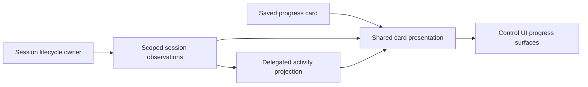

Codex review: blocked before merge.

## What this changes

This PR preserves authored checklist completion and displays live delegated activity separately across Control UI progress surfaces.

**Example:** Prepare the report has one completed step, one in-progress step, one pending step, and five children: two running and three queued.
- **Before:** Successful parent completion gives the unfinished step a completion check.
- **After:** The step remains unfinished, and a separate line shows Delegated work: 2 running · 3 queued.

## Review scores

| Measure | Result | What it means |
|---|---|---|
| **Overall readiness** | 🦐 gold shrimp **(3/6)** | Strong visual proof supports the UI repair, but product direction and unresolved required CI checks prevent merge readiness. |
| **Proof confidence** | 🦞 diamond lobster **(5/6)** ✨ media proof bonus | Sufficient (screenshot): Inspected Chromium screenshots exercise the real Control UI against synthetic Gateway state: unfinished steps remain unfinished with two running and three queued children, child failure updates separately, and mobile Details retains the checklist after reload; no live provider or channel coverage is claimed. |
| **Patch quality** | 🦐 gold shrimp **(3/6)** | No actionable review findings were identified. |

## Product

**Kind:** Bug fix · **Worth it:** Needs a maintainer decision · **Fix scope:** Complete
**User problem:** An unfinished saved checklist can appear completed when its parent turn succeeds while delegated work continues.
**Reason:** The visible inconsistency is demonstrated, but removing successful-run Completed presentation for nondelegated cards changes an intentional existing product behavior.

## Merge readiness

⛔ **Blocked before merge - 2 items remain**

Keep open: this PR addresses a verified current-main progress mismatch and contains meaningful, maintainer-engaged work; no new actionable code findings were established.

**Priority:** P2
**Reviewed head:** `79c379bebebeaaa5efda896a23db0faa13573994`
**Owner decision:** Required. See [Decision needed](#decision-needed).

## Decision needed

- **Question:** Should successful parent settlement stop producing Completed presentation on all saved progress-card surfaces, including sessions without delegated work?
- **Recommendation:** **Approve authored completion everywhere:** Use saved step statuses for completion checks and counts, with live activity shown separately across all affected surfaces.
- **Why:** The existing terminal presentation was intentional, this PR changes it globally, and the recorded re-review requests and integration commits do not explicitly settle that product choice.

## Before merge

- [ ] **Complete next step** - The contributor must establish attribution for the startup-recovery and off-roster-route CI failures, repair demonstrated PR-caused defects, and satisfy the test-line gate through coverage-preserving consolidation or an explicit maintainer budget allocation.
- [ ] **Resolve maintainer decision** - Resolve the maintainer decision shown above before merge.

## Findings

None.

<strong>Agent review details</strong>

### How this fits together

Gateway progress cards and session lifecycle observations feed shared Control UI presentation used by chat, Details, hovercards, board widgets, and plugin session summaries.

### Technical review

Best possible solution:

Preserve authored checklist truth through the existing shared presenter and session owners, with an explicit owner decision on successful-run presentation.

Do we have a high-confidence way to reproduce the issue?

Current main still maps a matching successful run to completed presentation for an authored in_progress step; supplied before/after browser evidence demonstrates the mismatch and repair, without a reviewer-run reproduction.

Is this the best way to solve the issue?

The shared presenter and existing session observations provide a coherent repair without changing stored plans; the broader replacement of deliberate successful-run presentation needs an owner decision.

AGENTS.md: found and applied where relevant.

Codex review notes: model internal, reasoning medium; reviewed against [338c8118a27b](https://github.com/openclaw/openclaw/commit/338c8118a27b5e7e9093f996f507c1bbb74ef9cf).

### Provenance checked

- `Successful-run progress presentation` changes intended behavior with a stated reason (80b8e79778824cd1b86c1620ae76552c3f551c0f: Present clear terminal outcomes and eliminate ambiguous terminal spinners; subsequent Solid migrations carried that behavior forward.)
- `Board target activity` keeps the original intent (ac0a263eebf99c5f532d2ae1b0c0eba7c5382c95: Resolve activity from the captured target agent independently of dashboard membership and preserve later-run timestamp fencing.)
- `Shared progress roster subscription` changes intended behavior with a stated reason (f27b11a73e18f9fcdb1b1c358aeaf2eba228517e: Share upstream observations while preserving application isolation and cleanup; the PR replaces bounded roster lookup with existing exact-row observation and removes the retired adapter.)

### Testing

Proof path: shipped entry point.

### Security

None.

### Evidence

What I checked:

- **Current main retains the completion mismatch:** Fetched main still maps done to completed while progressCounts counts only explicitly completed steps; the introduced diff removes that mapping. ([`ui/src/components/session-progress-card.ts:33`](https://github.com/openclaw/openclaw/blob/338c8118a27b5e7e9093f996f507c1bbb74ef9cf/ui/src/components/session-progress-card.ts#L33), [338c8118a27b](https://github.com/openclaw/openclaw/commit/338c8118a27b5e7e9093f996f507c1bbb74ef9cf))
- **Existing terminal presentation was deliberate:** https://github.com/openclaw/openclaw/pull/130183 deliberately introduced Completed terminal presentation; its merged history distinguishes this direction change from a mechanical repair. ([`ui/src/components/session-progress-card.ts`](https://github.com/openclaw/openclaw/blob/80b8e79778824cd1b86c1620ae76552c3f551c0f/ui/src/components/session-progress-card.ts), [80b8e7977882](https://github.com/openclaw/openclaw/commit/80b8e79778824cd1b86c1620ae76552c3f551c0f))
- **Original target-observation contract preserved:** https://github.com/openclaw/openclaw/pull/137255 required progress to follow its captured target independently of dashboard membership; exact row observation preserves that contract and removes the bounded-roster dependency. ([`ui/src/lib/board/widgets/session-progress.tsx:106`](https://github.com/openclaw/openclaw/blob/79c379bebebeaaa5efda896a23db0faa13573994/ui/src/lib/board/widgets/session-progress.tsx#L106), [79c379bebebe](https://github.com/openclaw/openclaw/commit/79c379bebebeaaa5efda896a23db0faa13573994))
- **Prepared visual evidence inspected:** Inspected all four downloaded screenshots: the baseline false checkmark, corrected delegated counts, visible child failure, and retained unfinished checklist in mobile Details after reload. ([`ui/src/e2e/session-progress-runtime.e2e.test.ts:20`](https://github.com/openclaw/openclaw/blob/79c379bebebeaaa5efda896a23db0faa13573994/ui/src/e2e/session-progress-runtime.e2e.test.ts#L20), [79c379bebebe](https://github.com/openclaw/openclaw/commit/79c379bebebeaaa5efda896a23db0faa13573994))
- **Earlier findings are repaired:** The widget disposes and rebinds retired observations with captured-read guards, and delegated stopped counts use endedWithoutFinishing, which includes interrupted children. ([`ui/src/lib/board/widgets/session-progress.tsx:157`](https://github.com/openclaw/openclaw/blob/79c379bebebeaaa5efda896a23db0faa13573994/ui/src/lib/board/widgets/session-progress.tsx#L157), [79c379bebebe](https://github.com/openclaw/openclaw/commit/79c379bebebeaaa5efda896a23db0faa13573994))
- **Current-head CI remains blocked:** https://github.com/openclaw/openclaw/actions/runs/40599502101 reports startup recovery at chat-view.startup.test.ts:68, off-roster route waiting at chat-snapshot-route.e2e.test.ts:249, and the test-line ratchet as failed; the aggregate gate derives from these failures. ([79c379bebebe](https://github.com/openclaw/openclaw/commit/79c379bebebeaaa5efda896a23db0faa13573994))

### PR surface

Source +346, Tests +427, Docs -1. Total +772 across 41 files. Added test files: 1.

View PR surface stats

| Area | Files | Added | Removed | Net |
|---|---:|---:|---:|---:|
| Source | 25 | 537 | 191 | +346 |
| Tests | 14 | 629 | 202 | +427 |
| Docs | 2 | 1 | 2 | -1 |
| Config | 0 | 0 | 0 | 0 |
| Generated | 0 | 0 | 0 | 0 |
| Other | 0 | 0 | 0 | 0 |
| **Total** | **41** | **1167** | **395** | **+772** |

### Review metrics

| Metric | Value | Why it matters |
|---|---|---|
| **Production versus test growth** | Production +537/−191; tests +629/−202 | Growth supplies shared activity rendering, exact-target observation, and distinct lifecycle and consumer regressions while removing the superseded roster adapter. |

### Root-cause cluster

Relationship: `partial_overlap`
Canonical: https://github.com/openclaw/openclaw/issues/137188
Summary: This PR addresses the remaining terminal-completion presentation gap within the broader progress lifecycle report.

Members:
- `canonical`: https://github.com/openclaw/openclaw/issues/137188 - Tracks the remaining authored-step versus successful-run mismatch alongside broader lifecycle evidence.
- `same_root_cause`: https://github.com/openclaw/openclaw/issues/180780 - The closed report identifies the same done-to-completed mapping and disagreement between completion markers and authored counts.
- `adjacent_distinct`: https://github.com/openclaw/openclaw/pull/179902 - Repairs resumed-parent plan propagation to retained channel cards rather than Control UI terminal presentation.

Proposal only: this assessment does not dispatch repair, suppress jobs, mutate sibling items, close, or merge anything.

### Labels

Label changes:

- add `status: ⏳ waiting on author`: ClawSweeper has contributor-facing work open and is waiting for author action.
- remove `status: ⏳ waiting on maintainer`: Current PR status label is `status: ⏳ waiting on author`.

Label justifications:

- `P2`: Misleading checklist completion affects progress monitoring without blocking the underlying agent workflow.
- `rating: 🦐 gold shrimp`: Overall readiness is 🦐 gold shrimp; proof is 🦞 diamond lobster and patch quality is 🦐 gold shrimp.
- `status: ⏳ waiting on author`: ClawSweeper has contributor-facing work open and is waiting for author action.
- `proof: sufficient`: Contributor real behavior proof is sufficient.
- `proof: 📸 screenshot`: Contributor real behavior proof includes screenshot evidence.

### Rating scale

6/6 🦀 challenger crab · 5/6 🦞 diamond lobster · 4/6 🐚 platinum hermit · 3/6 🦐 gold shrimp · 2/6 🦪 silver shellfish · 1/6 🧂 unranked krab. Overall follows the weaker of proof and patch quality; ✨ marks media proof (a screenshot, video, or linked artifact) that directly shows the changed behavior.

### Workflow

ClawSweeper edits this one comment on every review. Comment `@clawsweeper re-review` for a fresh review only. Repair and merge execution lanes are retired.

### History

Review history (4 earlier review cycles)

<!-- clawsweeper-review-history v=1 total=4 -->
- reviewed 2026-10-24T20:11:25.163Z sha 1cfa8b9fce2877536ac54d8de509afa9338c439b :: blocked before merge. :: [P2] Rebind the widget after its session observation retires | [P2] Include interrupted children in the stopped count
- reviewed 2026-10-24T21:59:50.192Z sha ac8fe164333e69a42ad6a7df3f920f82b9a5efb0 :: blocked before merge. :: none
- reviewed 2026-10-27T20:05:19.146Z sha aba0fd06b2959dffbc4cec02311655034de9ebb0 :: blocked before merge. :: none
- reviewed 2026-10-27T21:56:49.686Z sha a2e6392bede8688a267a2b7f7c27aa8c6c66ba8c :: blocked before merge. :: none

_Reviewed October 27, 2026, 7:33 PM ET / 23:33 UTC (Revision 5)._

<!-- clawsweeper-verdict:needs-human item=182832 sha=79c379bebebeaaa5efda896a23db0faa13573994 confidence=high updated_at=2026-10-27T23:26:44Z reviewed_at=2026-10-27T23:33:25.401Z lease_owner=github-run-40602107272-1 lease_comment_id=6456097420 source_revision=71b33f752e100e01adb23fe4322d531aef6f4b4edf146f46a0189b9d4993ac3e hold=blocked findings=0 -->
<!-- clawsweeper-review-state:blocked item=182832 sha=79c379bebebeaaa5efda896a23db0faa13573994 v=1 -->

<!-- clawsweeper-review-version item=182832 reviewed_at=2026-10-27T23:33:25.401Z sha=79c379bebebeaaa5efda896a23db0faa13573994 source_revision=71b33f752e100e01adb23fe4322d531aef6f4b4edf146f46a0189b9d4993ac3e lease_owner=github-run-40602107272-1 lease_comment_id=6456097420 v=1 -->

<!-- clawsweeper-review item=182832 -->