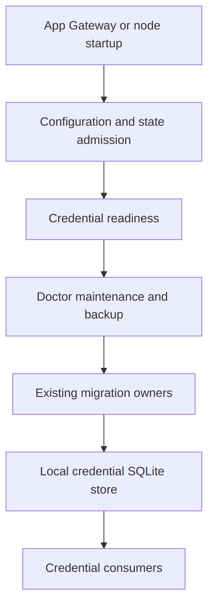

Codex review: needs maintainer review before merge.

## What this changes

This PR automatically prepares client credentials through Doctor before macOS app, Gateway, and node startup.

**Example:** A macOS profile has pending credential migration after updating from 2026.10.5.
- **Before:** The app exits and asks the user to run openclaw doctor --fix.
- **After:** Startup migrates supported credentials automatically while preserving existing keys and pairing tokens.

## Review scores

| Measure | Result | What it means |
|---|---|---|
| **Overall readiness** | 🐚 platinum hermit **(4/6)** | Useful, coherent repair with recorded production-entry-point and upgrade evidence, resolved prior findings, and no actionable introduced defect. |
| **Proof confidence** | 🐚 platinum hermit **(4/6)** ✨ media proof bonus | Sufficient (linked_artifact): Recorded predecessor proof covers packaged startup recovery, native app IPC admission, stable upgrade continuity, different-generation rejection, and revoked-token absence before client transmission; source comparison supports reuse for the reviewed behavior, while local media and artifact inspection was infrastructure-blocked. |
| **Patch quality** | 🐚 platinum hermit **(4/6)** | No actionable review findings were identified. |

## Product

**Kind:** Bug fix · **Worth it:** Yes · **Fix scope:** Complete
**User problem:** An updated installation can refuse startup until the user manually repairs pending or stale client credentials.
**Reason:** Automatic recovery has clear user value, retains established migration ownership, and has maintainer-authored direction.

## Merge readiness

✅ **Ready for maintainer review**

Keep open: this maintainer-authored PR addresses a current startup failure; both prior findings are resolved, no actionable introduced defect was found, and exact-head CI remains pending.

**Priority:** P0
**Reviewed head:** `a9b80488a4e89e5ff3f4e7f27e34f60efa7f498b`

## Before merge

None.

## Findings

None.

<strong>Agent review details</strong>

### How this fits together

Startup admission validates the selected configuration and database, delegates credential migration to Doctor’s existing maintenance owners, and then admits native, Gateway, and node credential consumers.

### Technical review

Best possible solution:

Recover supported credential migrations inline during startup through Doctor while preserving keys, tokens, approval policy, and rollback bindings.

Do we have a high-confidence way to reproduce the issue?

Current-main readiness gates and the app’s terminal-repair alert establish the failure path; the PR also records a packaged baseline reproduction, but this read-only review ran no target code.

Is this the best way to solve the issue?

The smallest complete fix delegates startup repair to Doctor and updates receipt, promotion, and port consumers together so credential ownership stays consistent.

AGENTS.md: found and applied where relevant.

Codex review notes: model internal, reasoning medium; reviewed against [1892041df9f4](https://github.com/openclaw/openclaw/commit/1892041df9f4a2e20e06558c5df753cfd64e2f3b).

### Provenance checked

- `Startup migration ownership` changes intended behavior with a stated reason (2a1402cd3e3914352820a24961087f1de0c736d9: https://github.com/openclaw/openclaw/pull/151025 moved general legacy repair into Doctor to preserve startup inputs and migration custody.)
- `Credential bootstrap and receipts` keeps the original intent (8f622108e0003e722801b420187b6011e0a4536e: https://github.com/openclaw/openclaw/pull/174599 established local credential custody, source binding, consumed-import claims, and rollback behavior.)
- `Database port credential binding` keeps the original intent (63b8eec1e3cdd9253e01d9155d2f7ae134a5bdbb: https://github.com/openclaw/openclaw/pull/178005 preserved credential continuity across verified database ports; this PR extends the same owner to each canonical root.)
- `Maintenance contention` keeps the original intent (ec38f535d3d5de9e087d834fe58e6190852fcb2a: https://github.com/openclaw/openclaw/pull/172772 waits for foreign agent leases without holding state ownership; startup preparation reuses that bounded wait.)

### Testing

Proof path: shipped entry point.

### Security

None.

### Evidence

What I checked:

- **Current-main startup boundary:** Current main checks identity and approval readiness without automatic credential preparation; the PR replaces that node entry point with the shared preparation operation. ([`src/node-host/startup-state-readiness.ts:4`](https://github.com/openclaw/openclaw/blob/1892041df9f4a2e20e06558c5df753cfd64e2f3b/src/node-host/startup-state-readiness.ts#L4), [1892041df9f4](https://github.com/openclaw/openclaw/commit/1892041df9f4a2e20e06558c5df753cfd64e2f3b))
- **Existing migration ownership retained:** The preparation operation validates required legacy inputs, acquires Doctor maintenance with root:null, and invokes existing schema, identity, auth, and approval migration owners. ([`src/commands/startup-client-credentials.ts:141`](https://github.com/openclaw/openclaw/blob/a9b80488a4e89e5ff3f4e7f27e34f60efa7f498b/src/commands/startup-client-credentials.ts#L141), [a9b80488a4e8](https://github.com/openclaw/openclaw/commit/a9b80488a4e89e5ff3f4e7f27e34f60efa7f498b))
- **Prior findings resolved:** Setup promotion now accepts verified empty bootstrap provenance while rejecting material-bearing stages; the restore regression expects the enriched PostgreSQL receipt. ([`src/wizard/setup.migration-promotion.ts:475`](https://github.com/openclaw/openclaw/blob/a9b80488a4e89e5ff3f4e7f27e34f60efa7f498b/src/wizard/setup.migration-promotion.ts#L475), [a9b80488a4e8](https://github.com/openclaw/openclaw/commit/a9b80488a4e89e5ff3f4e7f27e34f60efa7f498b))
- **Recorded behavior and upgrade evidence:** The PR records native-app migration/remount success and an installed 2026.10.5 upgrade with readiness and durable-session preservation on bd61. The affected startup, credential migration, and native-app production files are unchanged between bd61 and the reviewed head. ([`apps/macos/Tests/OpenClawIPCTests/ClientCredentialStartupCompositionTests.swift:23`](https://github.com/openclaw/openclaw/blob/a9b80488a4e89e5ff3f4e7f27e34f60efa7f498b/apps/macos/Tests/OpenClawIPCTests/ClientCredentialStartupCompositionTests.swift#L23), [a9b80488a4e8](https://github.com/openclaw/openclaw/commit/a9b80488a4e89e5ff3f4e7f27e34f60efa7f498b))
- **Authority evidence continuity:** The body records wrong-generation preservation and revoked-token absence at the client transmission boundary on ac5a. Comparison shows the subsequent migration changes select the canonical root’s credential companion; auth import and consumed-claim logic remain unchanged. ([`src/infra/client-credential-migration.ts:279`](https://github.com/openclaw/openclaw/blob/a9b80488a4e89e5ff3f4e7f27e34f60efa7f498b/src/infra/client-credential-migration.ts#L279), [a9b80488a4e8](https://github.com/openclaw/openclaw/commit/a9b80488a4e89e5ff3f4e7f27e34f60efa7f498b))
- **Artifact inspection infrastructure limit:** The prepared manifest reports “ffprobe failed: spawnSync ffprobe ENOENT”; browser fallback could not access the video, and artifact downloads were blocked at productionresultssa8.blob.core.windows.net. Recorded proof remains attributed to its published predecessors; these inspection limits are not contributor defects. ([a9b80488a4e8](https://github.com/openclaw/openclaw/commit/a9b80488a4e89e5ff3f4e7f27e34f60efa7f498b))

### PR surface

Source +1040, Tests +2704, Docs +10, Other +37. Total +3791 across 62 files. Added test files: 6.

View PR surface stats

| Area | Files | Added | Removed | Net |
|---|---:|---:|---:|---:|
| Source | 25 | 1268 | 228 | +1040 |
| Tests | 32 | 3118 | 414 | +2704 |
| Docs | 3 | 28 | 18 | +10 |
| Config | 0 | 0 | 0 | 0 |
| Generated | 0 | 0 | 0 | 0 |
| Other | 2 | 48 | 11 | +37 |
| **Total** | **62** | **4462** | **671** | **+3791** |

### Review metrics

| Metric | Value | Why it matters |
|---|---|---|
| **Production versus test growth** | Production +1268/-228; tests and test support +3166/-425 | Growth covers startup orchestration, receipt lifecycle and root ownership, with distinct migration, rollback, rejection, native composition, and portability coverage. |
| **New CLI option** | 1: doctor --client-credentials | The bundled app uses the narrow preparation operation; it requires repair and noninteractive mode and optionally returns JSON. |

### Labels

Label changes:

- add `proof: sufficient`: Contributor real behavior proof is sufficient.
- add `rating: 🐚 platinum hermit`: Overall readiness is 🐚 platinum hermit; proof is 🐚 platinum hermit and patch quality is 🐚 platinum hermit.
- add `status: 👀 ready for maintainer look`: ClawSweeper has no concrete contributor-facing blocker left for this PR.
- remove `rating: 🧂 unranked krab`: Current PR rating is `rating: 🐚 platinum hermit`, so this older rating label is no longer current.
- remove `merge-risk: 🚨 compatibility`: Current PR review selected no merge-risk labels.
- remove `merge-risk: 🚨 security-boundary`: Current PR review selected no merge-risk labels.
- remove `status: 📣 needs proof`: Current PR status label is `status: 👀 ready for maintainer look`.

Label justifications:

- `P0`: The affected macOS upgrade path exits before useful startup and requires terminal-based Doctor recovery; automatic preparation removes that nontechnical-user blocker.
- `rating: 🐚 platinum hermit`: Overall readiness is 🐚 platinum hermit; proof is 🐚 platinum hermit and patch quality is 🐚 platinum hermit.
- `status: 👀 ready for maintainer look`: ClawSweeper has no concrete contributor-facing blocker left for this PR.
- `proof: sufficient`: Contributor real behavior proof is sufficient.

### Rating scale

6/6 🦀 challenger crab · 5/6 🦞 diamond lobster · 4/6 🐚 platinum hermit · 3/6 🦐 gold shrimp · 2/6 🦪 silver shellfish · 1/6 🧂 unranked krab. Overall follows the weaker of proof and patch quality; ✨ marks media proof (a screenshot, video, or linked artifact) that directly shows the changed behavior.

### Workflow

ClawSweeper edits this one comment on every review. Comment `@clawsweeper re-review` for a fresh review only. Repair and merge execution lanes are retired.

### History

Review history (1 earlier review cycle)

<!-- clawsweeper-review-history v=1 total=1 -->
- reviewed 2026-10-21T04:09:37.514Z sha 6406c75f5652c5447ab63688facfaf13809355ed :: needs real behavior proof before merge. :: [P1] Update setup promotion for canonical bootstrap receipts | [P2] Update the restore regression for enriched bootstrap provenance

_Reviewed October 21, 2026, 5:31 AM ET / 09:31 UTC (Revision 2)._

<!-- clawsweeper-verdict:needs-human item=178998 sha=a9b80488a4e89e5ff3f4e7f27e34f60efa7f498b confidence=high updated_at=2026-10-21T09:22:34Z reviewed_at=2026-10-21T09:31:18.468Z lease_owner=github-run-39576372330-1 lease_comment_id=6312271072 source_revision=33111b3a5c5da615e580509555de876810ec30c46157b8bd223193ae382a221e hold=not_opted_in findings=0 -->
<!-- clawsweeper-review-state:ready item=178998 sha=a9b80488a4e89e5ff3f4e7f27e34f60efa7f498b v=1 -->

<!-- clawsweeper-review-version item=178998 reviewed_at=2026-10-21T09:31:18.468Z sha=a9b80488a4e89e5ff3f4e7f27e34f60efa7f498b source_revision=33111b3a5c5da615e580509555de876810ec30c46157b8bd223193ae382a221e lease_owner=github-run-39576372330-1 lease_comment_id=6312271072 v=1 -->

<!-- clawsweeper-review item=178998 -->