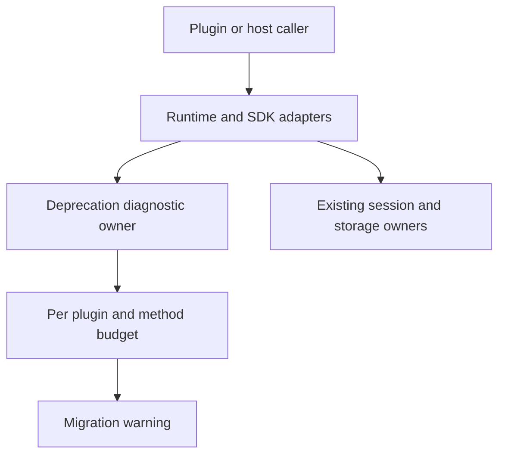

Codex review: needs changes before merge.

## What this changes

This PR makes SQLite SDK deprecation warnings specific to each method and aligns diagnostics and migration guidance with the existing retirement deadline.

**Example:** Plugin example-plugin calls SessionManager.appendCustomEntry and then SessionManager.appendSessionInfo.
- **Before:** The first warning consumes the session-persistence family budget and hides the second migration.
- **After:** Each method warns once per plugin per process and names its awaited replacement.

## Review scores

| Measure | Result | What it means |
|---|---|---|
| **Overall readiness** | 🦪 silver shellfish **(2/6)** | Useful owner-approved direction with integration-test support, but introduced diagnostic leakage and confirmed test failures prevent a clean verdict. |
| **Proof confidence** | 🦐 gold shrimp **(3/6)** | This maintainer-authored diagnostic change is outside the ordinary contributor proof gate; supplied validation consists of focused tests and CI, and the extracted native authority implementations preserve their checks. |
| **Patch quality** | 🦪 silver shellfish **(2/6)** | 2 actionable review findings remain. |

## Product

**Kind:** Bug fix · **Worth it:** Yes · **Fix scope:** Complete
**User problem:** Plugin authors can miss required migrations because one deprecated method hides another's warning, and some guidance names unavailable replacements.
**Reason:** The maintainer-authored direction improves an already approved migration program without removing APIs or changing the deadline.

## Merge readiness

⛔ **Needs changes before merge - 2 items remain**

Keep this maintainer-authored PR open: the migration improvement is useful, but supported host operations now emit misleading warnings and two existing tests retain incompatible expectations.

**Priority:** P2
**Reviewed head:** `d1e30529c2c9a29fc4d3cd576e5a8daaf5b7f22f`

## Before merge

- [ ] **Keep supported host authority reads off the warning adapter (P2)** - The new unconditional warning also runs when createRuntimeSandbox calls this getter for resolveWorkspaceAuthority and prepareWorkspaceAuthority's current-authority assertion, and when Talk prepares control authority. Those supported operations therefore report deprecated plugin usage even when the caller selected an awaited API; under Node's --throw-deprecation the warning can terminate the process. Route these internal reads through the existing non-warning owner while preserving their synchronous final-authority checks, and keep the warning on the public legacy adapter.
- [ ] **Update the remaining family-budget test expectations (P2)** - Adding the method to this key changes existing binding and TTS diagnostic contracts, but their tests still require one warning per family. Exact-head CI confirms session-binding-service.async-read.test.ts:194 receives three warnings instead of one, and tts-preferences.worker.test.ts:140 receives two instead of one. Update those tests to assert each expected method and deduplication across repeated calls, retaining their quiet awaited-path assertions.

## Findings

- [P2] Keep supported host authority reads off the warning adapter — `src/plugins/runtime/runtime-agent.ts:85-89`
- [P2] Update the remaining family-budget test expectations — `src/plugins/sdk-deprecation.ts:98-102`

### Tests

- Missing end-to-end proof: No shipped CLI or Gateway trace demonstrates the changed diagnostics, and no explicit base-fail/head-pass run is supplied.

<strong>Agent review details</strong>

### How this fits together

Plugin SDK adapters and session runtime facades feed legacy API calls into a shared diagnostic owner, which records plugin usage and emits migration warnings before delegating to existing implementations.

### Technical review

Best possible solution:

Keep per-method diagnostics on public legacy adapters while supported host operations use the existing owners without misleading warnings.

Do we have a high-confidence way to reproduce the issue?

Current main's plugin/family-only key demonstrably suppresses a second method's warning; source tracing also establishes the introduced host-warning path, without executing target code.

Is this the best way to solve the issue?

The shared per-method budget is an appropriate fix, but warning placement must distinguish public legacy use from supported host delegation and affected diagnostic tests must follow the new contract.

Full review comments:

- [P2] Keep supported host authority reads off the warning adapter — `src/plugins/runtime/runtime-agent.ts:85-89`
  The new unconditional warning also runs when createRuntimeSandbox calls this getter for resolveWorkspaceAuthority and prepareWorkspaceAuthority's current-authority assertion, and when Talk prepares control authority. Those supported operations therefore report deprecated plugin usage even when the caller selected an awaited API; under Node's --throw-deprecation the warning can terminate the process. Route these internal reads through the existing non-warning owner while preserving their synchronous final-authority checks, and keep the warning on the public legacy adapter.
  Confidence: 0.99
- [P2] Update the remaining family-budget test expectations — `src/plugins/sdk-deprecation.ts:98-102`
  Adding the method to this key changes existing binding and TTS diagnostic contracts, but their tests still require one warning per family. Exact-head CI confirms session-binding-service.async-read.test.ts:194 receives three warnings instead of one, and tts-preferences.worker.test.ts:140 receives two instead of one. Update those tests to assert each expected method and deduplication across repeated calls, retaining their quiet awaited-path assertions.
  Confidence: 1

Overall correctness: patch is incorrect
Overall confidence: 0.96

AGENTS.md: found and applied where relevant.

Codex review notes: model internal, reasoning medium; reviewed against [25933024a1e1](https://github.com/openclaw/openclaw/commit/25933024a1e197fa1a503e84b573a47203fc674f).

### Provenance checked

- `Shared warning budget` changes intended behavior with a stated reason (7924f12c75f5e5208a52432583000ed772616b22: Deduplicate legacy persistence warnings across source imports, SDK bundles, capability families, and plugin reloads.)
- `Retirement annotations and migration documentation` keeps the original intent (418f32e2468b2fac5686b501d6359501949cc964: Preserve released synchronous contracts through the approved December deadline and provide awaited migration paths.)
- `Native binding authority delegation` keeps the original intent (283d5e6fe371725484cd316151051b977b2c5a66: Prevent stale native sessions from mutating successors by preserving initiating lineage and checking current authority at effects.)

### Testing

Proof path: in-process harness.

### Security

None.

### Evidence

What I checked:

- **Pinned introduction and current main:** The introduced diff changes warning deduplication from plugin/family to plugin/family/method for dated SQLite families; fetched main still uses the family-only key. ([`src/plugins/sdk-deprecation.ts:98`](https://github.com/openclaw/openclaw/blob/d1e30529c2c9a29fc4d3cd576e5a8daaf5b7f22f/src/plugins/sdk-deprecation.ts#L98), [d1e30529c2c9](https://github.com/openclaw/openclaw/commit/d1e30529c2c9a29fc4d3cd576e5a8daaf5b7f22f))
- **Supported host callers reach the new warning:** createRuntimeSandbox uses the warned getter both for resolveWorkspaceAuthority and for prepareWorkspaceAuthority's current-authority assertion; Talk control also calls it directly. This independently confirms the earlier automated review's host-caller concern. ([`src/plugins/runtime/index.ts:213`](https://github.com/openclaw/openclaw/blob/d1e30529c2c9a29fc4d3cd576e5a8daaf5b7f22f/src/plugins/runtime/index.ts#L213), [d1e30529c2c9](https://github.com/openclaw/openclaw/commit/d1e30529c2c9a29fc4d3cd576e5a8daaf5b7f22f))
- **Diff-caused warning assertion failures:** Exact-head CI annotations report three warnings where the binding test expects one, and two warnings where the TTS test expects one; source confirms both expectations still assume family-wide suppression. ([`src/infra/outbound/session-binding-service.async-read.test.ts:194`](https://github.com/openclaw/openclaw/blob/d1e30529c2c9a29fc4d3cd576e5a8daaf5b7f22f/src/infra/outbound/session-binding-service.async-read.test.ts#L194), [d1e30529c2c9](https://github.com/openclaw/openclaw/commit/d1e30529c2c9a29fc4d3cd576e5a8daaf5b7f22f))
- **Other checks remain unclassified:** The model-runtime shard fails a registry-fork count assertion at runtime-llm.prepared-owner.test.ts:923; no head-versus-base evidence establishes its cause. The PR context check also fails. Neither is attributed to the patch. Full job logs redirect to a host blocked by this environment. ([`src/plugins/runtime/runtime-llm.prepared-owner.test.ts:923`](https://github.com/openclaw/openclaw/blob/d1e30529c2c9a29fc4d3cd576e5a8daaf5b7f22f/src/plugins/runtime/runtime-llm.prepared-owner.test.ts#L923), [d1e30529c2c9](https://github.com/openclaw/openclaw/commit/d1e30529c2c9a29fc4d3cd576e5a8daaf5b7f22f))
- **Existing retirement decision:** The SDK policy and https://github.com/openclaw/openclaw/pull/171775 already approve the December 31 compatibility deadline and January stable removal; this PR preserves that decision and corrects migration guidance. ([`src/plugin-sdk/AGENTS.md:75`](https://github.com/openclaw/openclaw/blob/d1e30529c2c9a29fc4d3cd576e5a8daaf5b7f22f/src/plugin-sdk/AGENTS.md#L75), [d1e30529c2c9](https://github.com/openclaw/openclaw/commit/d1e30529c2c9a29fc4d3cd576e5a8daaf5b7f22f))
- **Provider-removal concern predates this patch:** The base unregisterProvider already delegates to refresh, which emits a deprecation warning for disk-backed catalogs; the existing review's warning-on-supported-extension concern therefore does not establish a newly introduced regression for registered providers. ([`src/agents/sessions/model-registry.ts:864`](https://github.com/openclaw/openclaw/blob/7034ca42b491cbfed987e8b232ae6abf0bb9e6d4/src/agents/sessions/model-registry.ts#L864), [7034ca42b491](https://github.com/openclaw/openclaw/commit/7034ca42b491cbfed987e8b232ae6abf0bb9e6d4))

### PR surface

Source +102, Tests +222, Docs +26. Total +350 across 65 files. Added test files: 0.

View PR surface stats

| Area | Files | Added | Removed | Net |
|---|---:|---:|---:|---:|
| Source | 52 | 257 | 155 | +102 |
| Tests | 11 | 251 | 29 | +222 |
| Docs | 2 | 48 | 22 | +26 |
| Config | 0 | 0 | 0 | 0 |
| Generated | 0 | 0 | 0 | 0 |
| Other | 0 | 0 | 0 | 0 |
| **Total** | **65** | **556** | **206** | **+350** |

### Labels

Label changes:

- add `P2`: Useful SDK migration diagnostics need focused corrections before merge; no urgent production incident is established.
- add `merge-risk: 🚨 compatibility`: New public runtime warnings also reach supported host authority operations and can terminate processes configured with --throw-deprecation.
- add `rating: 🦪 silver shellfish`: Overall readiness is 🦪 silver shellfish; proof is 🦐 gold shrimp and patch quality is 🦪 silver shellfish.
- add `status: ⏳ waiting on author`: ClawSweeper has contributor-facing work open and is waiting for author action.

Label justifications:

- `P2`: Useful SDK migration diagnostics need focused corrections before merge; no urgent production incident is established.
- `merge-risk: 🚨 compatibility`: New public runtime warnings also reach supported host authority operations and can terminate processes configured with --throw-deprecation.
- `rating: 🦪 silver shellfish`: Overall readiness is 🦪 silver shellfish; proof is 🦐 gold shrimp and patch quality is 🦪 silver shellfish.
- `status: ⏳ waiting on author`: ClawSweeper has contributor-facing work open and is waiting for author action.

### Rating scale

6/6 🦀 challenger crab · 5/6 🦞 diamond lobster · 4/6 🐚 platinum hermit · 3/6 🦐 gold shrimp · 2/6 🦪 silver shellfish · 1/6 🧂 unranked krab. Overall follows the weaker of proof and patch quality; ✨ marks media proof (a screenshot, video, or linked artifact) that directly shows the changed behavior.

### Workflow

ClawSweeper edits this one comment on every review. Comment `@clawsweeper re-review` for a fresh review only. Repair and merge execution lanes are retired.

_Reviewed October 16, 2026, 9:14 PM ET / October 17, 2026, 01:14 UTC._

<!-- clawsweeper-verdict:needs-changes item=174902 sha=d1e30529c2c9a29fc4d3cd576e5a8daaf5b7f22f confidence=high updated_at=2026-10-17T01:09:35Z reviewed_at=2026-10-17T01:14:45.685Z lease_owner=github-run-38989575901-1 lease_comment_id=6227770895 source_revision=2731d91b4d0997e310bb9ccc32a86f823d28ba993c5d85e0066ea81014bff6dd -->
<!-- clawsweeper-review-state:needs-changes item=174902 sha=d1e30529c2c9a29fc4d3cd576e5a8daaf5b7f22f v=1 -->

<!-- clawsweeper-review-version item=174902 reviewed_at=2026-10-17T01:14:45.685Z sha=d1e30529c2c9a29fc4d3cd576e5a8daaf5b7f22f source_revision=2731d91b4d0997e310bb9ccc32a86f823d28ba993c5d85e0066ea81014bff6dd lease_owner=github-run-38989575901-1 lease_comment_id=6227770895 v=1 -->

<!-- clawsweeper-review item=174902 -->