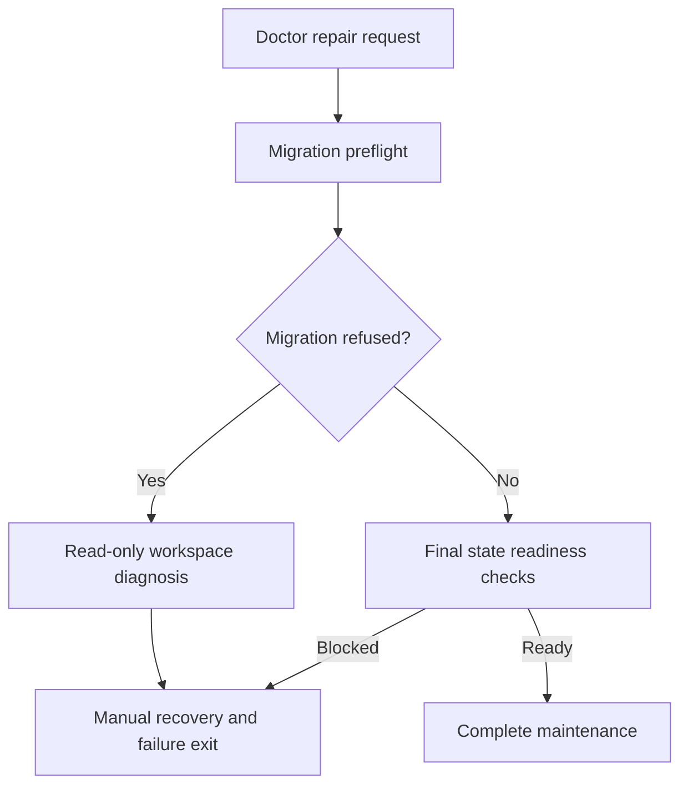

Codex review: needs maintainer review before merge. _Reviewed September 7, 2026, 2:39 AM ET / 06:39 UTC._

# ClawSweeper review

## What this changes

Doctor checks saved workspace state before reporting successful repair and gives path-specific manual recovery instructions for unsupported versions and retained migration inputs.

## Merge readiness

✅ **Ready for maintainer review**

This remains useful: current main still gives circular recovery guidance, and the merged related work explicitly excluded this follow-up. No actionable patch defect was found. The supplied test merge resolves the previous conflict blocker.

**Priority:** P2
**Reviewed head:** `44a026d0469a2c882ef709738b0f89fe968ec0a6`

## Review scores

| Measure | Result | What it means |
|---|---|---|
| **Overall readiness** | 🐚 platinum hermit **(4/6)** | A coherent recovery fix with meaningful regression coverage and no identified blocking defect. |
| **Proof confidence** | 🌊 off-meta tidepool | Not applicable: The supplied MEMBER association exempts this PR from the external-contributor proof gate, and no material authority change triggers additional proof. The body reports a built-CLI run covering the changed Doctor path, failure exit, and state preservation; that fixture was inspected but not rerun. |
| **Patch quality** | 🐚 platinum hermit **(4/6)** | No actionable review findings were identified. |

## Verification

| Check | Result | Evidence |
|---|---|---|
| **Real behavior** | Not applicable | Not applicable: The supplied MEMBER association exempts this PR from the external-contributor proof gate, and no material authority change triggers additional proof. The body reports a built-CLI run covering the changed Doctor path, failure exit, and state preservation; that fixture was inspected but not rerun. |
| **Evidence reviewed** | 8 items | Current main still needs the repair: At the fetched main revision, unsupported workspace versions still throw a Doctor repair instruction, and configured-workspace readiness checks only legacy sources rather than canonical workspace snapshots. Read-only diagnosis preserves refusal: The new preflight helper diagnoses workspace state after a migration refusal and rethrows that refusal. The readiness reader passes readOnly: true; its snapshot path does not register aliases or write workspace rows. Execution-policy preservation: The introduced exec-migration changes format diagnostics after the existing migration decision. Canonical-policy selection, source removal, locking, and receipt writes remain unchanged; successful removal keeps its distinct receipt-finalization warning. |
| **Findings** | None | None. |
| **Security** | None | None. |

## How this fits together

Doctor coordinates configuration and state repairs before allowing the Gateway to resume. Workspace and execution-policy checks determine whether repair can finish or must report an operator recovery action.

## Before merge

None.

<strong>Agent review details</strong>

### Security

None.

### PR surface

Source +100, Tests +170, Docs +11. Total +281 across 23 files.

View PR surface stats

| Area | Files | Added | Removed | Net |
|---|---:|---:|---:|---:|
| Source | 16 | 175 | 75 | +100 |
| Tests | 6 | 178 | 8 | +170 |
| Docs | 1 | 13 | 2 | +11 |
| Config | 0 | 0 | 0 | 0 |
| Generated | 0 | 0 | 0 | 0 |
| Other | 0 | 0 | 0 | 0 |
| **Total** | **23** | **366** | **85** | **+281** |

### Review metrics

| Metric | Value | Why it matters |
|---|---|---|
| **Production versus test growth** | Production +175/-75; tests +178/-8 | The PR explains the production growth as shared recovery messaging, caller propagation, and read-only completion checks. |

### Stored data model

Persistent data-model change detected: `migration/backfill/repair: src/agents/workspace-legacy-state.ts`, `migration/backfill/repair: src/agents/workspace-state-dirs.ts`, `migration/backfill/repair: src/agents/workspace-state-store.ts`, `migration/backfill/repair: src/commands/doctor-config-preflight-startup.ts`, `migration/backfill/repair: src/commands/doctor-config-preflight.ts`, `migration/backfill/repair: src/commands/doctor-skill-workshop-collection-backups.ts`, and 12 more. Migration or upgrade compatibility proof is recorded; maintainers should verify it before merge.

### Technical review

Best possible solution:

Keep recovery diagnosis in Doctor’s existing readiness owners, preserve unsupported state and execution policy, and retain established runtime migration guidance.

Do we have a high-confidence way to reproduce the issue?

Yes, source establishes the circular unsupported-version guidance and missing canonical readiness check; the combined CLI fixture provides a concrete regression path. It was not executed during this review.

Is this the best way to solve the issue?

Yes. Reusing the snapshot reader and existing refusal owners addresses the diagnosis gap without inventing policy, deleting unsupported state, or changing stored formats.

AGENTS.md: found and applied where relevant.

Codex review notes: model internal, reasoning medium; reviewed against [20e32c2fdf3e](https://github.com/openclaw/openclaw/commit/20e32c2fdf3eb7a7e74c37ce357624e38b4884d9).

### Labels

Label justifications:

- `P2`: This repairs misleading Doctor completion and recovery guidance for bounded unsupported-state conditions.
- `rating: 🐚 platinum hermit`: Overall readiness is 🐚 platinum hermit; proof is 🌊 off-meta tidepool and patch quality is 🐚 platinum hermit.
- `status: 👀 ready for maintainer look`: ClawSweeper has no concrete contributor-facing blocker left for this PR. Not applicable: The supplied MEMBER association exempts this PR from the external-contributor proof gate, and no material authority change triggers additional proof. The body reports a built-CLI run covering the changed Doctor path, failure exit, and state preservation; that fixture was inspected but not rerun.

### Evidence

What I checked:

- **Current main still needs the repair:** At the fetched main revision, unsupported workspace versions still throw a Doctor repair instruction, and configured-workspace readiness checks only legacy sources rather than canonical workspace snapshots. ([`src/agents/workspace-state-store.ts:250`](https://github.com/openclaw/openclaw/blob/20e32c2fdf3eb7a7e74c37ce357624e38b4884d9/src/agents/workspace-state-store.ts#L250), [20e32c2fdf3e](https://github.com/openclaw/openclaw/commit/20e32c2fdf3eb7a7e74c37ce357624e38b4884d9))
- **Read-only diagnosis preserves refusal:** The new preflight helper diagnoses workspace state after a migration refusal and rethrows that refusal. The readiness reader passes readOnly: true; its snapshot path does not register aliases or write workspace rows. ([`src/commands/doctor-config-preflight-startup.ts:189`](https://github.com/openclaw/openclaw/blob/44a026d0469a2c882ef709738b0f89fe968ec0a6/src/commands/doctor-config-preflight-startup.ts#L189), [44a026d0469a](https://github.com/openclaw/openclaw/commit/44a026d0469a2c882ef709738b0f89fe968ec0a6))
- **Execution-policy preservation:** The introduced exec-migration changes format diagnostics after the existing migration decision. Canonical-policy selection, source removal, locking, and receipt writes remain unchanged; successful removal keeps its distinct receipt-finalization warning. ([`src/infra/state-migrations.exec-approvals.ts:460`](https://github.com/openclaw/openclaw/blob/44a026d0469a2c882ef709738b0f89fe968ec0a6/src/infra/state-migrations.exec-approvals.ts#L460), [44a026d0469a](https://github.com/openclaw/openclaw/commit/44a026d0469a2c882ef709738b0f89fe968ec0a6))
- **Combined CLI regression:** The added regression runs the built Doctor CLI with workspace version 99 and conflicting legacy versus SQLite policy. It asserts exit 1, both offending paths, manual recovery, no repeated repair command, retained legacy bytes, and unchanged workspace version and canonical policy. The captured PR body reports this run passed; this review inspected the fixture and helper without executing them. ([`src/commands/doctor-config-preflight.refusal.process.test.ts:104`](https://github.com/openclaw/openclaw/blob/44a026d0469a2c882ef709738b0f89fe968ec0a6/src/commands/doctor-config-preflight.refusal.process.test.ts#L104), [44a026d0469a](https://github.com/openclaw/openclaw/commit/44a026d0469a2c882ef709738b0f89fe968ec0a6))
- **Previous conflict blocker resolved:** The test merge records the pinned base dca03cc7e846177b2dc737dc65e119e1046d2534 followed by the exact PR head. Comparison found no differences between the head and test merge in the central reviewed recovery files. The earlier reviewed commit was unavailable locally, so no patch-equivalence claim against that earlier head is made. ([178864d8a470](https://github.com/openclaw/openclaw/commit/178864d8a47092d7eeceebca97427bbd689b82ca))
- **Related merged work is distinct:** The supplied GitHub context verifies https://github.com/openclaw/openclaw/pull/139395 merged. Its body explicitly excludes unsupported-version and conflicting-policy recovery, establishing this PR as the separate follow-up rather than redundant work. ([57cc29293aee](https://github.com/openclaw/openclaw/commit/57cc29293aeead57e2174f68325f436ba6692f11))

Likely related people:

- **steipete:** Suggested for follow-up; no historical authorship or introduction is verified. (role: unverified routing candidate; confidence: low)
- **Jason (Json):** Suggested for follow-up; no historical authorship or introduction is verified. (role: unverified routing candidate; confidence: low)

### Rating scale

| Score | Internal tier | Crab rank | Meaning |
|---:|:---:|---|---|
| **6/6** | S | 🦀 challenger crab | Exceptional readiness |
| **5/6** | A | 🦞 diamond lobster | Very strong readiness |
| **4/6** | B | 🐚 platinum hermit | Good normal PR; ordinary maintainer review |
| **3/6** | C | 🦐 gold shrimp | Useful, but confidence is limited |
| **2/6** | D | 🦪 silver shellfish | Proof or implementation needs work |
| **1/6** | F | 🧂 unranked krab | Not merge-ready |
| N/A | NA | 🌊 off-meta tidepool | Rating does not apply |

Overall follows the weaker of proof and patch quality.
Shiny media proof means a screenshot, video, or linked artifact directly shows the changed behavior. Runtime, network, CSP, and security claims still need visible diagnostics.

### Workflow

- ClawSweeper keeps one durable marker-backed review comment per issue or PR.
- Re-runs edit this comment so the latest verdict, findings, and automation markers stay together instead of adding duplicate bot comments.
- A fresh review can be triggered by eligible `@clawsweeper re-review` comments, exact-item GitHub events, scheduled/background review runs, or manual workflow dispatch.
- PR/issue authors and users with repository write access can comment `@clawsweeper re-review` or `@clawsweeper re-run` on an open PR or issue to request a fresh review only.
- Maintainers can also comment `@clawsweeper review` to request a fresh review only.
- Fresh-review commands do not start repair, autofix, rebase, CI repair, or automerge.
- Maintainer-only repair and merge flows require explicit commands such as `@clawsweeper autofix`, `@clawsweeper automerge`, `@clawsweeper fix ci`, or `@clawsweeper address review`.
- Maintainers can comment `@clawsweeper explain` to ask for more context, or `@clawsweeper stop` to stop active automation.

### History

Review history (2 earlier review cycles)

<!-- clawsweeper-review-history v=1 total=2 -->
- reviewed 2026-09-07T05:29:41.602Z sha 89d11626af6a1106d483a976c172bd9e7cc330a1 :: needs maintainer review before merge. :: none
- reviewed 2026-09-07T06:22:15.130Z sha 07043e22c8b3fdae8461cd657bbbc164322e7953 :: blocked before merge. :: none

<!-- clawsweeper-verdict:needs-human item=140854 sha=44a026d0469a2c882ef709738b0f89fe968ec0a6 confidence=high updated_at=2026-09-07T06:36:26Z reviewed_at=2026-09-07T06:39:00.966Z lease_owner=github-run-34091467763-1 lease_comment_id=5566117664 source_revision=17c0a256d67bedd56ca12790953af7df57c6b3f96998146aab7e1deb7e53d7f0 live_verification=absent -->
<!-- clawsweeper-review-state:ready item=140854 sha=44a026d0469a2c882ef709738b0f89fe968ec0a6 v=1 -->

<!-- clawsweeper-review-version item=140854 reviewed_at=2026-09-07T06:39:00.966Z sha=44a026d0469a2c882ef709738b0f89fe968ec0a6 source_revision=17c0a256d67bedd56ca12790953af7df57c6b3f96998146aab7e1deb7e53d7f0 lease_owner=github-run-34091467763-1 lease_comment_id=5566117664 v=1 -->

<!-- clawsweeper-review item=140854 -->