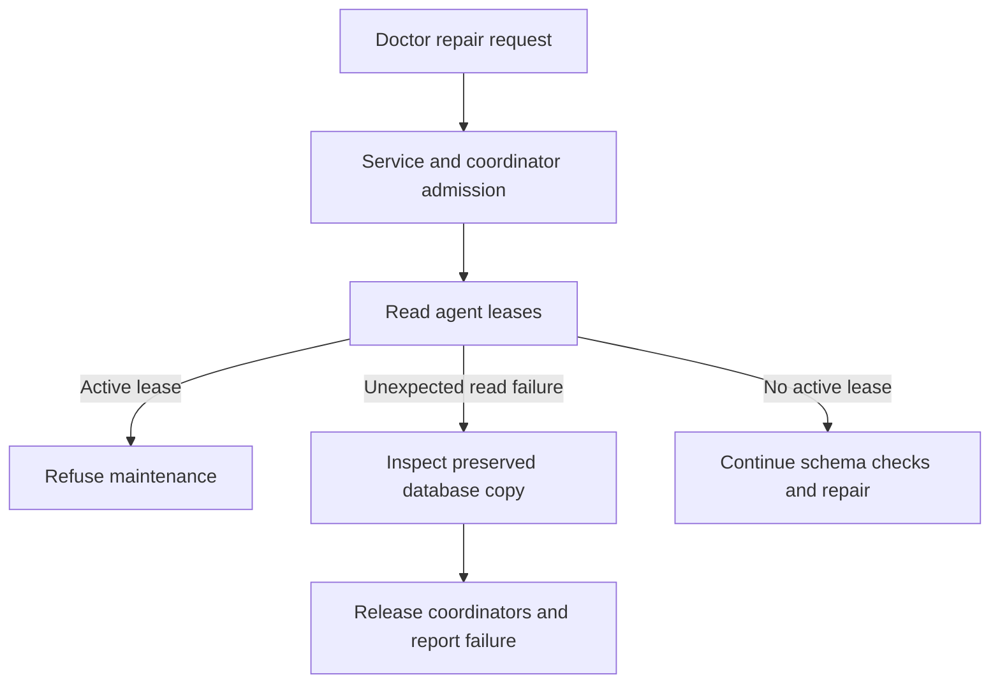

Codex review: blocked before merge. _Reviewed September 7, 2026, 10:31 PM ET / September 8, 2026, 02:31 UTC._

# ClawSweeper review

## What this changes

Doctor repair now reports the unreadable shared database’s path and backup recovery guidance using the same diagnostic as ordinary Doctor inspection.

## Merge readiness

⛔ **Blocked before merge - 1 item remains**

This PR remains useful: inspected main still replaces unreadable-state recovery guidance with a generic maintenance error. No introduced correctness or security defect was found.

**Priority:** P2
**Reviewed head:** `e8755e6a6ac3f184be6c1f13a40134f5fc7f3550`

## Review scores

| Measure | Result | What it means |
|---|---|---|
| **Overall readiness** | 🐚 platinum hermit **(4/6)** | A focused repair with existing behavioral regression coverage and no blocking finding. |
| **Proof confidence** | 🌊 off-meta tidepool | Not applicable: The supplied repository state identifies a MEMBER-authored PR, so the external-contributor proof gate does not apply. The body reports before/after Doctor regression results; the diagnostic-only change introduces no material authority transfer requiring separate final-effect proof. |
| **Patch quality** | 🐚 platinum hermit **(4/6)** | No actionable review findings were identified. |

## Verification

| Check | Result | Evidence |
|---|---|---|
| **Real behavior** | Not applicable | Not applicable: The supplied repository state identifies a MEMBER-authored PR, so the external-contributor proof gate does not apply. The body reports before/after Doctor regression results; the diagnostic-only change introduces no material authority transfer requiring separate final-effect proof. |
| **Evidence reviewed** | 7 items | Verified introduced change: The merge-base-to-head diff adds diagnostic classification after an unexpected lease-read failure, preserves immediate active-lease rejection, and releases coordinators before propagating the diagnostic. Still necessary on inspected main: Main calls the read-only lease checker directly and wraps its failure in generic stop-and-retry guidance before the health flow can produce the database-specific recovery message. Preserved-copy inspection and cleanup: The reused preflight requests preserveSourceArtifacts, opens the resulting snapshot read-only, returns after shared-state inspection for scope state, and closes the snapshot in finally. The new failure branch never grants repair admission. |
| **Findings** | None | None. |
| **Security** | None | None. |

## How this fits together

Doctor checks and repairs OpenClaw’s local configuration and databases. Explicit repair first coordinates with running processes; database inspection then determines whether repair can proceed or must report recovery instructions.

## Before merge

- [ ] **Add data-model compatibility proof** - Confirm migration or upgrade compatibility proof before merge.

<strong>Agent review details</strong>

### Security

None.

### PR surface

Source +40. Total +40 across 3 files.

View PR surface stats

| Area | Files | Added | Removed | Net |
|---|---:|---:|---:|---:|
| Source | 3 | 48 | 8 | +40 |
| Tests | 0 | 0 | 0 | 0 |
| Docs | 0 | 0 | 0 | 0 |
| Config | 0 | 0 | 0 | 0 |
| Generated | 0 | 0 | 0 | 0 |
| Other | 0 | 0 | 0 | 0 |
| **Total** | **3** | **48** | **8** | **+40** |

### Review metrics

None.

### Stored data model

Persistent data-model change detected: `migration/backfill/repair: src/commands/doctor-maintenance.ts`, `migration/backfill/repair: src/flows/doctor-health.ts`, `unknown-data-model-change: src/commands/doctor-maintenance.ts`. Confirm migration or upgrade compatibility proof before merge.

### Technical review

Best possible solution:

Keep one shared unreadable-state diagnostic while preserving lease rejection, database bytes, and coordinator cleanup.

Do we have a high-confidence way to reproduce the issue?

Yes, source establishes the failure path: non-SQLite shared-state bytes make repair’s lease query fail before the normal recovery diagnostic. Existing regression coverage exercises that exact case; it was not run during this review.

Is this the best way to solve the issue?

Yes. Reusing preserved-copy preflight only after an unexpected lease-read failure provides the missing diagnosis without bypassing admission or duplicating database classification.

AGENTS.md: found and applied where relevant.

Codex review notes: model internal, reasoning medium; reviewed against [009f929485ce](https://github.com/openclaw/openclaw/commit/009f929485cea13760d87bca66e5befb943765ad).

### Labels

Label changes:

- add `P2`: This repairs misleading recovery guidance for an unreadable database without changing successful repair behavior.
- add `rating: 🐚 platinum hermit`: Overall readiness is 🐚 platinum hermit; proof is 🌊 off-meta tidepool and patch quality is 🐚 platinum hermit.
- add `status: 👀 ready for maintainer look`: ClawSweeper has no concrete contributor-facing blocker left for this PR. Not applicable: The supplied repository state identifies a MEMBER-authored PR, so the external-contributor proof gate does not apply. The body reports before/after Doctor regression results; the diagnostic-only change introduces no material authority transfer requiring separate final-effect proof.

Label justifications:

- `P2`: This repairs misleading recovery guidance for an unreadable database without changing successful repair behavior.
- `rating: 🐚 platinum hermit`: Overall readiness is 🐚 platinum hermit; proof is 🌊 off-meta tidepool and patch quality is 🐚 platinum hermit.
- `status: 👀 ready for maintainer look`: ClawSweeper has no concrete contributor-facing blocker left for this PR. Not applicable: The supplied repository state identifies a MEMBER-authored PR, so the external-contributor proof gate does not apply. The body reports before/after Doctor regression results; the diagnostic-only change introduces no material authority transfer requiring separate final-effect proof.

### Evidence

What I checked:

- **Verified introduced change:** The merge-base-to-head diff adds diagnostic classification after an unexpected lease-read failure, preserves immediate active-lease rejection, and releases coordinators before propagating the diagnostic. ([`src/commands/doctor-maintenance.ts:163`](https://github.com/openclaw/openclaw/blob/e8755e6a6ac3f184be6c1f13a40134f5fc7f3550/src/commands/doctor-maintenance.ts#L163), [e8755e6a6ac3](https://github.com/openclaw/openclaw/commit/e8755e6a6ac3f184be6c1f13a40134f5fc7f3550))
- **Still necessary on inspected main:** Main calls the read-only lease checker directly and wraps its failure in generic stop-and-retry guidance before the health flow can produce the database-specific recovery message. ([`src/commands/doctor-maintenance.ts:162`](https://github.com/openclaw/openclaw/blob/009f929485cea13760d87bca66e5befb943765ad/src/commands/doctor-maintenance.ts#L162), [009f929485ce](https://github.com/openclaw/openclaw/commit/009f929485cea13760d87bca66e5befb943765ad))
- **Preserved-copy inspection and cleanup:** The reused preflight requests preserveSourceArtifacts, opens the resulting snapshot read-only, returns after shared-state inspection for scope state, and closes the snapshot in finally. The new failure branch never grants repair admission. ([`src/state/openclaw-database-preflight.ts:455`](https://github.com/openclaw/openclaw/blob/e8755e6a6ac3f184be6c1f13a40134f5fc7f3550/src/state/openclaw-database-preflight.ts#L455), [e8755e6a6ac3](https://github.com/openclaw/openclaw/commit/e8755e6a6ac3f184be6c1f13a40134f5fc7f3550))
- **Existing observable regression coverage:** The existing parameterized test runs plain Doctor and repair against non-SQLite bytes, checks the path, backup guidance and unchanged bytes, and rejects advice to rerun Doctor repair. The PR body reports the repair case failing before the fix and 102 focused tests passing afterward; this read-only review did not execute tests. ([`src/commands/doctor.refuses-newer-database-schemas.e2e.test.ts:92`](https://github.com/openclaw/openclaw/blob/e8755e6a6ac3f184be6c1f13a40134f5fc7f3550/src/commands/doctor.refuses-newer-database-schemas.e2e.test.ts#L92), [e8755e6a6ac3](https://github.com/openclaw/openclaw/commit/e8755e6a6ac3f184be6c1f13a40134f5fc7f3550))
- **Documented maintenance contract:** Doctor repair coordinates service shutdown before mutable inspection, preserves the installed service definition, and leaves independently owned or previously offline services unchanged. The patch retains those decisions. Public docs: [`docs/gateway/doctor.md`](https://docs.openclaw.ai/gateway/doctor). ([`docs/gateway/doctor.md:698`](https://docs.openclaw.ai/gateway/doctor), [e8755e6a6ac3](https://github.com/openclaw/openclaw/commit/e8755e6a6ac3f184be6c1f13a40134f5fc7f3550))
- **Related merged work and routing history:** Provided GitHub metadata identifies https://github.com/openclaw/openclaw/pull/141412 as merged. Local main history lists that admission change and several recent Doctor lifecycle changes by Peter Steinberger. This is a diagnostic follow-up, not a duplicate. Exact line-introduction verification was unavailable because required historical blobs could not be fetched. ([`src/commands/doctor-maintenance.ts`](https://github.com/openclaw/openclaw/blob/662080ac830ea15d147a498d72a1abf884e48b37/src/commands/doctor-maintenance.ts), [662080ac830e](https://github.com/openclaw/openclaw/commit/662080ac830ea15d147a498d72a1abf884e48b37))

Likely related people:

- **steipete:** Suggested for follow-up; no historical authorship or introduction is verified. (role: unverified routing candidate; confidence: low)

### Rating scale

| Score | Internal tier | Crab rank | Meaning |
|---:|:---:|---|---|
| **6/6** | S | 🦀 challenger crab | Exceptional readiness |
| **5/6** | A | 🦞 diamond lobster | Very strong readiness |
| **4/6** | B | 🐚 platinum hermit | Good normal PR; ordinary maintainer review |
| **3/6** | C | 🦐 gold shrimp | Useful, but confidence is limited |
| **2/6** | D | 🦪 silver shellfish | Proof or implementation needs work |
| **1/6** | F | 🧂 unranked krab | Not merge-ready |
| N/A | NA | 🌊 off-meta tidepool | Rating does not apply |

Overall follows the weaker of proof and patch quality.
Shiny media proof means a screenshot, video, or linked artifact directly shows the changed behavior. Runtime, network, CSP, and security claims still need visible diagnostics.

### Workflow

- ClawSweeper keeps one durable marker-backed review comment per issue or PR.
- Re-runs edit this comment so the latest verdict, findings, and automation markers stay together instead of adding duplicate bot comments.
- A fresh review can be triggered by eligible `@clawsweeper re-review` comments, exact-item GitHub events, scheduled/background review runs, or manual workflow dispatch.
- PR/issue authors and users with repository write access can comment `@clawsweeper re-review` or `@clawsweeper re-run` on an open PR or issue to request a fresh review only.
- Maintainers can also comment `@clawsweeper review` to request a fresh review only.
- Fresh-review commands do not start repair, autofix, rebase, CI repair, or automerge.
- Maintainer-only repair and merge flows require explicit commands such as `@clawsweeper autofix`, `@clawsweeper automerge`, `@clawsweeper fix ci`, or `@clawsweeper address review`.
- Maintainers can comment `@clawsweeper explain` to ask for more context, or `@clawsweeper stop` to stop active automation.

<!-- clawsweeper-verdict:needs-human item=141776 sha=e8755e6a6ac3f184be6c1f13a40134f5fc7f3550 confidence=high updated_at=2026-09-08T02:29:05Z reviewed_at=2026-09-08T02:31:01.568Z lease_owner=github-run-34179952390-1 lease_comment_id=5578195650 source_revision=495586cd7d24d0b6916e1ab55d062f00dda70f89149fb6b07aca61d15bc0864c live_verification=absent -->
<!-- clawsweeper-review-state:blocked item=141776 sha=e8755e6a6ac3f184be6c1f13a40134f5fc7f3550 v=1 -->

<!-- clawsweeper-review-version item=141776 reviewed_at=2026-09-08T02:31:01.568Z sha=e8755e6a6ac3f184be6c1f13a40134f5fc7f3550 source_revision=495586cd7d24d0b6916e1ab55d062f00dda70f89149fb6b07aca61d15bc0864c lease_owner=github-run-34179952390-1 lease_comment_id=5578195650 v=1 -->

<!-- clawsweeper-review item=141776 -->