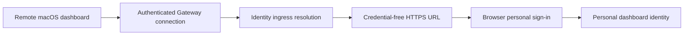

Codex review: blocked before merge. _Reviewed September 4, 2026, 11:40 AM ET / 15:40 UTC._

# ClawSweeper review

## What this changes

The PR makes remote macOS dashboards use a verified personal browser identity instead of shared Gateway credentials when a safe public identity ingress is available.

## Regression provenance

Possible regression — probable (reproduction; reviewed change). No predecessor PR is attributed.

## Merge readiness

⛔ **Blocked before merge - 4 items remain**

The PR remains necessary and its identity-routing and lifecycle boundaries are internally coherent; no introduced correctness or security defect was found. A release owner should explicitly accept deployment-stage signed-Mac Team sign-in verification before merge.

**Priority:** P1
**Reviewed head:** `ab76a915d5dc23a963e82fa8fc3d4fad8465419a`
**Owner decision:** Required. See [Decision needed](#decision-needed).

## Review scores

| Measure | Result | What it means |
|---|---|---|
| **Overall readiness** | 🦐 gold shrimp **(3/6)** | The implementation and boundary coverage are strong, while real signed-Mac Team identity behavior remains to be recorded after deployment. |
| **Proof confidence** | 🦐 gold shrimp **(3/6)** | Not applicable: Automated and synthetic evidence supports the patch; the remaining signed-Mac Team observation is a deployment-stage maintainer check, not an external-contributor proof requirement. |
| **Patch quality** | 🦞 diamond lobster **(5/6)** | No actionable review findings were identified. |

## Verification

| Check | Result | Evidence |
|---|---|---|
| **Real behavior** | Not applicable | Not applicable: Automated and synthetic evidence supports the patch; the remaining signed-Mac Team observation is a deployment-stage maintainer check, not an external-contributor proof requirement. |
| **Evidence reviewed** | 6 items | Gateway identity owner: The resolver permits trusted-proxy origins or a live Tailscale Serve claim only, and never advertises Funnel as a personal-identity ingress. Route lifetime is enforced: Operator hello records the identity URL immediately before delivery and closes connections when the associated Serve route is withdrawn. macOS credential separation: The dashboard selects a browser-identity authentication mode without a token or password and suppresses native TLS parameters for that route. |
| **Findings** | None | None. |
| **Security** | None | None. |

## How this fits together

The Gateway advertises a credential-free identity URL to authenticated operator clients. The macOS dashboard opens that URL for browser sign-in while native device operations remain on the existing Gateway connection.

## Decision needed

| Question | Recommendation |
|---|---|
| Is canonical-deployment signed-Mac Team personal-identity verification, with an accountable rollback owner, acceptable instead of staged pre-merge SSO proof? | **Accept deployment-stage verification:** Merge with a named owner for a redacted signed-Mac Team sign-in observation and rollback if personal identity is not used. |

Why: The source and regression coverage support the patch, but the actual Team identity ingress requires deployment-specific signed-app evidence unavailable in this read-only checkout.

## Before merge

- [ ] **Resolve merge risk (P1)** - The authentication path changes from shared device credentials to browser identity; real signed-Mac Team SSO behavior is planned for canonical deployment rather than independently demonstrated before merge.
- [ ] **Resolve merge risk (P1)** - The bug fix adds a net 419 production lines across Gateway, protocol, macOS, and Control UI ownership boundaries; the added lifecycle enforcement is justified, but it merits explicit release-owner acceptance.
- [ ] **Complete next step (P2)** - Confirm whether canonical deployment plus redacted signed-Mac Team sign-in verification is acceptable before merge.
- [ ] **Resolve maintainer decision** - Resolve the maintainer decision shown above before merge.

<strong>Agent review details</strong>

### Security

None.

### PR surface

Source +87, Tests +334, Docs +23, Other +1286. Total +1730 across 32 files.

View PR surface stats

| Area | Files | Added | Removed | Net |
|---|---:|---:|---:|---:|
| Source | 9 | 128 | 41 | +87 |
| Tests | 5 | 364 | 30 | +334 |
| Docs | 2 | 23 | 0 | +23 |
| Config | 0 | 0 | 0 | 0 |
| Generated | 0 | 0 | 0 | 0 |
| Other | 16 | 1623 | 337 | +1286 |
| **Total** | **32** | **2138** | **408** | **+1730** |

### Review metrics

| Metric | Value | Why it matters |
|---|---|---|
| **Production and test delta** | production +709/-290; tests/support +1400/-117; docs +23 | The production growth implements identity ingress and lifecycle isolation; its authentication-route impact requires release validation. |

### Root-cause cluster

Relationship: `fixed_by_candidate`
Canonical: https://github.com/openclaw/openclaw/issues/137916
Summary: This PR is the candidate fix for the reported macOS remote-dashboard identity issue.

Members:
- `canonical`: https://github.com/openclaw/openclaw/issues/137916 - The issue describes the shared-owner identity behavior addressed by this PR.

Proposal only: this assessment does not dispatch repair, suppress jobs, mutate sibling items, close, or merge anything.

### Merge-risk options

**Maintainer options:**
1. **Accept deployment-stage validation (recommended)**  
   Merge only with explicit ownership for a redacted signed-Mac Team sign-in check and rollback if the browser identity route fails.
2. **Require staged identity proof**  
   Pause until a representative signed-app Team identity flow is observed before landing.

### Technical review

Best possible solution:

Obtain explicit release-owner acceptance of the canonical post-deployment signed-Mac Team sign-in check and rollback ownership before merge.

Do we have a high-confidence way to reproduce the issue?

Yes—source shows the prior remote dashboard path used shared credentials, and the issue supplies an observed signed-macOS reproduction; this read-only review did not execute it locally.

Is this the best way to solve the issue?

Yes—the PR preserves native device access while using a validated credential-free public ingress for personal browser identity.

AGENTS.md: found and applied where relevant.

Codex review notes: model internal, reasoning high; reviewed against [407a8f453c0f](https://github.com/openclaw/openclaw/commit/407a8f453c0f0306af1ddc0aafa8697c1d49a9e7).

### Labels

Label changes:

- add `rating: 🦐 gold shrimp`: Overall readiness is 🦐 gold shrimp; proof is 🦐 gold shrimp and patch quality is 🦞 diamond lobster.
- remove `rating: 🐚 platinum hermit`: Current PR rating is `rating: 🦐 gold shrimp`, so this older rating label is no longer current.

Label justifications:

- `P1`: The PR repairs personal identity and message attribution for remote team macOS dashboards.
- `merge-risk: 🚨 auth-provider`: Merging switches eligible remote dashboards from shared native credentials to browser-authenticated personal identity.
- `rating: 🦐 gold shrimp`: Overall readiness is 🦐 gold shrimp; proof is 🦐 gold shrimp and patch quality is 🦞 diamond lobster.
- `status: 👀 ready for maintainer look`: ClawSweeper has no concrete contributor-facing blocker left for this PR. Not applicable: Automated and synthetic evidence supports the patch; the remaining signed-Mac Team observation is a deployment-stage maintainer check, not an external-contributor proof requirement.

### Evidence

Acceptance criteria:

- [P1] After canonical deployment, open the signed macOS app against a Team Gateway with a verified browser identity and confirm personal footer and message attribution without a shared native token.

What I checked:

- **Gateway identity owner:** The resolver permits trusted-proxy origins or a live Tailscale Serve claim only, and never advertises Funnel as a personal-identity ingress. ([`src/gateway/control-ui-identity.ts:17`](https://github.com/openclaw/openclaw/blob/ab76a915d5dc23a963e82fa8fc3d4fad8465419a/src/gateway/control-ui-identity.ts#L17), [ab76a915d5dc](https://github.com/openclaw/openclaw/commit/ab76a915d5dc23a963e82fa8fc3d4fad8465419a))
- **Route lifetime is enforced:** Operator hello records the identity URL immediately before delivery and closes connections when the associated Serve route is withdrawn. ([`src/gateway/server/ws-connection/connect-hello.ts:230`](https://github.com/openclaw/openclaw/blob/ab76a915d5dc23a963e82fa8fc3d4fad8465419a/src/gateway/server/ws-connection/connect-hello.ts#L230), [ab76a915d5dc](https://github.com/openclaw/openclaw/commit/ab76a915d5dc23a963e82fa8fc3d4fad8465419a))
- **macOS credential separation:** The dashboard selects a browser-identity authentication mode without a token or password and suppresses native TLS parameters for that route. ([`apps/macos/Sources/OpenClaw/DashboardManager.swift:1042`](https://github.com/openclaw/openclaw/blob/ab76a915d5dc23a963e82fa8fc3d4fad8465419a/apps/macos/Sources/OpenClaw/DashboardManager.swift#L1042), [ab76a915d5dc](https://github.com/openclaw/openclaw/commit/ab76a915d5dc23a963e82fa8fc3d4fad8465419a))
- **Protocol and client contract:** The public protocol documentation requires a credential-free HTTPS URL, normal browser TLS trust, and reconnect after Serve route replacement. Public docs: [`docs/gateway/protocol.md`](https://docs.openclaw.ai/gateway/protocol). ([`docs/gateway/protocol.md:252`](https://docs.openclaw.ai/gateway/protocol), [ab76a915d5dc](https://github.com/openclaw/openclaw/commit/ab76a915d5dc23a963e82fa8fc3d4fad8465419a))
- **Current-main comparison:** Fetched main has no browser-identity advertisement at the hello delivery point, while the PR adds the resolver and modifies the macOS dashboard owner; it is not superseded by current main. ([`src/gateway/server/ws-connection/connect-hello.ts:230`](https://github.com/openclaw/openclaw/blob/407a8f453c0f0306af1ddc0aafa8697c1d49a9e7/src/gateway/server/ws-connection/connect-hello.ts#L230), [407a8f453c0f](https://github.com/openclaw/openclaw/commit/407a8f453c0f0306af1ddc0aafa8697c1d49a9e7))
- **Targeted regression coverage:** Gateway tests cover eligibility, route withdrawal, replacement, and reconnect; macOS tests cover validated identity URL use and dashboard-window lifecycle. ([`src/gateway/server/ws-connection/connect-hello.update-scope.test.ts:177`](https://github.com/openclaw/openclaw/blob/ab76a915d5dc23a963e82fa8fc3d4fad8465419a/src/gateway/server/ws-connection/connect-hello.update-scope.test.ts#L177), [ab76a915d5dc](https://github.com/openclaw/openclaw/commit/ab76a915d5dc23a963e82fa8fc3d4fad8465419a))

Likely related people:

- **steipete:** Suggested for follow-up; no historical authorship or introduction is verified. (role: unverified routing candidate; confidence: low)

### Rank-up moves

Optional improvements that raise the rating; they are not merge blockers.

- Record the planned redacted signed-Mac Team personal-identity result after canonical deployment.

### Rating scale

| Score | Internal tier | Crab rank | Meaning |
|---:|:---:|---|---|
| **6/6** | S | 🦀 challenger crab | Exceptional readiness |
| **5/6** | A | 🦞 diamond lobster | Very strong readiness |
| **4/6** | B | 🐚 platinum hermit | Good normal PR; ordinary maintainer review |
| **3/6** | C | 🦐 gold shrimp | Useful, but confidence is limited |
| **2/6** | D | 🦪 silver shellfish | Proof or implementation needs work |
| **1/6** | F | 🧂 unranked krab | Not merge-ready |
| N/A | NA | 🌊 off-meta tidepool | Rating does not apply |

Overall follows the weaker of proof and patch quality.
Shiny media proof means a screenshot, video, or linked artifact directly shows the changed behavior. Runtime, network, CSP, and security claims still need visible diagnostics.

### Workflow

- ClawSweeper keeps one durable marker-backed review comment per issue or PR.
- Re-runs edit this comment so the latest verdict, findings, and automation markers stay together instead of adding duplicate bot comments.
- A fresh review can be triggered by eligible `@clawsweeper re-review` comments, exact-item GitHub events, scheduled/background review runs, or manual workflow dispatch.
- PR/issue authors and users with repository write access can comment `@clawsweeper re-review` or `@clawsweeper re-run` on an open PR or issue to request a fresh review only.
- Maintainers can also comment `@clawsweeper review` to request a fresh review only.
- Fresh-review commands do not start repair, autofix, rebase, CI repair, or automerge.
- Maintainer-only repair and merge flows require explicit commands such as `@clawsweeper autofix`, `@clawsweeper automerge`, `@clawsweeper fix ci`, or `@clawsweeper address review`.
- Maintainers can comment `@clawsweeper explain` to ask for more context, or `@clawsweeper stop` to stop active automation.

### History

Review history (10 earlier review cycles; latest 8 shown)

<!-- clawsweeper-review-history v=1 total=10 -->
- reviewed 2026-09-04T06:09:02.783Z sha 2e643bdf66e777a16a2f069a50cdc660d669c1f0 :: blocked before merge. :: [P1] Bind browser identity URLs to the actual identity ingress
- reviewed 2026-09-04T09:30:55.556Z sha 5e8273a6f73e00a3ebc605bc8c0fbff0403a7ee4 :: blocked before merge. :: [P1] Withdraw browser identity URLs when Serve exits
- reviewed 2026-09-04T09:40:30.956Z sha 5e8273a6f73e00a3ebc605bc8c0fbff0403a7ee4 :: blocked before merge. :: [P1] Withdraw cached browser identity after Serve exit
- reviewed 2026-09-04T10:24:30.702Z sha a0339266500e0fedf23b804d60b547e5e892618f :: blocked before merge. :: [P1] Await the profile fleet lookup
- reviewed 2026-09-04T11:12:51.025Z sha ca9133a31ee742e644ec272c3623e46dabcc23b3 :: blocked before merge. :: none
- reviewed 2026-09-04T12:08:02.148Z sha 87637cc129ee0b68deb9836eabf489fc47fe172b :: blocked before merge. :: none
- reviewed 2026-09-04T13:41:29.182Z sha 87637cc129ee0b68deb9836eabf489fc47fe172b :: blocked before merge. :: none
- reviewed 2026-09-04T14:50:59.146Z sha ab76a915d5dc23a963e82fa8fc3d4fad8465419a :: blocked before merge. :: none

<!-- clawsweeper-verdict:needs-human item=137933 sha=ab76a915d5dc23a963e82fa8fc3d4fad8465419a confidence=high updated_at=2026-09-04T15:35:09Z reviewed_at=2026-09-04T15:40:49.993Z lease_owner=github-run-33890068369-1 lease_comment_id=5542835856 source_revision=27bedc3215b87d596628021806262b019c2ca700501b113d9c6ead79266f4738 live_verification=absent -->
<!-- clawsweeper-review-state:blocked item=137933 sha=ab76a915d5dc23a963e82fa8fc3d4fad8465419a v=1 -->

<!-- clawsweeper-review-version item=137933 reviewed_at=2026-09-04T15:40:49.993Z sha=ab76a915d5dc23a963e82fa8fc3d4fad8465419a source_revision=27bedc3215b87d596628021806262b019c2ca700501b113d9c6ead79266f4738 lease_owner=github-run-33890068369-1 lease_comment_id=5542835856 v=1 -->

<!-- clawsweeper-review item=137933 -->