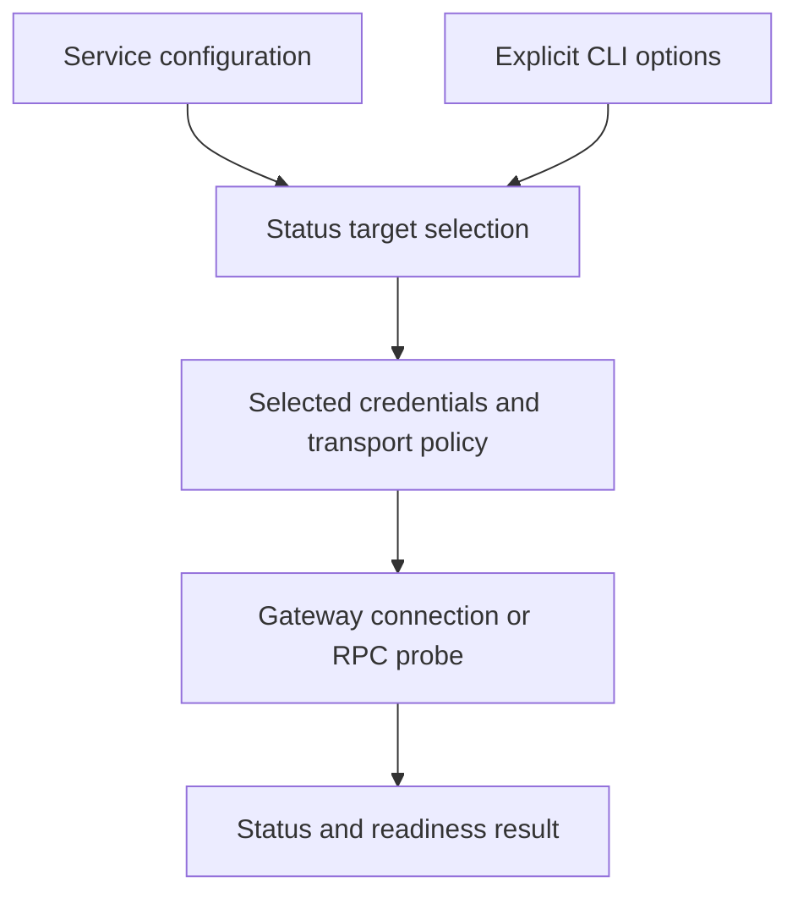

Codex review: needs real behavior proof before merge. _Reviewed September 7, 2026, 1:03 AM ET / 05:03 UTC._

# ClawSweeper review

## What this changes

The PR keeps Gateway service-status probes tied to their selected target and credentials, preserves endpoint-scoped proxy headers and certificate pins, and prevents advisory plugin reads from creating database sidecars.

## Merge readiness

⛔ **Blocked before merge - 3 items remain**

This remains a useful fix for a bug present on current main and the latest release. The previous saved-pin finding is resolved, and no remaining actionable code defect was found; transport proof for that correction is still outstanding.

**Priority:** P1
**Reviewed head:** `5819c53f08df82fc495cd63c69c97b1b4ac1fbf8`

## Review scores

| Measure | Result | What it means |
|---|---|---|
| **Overall readiness** | 🦐 gold shrimp **(3/6)** | The implementation addresses prior findings, but the remaining authority-boundary proof gap prevents merge readiness. |
| **Proof confidence** | 🦐 gold shrimp **(3/6)** | Needs stronger real behavior proof before merge: Authority-chain proof required: earlier managed-service and real-socket credential evidence remains valid, but the captured body explicitly leaves the new gather-to-TLS cases unexecuted. Provide redacted transport output showing saved-pin success and wrong-certificate rejection before HTTP headers or credentials; the existing production-path harness is suitable. Redact private addresses, keys, and endpoints, then update the PR body to trigger review; if needed, ask a maintainer for `@clawsweeper re-review`. |
| **Patch quality** | 🦐 gold shrimp **(3/6)** | No actionable review findings were identified. |

## Verification

| Check | Result | Evidence |
|---|---|---|
| **Real behavior** | Needs proof | Needs stronger real behavior proof before merge: Authority-chain proof required: earlier managed-service and real-socket credential evidence remains valid, but the captured body explicitly leaves the new gather-to-TLS cases unexecuted. Provide redacted transport output showing saved-pin success and wrong-certificate rejection before HTTP headers or credentials; the existing production-path harness is suitable. Redact private addresses, keys, and endpoints, then update the PR body to trigger review; if needed, ask a maintainer for `@clawsweeper re-review`. |
| **Evidence reviewed** | 10 items | Current-main necessity: Current main still forwards every required-RPC status target as callGateway.url, which bootstrap classifies as an explicit CLI override. The linked report establishes the resulting auth-none failure. Latest-release check: The supplied latest release, v2026.9.2, also forwards the service-derived URL through the explicit URL argument; the central repair is not present there. Established status contract and linked issue: docs/cli/gateway.md distinguishes explicit URLs from service-derived targets and defines --require-rpc as a read-capability check. https://github.com/openclaw/openclaw/issues/135471 supplies native-service reproduction and is explicitly paired with this open candidate. |
| **Findings** | None | None. |
| **Security** | None | None. |

## How this fits together

Gateway status combines native-service details, configuration, and explicit CLI options to select a connection target. Its probes then report connectivity or read-capability status to operators and readiness scripts.

## Before merge

- [ ] **Add real behavior proof** - Needs stronger real behavior proof before merge: Authority-chain proof required: earlier managed-service and real-socket credential evidence remains valid, but the captured body explicitly leaves the new gather-to-TLS cases unexecuted. Provide redacted transport output showing saved-pin success and wrong-certificate rejection before HTTP headers or credentials; the existing production-path harness is suitable. Redact private addresses, keys, and endpoints, then update the PR body to trigger review; if needed, ask a maintainer for `@clawsweeper re-review`.
- [ ] **Resolve merge risk (P1)** - The changed projection carries credentials and certificate policy to the transport boundary, but the latest matching-pin and wrong-certificate cases lack recorded execution results; rejection before credential-bearing HTTP traffic remains unproven for this correction.
- [ ] **Complete next step (P2)** - Add the outstanding after-fix TLS transport evidence to the PR body before merge.

<strong>Agent review details</strong>

### Security

None.

### PR surface

Source +64, Tests +476. Total +540 across 10 files.

View PR surface stats

| Area | Files | Added | Removed | Net |
|---|---:|---:|---:|---:|
| Source | 6 | 87 | 23 | +64 |
| Tests | 4 | 505 | 29 | +476 |
| Docs | 0 | 0 | 0 | 0 |
| Config | 0 | 0 | 0 | 0 |
| Generated | 0 | 0 | 0 | 0 |
| Other | 0 | 0 | 0 | 0 |
| **Total** | **10** | **592** | **52** | **+540** |

### Review metrics

| Metric | Value | Why it matters |
|---|---|---|
| **Production versus regression coverage** | Production net +64 lines; tests net +476 lines | Production growth carries target provenance and a command-local credential view; most added code exercises isolation and transport boundaries. |

### Root-cause cluster

Relationship: `fixed_by_candidate`
Canonical: https://github.com/openclaw/openclaw/issues/135471
Summary: This PR is the explicitly linked implementation candidate for the service-target classification bug.

Members:
- `canonical`: https://github.com/openclaw/openclaw/issues/135471 - The open issue records the native-service failure and required explicit-URL isolation contract.

Proposal only: this assessment does not dispatch repair, suppress jobs, mutate sibling items, close, or merge anything.

### Merge-risk options

**Maintainer options:**
1. **Complete the existing transport proof (recommended)**  
   Provide observed matching-pin success and mismatch rejection before HTTP headers or credentials leave the corrected status flow.

### Technical review

Best possible solution:

Keep the service-owned target and credential flow, with transport evidence confirming that existing pinned endpoints still work and a wrong certificate receives no headers or Gateway credentials.

Do we have a high-confidence way to reproduce the issue?

Yes: the linked native-service report and current-main caller/bootstrap chain establish why auth-none status fails without an explicit URL. This review did not execute that flow.

Is this the best way to solve the issue?

Yes: preserving target provenance and freezing credentials at the status owner repairs the mismatch without weakening the generic explicit-URL guard; the previous endpoint-policy omissions are now corrected.

AGENTS.md: found and applied where relevant.

Codex review notes: model internal, reasoning medium; reviewed against [85c00af82973](https://github.com/openclaw/openclaw/commit/85c00af82973c1899cac7713ba3a07d611b2ac56).

### Labels

Label changes:

- remove `merge-risk: 🚨 compatibility`: Current PR review merge-risk labels are `merge-risk: 🚨 security-boundary`.

Label justifications:

- `P1`: A healthy auth-none Gateway currently fails the documented RPC readiness check used by operator automation.
- `merge-risk: 🚨 security-boundary`: The corrected credential-bearing transport path still needs observed rejection of a mismatched certificate before HTTP traffic.
- `rating: 🦐 gold shrimp`: Overall readiness is 🦐 gold shrimp; proof is 🦐 gold shrimp and patch quality is 🦐 gold shrimp.
- `status: 📣 needs proof`: The PR needs real behavior proof before ClawSweeper can clear the contributor ask. Needs stronger real behavior proof before merge: Authority-chain proof required: earlier managed-service and real-socket credential evidence remains valid, but the captured body explicitly leaves the new gather-to-TLS cases unexecuted. Provide redacted transport output showing saved-pin success and wrong-certificate rejection before HTTP headers or credentials; the existing production-path harness is suitable. Redact private addresses, keys, and endpoints, then update the PR body to trigger review; if needed, ask a maintainer for `@clawsweeper re-review`.

### Evidence

What I checked:

- **Current-main necessity:** Current main still forwards every required-RPC status target as callGateway.url, which bootstrap classifies as an explicit CLI override. The linked report establishes the resulting auth-none failure. ([`src/cli/daemon-cli/probe.ts:86`](https://github.com/openclaw/openclaw/blob/85c00af82973c1899cac7713ba3a07d611b2ac56/src/cli/daemon-cli/probe.ts#L86), [85c00af82973](https://github.com/openclaw/openclaw/commit/85c00af82973c1899cac7713ba3a07d611b2ac56))
- **Latest-release check:** The supplied latest release, v2026.9.2, also forwards the service-derived URL through the explicit URL argument; the central repair is not present there. ([`src/cli/daemon-cli/probe.ts:86`](https://github.com/openclaw/openclaw/blob/3928bad9badfcb6c7d140530435e806fb8092190/src/cli/daemon-cli/probe.ts#L86), [3928bad9badf](https://github.com/openclaw/openclaw/commit/3928bad9badfcb6c7d140530435e806fb8092190))
- **Established status contract and linked issue:** docs/cli/gateway.md distinguishes explicit URLs from service-derived targets and defines --require-rpc as a read-capability check. https://github.com/openclaw/openclaw/issues/135471 supplies native-service reproduction and is explicitly paired with this open candidate. Public docs: [`docs/cli/gateway.md`](https://docs.openclaw.ai/cli/gateway). ([`docs/cli/gateway.md:406`](https://docs.openclaw.ai/cli/gateway), [5819c53f08df](https://github.com/openclaw/openclaw/commit/5819c53f08df82fc495cd63c69c97b1b4ac1fbf8))
- **Previous finding resolved:** The command-local projection now retains remote URL scope, edgeAuth, and tlsFingerprint while excluding remote token/password and local TLS configuration. The ordinary probe's existing exact-endpoint selector can therefore receive the saved pin again. ([`src/cli/daemon-cli/status.gateway.ts:75`](https://github.com/openclaw/openclaw/blob/5819c53f08df82fc495cd63c69c97b1b4ac1fbf8/src/cli/daemon-cli/status.gateway.ts#L75), [5819c53f08df](https://github.com/openclaw/openclaw/commit/5819c53f08df82fc495cd63c69c97b1b4ac1fbf8))
- **Production transport boundary:** The ordinary probe selects a saved pin only for the exact configured endpoint. The shared transport validates the peer fingerprint before ending the HTTP upgrade request and destroys the request on mismatch. ([`packages/gateway-client/src/websocket-transport.ts:138`](https://github.com/openclaw/openclaw/blob/5819c53f08df82fc495cd63c69c97b1b4ac1fbf8/packages/gateway-client/src/websocket-transport.ts#L138), [5819c53f08df](https://github.com/openclaw/openclaw/commit/5819c53f08df82fc495cd63c69c97b1b4ac1fbf8))
- **Relevant TLS cases added, execution not established:** The new gather tests delegate to the real ordinary probe and TLS WebSocket client. Matching-pin assertions observe the proxy header and explicit token; mismatch assertions require zero decrypted HTTP bytes, upgrades, headers, and connect tokens. The captured PR body expressly says these new cases have not yet run and makes no new TLS execution claim. ([`src/cli/daemon-cli/status.gather.test.ts:733`](https://github.com/openclaw/openclaw/blob/5819c53f08df82fc495cd63c69c97b1b4ac1fbf8/src/cli/daemon-cli/status.gather.test.ts#L733), [5819c53f08df](https://github.com/openclaw/openclaw/commit/5819c53f08df82fc495cd63c69c97b1b4ac1fbf8))

Likely related people:

- **vincentkoc:** Suggested for follow-up; no historical authorship or introduction is verified. (role: unverified routing candidate; confidence: low)
- **steipete:** Suggested for follow-up; no historical authorship or introduction is verified. (role: unverified routing candidate; confidence: low)

### Rank-up moves

Optional improvements that raise the rating; they are not merge blockers.

- Publish after-fix transport observations for both saved-pin acceptance and mismatch rejection before credential-bearing traffic.

### Rating scale

| Score | Internal tier | Crab rank | Meaning |
|---:|:---:|---|---|
| **6/6** | S | 🦀 challenger crab | Exceptional readiness |
| **5/6** | A | 🦞 diamond lobster | Very strong readiness |
| **4/6** | B | 🐚 platinum hermit | Good normal PR; ordinary maintainer review |
| **3/6** | C | 🦐 gold shrimp | Useful, but confidence is limited |
| **2/6** | D | 🦪 silver shellfish | Proof or implementation needs work |
| **1/6** | F | 🧂 unranked krab | Not merge-ready |
| N/A | NA | 🌊 off-meta tidepool | Rating does not apply |

Overall follows the weaker of proof and patch quality.
Shiny media proof means a screenshot, video, or linked artifact directly shows the changed behavior. Runtime, network, CSP, and security claims still need visible diagnostics.

### Workflow

- ClawSweeper keeps one durable marker-backed review comment per issue or PR.
- Re-runs edit this comment so the latest verdict, findings, and automation markers stay together instead of adding duplicate bot comments.
- A fresh review can be triggered by eligible `@clawsweeper re-review` comments, exact-item GitHub events, scheduled/background review runs, or manual workflow dispatch.
- PR/issue authors and users with repository write access can comment `@clawsweeper re-review` or `@clawsweeper re-run` on an open PR or issue to request a fresh review only.
- Maintainers can also comment `@clawsweeper review` to request a fresh review only.
- Fresh-review commands do not start repair, autofix, rebase, CI repair, or automerge.
- Maintainer-only repair and merge flows require explicit commands such as `@clawsweeper autofix`, `@clawsweeper automerge`, `@clawsweeper fix ci`, or `@clawsweeper address review`.
- Maintainers can comment `@clawsweeper explain` to ask for more context, or `@clawsweeper stop` to stop active automation.

### History

Review history (37 earlier review cycles; latest 8 shown)

<!-- clawsweeper-review-history v=1 total=37 -->
- reviewed 2026-09-03T10:16:20.226Z sha d7b804b396fe6b21fd4976054955e9992fc0e94d :: needs real behavior proof before merge. :: none
- reviewed 2026-09-03T10:50:16.438Z sha d7b804b396fe6b21fd4976054955e9992fc0e94d :: blocked before merge. :: none
- reviewed 2026-09-03T15:38:50.255Z sha 0349fb6b747e5aca9ddea6803f1e480ba6767555 :: blocked before merge. :: none
- reviewed 2026-09-03T15:52:56.466Z sha 7ab99eac57a3becf7af90391abe22f8b89964947 :: blocked before merge. :: none
- reviewed 2026-09-07T04:16:19.745Z sha 74b0c048d158aa11c19714aabaff3ff472b11caa :: needs real behavior proof before merge. :: [P1] Preserve origin-scoped edge auth for explicit status targets
- reviewed 2026-09-07T04:25:50.841Z sha e59df612539b1d3d2ffc0179d4526799f58f0545 :: needs real behavior proof before merge. :: [P1] Preserve origin-scoped edge auth for explicit status targets
- reviewed 2026-09-07T04:40:45.945Z sha a94fb88434d8fe96e8076e1ced93cfa118c6e921 :: needs real behavior proof before merge. :: [P1] Preserve the saved TLS pin for an exact explicit status endpoint
- reviewed 2026-09-07T04:50:32.537Z sha 8dd21f205d357ace6e2178f38a3df699c642b666 :: needs real behavior proof before merge. :: [P1] Preserve the saved TLS pin for an exact explicit status endpoint

<!-- clawsweeper-verdict:needs-human item=135862 sha=5819c53f08df82fc495cd63c69c97b1b4ac1fbf8 confidence=high updated_at=2026-09-07T05:00:28Z reviewed_at=2026-09-07T05:03:26.018Z lease_owner=github-run-34085066175-1 lease_comment_id=5565269248 source_revision=48c94b7bf4d4db6179c8d7a04ceede4f9b1439b787927dfe83fa0ede778ded03 live_verification=absent -->
<!-- clawsweeper-review-state:blocked item=135862 sha=5819c53f08df82fc495cd63c69c97b1b4ac1fbf8 v=1 -->

<!-- clawsweeper-review-version item=135862 reviewed_at=2026-09-07T05:03:26.018Z sha=5819c53f08df82fc495cd63c69c97b1b4ac1fbf8 source_revision=48c94b7bf4d4db6179c8d7a04ceede4f9b1439b787927dfe83fa0ede778ded03 lease_owner=github-run-34085066175-1 lease_comment_id=5565269248 v=1 -->

<!-- clawsweeper-review item=135862 -->