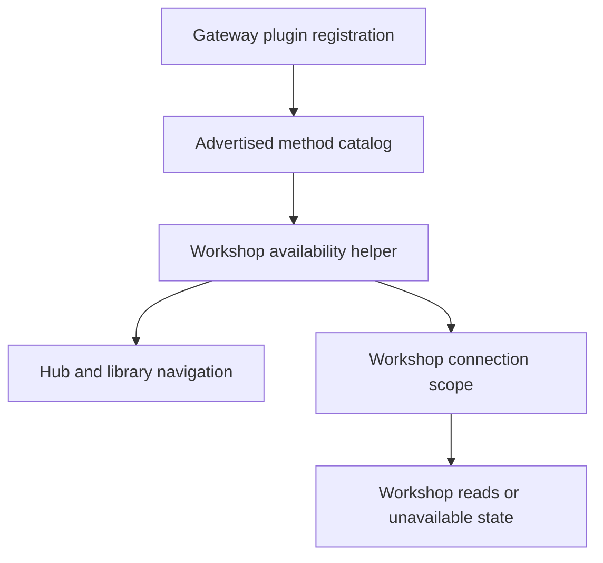

Codex review: needs changes before merge.

## What this changes

Hide unavailable Skill Workshop links and show an explanatory state when its plugin is absent.

**Example:** Open the Workshop page on a Gateway without the skill-workshop plugin.
- **Before:** The page reports “unknown method: skills.workshop.list” and offers an ineffective Retry button.
- **After:** The page explains that Skill Workshop is unavailable and asks the user to enable the plugin.

## Review scores

| Measure | Result | What it means |
|---|---|---|
| **Overall readiness** | 🦐 gold shrimp **(3/6)** | A useful, focused fix with direct visual evidence, outstanding scoped validation, and two concrete CI repairs. |
| **Proof confidence** | 🦐 gold shrimp **(3/6)** | Real behavior proof is not required for maintainer- or bot-authored pull requests. |
| **Patch quality** | 🦐 gold shrimp **(3/6)** | 2 actionable review findings remain. |

## Product

**Kind:** Bug fix · **Worth it:** Yes · **Fix scope:** Complete
**User problem:** An unavailable optional plugin leaves visible navigation leading to an error page with a Retry action that cannot work.
**Reason:** The maintainer-authored fix makes the UI respect the approved plugin boundary without adding settings or changing enabled-plugin behavior.

## Merge readiness

⛔ **Needs changes before merge - 2 items remain**

Keep this PR open: it fixes a current plugin-disabled UI failure, but the introduced test-budget and chat-bundle growth failures need repair.

**Priority:** P2
**Reviewed head:** `11846ed58d0b95e2df8585aa1144b4475deab0fe`

## Before merge

- [ ] **Keep chat boot growth within the existing allowance (P2)** - The exact-head control-ui-performance check reports chat boot JavaScript at 1252.8 KiB. Although its base already exceeds the absolute cap, the checker separately permits only 192 bytes of additional growth above the measured 1,282,395-byte base, and this candidate exceeds that allowance. Reduce the emitted growth from the new availability wiring while preserving lazy page boundaries; treating this as an inherited failure would leave a PR-caused required check failing.
- [ ] **Allocate the justified regression-test growth (P3)** - The added page test, header test, and counted support fixture contribute 33 net test lines without a corresponding allocation. The exact-head baseline check identifies test-lines as failing, and the documented checker rejects positive growth in an over-ceiling tree. Add a scoped allocation for the justified regression coverage, keeping the shared scalar unchanged.

## Findings

- [P2] Keep chat boot growth within the existing allowance — `ui/src/pages/plugins/plugins-hub-header.tsx:4-7`
- [P3] Allocate the justified regression-test growth — `ui/src/pages/skill-workshop/skill-workshop-page.test.tsx:202-209`

### Tests

- Missing end-to-end proof: The required layout-shift measurements at 400, 820, and 1280 px and red-on-base regression results are not supplied.

<strong>Agent review details</strong>

### How this fits together

The Control UI consumes the Gateway method catalog to present Workshop navigation and admit page reads; the bundled plugin supplies the Workshop methods.

### Technical review

Best possible solution:

Retain the shared availability check and existing scope owner while repairing the test allocation and bundle growth.

Do we have a high-confidence way to reproduce the issue?

Current-main source unconditionally starts Workshop reads on connection, and the supplied real-package screenshots show the resulting unknown-method error without the plugin.

Is this the best way to solve the issue?

The change uses the existing method-advertisement contract and connection-scope lifecycle, preserves server authorization, and covers the affected navigation paths without adding another state owner.

Full review comments:

- [P2] Keep chat boot growth within the existing allowance — `ui/src/pages/plugins/plugins-hub-header.tsx:4-7`
  The exact-head control-ui-performance check reports chat boot JavaScript at 1252.8 KiB. Although its base already exceeds the absolute cap, the checker separately permits only 192 bytes of additional growth above the measured 1,282,395-byte base, and this candidate exceeds that allowance. Reduce the emitted growth from the new availability wiring while preserving lazy page boundaries; treating this as an inherited failure would leave a PR-caused required check failing.
  Confidence: 0.94
- [P3] Allocate the justified regression-test growth — `ui/src/pages/skill-workshop/skill-workshop-page.test.tsx:202-209`
  The added page test, header test, and counted support fixture contribute 33 net test lines without a corresponding allocation. The exact-head baseline check identifies test-lines as failing, and the documented checker rejects positive growth in an over-ceiling tree. Add a scoped allocation for the justified regression coverage, keeping the shared scalar unchanged.
  Confidence: 0.98

Overall correctness: patch is incorrect
Overall confidence: 0.93

AGENTS.md: found and applied where relevant.

Codex review notes: model internal, reasoning medium; reviewed against [55a554e78a83](https://github.com/openclaw/openclaw/commit/55a554e78a83af031760ef247e26d5be9e24329d).

### Provenance checked

- `Workshop availability` keeps the original intent (https://github.com/openclaw/openclaw/pull/192471: Move Workshop into a bundled plugin that can be disabled while retaining its method names and scopes when enabled.)
- `Workshop connection scope and async presentation` keeps the original intent (874e463653eb5d4f8116b99dec59f9e2a9cb94ae: Keep synchronous request admission and stale-scope suppression in the existing owner while Solid presents asynchronous results.)
- `Plugin and Skills navigation` changes intended behavior with a stated reason (91fc36588c7701bbb737a5565f91ed1cc5b9fba4: Keep Workshop reachable through matching desktop and phone actions while compacting the Skills controls.)

### Testing

Proof path: shipped entry point.

### Security

None.

### Evidence

Acceptance criteria:

- pnpm check:test-lines-ratchet --base c1e5341a9c19be2227f578e03fd7ea0d7151a337
- pnpm test ui/src/pages/skill-workshop/skill-workshop-page.test.tsx ui/src/pages/plugins/plugins-hub-header.test.tsx --maxWorkers=1
- pnpm tsgo:ui
- Repeat the control-ui-performance CI job's base/head build comparison with unchanged budgets.

What I checked:

- **Introduced patch:** The pinned introduction diff adds one availability decision and applies it to the hub, library controls, and existing Workshop scope owner. ([`ui/src/pages/skill-workshop/access.ts:9`](https://github.com/openclaw/openclaw/blob/11846ed58d0b95e2df8585aa1144b4475deab0fe/ui/src/pages/skill-workshop/access.ts#L9), [11846ed58d0b](https://github.com/openclaw/openclaw/commit/11846ed58d0b95e2df8585aa1144b4475deab0fe))
- **Current-main failure remains:** Fetched main still admits Workshop reads whenever connected, without checking plugin availability; the plugin now owns registration of skills.workshop.list. ([`ui/src/pages/skill-workshop/skill-workshop-page.tsx:104`](https://github.com/openclaw/openclaw/blob/55a554e78a83af031760ef247e26d5be9e24329d/ui/src/pages/skill-workshop/skill-workshop-page.tsx#L104), [55a554e78a83](https://github.com/openclaw/openclaw/commit/55a554e78a83af031760ef247e26d5be9e24329d))
- **Plugin extraction context:** https://github.com/openclaw/openclaw/pull/192471 explicitly accepts unknown-method responses when the plugin is disabled; this PR adapts the UI to that established boundary. ([`extensions/skill-workshop/src/gateway-methods.ts:148`](https://github.com/openclaw/openclaw/blob/08f4a198a3109d3b6f447f0f39e8e5484f13a2b4/extensions/skill-workshop/src/gateway-methods.ts#L148), [08f4a198a310](https://github.com/openclaw/openclaw/commit/08f4a198a3109d3b6f447f0f39e8e5484f13a2b4))
- **Inspected visual proof:** The four prepared screenshots show the plugin-less hub before and after, plus the failing Workshop page replaced by the unavailable explanation. ([11846ed58d0b](https://github.com/openclaw/openclaw/commit/11846ed58d0b95e2df8585aa1144b4475deab0fe))
- **Diff-caused test-budget failure:** The exact-head check identifies test-lines failure; the introduction adds 33 counted test/support lines without an allocation, contrary to the documented regression-growth contract. ([`scripts/check-test-lines-ratchet.mts:225`](https://github.com/openclaw/openclaw/blob/11846ed58d0b95e2df8585aa1144b4475deab0fe/scripts/check-test-lines-ratchet.mts#L225), [11846ed58d0b](https://github.com/openclaw/openclaw/commit/11846ed58d0b95e2df8585aa1144b4475deab0fe))
- **Diff-caused bundle-budget failure:** The exact-head performance annotation reports chat boot JavaScript at 1252.8 KiB, exceeding the base-relative allowance of 192 bytes above 1,282,395 bytes; this is additional growth despite the base already exceeding its cap. ([`ui/src/pages/plugins/plugins-hub-header.tsx:4`](https://github.com/openclaw/openclaw/blob/11846ed58d0b95e2df8585aa1144b4475deab0fe/ui/src/pages/plugins/plugins-hub-header.tsx#L4), [11846ed58d0b](https://github.com/openclaw/openclaw/commit/11846ed58d0b95e2df8585aa1144b4475deab0fe))

Likely related people:

- **Ayaan Zaidi:** Raw commit 08f4a198a3109d3b6f447f0f39e8e5484f13a2b4 adds extensions/skill-workshop/src/gateway-methods.ts:148 relative to its recorded parents. This identifies author metadata, not feature responsibility or a PR merger. (role: source-line author; confidence: high; commits: [08f4a198a310](https://github.com/openclaw/openclaw/commit/08f4a198a3109d3b6f447f0f39e8e5484f13a2b4); files: `extensions/skill-workshop/src/gateway-methods.ts`)
- **Peter Steinberger:** Raw commit 874e463653eb5d4f8116b99dec59f9e2a9cb94ae adds ui/src/pages/skill-workshop/skill-workshop-page.tsx:110 relative to its recorded parents. This identifies author metadata, not feature responsibility or a PR merger. (role: source-line author; confidence: high; commits: [874e463653eb](https://github.com/openclaw/openclaw/commit/874e463653eb5d4f8116b99dec59f9e2a9cb94ae); files: `ui/src/pages/skill-workshop/skill-workshop-page.tsx`)
- **Vyctor H. Brzezowski:** Raw commit 91fc36588c7701bbb737a5565f91ed1cc5b9fba4 adds ui/src/pages/skills/library-toolbar.tsx:17 relative to its recorded parents. This identifies author metadata, not feature responsibility or a PR merger. (role: source-line author; confidence: high; commits: [91fc36588c77](https://github.com/openclaw/openclaw/commit/91fc36588c7701bbb737a5565f91ed1cc5b9fba4); files: `ui/src/pages/skills/library-toolbar.tsx`)

### PR surface

Source +49, Tests +33. Total +82 across 11 files. Added test files: 0.

View PR surface stats

| Area | Files | Added | Removed | Net |
|---|---:|---:|---:|---:|
| Source | 7 | 91 | 42 | +49 |
| Tests | 4 | 35 | 2 | +33 |
| Docs | 0 | 0 | 0 | 0 |
| Config | 0 | 0 | 0 | 0 |
| Generated | 0 | 0 | 0 | 0 |
| Other | 0 | 0 | 0 | 0 |
| **Total** | **11** | **126** | **44** | **+82** |

### Labels

Label changes:

- add `P2`: A focused UI bug affects Gateways where the optional Workshop plugin is disabled or absent; the default enabled setup is unaffected.
- add `rating: 🦐 gold shrimp`: Overall readiness is 🦐 gold shrimp; proof is 🦐 gold shrimp and patch quality is 🦐 gold shrimp.
- add `status: ⏳ waiting on author`: ClawSweeper has contributor-facing work open and is waiting for author action.

Label justifications:

- `P2`: A focused UI bug affects Gateways where the optional Workshop plugin is disabled or absent; the default enabled setup is unaffected.
- `rating: 🦐 gold shrimp`: Overall readiness is 🦐 gold shrimp; proof is 🦐 gold shrimp and patch quality is 🦐 gold shrimp.
- `status: ⏳ waiting on author`: ClawSweeper has contributor-facing work open and is waiting for author action.

### Rating scale

6/6 🦀 challenger crab · 5/6 🦞 diamond lobster · 4/6 🐚 platinum hermit · 3/6 🦐 gold shrimp · 2/6 🦪 silver shellfish · 1/6 🧂 unranked krab. Overall follows the weaker of proof and patch quality; ✨ marks media proof (a screenshot, video, or linked artifact) that directly shows the changed behavior.

### Workflow

ClawSweeper edits this one comment on every review. Comment `@clawsweeper re-review` for a fresh review only. Repair and merge execution lanes are retired.

_Reviewed November 4, 2026, 7:10 AM ET / 12:10 UTC._

<!-- clawsweeper-verdict:needs-changes item=192766 sha=11846ed58d0b95e2df8585aa1144b4475deab0fe confidence=high updated_at=2026-11-04T12:07:00Z reviewed_at=2026-11-04T12:10:58.686Z lease_owner=github-run-41826303286-1 lease_comment_id=6630153952 source_revision=62c93ab3bef3acf079b7da8716e91532ad9afa6bd45f60638d94877d75ab1dc5 -->
<!-- clawsweeper-review-state:needs-changes item=192766 sha=11846ed58d0b95e2df8585aa1144b4475deab0fe v=1 -->

<!-- clawsweeper-review-version item=192766 reviewed_at=2026-11-04T12:10:58.686Z sha=11846ed58d0b95e2df8585aa1144b4475deab0fe source_revision=62c93ab3bef3acf079b7da8716e91532ad9afa6bd45f60638d94877d75ab1dc5 lease_owner=github-run-41826303286-1 lease_comment_id=6630153952 v=1 -->

<!-- clawsweeper-review item=192766 -->