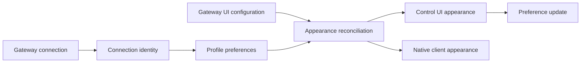

Codex review: found issues before merge. _Reviewed August 26, 2026, 7:25 PM ET / 23:25 UTC._

# ClawSweeper review

## What this changes

The PR makes Control UI theme, mode, and accent profile-specific for authenticated users, with gateway-wide preferences as the fallback for unprofiled connections.

## Regression provenance

Possible regression — suspected (reviewed change). No predecessor PR is attributed.

## Merge readiness

⚠️ **Ready for maintainer review - 7 items remain**

Keep open: three identity and native-client gaps mean profile appearance can persist into unprofiled access, lose a reset during loading, or fail to reach native branding.

**Priority:** P2
**Reviewed head:** `d364920d61ef67b2722149826101c246292ee479`

## Review scores

| Measure | Result | What it means |
|---|---|---|
| **Overall readiness** | 🦐 gold shrimp **(3/6)** | The feature has targeted coverage and an authorization-safe server boundary, but three user-visible correctness gaps remain. |
| **Proof confidence** | 🐚 platinum hermit **(4/6)** | Not applicable: The PR is authored by a repository member, so the external-contributor proof gate does not apply. |
| **Patch quality** | 🦐 gold shrimp **(3/6)** | 3 actionable review findings remain. |

## Verification

| Check | Result | Evidence |
|---|---|---|
| **Real behavior** | Not applicable | Not applicable: The PR is authored by a repository member, so the external-contributor proof gate does not apply. |
| **Evidence reviewed** | 7 items | Profile removal does not restore fallback: Gateway synchronization refreshes profile preferences after runtime configuration setup, but that refresh returns immediately with no profile; the cached config snapshot is not reapplied. Cached config cannot reload on identity change: ensureLoaded loads only when no config snapshot exists, so it cannot restore gateway preference values after a profile disappears. Unprofiled transitions are reachable: The gateway store clears selfUser during stale-build and connection-error transitions. |
| **Findings** | 3 actionable findings | [P1] Reconcile appearance when an authenticated profile disappears [P1] Carry the active profile through appearance reset [P2] Deliver profile accent to the native branding consumers |
| **Security** | None | None. |

## How this fits together

The Control UI receives a gateway connection snapshot, combines gateway configuration with profile preferences, and applies the resulting appearance in the browser. Gateway methods persist profile preferences and expose profile-aware accent data to connected clients.

## Before merge

- [ ] **Reconcile appearance when an authenticated profile disappears (P1)** - When `selfUser` changes from a profile to `null`, the profile refresh returns immediately and the cached gateway config is not reapplied. The former profile overlay can therefore remain visible for token/password or other unprofiled access. Reconcile gateway preferences under the new unprofiled scope and add a profile-to-none regression.
- [ ] **Carry the active profile through appearance reset (P1)** - Reset chooses its scope from the asynchronously loaded preference cache rather than the current gateway snapshot. Before a fetch finishes, or while changing profiles, an explicit default selection can be treated as device-local and skipped by the write path, so it is lost on reload. Pass the current profile ID through reset/write selection, or gate edits until loading completes.
- [ ] **Deliver profile accent to the native branding consumers (P2)** - This adds a profile-aware accent only to `talk.config`, but iOS and Android branding refreshes read `config.get`, which has no client/profile projection; their talk-config parsers do not consume `ui`. The new allowlist's claim that native clients resolve this accent through `talk.config` is therefore false. Wire the profile-aware result into native branding refresh and add request-to-render-state coverage.
- [ ] **Resolve merge risk (P2)** - A profile-to-unprofiled transition can display the former user’s appearance instead of the gateway fallback.
- [ ] **Resolve merge risk (P1)** - A reset while preference loading is pending can skip persistence for the active profile.
- [ ] **Resolve merge risk (P1)** - iOS and Android can retain gateway-wide branding despite the PR's profile-accent behavior.
- [ ] **Complete next step (P2)** - The active feature branch needs its three concrete identity and native-propagation defects corrected before merger review.

## Findings

- [P1] Reconcile appearance when an authenticated profile disappears — `ui/src/app/app-shell-gateway.ts:287-296`
- [P1] Carry the active profile through appearance reset — `ui/src/app/server-prefs.ts:270-304`
- [P2] Deliver profile accent to the native branding consumers — `src/gateway/server-methods/talk.ts:809-823`

<strong>Agent review details</strong>

### Security

None.

### PR surface

Source +501, Tests +740, Docs +6, Other +21. Total +1268 across 36 files.

View PR surface stats

| Area | Files | Added | Removed | Net |
|---|---:|---:|---:|---:|
| Source | 19 | 660 | 159 | +501 |
| Tests | 9 | 764 | 24 | +740 |
| Docs | 3 | 9 | 3 | +6 |
| Config | 0 | 0 | 0 | 0 |
| Generated | 0 | 0 | 0 | 0 |
| Other | 5 | 24 | 3 | +21 |
| **Total** | **36** | **1457** | **189** | **+1268** |

### Review metrics

| Metric | Value | Why it matters |
|---|---|---|
| **Production versus test change** | production ~+330, tests ~+310 | The feature adds a material profile-preference protocol and reconciliation path; its production behavior needs the identified transition fixes. |
| **Preference contract** | 3 profile-stored appearance keys, 1 additive preference-change event | Authenticated operators now have a different preference precedence and propagation contract. |

### Stored data model

Persistent data-model change detected: `serialized state: ui/src/app/server-prefs-storage.ts`, `serialized state: ui/src/app/server-prefs.profile.test.ts`, `unknown-data-model-change: packages/gateway-protocol/src/schema/users-prefs.test.ts`. Confirm migration or upgrade compatibility proof before merge.

### Merge-risk options

**Maintainer options:**
1. **Repair identity and native propagation (recommended)**  
   Restore gateway fallback on profile removal, bind reset/write scope to the current identity, and connect profile accent to native branding with focused regressions.

### Technical review

Best possible solution:

Use the current connection identity, including no identity, as the sole source for reconciliation and reset scope, then wire profile-aware accent data into native branding refreshes.

Do we have a high-confidence way to reproduce the issue?

Yes—source establishes deterministic profile-to-none, loading-time reset, and native refresh paths; this read-only review did not execute them.

Is this the best way to solve the issue?

Yes—the existing architecture can address the defects by making active identity authoritative and adding a real native appearance consumer.

Full review comments:

- [P1] Reconcile appearance when an authenticated profile disappears — `ui/src/app/app-shell-gateway.ts:287-296`
  When `selfUser` changes from a profile to `null`, the profile refresh returns immediately and the cached gateway config is not reapplied. The former profile overlay can therefore remain visible for token/password or other unprofiled access. Reconcile gateway preferences under the new unprofiled scope and add a profile-to-none regression.
  Confidence: 0.96
- [P1] Carry the active profile through appearance reset — `ui/src/app/server-prefs.ts:270-304`
  Reset chooses its scope from the asynchronously loaded preference cache rather than the current gateway snapshot. Before a fetch finishes, or while changing profiles, an explicit default selection can be treated as device-local and skipped by the write path, so it is lost on reload. Pass the current profile ID through reset/write selection, or gate edits until loading completes.
  Confidence: 0.91
- [P2] Deliver profile accent to the native branding consumers — `src/gateway/server-methods/talk.ts:809-823`
  This adds a profile-aware accent only to `talk.config`, but iOS and Android branding refreshes read `config.get`, which has no client/profile projection; their talk-config parsers do not consume `ui`. The new allowlist's claim that native clients resolve this accent through `talk.config` is therefore false. Wire the profile-aware result into native branding refresh and add request-to-render-state coverage.
  Confidence: 0.94

Overall correctness: patch is incorrect
Overall confidence: 0.93

AGENTS.md: found and applied where relevant.

Codex review notes: model internal, reasoning high; reviewed against [25a16dd96c42](https://github.com/openclaw/openclaw/commit/25a16dd96c42876cc80b0ad754a612a75524b4eb).

### Labels

Label changes:

- add `rating: 🦐 gold shrimp`: Overall readiness is 🦐 gold shrimp; proof is 🐚 platinum hermit and patch quality is 🦐 gold shrimp.
- remove `rating: 🦪 silver shellfish`: Current PR rating is `rating: 🦐 gold shrimp`, so this older rating label is no longer current.

Label justifications:

- `P2`: The feature has bounded but user-visible preference correctness gaps across identity transitions and native clients.
- `merge-risk: 🚨 compatibility`: Existing authenticated and unprofiled connections can retain, lose, or fail to receive the intended appearance state.
- `rating: 🦐 gold shrimp`: Overall readiness is 🦐 gold shrimp; proof is 🐚 platinum hermit and patch quality is 🦐 gold shrimp.
- `status: ⏳ waiting on author`: ClawSweeper has contributor-facing work open and is waiting for author action. Not applicable: The PR is authored by a repository member, so the external-contributor proof gate does not apply.

### Evidence

Acceptance criteria:

- [P1] Run focused Control UI regressions for profile-to-none and pending identity-switch reset paths.
- [P2] Exercise an authenticated profile followed by unprofiled reconnect and verify gateway fallback appearance.
- [P1] Verify iOS and Android request-to-render state reflects the authenticated profile accent.

What I checked:

- **Profile removal does not restore fallback:** Gateway synchronization refreshes profile preferences after runtime configuration setup, but that refresh returns immediately with no profile; the cached config snapshot is not reapplied. ([`ui/src/app/app-shell-gateway.ts:287`](https://github.com/openclaw/openclaw/blob/d364920d61ef/ui/src/app/app-shell-gateway.ts#L287), [d364920d61ef](https://github.com/openclaw/openclaw/commit/d364920d61ef))
- **Cached config cannot reload on identity change:** ensureLoaded loads only when no config snapshot exists, so it cannot restore gateway preference values after a profile disappears. ([`ui/src/lib/config/runtime-config-capability.ts:182`](https://github.com/openclaw/openclaw/blob/d364920d61ef/ui/src/lib/config/runtime-config-capability.ts#L182), [d364920d61ef](https://github.com/openclaw/openclaw/commit/d364920d61ef))
- **Unprofiled transitions are reachable:** The gateway store clears selfUser during stale-build and connection-error transitions. ([`ui/src/app/gateway-store.ts:414`](https://github.com/openclaw/openclaw/blob/d364920d61ef/ui/src/app/gateway-store.ts#L414), [d364920d61ef](https://github.com/openclaw/openclaw/commit/d364920d61ef))
- **Reset scope is derived from asynchronous cache:** Appearance reset obtains its active profile from loaded preference cache instead of the current gateway snapshot identity. ([`ui/src/app/server-prefs.ts:270`](https://github.com/openclaw/openclaw/blob/d364920d61ef/ui/src/app/server-prefs.ts#L270), [d364920d61ef](https://github.com/openclaw/openclaw/commit/d364920d61ef))
- **Native claim lacks a consumer:** talk.config projects profile accent, but native branding reads profile-independent config.get; the new event allowlist says the accent is resolved through talk.config although the Android parser does not consume UI data. ([`src/gateway/server-methods/talk.ts:809`](https://github.com/openclaw/openclaw/blob/d364920d61ef/src/gateway/server-methods/talk.ts#L809), [d364920d61ef](https://github.com/openclaw/openclaw/commit/d364920d61ef))
- **Profile writes remain authorization-bound:** users.prefs.set resolves the caller's canonical authenticated profile before writing and broadcasts only to matching profile connections. ([`src/gateway/server-methods/users.ts:201`](https://github.com/openclaw/openclaw/blob/d364920d61ef/src/gateway/server-methods/users.ts#L201), [d364920d61ef](https://github.com/openclaw/openclaw/commit/d364920d61ef))

Likely related people:

- **steipete:** Authored this feature series and multiple prior profile/preference changes. (role: feature owner and recent area contributor; confidence: high; commits: [a86807d617b4](https://github.com/openclaw/openclaw/commit/a86807d617b424c91c47431a828fc142c9f655eb), [d364920d61ef](https://github.com/openclaw/openclaw/commit/d364920d61ef67b2722149826101c246292ee479); files: `ui/src/app/server-prefs.ts`, `src/gateway/server-methods/users.ts`)
- **Shakker:** History shows substantial preference state and synchronization work in this owner boundary. (role: preference-state refactor contributor; confidence: medium; commits: [55e1246702c7](https://github.com/openclaw/openclaw/commit/55e1246702c76797b976057b591b6073e7c08648), [fa06a000c564](https://github.com/openclaw/openclaw/commit/fa06a000c56449716f00cbb871ea5fca89a927ce); files: `ui/src/app/server-prefs-state.ts`, `ui/src/app/server-prefs.ts`)
- **Vincent Koc:** History shows prior fixes for transient sync and preference provenance. (role: preference-sync contributor; confidence: medium; commits: [fefd0830436f](https://github.com/openclaw/openclaw/commit/fefd0830436f0567295e7d8e6c8448ec21a2a048), [56ca103f9e21](https://github.com/openclaw/openclaw/commit/56ca103f9e21fde95b931471ca021ec774712423); files: `ui/src/app/server-prefs.ts`)

### Rank-up moves

Optional improvements that raise the rating; they are not merge blockers.

- Repair identity removal and pending-profile reset behavior with focused regressions.
- Wire profile accent into native branding and prove the request-to-render path.
- Refresh redacted live Control UI and native behavior proof after the repairs.

### Rating scale

| Score | Internal tier | Crab rank | Meaning |
|---:|:---:|---|---|
| **6/6** | S | 🦀 challenger crab | Exceptional readiness |
| **5/6** | A | 🦞 diamond lobster | Very strong readiness |
| **4/6** | B | 🐚 platinum hermit | Good normal PR; ordinary maintainer review |
| **3/6** | C | 🦐 gold shrimp | Useful, but confidence is limited |
| **2/6** | D | 🦪 silver shellfish | Proof or implementation needs work |
| **1/6** | F | 🧂 unranked krab | Not merge-ready |
| N/A | NA | 🌊 off-meta tidepool | Rating does not apply |

Overall follows the weaker of proof and patch quality.
Shiny media proof means a screenshot, video, or linked artifact directly shows the changed behavior. Runtime, network, CSP, and security claims still need visible diagnostics.

### Workflow

- ClawSweeper keeps one durable marker-backed review comment per issue or PR.
- Re-runs edit this comment so the latest verdict, findings, and automation markers stay together instead of adding duplicate bot comments.
- A fresh review can be triggered by eligible `@clawsweeper re-review` comments, exact-item GitHub events, scheduled/background review runs, or manual workflow dispatch.
- PR/issue authors and users with repository write access can comment `@clawsweeper re-review` or `@clawsweeper re-run` on an open PR or issue to request a fresh review only.
- Maintainers can also comment `@clawsweeper review` to request a fresh review only.
- Fresh-review commands do not start repair, autofix, rebase, CI repair, or automerge.
- Maintainer-only repair and merge flows require explicit commands such as `@clawsweeper autofix`, `@clawsweeper automerge`, `@clawsweeper fix ci`, or `@clawsweeper address review`.
- Maintainers can comment `@clawsweeper explain` to ask for more context, or `@clawsweeper stop` to stop active automation.

### History

Review history (4 earlier review cycles)

<!-- clawsweeper-review-history v=1 total=4 -->
- reviewed 2026-08-26T20:38:11.936Z sha 4403739cefcc0512f6d4d2c494fc5934a5bb9526 :: found issues before merge. :: [P1] Persist the product-default choice for profile users | [P1] Reapply a profile when the active identity changes | [P2] Do not project gateway accent while GitHub identity is pending
- reviewed 2026-08-26T21:21:36.607Z sha 7a35ed93d4112917c660b09f2aa99cd5d190e04e :: needs maintainer review before merge. :: none
- reviewed 2026-08-26T21:38:04.317Z sha d203a89dca5cb90078cbf528aded26ea48f1e35b :: found issues before merge. :: [P1] Keep imported custom themes browser-local
- reviewed 2026-08-26T22:32:55.193Z sha 25f70bbf3c827ec1b8fa61f3c8df1efcee136168 :: found issues before merge. :: [P1] Keep imported custom themes out of profile storage

<!-- clawsweeper-verdict:needs-human item=130340 sha=d364920d61ef67b2722149826101c246292ee479 confidence=high updated_at=2026-08-26T23:19:49Z reviewed_at=2026-08-26T23:25:16.880Z lease_owner=github-run-33022842375-1 lease_comment_id=5432234895 source_revision=7a3678ca77c9ceb8492d0bc70711a8b5f787f054c473a8070d394e040b538319 -->

<!-- clawsweeper-review-version item=130340 reviewed_at=2026-08-26T23:25:16.880Z sha=d364920d61ef67b2722149826101c246292ee479 source_revision=7a3678ca77c9ceb8492d0bc70711a8b5f787f054c473a8070d394e040b538319 lease_owner=github-run-33022842375-1 lease_comment_id=5432234895 v=1 -->

<!-- clawsweeper-review item=130340 -->