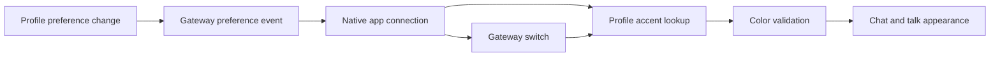

Codex review: found issues before merge. _Reviewed August 26, 2026, 10:28 PM ET / August 27, 2026, 02:28 UTC._

# ClawSweeper review

## What this changes

This PR makes iOS, macOS, and Android prefer a caller-bound profile accent over the gateway accent and refresh it when that profile’s preferences change.

## Merge readiness

⚠️ **Ready for maintainer review - 4 items remain**

Keep open: the macOS refresh can apply a profile accent from a retired Gateway connection after a switch, so the new connection may show the prior profile’s appearance until a later refresh. The PR is also maintainer-labeled and MEMBER-authored, so it requires explicit maintainer handling rather than automated cleanup.

**Priority:** P2
**Reviewed head:** `f8d9d324cc09da835ba50ac2b1ab38ef1ce68dc3`

## Review scores

| Measure | Result | What it means |
|---|---|---|
| **Overall readiness** | 🦐 gold shrimp **(3/6)** | The cross-platform design is coherent, but the macOS path bypasses the repository’s existing stale-connection fence. |
| **Proof confidence** | 🌊 off-meta tidepool | Not applicable: The external-contributor proof gate does not apply to this MEMBER-authored PR; the body nevertheless records that native after-fix proof was blocked by pairing choreography, so the submitted tests are not live native evidence. |
| **Patch quality** | 🦐 gold shrimp **(3/6)** | 1 actionable review finding remain. |

## Verification

| Check | Result | Evidence |
|---|---|---|
| **Real behavior** | Not applicable | Not applicable: The external-contributor proof gate does not apply to this MEMBER-authored PR; the body nevertheless records that native after-fix proof was blocked by pairing choreography, so the submitted tests are not live native evidence. |
| **Evidence reviewed** | 7 items | Mac refresh is not bound to the event socket: The new task fetches through the unbound request API and writes the result directly to global app state, with no route or socket-generation check after the await.<br>Existing Gateway API provides the required fence: GatewayConnection has a server-lease request form that rejects a response after the route or physical socket is replaced; the unbound request form used by this PR does not provide that guarantee.<br>The gateway contract is self-bound: The merged gateway handler reads preferences from the authenticated connection profile and returns no durable identity for profile-less connections, supporting the proposed native fallback behavior. |
| **Findings** | 1 actionable finding | [P1] Bind the macOS refresh to the snapshot route |
| **Security** | None | None. |


### Live Verification

**Command:** `pnpm check:protocol-coverage`

**Result:** PASS (completed)

```text
$ node scripts/check-protocol-event-coverage.mjs
Protocol event coverage OK: 54 gateway events; ios handles 21, allowlists 33; android handles 19, allowlists 35.
$ node scripts/check-protocol-event-coverage.mjs
Protocol event coverage OK: 54 gateway events; ios handles 21, allowlists 33; android handles 19, allowlists 35.
```

**Assertions:**

- PASS `expect_output`: Protocol event coverage OK

## How this fits together

The Gateway stores profile appearance preferences and pushes change notifications to the matching connected profile. Native clients read that preference, validate the color, and supply the result to their chat and talk UI.



## Before merge

- [ ] **Bind the macOS refresh to the snapshot route (P1)** - This unbound request can complete after a Gateway/profile switch and then overwrite shared `profileAccentHex` with the retired connection’s response. `GatewayConnection` already provides the server-lease request form that rejects stale sockets; capture that lease before dispatch and verify it before publishing.
- [ ] **Resolve merge risk (P1)** - Merging as written can leave a newly selected macOS Gateway displaying the prior Gateway profile’s accent after an in-flight response wins the race.
- [ ] **Resolve merge risk (P1)** - The submitted native checks validate helpers and compilation but do not demonstrate the three-platform profile lookup and event refresh in a live native connection; the PR documents a concrete pairing limitation for that gap.
- [ ] **Complete next step (P2)** - Repair the macOS stale-route finding before the protected maintainer PR proceeds; it is not an automatic repair candidate under the maintainer-label gate.

## Findings

- [P1] Bind the macOS refresh to the snapshot route — `apps/macos/Sources/OpenClaw/ControlChannel.swift:535-538`


<details>
<summary><strong>Agent review details</strong></summary>

### Security

None.

### PR surface

Other +178. Total +178 across 13 files.

<details>
<summary>View PR surface stats</summary>

| Area | Files | Added | Removed | Net |
|---|---:|---:|---:|---:|
| Source | 0 | 0 | 0 | 0 |
| Tests | 0 | 0 | 0 | 0 |
| Docs | 0 | 0 | 0 | 0 |
| Config | 0 | 0 | 0 | 0 |
| Generated | 0 | 0 | 0 | 0 |
| Other | 13 | 189 | 11 | +178 |
| **Total** | **13** | **189** | **11** | **+178** |

</details>

### Review metrics

| Metric | Value | Why it matters |
|---|---|---|
| **Production versus test delta** | production/tooling +126 net; tests +52 net | The feature adds native behavior on three platforms; the added tests currently cover normalization and precedence rather than the macOS connection-replacement lifecycle. |

### Merge-risk options

**Maintainer options:**
1. **Fence the macOS profile refresh (recommended)**  
   Capture the snapshot’s current server lease and prevent a response from a replaced connection from updating shared appearance state.
2. **Pause the native follow-up**  
   Do not merge until the macOS connection-switch behavior has a route-bound repair and regression proof.

### Technical review

Best possible solution:

Capture the current macOS server lease before the profile lookup, use the lease-bound Gateway request, reject stale completion before publishing, and add a replacement-socket regression test.

Do we have a high-confidence way to reproduce the issue?

Yes, from source: begin the macOS profile lookup, replace the Gateway route or socket before its response returns, then allow the old request to complete after the replacement snapshot.

Is this the best way to solve the issue?

No. The iOS route-bound and Android generation-bound implementations preserve the required ownership invariant; macOS should use its existing server-lease API instead of an unbound request.

Full review comments:

- [P1] Bind the macOS refresh to the snapshot route — `apps/macos/Sources/OpenClaw/ControlChannel.swift:535-538`
  This unbound request can complete after a Gateway/profile switch and then overwrite shared `profileAccentHex` with the retired connection’s response. `GatewayConnection` already provides the server-lease request form that rejects stale sockets; capture that lease before dispatch and verify it before publishing.
  Confidence: 0.96

Overall correctness: patch is incorrect
Overall confidence: 0.96

AGENTS.md: found and applied where relevant.

Codex review notes: model internal, reasoning high; reviewed against [c75616186224](https://github.com/openclaw/openclaw/commit/c756161862249c5fc23dc12e8e59ebf2cb5c4f8a).

### Labels

Label changes:

- add `P2`: This is a bounded native appearance feature with a concrete pre-merge correctness defect, not an outage or security incident.
- add `merge-risk: 🚨 other`: A connection switch can publish appearance data from a retired profile after the new Gateway is active.
- add `rating: 🦐 gold shrimp`: Overall readiness is 🦐 gold shrimp; proof is 🌊 off-meta tidepool and patch quality is 🦐 gold shrimp.
- add `status: ⏳ waiting on author`: ClawSweeper has contributor-facing work open and is waiting for author action. Not applicable: The external-contributor proof gate does not apply to this MEMBER-authored PR; the body nevertheless records that native after-fix proof was blocked by pairing choreography, so the submitted tests are not live native evidence.

Label justifications:

- `P2`: This is a bounded native appearance feature with a concrete pre-merge correctness defect, not an outage or security incident.
- `merge-risk: 🚨 other`: A connection switch can publish appearance data from a retired profile after the new Gateway is active.
- `rating: 🦐 gold shrimp`: Overall readiness is 🦐 gold shrimp; proof is 🌊 off-meta tidepool and patch quality is 🦐 gold shrimp.
- `status: ⏳ waiting on author`: ClawSweeper has contributor-facing work open and is waiting for author action. Not applicable: The external-contributor proof gate does not apply to this MEMBER-authored PR; the body nevertheless records that native after-fix proof was blocked by pairing choreography, so the submitted tests are not live native evidence.

### Evidence

What I checked:

- **Mac refresh is not bound to the event socket:** The new task fetches through the unbound request API and writes the result directly to global app state, with no route or socket-generation check after the await. ([`apps/macos/Sources/OpenClaw/ControlChannel.swift:520`](https://github.com/openclaw/openclaw/blob/f8d9d324cc09/apps/macos/Sources/OpenClaw/ControlChannel.swift#L520), [f8d9d324cc09](https://github.com/openclaw/openclaw/commit/f8d9d324cc09))
- **Existing Gateway API provides the required fence:** GatewayConnection has a server-lease request form that rejects a response after the route or physical socket is replaced; the unbound request form used by this PR does not provide that guarantee. ([`apps/macos/Sources/OpenClaw/GatewayConnection.swift:426`](https://github.com/openclaw/openclaw/blob/c75616186224/apps/macos/Sources/OpenClaw/GatewayConnection.swift#L426), [c75616186224](https://github.com/openclaw/openclaw/commit/c75616186224))
- **The gateway contract is self-bound:** The merged gateway handler reads preferences from the authenticated connection profile and returns no durable identity for profile-less connections, supporting the proposed native fallback behavior. ([`src/gateway/server-methods/users.ts:168`](https://github.com/openclaw/openclaw/blob/a4c01c1a77ac/src/gateway/server-methods/users.ts#L168), [a4c01c1a77ac](https://github.com/openclaw/openclaw/commit/a4c01c1a77ac))
- **Related gateway feature provenance:** The profile-preference method and event came from the merged related PR, which predates this native follow-up. ([`packages/gateway-protocol/src/schema/users.ts:83`](https://github.com/openclaw/openclaw/blob/a4c01c1a77ac/packages/gateway-protocol/src/schema/users.ts#L83), [a4c01c1a77ac](https://github.com/openclaw/openclaw/commit/a4c01c1a77ac))
- **Current main does not contain this PR:** The PR head is not an ancestor of the supplied current-main SHA, so its native behavior is not already implemented on main. ([c75616186224](https://github.com/openclaw/openclaw/commit/c75616186224))
- **Tests cover parsing and precedence, not replacement ordering:** The added macOS tests validate color normalization and state precedence, while no test exercises a Gateway replacement between request dispatch and profile-accent publication. ([`apps/macos/Tests/OpenClawIPCTests/ChannelsStoreUIConfigTests.swift:22`](https://github.com/openclaw/openclaw/blob/f8d9d324cc09/apps/macos/Tests/OpenClawIPCTests/ChannelsStoreUIConfigTests.swift#L22), [f8d9d324cc09](https://github.com/openclaw/openclaw/commit/f8d9d324cc09))

Likely related people:

- **steipete:** Current native accent work, macOS stale-Gateway route fencing, and the related merged profile-preference feature all trace to this contributor. (role: feature owner and recent area contributor; confidence: high; commits: [f8d9d324cc09](https://github.com/openclaw/openclaw/commit/f8d9d324cc09da835ba50ac2b1ab38ef1ce68dc3), [762544319587](https://github.com/openclaw/openclaw/commit/76254431958798b3b66f0bb16c009d59a0d8d225), [a4c01c1a77ac](https://github.com/openclaw/openclaw/commit/a4c01c1a77acae8ffd9740bfbf53b5f8f7bbc78a); files: `apps/macos/Sources/OpenClaw/ControlChannel.swift`, `apps/macos/Sources/OpenClaw/GatewayConnection.swift`, `apps/ios/Sources/Model/NodeAppModel.swift`)

### Rank-up moves

Optional improvements that raise the rating; they are not merge blockers.

- Capture and use the current macOS server lease for the profile lookup, then add a replacement-socket regression test.
- When the documented pairing blocker is resolved, add redacted native after-fix evidence for an identity-bound profile update.

### Rating scale

| Score | Internal tier | Crab rank | Meaning |
|---:|:---:|---|---|
| **6/6** | S | 🦀 challenger crab | Exceptional readiness |
| **5/6** | A | 🦞 diamond lobster | Very strong readiness |
| **4/6** | B | 🐚 platinum hermit | Good normal PR; ordinary maintainer review |
| **3/6** | C | 🦐 gold shrimp | Useful, but confidence is limited |
| **2/6** | D | 🦪 silver shellfish | Proof or implementation needs work |
| **1/6** | F | 🧂 unranked krab | Not merge-ready |
| N/A | NA | 🌊 off-meta tidepool | Rating does not apply |

Overall follows the weaker of proof and patch quality.
Shiny media proof means a screenshot, video, or linked artifact directly shows the changed behavior. Runtime, network, CSP, and security claims still need visible diagnostics.

### Workflow

- ClawSweeper keeps one durable marker-backed review comment per issue or PR.
- Re-runs edit this comment so the latest verdict, findings, and automation markers stay together instead of adding duplicate bot comments.
- A fresh review can be triggered by eligible `@clawsweeper re-review` comments, exact-item GitHub events, scheduled/background review runs, or manual workflow dispatch.
- PR/issue authors and users with repository write access can comment `@clawsweeper re-review` or `@clawsweeper re-run` on an open PR or issue to request a fresh review only.
- Maintainers can also comment `@clawsweeper review` to request a fresh review only.
- Fresh-review commands do not start repair, autofix, rebase, CI repair, or automerge.
- Maintainer-only repair and merge flows require explicit commands such as `@clawsweeper autofix`, `@clawsweeper automerge`, `@clawsweeper fix ci`, or `@clawsweeper address review`.
- Maintainers can comment `@clawsweeper explain` to ask for more context, or `@clawsweeper stop` to stop active automation.

</details>

<!-- clawsweeper-verdict:needs-human item=130598 sha=f8d9d324cc09da835ba50ac2b1ab38ef1ce68dc3 confidence=high updated_at=2026-08-27T02:25:04Z reviewed_at=2026-08-27T02:28:39.736Z lease_owner=github-run-33033106727-1 lease_comment_id=5433571494 source_revision=599967541664f5302721c1b3de24352fa59028a4e58b665d1546c4592395a452 -->

<!-- clawsweeper-review-version item=130598 reviewed_at=2026-08-27T02:28:39.736Z sha=f8d9d324cc09da835ba50ac2b1ab38ef1ce68dc3 source_revision=599967541664f5302721c1b3de24352fa59028a4e58b665d1546c4592395a452 lease_owner=github-run-33033106727-1 lease_comment_id=5433571494 v=1 -->

<!-- clawsweeper-review item=130598 -->