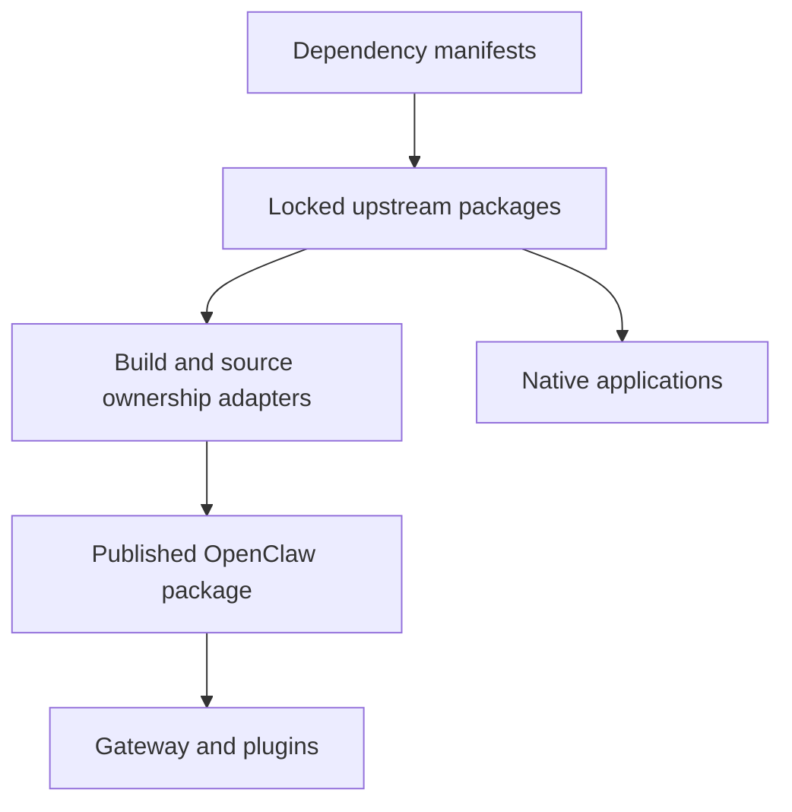

Codex review: blocked before merge.

## What this changes

This PR updates dependencies across OpenClaw and adapts existing build, packaging, and Muse approval handling to their newer contracts.

**Example:** Building updater compatibility bridges with tsdown 0.23.2.
- **Before:** The bridge generator recognizes //#region source labels but misses Rolldown's new // src/daemon/inspect.ts labels.
- **After:** Both label formats resolve through the existing source-and-symbol ownership checks.

## Review scores

| Measure | Result | What it means |
|---|---|---|
| **Overall readiness** | 🦪 silver shellfish **(2/6)** | Useful maintenance with focused supporting regressions, but two source-verified compatibility defects prevent a passing review. |
| **Proof confidence** | 🦐 gold shrimp **(3/6)** | This maintainer-authored PR is outside the ordinary contributor proof gate; its body reports installed wrapper/AOT and Chromium/OOPIF qualification while explicitly leaving native application builds to platform CI. |
| **Patch quality** | 🦪 silver shellfish **(2/6)** | 2 actionable review findings remain. |

## Product

**Kind:** Maintenance · **Worth it:** Yes · **Fix scope:** Complete
**User problem:** Users and developers miss maintained upstream fixes when compatible dependency updates remain unqualified.
**Reason:** Maintainer authorship establishes direction, and synchronized pins, preserved patches, and focused consumer adaptations provide useful maintenance.

## Merge readiness

⛔ **Blocked before merge - 4 items remain**

Keep open: this useful maintainer-authored dependency refresh has two concrete compatibility defects that block merge.

**Priority:** P2
**Reviewed head:** `cffddb96f728bd8d55558f35a35ecf2f5242ade9`

## Before merge

- [ ] **Retain the qualified npm pin until its bundle is admitted (P2)** - Selecting npm 12.2.1 leaves the root npm-lock generator unable to validate its bundled dependencies. Its verified published tarball contains minimatch 10.2.5 and ip-address 10.7.2, while workspace overrides require 10.2.6 and 10.7.4. NPM_BUNDLED_DEPENDENCY_POLICIES still ends at 12.2.0, so neither the narrow bundle exceptions nor tarball-backed lock verification applies. The current-head check-npm-lock job also fails. Restore 12.2.0 and its lock entry, or qualify 12.2.1 through the existing exact-bundle policy without weakening validation.
- [ ] **Update picker fixtures for client viewport measurements (P2)** - virtual-core 3.19.7 changes observeElementRect from offsetWidth/offsetHeight to clientWidth/clientHeight. The shared installModelPickerLayout fixture still mocks only offset dimensions, leaving the simulated viewport at zero height; virtual-core consequently returns no virtual rows. This explains the current-head model-control failure expecting two options but receiving zero and the missing model-option elements across both UI shards. Update the shared fixture's client dimensions while preserving row measurement and cleanup, rather than changing production picker behavior or weakening assertions.
- [ ] **Await maintainer action** - A release manager must review the changed release-check scripts under the enforced code-owner requirement.
- [ ] **Explain or restore the original intent of npm dependency qualification** - ed4c9d4434495921bc42192fe724f9fd0d5d629b: The previous refresh explicitly deferred npm 12.2.1 because its bundled dependencies failed existing validation; this PR changes the pin without updating that owner.

## Findings

- [P2] Retain the qualified npm pin until its bundle is admitted — `package.json:2445`
- [P2] Update picker fixtures for client viewport measurements — `ui/package.json:38`

### Provenance

- `npm dependency qualification` changes intended behavior without addressing why it exists (ed4c9d4434495921bc42192fe724f9fd0d5d629b: The previous refresh explicitly deferred npm 12.2.1 because its bundled dependencies failed existing validation; this PR changes the pin without updating that owner.)

<strong>Agent review details</strong>

### How this fits together

Dependency manifests and lockfiles feed package installation and builds; build adapters preserve updater bridges, packaged browser artifacts, and plugin runtime contracts.

### Technical review

Best possible solution:

Retain the qualified npm pin and update the shared picker fixture while preserving the existing patch and updater owners.

Do we have a high-confidence way to reproduce the issue?

Published dependency contents and current consumers establish both failure paths, corroborated by current-head npm-lock and model-picker CI failures; no local execution was performed.

Is this the best way to solve the issue?

The shared label reader and narrow Muse adaptation fit existing owners, but dependency qualification must also cover npm's bundled-package validator and picker measurement fixtures.

Full review comments:

- [P2] Retain the qualified npm pin until its bundle is admitted — `package.json:2445`
  Selecting npm 12.2.1 leaves the root npm-lock generator unable to validate its bundled dependencies. Its verified published tarball contains minimatch 10.2.5 and ip-address 10.7.2, while workspace overrides require 10.2.6 and 10.7.4. NPM_BUNDLED_DEPENDENCY_POLICIES still ends at 12.2.0, so neither the narrow bundle exceptions nor tarball-backed lock verification applies. The current-head check-npm-lock job also fails. Restore 12.2.0 and its lock entry, or qualify 12.2.1 through the existing exact-bundle policy without weakening validation.
  Confidence: 0.98
- [P2] Update picker fixtures for client viewport measurements — `ui/package.json:38`
  virtual-core 3.19.7 changes observeElementRect from offsetWidth/offsetHeight to clientWidth/clientHeight. The shared installModelPickerLayout fixture still mocks only offset dimensions, leaving the simulated viewport at zero height; virtual-core consequently returns no virtual rows. This explains the current-head model-control failure expecting two options but receiving zero and the missing model-option elements across both UI shards. Update the shared fixture's client dimensions while preserving row measurement and cleanup, rather than changing production picker behavior or weakening assertions.
  Confidence: 0.99

Overall correctness: patch is incorrect
Overall confidence: 0.97

AGENTS.md: found and applied where relevant.

Codex review notes: model internal, reasoning medium; reviewed against [a79f20dd19c3](https://github.com/openclaw/openclaw/commit/a79f20dd19c3379486bb84c748b4109dadf4b5e2).

### Provenance checked

- `Updater source-and-symbol mapping` keeps the original intent (05bf4e050b1cf795d28f15d2f82b87513bff56fa: Published updaters need verified bridges after package replacement; the new label parser preserves binding tracing and ambiguity rejection.)
- `Muse approval failure settlement` keeps the original intent (1c147d4bca0d711f458842c588b2d5df176bc2b8: Approval failures must interrupt and settle the native turn; the new error member retains that lifecycle.)
- `Chrome snapshot identity patch` keeps the original intent (65485f6adee955abe60d18ec3277ff9bd77e1309: Preserve element identity across renderer and frame changes; the forward-port retains session, document, and frame ownership checks.)
- `Lobster AOT validation` keeps the original intent (ee66e3ff40559640d6cc91905d94d6b819327242: Fixed schemas must work without runtime string compilation; the renamed patch retains generated validation.)
- `Crabline static codec` keeps the original intent (ac9b32b461cbe6838702e189a758196af9882582: Feishu frame conversion must work without runtime code generation; the forward-port preserves the static codec.)

### Testing

Proof path: in-process harness.

### Security

None.

### Evidence

What I checked:

- **Pinned PR introduction:** Reviewed the merge-base-to-head changes separately from base movement; current main still carries the older dependency pins and region-only parser. ([`package.json:2445`](https://github.com/openclaw/openclaw/blob/cffddb96f728bd8d55558f35a35ecf2f5242ade9/package.json#L2445), [cffddb96f728](https://github.com/openclaw/openclaw/commit/cffddb96f728bd8d55558f35a35ecf2f5242ade9))
- **npm bundle admission mismatch:** The npm bundle policy admits only 11.20.0, 12.1.0, and 12.2.0; generation fetches bundle-verification bytes only for those versions, while workspace overrides require minimatch 10.2.6 and ip-address 10.7.4. ([`scripts/generate-npm-package-lock.mts:1130`](https://github.com/openclaw/openclaw/blob/cffddb96f728bd8d55558f35a35ecf2f5242ade9/scripts/generate-npm-package-lock.mts#L1130), [cffddb96f728](https://github.com/openclaw/openclaw/commit/cffddb96f728bd8d55558f35a35ecf2f5242ade9))
- **Published npm bundle inspected:** Read npm 12.2.1's published tarball without executing it and verified its SHA-512 against registry metadata; it bundles minimatch 10.2.5 and ip-address 10.7.2, neither present as a package identity in the candidate pnpm lock. ([136fc5dacc1a](https://github.com/npm/cli/commit/136fc5dacc1a2f3d9a051dbf03a4951228144658))
- **Picker fixture retains old measurement contract:** The shared model-picker layout fixture supplies offsetHeight and offsetWidth only; production picker virtualization imports virtual-core's observeElementRect directly. ([`ui/src/test-helpers/model-picker-layout.ts:14`](https://github.com/openclaw/openclaw/blob/cffddb96f728bd8d55558f35a35ecf2f5242ade9/ui/src/test-helpers/model-picker-layout.ts#L14), [cffddb96f728](https://github.com/openclaw/openclaw/commit/cffddb96f728bd8d55558f35a35ecf2f5242ade9))
- **Changed dependency measurement contract:** The imported virtual-core 3.19.7 implementation reads clientWidth and clientHeight instead of offset dimensions; calculateRange returns null for a zero viewport, causing getVirtualIndexes to return no rows. ([`packages/virtual-core/src/index.ts:76`](https://github.com/tanstack/virtual/blob/c462c6141ea434fdbc52b5dd866bb8db7e4fd07e/packages/virtual-core/src/index.ts#L76), [c462c6141ea4](https://github.com/tanstack/virtual/commit/c462c6141ea434fdbc52b5dd866bb8db7e4fd07e))
- **Current-head CI corroboration:** The npm-lock check failed on the reviewed head. UI annotations show missing model options, including an expected two options becoming zero at model-control.test.ts:157; other Linux, lint, Gateway, Android, and UI failures remain unattributed. Full job-log downloads were blocked by the host's network allowlist, so those failures are not assigned to the contributor. ([`ui/src/pages/new-session/model-control.test.ts:157`](https://github.com/openclaw/openclaw/blob/cffddb96f728bd8d55558f35a35ecf2f5242ade9/ui/src/pages/new-session/model-control.test.ts#L157), [cffddb96f728](https://github.com/openclaw/openclaw/commit/cffddb96f728bd8d55558f35a35ecf2f5242ade9))

Likely related people:

- **Peter Steinberger:** Raw commit cf32d5a527d75b44dfa23a57ab1c6cde919ebe2f adds scripts/lib/update-compat-module-graph.mts:43 relative to its recorded parents. This identifies author metadata, not feature responsibility or a PR merger. (role: source-line author; confidence: high; commits: [cf32d5a527d7](https://github.com/openclaw/openclaw/commit/cf32d5a527d75b44dfa23a57ab1c6cde919ebe2f); files: `scripts/lib/update-compat-module-graph.mts`)
- **Ayaan Zaidi:** Raw commit 1c147d4bca0d711f458842c588b2d5df176bc2b8 adds extensions/muse/harness.ts:298 relative to its recorded parents. This identifies author metadata, not feature responsibility or a PR merger. (role: source-line author; confidence: high; commits: [1c147d4bca0d](https://github.com/openclaw/openclaw/commit/1c147d4bca0d711f458842c588b2d5df176bc2b8); files: `extensions/muse/harness.ts`)
- **Vincent Koc:** Raw commit abc32977452d855eae46e0e03d57538d456b80e9 adds scripts/lib/package-bundled-mcp.mts:68 relative to its recorded parents. This identifies author metadata, not feature responsibility or a PR merger. (role: source-line author; confidence: medium; commits: [abc32977452d](https://github.com/openclaw/openclaw/commit/abc32977452d855eae46e0e03d57538d456b80e9); files: `scripts/lib/package-bundled-mcp.mts`)

### PR surface

PR surface statistics unavailable: the file list is incomplete.

### Labels

Label changes:

- add `P2`: This maintenance change has focused dependency compatibility blockers without evidence of an urgent released-user incident.
- add `merge-risk: 🚨 automation`: The selected npm bundle is unsupported by lock validation, and the virtual-core update breaks shared picker test geometry.
- add `rating: 🦪 silver shellfish`: Overall readiness is 🦪 silver shellfish; proof is 🦐 gold shrimp and patch quality is 🦪 silver shellfish.
- add `status: ⏳ waiting on author`: ClawSweeper has contributor-facing work open and is waiting for author action.

Label justifications:

- `P2`: This maintenance change has focused dependency compatibility blockers without evidence of an urgent released-user incident.
- `merge-risk: 🚨 automation`: The selected npm bundle is unsupported by lock validation, and the virtual-core update breaks shared picker test geometry.
- `rating: 🦪 silver shellfish`: Overall readiness is 🦪 silver shellfish; proof is 🦐 gold shrimp and patch quality is 🦪 silver shellfish.
- `status: ⏳ waiting on author`: ClawSweeper has contributor-facing work open and is waiting for author action.

### Rating scale

6/6 🦀 challenger crab · 5/6 🦞 diamond lobster · 4/6 🐚 platinum hermit · 3/6 🦐 gold shrimp · 2/6 🦪 silver shellfish · 1/6 🧂 unranked krab. Overall follows the weaker of proof and patch quality; ✨ marks media proof (a screenshot, video, or linked artifact) that directly shows the changed behavior.

### Workflow

ClawSweeper edits this one comment on every review. Comment `@clawsweeper re-review` for a fresh review only. Repair and merge execution lanes are retired.

_Reviewed October 30, 2026, 2:08 PM ET / 18:08 UTC._

<!-- clawsweeper-verdict:needs-human item=188576 sha=cffddb96f728bd8d55558f35a35ecf2f5242ade9 confidence=high updated_at=2026-10-30T17:58:54Z reviewed_at=2026-10-30T18:08:03.740Z lease_owner=github-run-41102675829-1 lease_comment_id=6529812353 source_revision=27579fca6ad557ec72279045d6e5663c7ff619d1cc625076953f513766cef298 hold=blocked findings=2 -->
<!-- clawsweeper-review-state:blocked item=188576 sha=cffddb96f728bd8d55558f35a35ecf2f5242ade9 v=1 -->

<!-- clawsweeper-review-version item=188576 reviewed_at=2026-10-30T18:08:03.740Z sha=cffddb96f728bd8d55558f35a35ecf2f5242ade9 source_revision=27579fca6ad557ec72279045d6e5663c7ff619d1cc625076953f513766cef298 lease_owner=github-run-41102675829-1 lease_comment_id=6529812353 v=1 -->

<!-- clawsweeper-review item=188576 -->